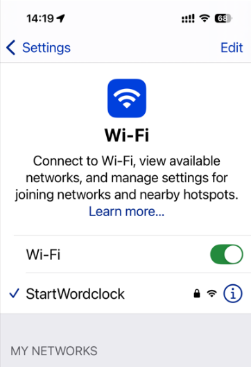
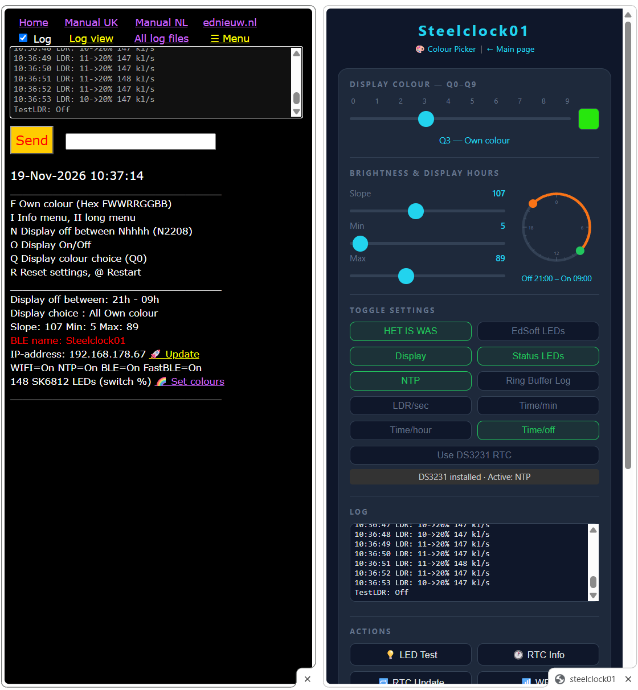

# Korte gebruikershandleiding woordklok

[English](UserGuide.md)

Deze korte handleiding is voor het dagelijks gebruik van een kant-en-klare woordklok met een Arduino Nano ESP32. Alle details staan in de volledige [Handleiding](Handleiding.md).

## Inhoud

1. [De klok aansluiten](#1-de-klok-aansluiten)
2. [WIFI koppelen](#2-wifi-koppelen)
3. [De klok bedienen](#3-de-klok-bedienen)
4. [Veelgebruikte instellingen](#4-veelgebruikte-instellingen)
5. [De tijd instellen zonder WIFI](#5-de-tijd-instellen-zonder-wifi)
6. [De software bijwerken](#6-de-software-bijwerken)
7. [Resetten](#7-resetten)
8. [Problemen oplossen](#8-problemen-oplossen)

---

## 1. De klok aansluiten

Sluit de voeding van de klok aan. Zodra de klok aan staat, brandt de status-LED op de Nano ESP32:

| Kleur | Betekenis |
|---|---|
| Rood | Het programma draait |
| Groen | WIFI is verbonden |
| Blauw | Er is een Bluetooth-verbinding |

## 2. WIFI koppelen

De klok haalt de tijd van het internet. Daarvoor heeft hij eenmalig de naam (SSID) en het wachtwoord van de WIFI-router nodig. Die staan vaak onderop de router.

### Met de toegangspunt-pagina (zonder app)

1. Open op een telefoon, tablet of pc de WIFI-instellingen en kies het station **StartWordclock**. Het wachtwoord is **wordclock**.
2. Open een browser en tik **192.168.4.1** in.
3. Voer de naam en het wachtwoord van de router in en druk op **Submit**.
4. De klok herstart en toont de juiste tijd.

### Met een Bluetooth-app

1. Installeer een seriële Bluetooth-app (zie [3](#3-de-klok-bedienen)) en maak verbinding met de klok.
2. Stuur `a` gevolgd door de routernaam, bijvoorbeeld `aNAAMrouter`.
3. Stuur `b` gevolgd door het wachtwoord, bijvoorbeeld `bGeHeim1234`.
4. Stuur `@` om de klok te herstarten.

Heeft de router een WPS-knop? Druk dan op de WPS-knop van de router en stuur daarna `z`.

## 3. De klok bedienen

De klok heeft één menu met commando's. Een commando bestaat uit een letter, eventueel gevolgd door een waarde. Hoofdletters of kleine letters maken niet uit.

### Met een app of een browser

| Platform | App |
|---|---|
| iPhone / iPad / Mac | **BLE Serial Pro** of **BLESerial nRF** |
| Android | **Serial Bluetooth Terminal** of **BLE Serial Pro** (zet *timestamp* uit) |
| Windows / Linux / macOS (browser) | [BLE UART Terminal](https://ednieuw.com/BLESerial/BLE_UART_Terminal.html) |

Kies in de app de klok in de lijst (standaard `wordclock`) en stuur `i` voor het korte menu of `ii` voor het lange menu.

### Met de webpagina

Is de klok met WIFI verbonden, dan staat het IP-adres in het menu (`i`). Typ dat adres in een browser, bijvoorbeeld `192.168.178.77`, of gebruik `http://wordclock.local`. Bewaar de link als favoriet. De pagina heeft een invoerveld voor commando's, een **Menu**-pagina met schuifregelaars en schakelaars, een kleurkiezer (*Set colours*) en een logviewer.

## 4. Veelgebruikte instellingen

| Wat | Commando | Voorbeeld |
|---|---|---|
| Kleurschema kiezen (`Q` alleen toont de lijst) | `Q0` t/m `Q9` | `Q2` = alle woorden wit |
| Eigen kleur | `Fwwrrggbb` of `Fwrgb`, of de kleurkiezer op de webpagina | `F0900` = rood |
| Kleurschema automatisch laten wisselen | `~1` (per minuut), `~2` (per uur), `~0` (uit) | `~2` |
| Display uit tussen twee uren | `Nhhhh` | `N2208` = uit van 22:00 tot 08:00; `N` alleen schakelt uit |
| Display aan of uit | `O` | `O` |
| Minimale helderheid | `Lnnn` | `L5` |
| Maximale helderheid | `Mnnn` | `M200` |
| Hoe snel de helderheid met het licht meegaat | `Snnn` | `S80` |
| Tijdzone | `E` + tijdzone-tekst | `eCET-1CEST,M3.5.0,M10.5.0/3` (Nederland) |

De instellingen blijven bewaard bij een stroomstoring. Zie [hoofdstuk 7](Handleiding.md#7-menucommandos-a-z) van de Handleiding voor alle commando's en [de tijdzonetabel](Handleiding.md#13-bijlagen).

## 5. De tijd instellen zonder WIFI

Met WIFI is er niets in te stellen: de klok haalt de tijd zelf op. Zonder WIFI is een DS3231-tijdmodule op de printplaat nodig.

1. Stuur `J`: de klok gebruikt de DS3231.
2. Stuur `W` om WIFI uit te zetten en `@` om te herstarten.
3. Stuur de datum, bijvoorbeeld `D09062025`, en de tijd, bijvoorbeeld `T143000`.

Heeft de klok een **rotary encoder** of drie **drukknoppen**? Druk dan op de knop (60 seconden actief): 1x drukken stelt de uren in, 2x de minuten, 3x de lichtintensiteit, 4x schakelt tussen RTC en NTP. Zie [hoofdstuk 5.3](Handleiding.md#53-de-tijd-instellen) voor de IR-afstandsbediening en de tijdontvanger.

## 6. De software bijwerken

Is de klok met WIFI verbonden, dan kan nieuwe software zonder kabel worden geüpload.

1. Zoek het IP-adres in het menu (`i`).
2. Typ in een browser het adres gevolgd door `/update`, bijvoorbeeld `192.168.178.141/update`.
3. Kies het juiste `.bin`-bestand voor de klokvariant en druk **één keer** op *Upload*.
4. Wacht ongeveer 20 seconden. De klok herstart zelf.

Zie [hoofdstuk 11.1](Handleiding.md#111-de-software-bijwerken-ota) voor meer uitleg.

## 7. Resetten

| Commando | Wat gebeurt er |
|---|---|
| `@` | De klok herstart. Alle instellingen blijven behouden |
| `R` | Alle voorkeuren terug naar de standaardwaarden. WIFI-gegevens en tijdzone blijven |
| `RRRRR` | Totale reset, ook de WIFI-gegevens worden gewist |

## 8. Problemen oplossen

| Probleem | Oplossing |
|---|---|
| De klok verbindt niet met WIFI | Controleer de routernaam en het wachtwoord (hoofdlettergevoelig). Stuur `G` om de netwerken in de buurt te zien. De klok werkt alleen met WIFI op 2,4 GHz. Stuur zo nodig `RRRRR` en voer de gegevens opnieuw in |
| De klok start steeds het station *StartWordclock* | De routergegevens ontbreken of kloppen niet. Voer ze opnieuw in via de toegangspunt-pagina |
| Het display is uit | Staat `N` op een tijdsbereik? Stuur `N` om dat uit te schakelen. Stuur `O` of `O1` om het display aan te zetten |
| Een uur verschil | Controleer de tijdzone (`E`) en of WIFI en NTP aan staan en de DS3231 uit (`ii`, onderaan) |
| De webpagina is niet bereikbaar | Gebruik het IP-adres uit het menu in plaats van `wordclock.local` |
| De app toont afgekapte of vervormde regels | Stuur `+` om te wisselen tussen snelle en langzame Bluetooth |
| De klok verschijnt niet in de app | Controleer of Bluetooth aan staat (`CCC`) en gebruik een app die de nRF52-UART ondersteunt |
| Niets helpt | Stuur `@`. Lost dat het niet op, stuur dan `R`, en daarna zo nodig `RRRRR` |

Zie [hoofdstuk 11.6](Handleiding.md#116-problemen-oplossen) voor meer problemen en oplossingen.

---

Meer weten? De volledige [Handleiding](Handleiding.md) behandelt onder meer MQTT en Home Assistant, de Fibonacci-klok en de tijdzender. De bouw van de klok staat in [Hardware.md](Hardware.md).
