# Handleiding Arduino ESP32-Nano woordklok - compleet

*Software WordFiboClock V247 - alle hoofdstukken in één bestand*

[English](Manual_Complete.md) · [README](READMENL.md) · [Korte gebruikershandleiding](Gebruikershandleiding.md)

Dit bestand bevat de volledige handleiding, de hardware en bouw (hoofdstuk 3) en de programmauitleg (hoofdstuk 12). Het wordt automatisch samengesteld uit `Handleiding.md`, `Hardware.md` en `Programmauitleg.md`.

## Inhoud

- **[1. Inleiding](#1-inleiding)**
  - [1.1 Wat is een woordklok?](#11-wat-is-een-woordklok)
  - [1.2 Wat kan de klok?](#12-wat-kan-de-klok)
  - [1.3 Drie varianten in één programma](#13-drie-varianten-in-één-programma)
  - [1.4 Bediening van de klok](#14-bediening-van-de-klok)
  - [1.5 Nieuw in V245 (ten opzichte van V195)](#15-nieuw-in-v245-ten-opzichte-van-v195)
  - [1.6 Meer informatie](#16-meer-informatie)
- **[2. Snelle start](#2-snelle-start)**
  - [Wat heb je nodig?](#wat-heb-je-nodig)
  - [Stap 1 - Kies een bediening-app](#stap-1---kies-een-bediening-app)
  - [Stap 2 - Sluit de voeding aan](#stap-2---sluit-de-voeding-aan)
  - [Stap 3 - Verbind de klok met WIFI](#stap-3---verbind-de-klok-met-wifi)
  - [Stap 4 - Klaar, of zonder WIFI](#stap-4---klaar-of-zonder-wifi)
  - [En nu?](#en-nu)
- **[3. Hardware en bouw](#3-hardware-en-bouw)**
  - [3.1 Overzicht van de onderdelen](#31-overzicht-van-de-onderdelen)
  - [3.2 De LED-strip en het datasignaal](#32-de-led-strip-en-het-datasignaal)
  - [3.3 De printplaten](#33-de-printplaten)
  - [3.4 Onderdelenlijst (Bill of Materials)](#34-onderdelenlijst-bill-of-materials)
  - [3.5 Voeding](#35-voeding)
  - [3.6 Aansluitingen op de printplaat](#36-aansluitingen-op-de-printplaat)
  - [3.7 De optionele onderdelen](#37-de-optionele-onderdelen)
  - [3.8 De LED-grondplaat en de klokkast](#38-de-led-grondplaat-en-de-klokkast)
- **[4. Software installeren](#4-software-installeren)**
  - [4.1 Wat is nodig?](#41-wat-is-nodig)
  - [4.2 De bibliotheken installeren](#42-de-bibliotheken-installeren)
  - [4.3 De sketch openen en de klokvariant kiezen](#43-de-sketch-openen-en-de-klokvariant-kiezen)
  - [4.4 De boardinstellingen](#44-de-boardinstellingen)
  - [4.5 Compileren en uploaden](#45-compileren-en-uploaden)
  - [4.6 Zonder compileren: een `.bin`-bestand uploaden](#46-zonder-compileren-een-bin-bestand-uploaden)
  - [4.7 Problemen](#47-problemen)
- **[5. Eerste ingebruikname](#5-eerste-ingebruikname)**
  - [5.1 Welke invoer heeft de klok?](#51-welke-invoer-heeft-de-klok)
  - [5.2 Verbinden met WIFI](#52-verbinden-met-wifi)
  - [5.3 De tijd instellen](#53-de-tijd-instellen)
- **[6. Bediening en menu](#6-bediening-en-menu)**
  - [6.1 Bediening met een Bluetooth-app](#61-bediening-met-een-bluetooth-app)
  - [6.2 Bediening met de webpagina](#62-bediening-met-de-webpagina)
  - [6.3 Bediening met een seriële kabel](#63-bediening-met-een-seriële-kabel)
  - [6.4 Bediening met MQTT](#64-bediening-met-mqtt)
  - [6.5 Het menu gebruiken](#65-het-menu-gebruiken)
  - [6.6 De helderheid van het display](#66-de-helderheid-van-het-display)
  - [6.7 De status-LED's](#67-de-status-leds)
- **[7. Menucommando's A-Z](#7-menucommandos-a-z)**
  - [7.1 Overzicht](#71-overzicht)
  - [7.2 Verbinding en netwerk](#72-verbinding-en-netwerk)
  - [7.3 Tijd en datum](#73-tijd-en-datum)
  - [7.4 Kleuren en weergave](#74-kleuren-en-weergave)
  - [7.5 Helderheid](#75-helderheid)
  - [7.6 Informatie en logboek](#76-informatie-en-logboek)
  - [7.7 Onderhoud en tests](#77-onderhoud-en-tests)
- **[8. Tijdontvanger en tijdzender](#8-tijdontvanger-en-tijdzender)**
  - [8.1 Tijdontvanger (H05)](#81-tijdontvanger-h05)
  - [8.2 Tijdzenders](#82-tijdzenders)
  - [8.3 De klok als tijdzender (H06)](#83-de-klok-als-tijdzender-h06)
  - [8.4 HC-12 tijdzender (433 MHz)](#84-hc-12-tijdzender-433-mhz)
  - [8.5 Problemen oplossen](#85-problemen-oplossen)
- **[9. MQTT en Home Assistant](#9-mqtt-en-home-assistant)**
  - [9.1 Wat verschijnt er in Home Assistant?](#91-wat-verschijnt-er-in-home-assistant)
  - [9.2 Wat is nodig?](#92-wat-is-nodig)
  - [9.3 Instellen in Home Assistant](#93-instellen-in-home-assistant)
  - [9.4 Instellen in de klok](#94-instellen-in-de-klok)
  - [9.5 Een andere broker, gebruikersnaam of wachtwoord](#95-een-andere-broker-gebruikersnaam-of-wachtwoord)
  - [9.6 Hoe werkt het?](#96-hoe-werkt-het)
  - [9.7 Handmatig testen](#97-handmatig-testen)
  - [9.8 Een dashboard in Home Assistant](#98-een-dashboard-in-home-assistant)
  - [9.9 Problemen oplossen](#99-problemen-oplossen)
- **[10. Fibonacci-klok en NOCLOCK](#10-fibonacci-klok-en-noclock)**
  - [10.1 Fibonacci-klok](#101-fibonacci-klok)
  - [10.2 Klok zonder display (NOCLOCK)](#102-klok-zonder-display-noclock)
- **[11. Onderhoud en problemen oplossen](#11-onderhoud-en-problemen-oplossen)**
  - [11.1 De software bijwerken (OTA)](#111-de-software-bijwerken-ota)
  - [11.2 De software bijwerken met een USB-kabel](#112-de-software-bijwerken-met-een-usb-kabel)
  - [11.3 Logboek en diagnose](#113-logboek-en-diagnose)
  - [11.4 Automatische bewaking](#114-automatische-bewaking)
  - [11.5 Resetten](#115-resetten)
  - [11.6 Problemen oplossen](#116-problemen-oplossen)
  - [11.7 Contact en meer informatie](#117-contact-en-meer-informatie)
- **[12. Programmauitleg](#12-programmauitleg)**
  - [12.1 Overzicht](#121-overzicht)
  - [12.2 Bestanden en klokvarianten](#122-bestanden-en-klokvarianten)
  - [12.3 Bibliotheken](#123-bibliotheken)
  - [12.4 Globale variabelen en permanente opslag](#124-globale-variabelen-en-permanente-opslag)
  - [12.5 Opstarten: `setup()`](#125-opstarten-setup)
  - [12.6 Het hoofdprogramma: `loop()` en de tijdstappen](#126-het-hoofdprogramma-loop-en-de-tijdstappen)
  - [12.7 Uitvoer: de `Tekstprint`-functies en het logboek](#127-uitvoer-de-tekstprint-functies-en-het-logboek)
  - [12.8 Invoer: alle commando's via `ReworkInputString()`](#128-invoer-alle-commandos-via-reworkinputstring)
  - [12.9 Tijd](#129-tijd)
  - [12.10 LEDs en helderheid](#1210-leds-en-helderheid)
  - [12.11 Het klokbord](#1211-het-klokbord)
  - [12.12 Bluetooth, tijdontvanger en tijdzender](#1212-bluetooth-tijdontvanger-en-tijdzender)
  - [12.13 WIFI, webpagina's en OTA](#1213-wifi-webpaginas-en-ota)
  - [12.14 MQTT en Home Assistant](#1214-mqtt-en-home-assistant)
  - [12.15 Bewaking en herstel](#1215-bewaking-en-herstel)
  - [12.16 Aanpassen en uitbreiden](#1216-aanpassen-en-uitbreiden)
  - [12.17 Functieoverzicht](#1217-functieoverzicht)
- **[13. Bijlagen](#13-bijlagen)**
  - [13.1 Klokvarianten en bestandsnamen](#131-klokvarianten-en-bestandsnamen)
  - [13.2 Aansluitingen van de Arduino Nano ESP32](#132-aansluitingen-van-de-arduino-nano-esp32)
  - [13.3 Bestanden bij de sketch](#133-bestanden-bij-de-sketch)
  - [13.4 Versiegeschiedenis](#134-versiegeschiedenis)
  - [13.5 Gerelateerde projecten](#135-gerelateerde-projecten)
  - [13.6 Tijdzones](#136-tijdzones)

---

# 1. Inleiding

## 1.1 Wat is een woordklok?

Een klok die de tijd in woorden toont, met WS2812 RGB- of SK6812 RGBW-LEDs en een
[Arduino Nano ESP32](https://docs.arduino.cc/hardware/nano-esp32/) als hart. 

Er zijn ééntalige klokken (Nederlands, Engels, Frans of Duits) met 144 LEDs in een raster van 12 x 12 LEDs en een grote[4-talenklok](https://github.com/ednieuw/FourLanguageClock) met 625 LEDs in een raster van 25 x 25.
Dezelfde software is zo ontworpen dat het ook een Fibonacci-klok kan aansturen, of draaien zonder klokfunctie zodat de software voor andere projecten zoals aansturen van schakelaar of verrichten van metingen gebruikt kan worden.

De sketch werkt met enige aanpassingen ook met andere ESP32-borden, met een andere pinnummering.

| 4-talenklok | Nederlandse klok | Cortenstaalklok |
|---|---|---|
| 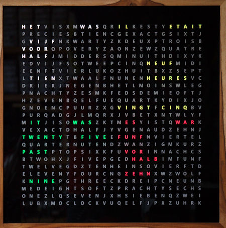 | 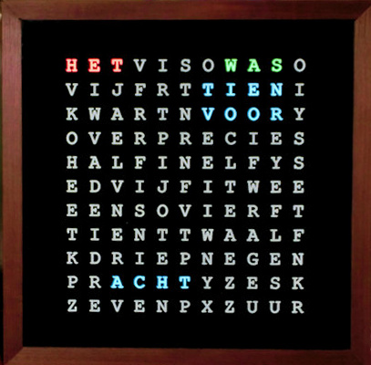 | 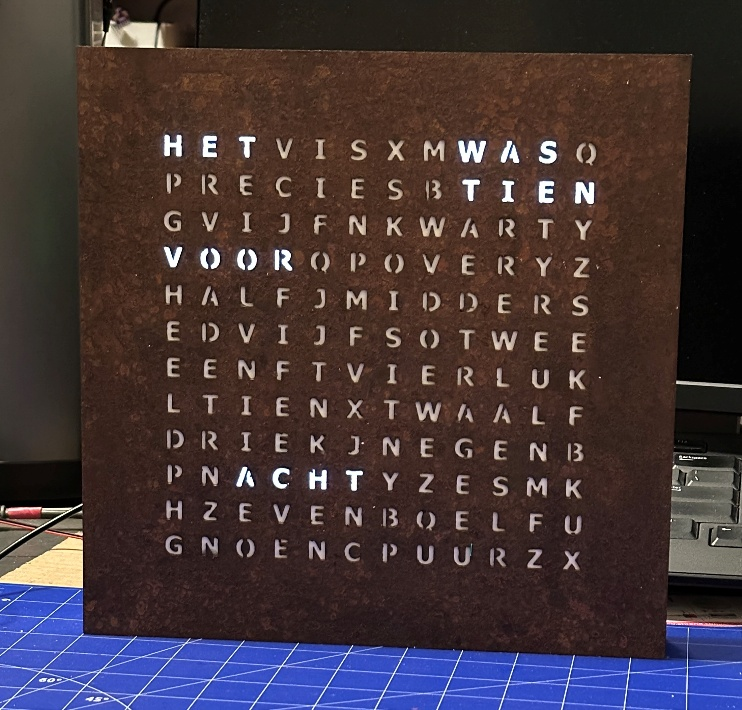 |

> Zie [de selectiepagina](https://github.com/ednieuw/WordclockSelector) om andere woordklok-ontwerpen te vergelijken.

## 1.2 Wat kan de klok?

- **Tijd via internet.** De klok haalt de tijd op met het Network Time Protocol (NTP), tot op de seconde nauwkeurig, met automatische zomer-/wintertijd als een tijdzone is ingevoerd.
- **Tijd zonder internet.** Een DS3231 RTC-module op de printplaat houdt de tijd zeer nauwkeurig bij. De tijd kan worden gezet met een rotary encoder, drie drukknoppen (membraan), vrijwel elke infrarood-afstandsbediening, of een tijdzender-app.
- **Automatische helderheid.** Een LDR (lichtgevoelige weerstand) regelt de helderheid van de LEDs.
- **Veel kleurschema's.** Een rustige standaardkleur, wisselende uurkleuren, regenboog, eigen kleuren en meer (Q-opties in het menu).
- **Updaten zonder kabel.** Nieuwe software kan 'Over the Air' (OTA) via een webpagina worden geüpload.
- **Aangestuurd en gelezen worden via MQTT.** bijvoorbeeld home assistant.

## 1.3 Drie varianten in één programma

Sinds V230 is de woordklok-software samengevoegd met de
[Fibonacci-klok](https://github.com/ednieuw/Fibonacci-Nano-ESP32-clock) (V229/V230). Kies bij het compileren precies één
variant met een `#define`:

| Variant | Wat het is |
|---|---|
| Woordklok | De tijd in woorden, in 12 x 12 LEDs of in andere formaten (zie bijlage bouwvarianten) |
| `FIBONACCI` | Fibonacci- of chrono-klok met vijf vlakken (1, 1, 2, 3, 5) |
| `NOCLOCK` | Geen display: alleen BLE en/of HC-12, bijvoorbeeld als tijdzender |

## 1.4 Bediening van de klok

De klok kan op deze manieren worden bediend:

- [BLE-webpagina](https://github.com/ednieuw/HTML-BLEserial)
- [BLE-terminal in een browser](https://ednieuw.com/BLESerial/BLE_UART_Terminal.html)
- [BLE seriële terminal-app](https://ednieuw.com/BLESerial/IOSappMain.html) (iOS, Android)
- Seriële kabel (USB-C) met een pc en de Arduino IDE
- Webpagina van de klok zelf (menu, kleurkiezer en logviewer), zodra de klok met WIFI is verbonden
- Rotary encoder, (membraan) drukknoppen of IR-afstandsbediening
- MQTT, bijvoorbeeld via Home Assistant
- [Tijdzender-app (iOS) of -webpagina (Windows/Android)](https://ednieuw.com/Woordklok/TimeSender/TimeSender.html), met [uitleg](https://github.com/ednieuw/HTML-TimeSender)

Een [HC-12 tijdzender](https://github.com/ednieuw/ESP32-HC12) kan de NTP-tijd tot ongeveer 1000 meter ver doorsturen naar een of meerdere andere klokken/processors met een HC-12-module.

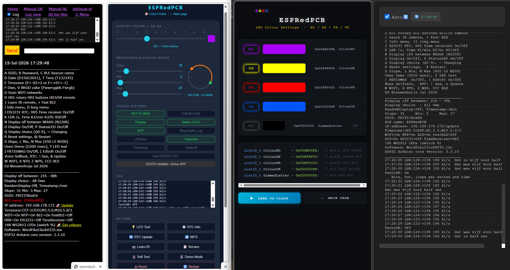

*Alle menu's in een browser (sinds V235). In veel browsers kan het tabblad worden gesplitst, zodat menu en logweergave naast elkaar staan.*

## 1.5 Nieuw in V245 (ten opzichte van V195)

- Nieuwe naam **WordFiboClock**: woordklok en Fibonacci-klok in één programma (V229).
- **MQTT / Home Assistant**: de klok meldt zich zelf aan met knoppen, schuifregelaars en sensoren (V236 - V244).
- **Tijdzender H06 (BLE) en H07 (HC-12, 433 MHz)**: de klok stuurt de tijd naar andere klokken (V229, H07 sinds V247).
- Nieuwe menu-opties: `_` (MQTT), `V` (achtergrondkleur), `FF` (Fibonacci/chrono), `^` (reset-knop), `O1`/`O0` (display aan/uit).
- Webpagina met live kleur, kleurkiezer (`/colourpick`) en bredere logweergave (V235 - V239).
- OTA-pagina met bescherming tegen dubbelklikken (V244).
- Nieuwe klokvarianten en `.bin`-bestanden.

## 1.6 Meer informatie

- Software, PCB's en bouwtekeningen: [github.com/ednieuw/Arduino-ESP32-Nano-Wordclock](https://github.com/ednieuw/Arduino-ESP32-Nano-Wordclock)
- BLE op een mobiel gebruiken om de ESP32 te bedienen: [github.com/ednieuw/nRF-ESP32](https://github.com/ednieuw/nRF-ESP32)
- Alle BLE-terminals bij elkaar: [ednieuw.com/BLESerial](https://ednieuw.com/BLESerial/)

> **Let op over Bluetooth.** Bluetooth LE bestaat in twee varianten voor seriële communicatie: de TI CC2541-service (`FFE0`) en de
> Nordic nRF52-service (`6e400001-b5a3-...`). Deze klok gebruikt de **nRF52-service**. Kies daarom in je terminal-app de nRF-instelling.

---

# 2. Snelle start

In vier stappen van een nieuwe klok naar een klok met de juiste tijd.

## Wat heb je nodig?

- De klok met voeding (USB-C of de aansluiting op de printplaat).
- Een telefoon, tablet of pc.
- Als je WIFI wilt gebruiken: de naam (SSID) en het wachtwoord van je WIFI-router. Die staan vaak onderop de router.
  Tip: je kunt ook de hotspot van je telefoon gebruiken.

## Stap 1 - Kies een bediening-app

De app stuurt commando's naar de klok. Zoek één van deze apps in de app store:

| Platform | App |
|---|---|
| iPhone / iPad / Mac | **BLE Serial Pro** of **BLESerial nRF** |
| Android | **BLE Serial Pro of Serial Bluetooth Terminal** (zet *timestamp* uit in het menu) |
| Windows / Linux  / macOS / Android (browser) | [BLE UART Terminal](https://ednieuw.com/BLESerial/BLE_UART_Terminal.html) |

| BLE Serial Pro | BLESerial nRF | Serial Bluetooth Terminal |
|---|---|---|
| 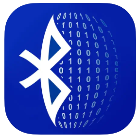 | 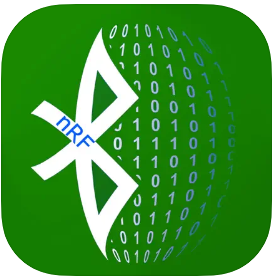 | 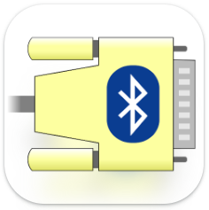 |

Lukt het niet om een app te installeren? Gebruik dan de toegangspunt-pagina in stap 3A of sluit de klok met een USB-C-kabel aan op een pc
en gebruik de seriële monitor van de Arduino IDE.

## Stap 2 - Sluit de voeding aan

Zodra de klok aanstaat gaat de rode status-LED branden (het programma draait). Een groene stip betekent: WIFI verbonden. Een blauwe stip:
Bluetooth verbonden.

Zonder WIFI of Bluetooth kan de tijd met de knoppen op de klok worden gezet (zie hoofdstuk 5).

## Stap 3 - Verbind de klok met WIFI

Een nieuwe klok verwacht WIFI en NTP. Als er nog geen routernaam en wachtwoord zijn ingevoerd, start de klok zelf een WIFI-station dat zichtbaar wordt bij de de WIFI netwerken.
Kies één van de volgende drie manieren.

### 3A - Via de toegangspunt-pagina (zonder app)

1. Open op je PC, telefoon of tablet bij de WIFI-instellingen het station **StartWordclock**.
2. Het wachtwoord is **wordclock**.
3. Open de browser en tik in: **192.168.4.1** en druk op enter.
4. Voer de naam en het wachtwoord van je WIFI-router in en druk op **Submit**.
5. De klok herstart en toont de juiste tijd.

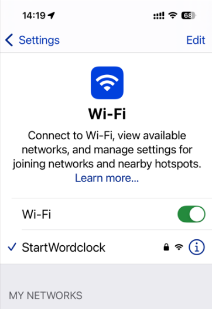

### 3B - Via de Bluetooth-app

Instellen gaat het makkelijkst met de Bluetooth-app.

1. Open de app. De iOS-app toont een lijst met Bluetooth-stations. Duurt dat te lang, druk dan op het wieltje linksboven (kies *nRF52*) en druk op *Done*. In Android: *Scan* en dan *Connect* met de woordklok.
2. Stuur `i` om het menu te zien.
3. Stuur `a` gevolgd door de naam van de router, bijvoorbeeld `aNAAMrouter`. Geen extra punten of spaties.
4. Stuur `b` gevolgd door het wachtwoord, bijvoorbeeld `bGeHeim1234`.
5. Stuur `@` om de klok te herstarten.

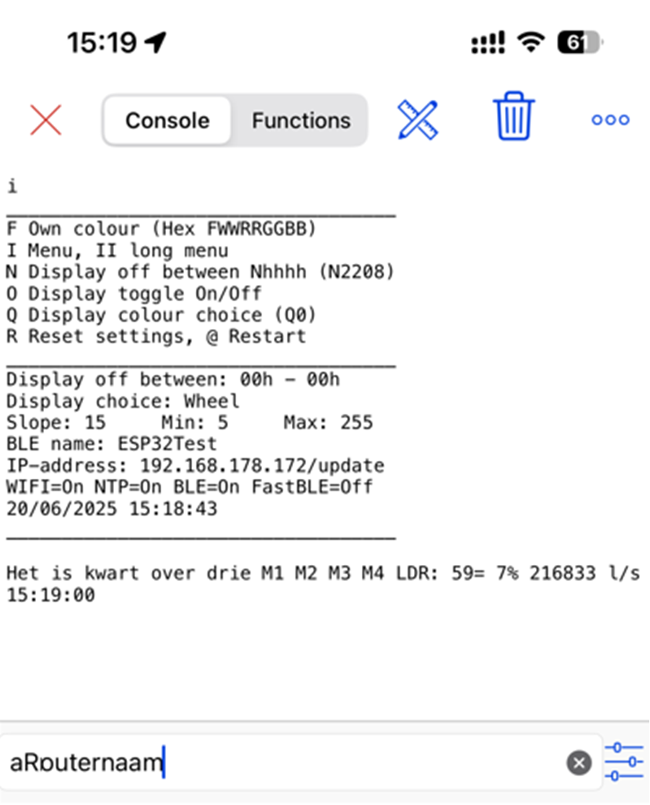

### 3C - Via WPS

Heeft de router een WPS-knop? Druk dan op de WPS-knop van de router en stuur daarna `z` in de Bluetooth-app. Soms moet je de knop op de router
een paar seconden indrukken. Hoe WPS wordt gestart verschilt per router. Als het goed gaat herstart de klok en staat de tijd gelijk.

> **Werkt het niet?** Als de routernaam of het wachtwoord niet klopt, start de klok na enkele herstarts weer de toegangspunt-pagina. Je kunt de
> gegevens dan opnieuw invoeren via die pagina, Bluetooth of USB. Stuur `RRRRR` om alle oude verbindingsgegevens te wissen.

## Stap 4 - Klaar, of zonder WIFI

**Met WIFI:** de klok haalt de tijd zelf van het internet. Je kunt het menu nu ook in een browser openen via het IP-adres van de klok
(te vinden in het menu met `i`) of via de naam, bijvoorbeeld `http://wordclock.local`.

**Zonder WIFI:**

1. Stuur `J` in het menu: de DS3231 RTC-module wordt gebruikt (*Use DS3231 is ON. WIFI ON, NTP OFF*).
2. Stuur `W` om WIFI uit te zetten en `@` om de klok te herstarten.
3. Stuur de tijd en datum, bijvoorbeeld `T143000` voor half drie en `D090625` voor 9 juni 2025.

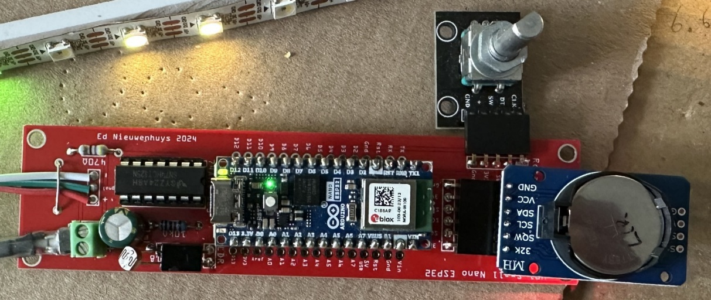

*Klein PCB-ontwerp met rotary encoder en DS3231 RTC-module.*

## En nu?

- Bediening en menu: hoofdstuk 6 en 7.
- De klok bouwen of aanpassen: hoofdstuk 3 en 4.
- Problemen met WIFI of Bluetooth: hoofdstuk 11.

---

# 3. Hardware en bouw

De onderdelen, de printplaten (PCB's), de voeding, de aansluitingen en de bouw van de klokkast.

## 3.1 Overzicht van de onderdelen

| Onderdeel | Doel | Verplicht? |
|---|---|---|
| **Arduino Nano ESP32** | Processor met WIFI en Bluetooth | Ja |
| **LED-strip SK6812 RGBW of WS2812 RGB** | Het display | Ja |
| **LDR (lichtgevoelige weerstand)** met 10 kΩ | Meet het omgevingslicht voor de automatische helderheid | Aanbevolen |
| **Level shifter 74HCT125** (of 74AHCT125) | Zet het 3,3 V datasignaal om naar 5 V voor de LED-strip | Aanbevolen |
| **DS3231 RTC-module** | Nauwkeurige klok voor gebruik zonder internet | Optioneel |
| **Rotary encoder** (KY-034) of **membraanschakelaar met drie knoppen** | Tijd instellen zonder WIFI of Bluetooth | Optioneel |
| **IR-ontvanger** met afstandsbediening | Tijd en kleurschema instellen | Optioneel |
| **Resetknop** | Fabrieksinstellingen herstellen | Optioneel |
| **HC-12 433 MHz-module** | Tijd versturen naar andere klokken | Optioneel |
| **DCF77-ontvanger** of ander apparaat dat pulsen levert | Aansluiting op de PCB aanwezig | Optioneel |
| **Voeding 5 V, > 1 A** | LED-strip en processor | Ja |

De klok werkt ook zonder een van de optionele onderdelen: met WIFI komt de tijd van het internet (NTP), en alle instellingen kunnen met Bluetooth, de webpagina of MQTT worden gedaan. Zie [hoofdstuk 5.1 van de handleiding](#51-welke-invoer-heeft-de-klok) voor de keuze van het invoerapparaat.

## 3.2 De LED-strip en het datasignaal

De SK6812 RGBW- of WS2812 RGB-LED-strip werkt op **5 V**. Het datasignaal van de Nano ESP32 is **3,3 V**. Dat is voor sommige strips te laag om betrouwbaar te werken.

- **Aanbevolen: een level shifter.** De 74HCT125 (vier poorten) zet het signaal om van 3,3 V naar 5 V. De andere drie poorten van de IC kunnen voor andere doeleinden worden gebruikt; het PCB-ontwerp doet dat.
- **Optocouplers werken niet.** Pogingen om het datasignaal met optocouplers te versterken zijn mislukt. Zie het [experiment met een optocoupler](https://ednieuw.com/ElecProj/OptoSK6812/OptocouplerSK6812.html).
- **Zonder level shifter** werkte een SK6812 RGBW-strip met 14 LEDs ook goed, met de datalijn direct op de 3,3 V-uitgang van de Nano ESP32. Strips met meer LEDs zijn niet getest.

Voor een strip zonder level shifter geldt als vuistregel: een weerstand van **470 Ω** in de datalijn en een condensator van **200 - 1000 µF** over 5 V en GND, direct op de strip. Succes is dan niet gegarandeerd.

### Soorten strips

| Strip | LEDs | Opmerking |
|---|---|---|
| **SK6812 RGBW** | Rood, groen, blauw en wit | De witte LED (het gele vlakje) geeft een mooi wit. Selecteer in het menu `%` voor het type |
| **WS2812 RGB** | Rood, groen, blauw | Geen witte LED; het wit-deel in kleurcommando's heeft geen effect |

## 3.3 De printplaten

De printplaten zijn ontworpen met de gratis software [Fritzing](https://fritzing.org/). Fritzing exporteert **Gerber-bestanden** die naar een PCB-fabrikant kunnen worden gestuurd. In Europa gemaakte printplaten kunnen met de Fritzing-app zelf worden besteld.

Een goedkope en goede ervaring is [PCBWay](https://www.pcbway.com/): 10 printplaten voor ongeveer $5, met ongeveer $25 verzend- en invoerkosten. De printplaten zijn binnen een week ontvangen en de kwaliteit was uitstekend. Upload het zipbestand met de Gerber-bestanden en betaal de kosten.

De ontwerpen (`.fzz`-bestand en Gerber-bestanden) staan in de map [PCB](PCB) van deze repository, en ook op [github.com/ednieuw/NanoESP32PCB](https://github.com/ednieuw/NanoESP32PCB).

| PCB | Map | Gebruik |
|---|---|---|
| **Grote PCB V04** | [PCB/Arduino Nano ESP32 PCB](<PCB/Arduino Nano ESP32 PCB>) | Alle aansluitingen: rotary of drukknoppen, DS3231, DCF77, LDR, IR, resetknop, level shifter |
| **Kleine PCB V03** | [PCB/Arduino Nano ESP32 small PCB](<PCB/Arduino Nano ESP32 small PCB>) | Minimaal ontwerp voor kleine ruimtes |
| **Ultimate PCB V005** | [PCB/Arduino Nano ESP32Ultimate PCB](<PCB/Arduino Nano ESP32Ultimate PCB>) | Uitgebreide uitvoering |
| **Universele PCB** | [Nano ESP32 RGBW BW PCB](https://github.com/ednieuw/NanoESP32-BW-RGBW-clock) | Voor RGB(W)-LEDs en witte 2835-LED-strips met schuifregisters, met één broncode |

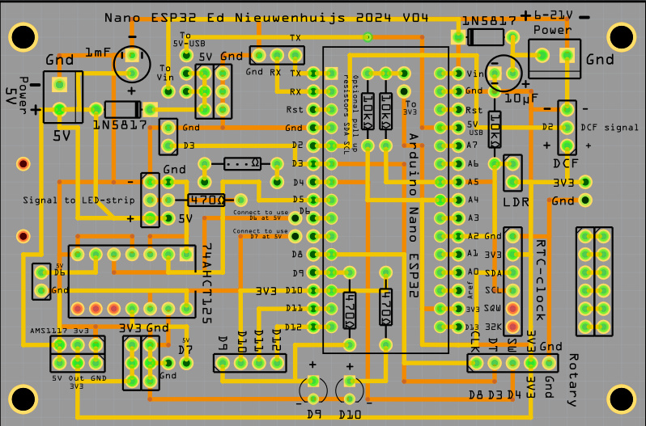

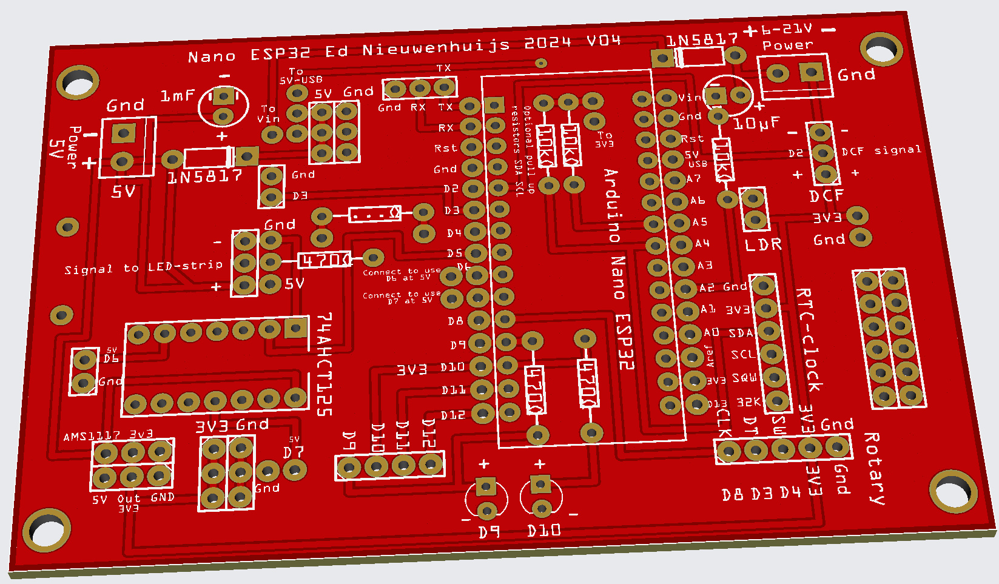


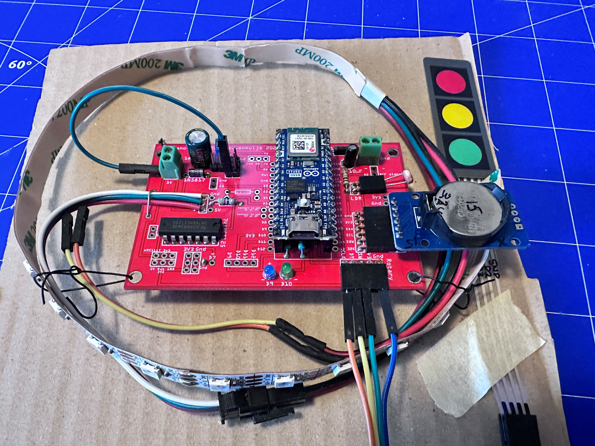

*Alle onderdelen op PCB V04, inclusief membraantoetsenbord.*

## 3.4 Onderdelenlijst (Bill of Materials)

### Grote PCB V04

| Aantal | Onderdeel | Waarde / specificatie | Aanduiding |
|---|---|---|---|
| 1 | Arduino Nano ESP32 | | Processor |
| 3 | Weerstand | 470 Ω, ±5% | Voor de LED-strip en de 3 mm LED |
| 3 | Weerstand | 10 kΩ, ±5% | LDR; 2 optioneel voor I2C |
| 1 | Elektrolytische condensator | 1000 µF, 16 V | 1mF |
| 1 | Elektrolytische condensator | 10 µF | 10uF |
| 1 | LDR | GL5516 | LDR |
| 1 | Rotary encoder of membraantoetsenbord | KY-034 | Rotary |
| 1 | RTC-module | DS3231 | RTC-clock |
| 1 | RGB(W) LED-strip | WS2812 of SK6812 | LED-strip |
| 2 | Diode | 1N5817 | 1N5817 |
| 1 | LED, 3 mm | Rood (633 nm) | D9 |
| 1 | LED, 3 mm | Geel (592 nm) | D10 |
| 1 | IC | 74AHCT125 | Level shifter |
| 2 | Schroefklem, 2-polig, 3,5 mm | POWER | J1, J2 |
| 2 | Female pin header, 15-polig, 0,1" | Aansluiting voor de Arduino Nano ESP32 | Nano ESP32 |
| 1 | Female pin header, 6-polig | DS3231 (GND, 5V, SDA, SCL op de I2C van de Arduino) | RTC-clock |
| 1 | Female pin header, 5-polig | Rotary encoder | Rotary |
| 1 | Female pin header, 3-polig | DCF77-ontvanger | DCF |
| 1 | Female pin header, 3-polig | Optionele 3,3 V-regelaar (GND, 5V, ingang-GND) | AMS1117 3v3 |
| 1 | Male pin header, 4-polig | 5 V naar Vin of USB | |
| 1 | Male pin header, 3-polig | Alle drie de pinnen aan 5 V | RTCclock12 |
| 1 | Male pin header, 3-polig | Alle drie de pinnen aan GND | RTCclock13 |
| 1 | Female pin header, 3-polig | GND, GND en één poot van R5 | RTCclock6 |
| 1 | Female pin header, 2-polig | LDR | LDR |
| 1 | Jumper, 2-polig | Kiest 5 V naar Vin of naar USB 5 V | Power shunt |
| 1 | Male pin header, 3-polig | TX/RX en GND van de Arduino | TX-RX |

### Kleine PCB V03

| Aantal | Onderdeel | Waarde / specificatie | Aanduiding |
|---|---|---|---|
| 1 | Arduino Nano ESP32 | | Processor |
| 1 | LDR | GL5516 | LDR |
| 1 | Rotary encoder of membraantoetsenbord | KY-034 | Rotary |
| 1 | RTC-module | DS3231 | RTC-clock |
| 1 | RGB(W) LED-strip | WS2812 of SK6812 | LED-strip |
| 1 | Weerstand | 470 Ω, ±5% | LED-strip |
| 1 | Weerstand | 10 kΩ, ±5% | LDR |
| 1 | Elektrolytische condensator | 1000 µF, 16 V | Bij de voeding |
| 1 | Diode | 1N5817 | Bij de voeding |
| 1 | IC | 74AHCT125 | Level shifter |
| 1 | Schroefklem, 2-polig, 3,5 mm | | Power |
| 2 | Female pin header, 15-polig | Aansluiting voor de Arduino Nano ESP32 | Nano ESP32 |
| 1 | Female pin header, 6-polig | DS3231 | RTC-clock |
| 1 | Female pin header, 5-polig | Rotary encoder | Rotary |
| 1 | Female pin header, 2-polig | LDR | LDR |

> **Opmerking over de diode.** Op de printplaat staat "1N5817", maar de onderliggende Fritzing-onderdeelinformatie noemt "1N4001". Dat zijn verschillende diodes: de 1N5817 is een Schottky-diode met een spanningsval van ongeveer 0,45 V, de 1N4001 een gewone gelijkrichter met ongeveer 0,7 V. De **1N5817** heeft de voorkeur. De volledige lijsten staan ook in [BillOfMaterials_PCBv04.md](PCB/BillOfMaterials_PCBv04.md) en [BillOfMaterials_smallPCB.md](PCB/BillOfMaterials_smallPCB.md).

## 3.5 Voeding

### Voeding van de LED-strip en de Nano

De LED-strip heeft **5 V** nodig. Dat kan op drie manieren, afhankelijk van hoe de PCB is aangesloten:

| Voeding | Aansluiting | Opmerking |
|---|---|---|
| **5 V-voeding > 1 A** | Schroefklem linksboven op de PCB (5 V) | Voedt de LED-strip rechtstreeks. Aanbevolen voor klokken met veel LEDs |
| **6 - 21 V** | Aansluiting *Power 6-21V* naar de VIN-pin van de Nano | Voedt ook de Nano. Zie de waarschuwing hieronder |
| **USB-C** | De USB-C-poort van de Nano ESP32 | De pin VBUS levert 5 V zodra via USB wordt gevoed. De LEDs worden dan via de PCB gevoed |

Welke voeding de LED-strip krijgt, wordt op de PCB bepaald met overbruggingen (zie de afbeelding): kortsluiten van de **rode** verbinding voedt de LED-strip met 5 V via de aansluiting *Power 6-21V* (VIN); kortsluiten van de **gele** verbinding voedt de LEDs via de USB-C-voeding.


> **Let op.** De 5 V-aansluiting gaat **rechtstreeks naar de LED-strip**. Wordt daar een voeding met een hogere spanning aangesloten, dan worden de LEDs vernield terwijl de Nano gewoon aangaat.

> **Stroom via USB-C.** De LEDs voeden via de USB-C-poort is prima voor ongeveer 20 LEDs, maar waarschijnlijk niet voor langere strips. De stroom loopt dan door de dunne koperbanen van de PCB. USB-C-voedingen kunnen meer dan 20 A leveren; dat kan de koperbanen laten smelten. Gebruik daarom bij langere strips een aparte 5 V-voeding op de schroefklem.

> **VIN en VBUS.** Wordt de Nano via de VIN-pin gevoed, dan is VBUS uitgeschakeld. Er is dan geen 5 V van het bord af te nemen. Een USB-voeding van 5 V op VIN werkt, hoewel als minimale spanning 6 V is opgegeven: de diode 1N5817 verlaagt de spanning nog met ongeveer 0,5 V naar 4,5 V.

### Condensator en weerstand

Een condensator van 1000 µF over 5 V en GND bij de LED-strip vangt stroompieken op. De weerstand van 470 Ω in de datalijn beschermt de eerste LED.

## 3.6 Aansluitingen op de printplaat

### Grote PCB

Met de klok mee, vanaf rechtsboven:

| Aansluiting | Pin of functie |
|---|---|
| Voedingsingang 6 - 21 V | Naar Vin op de Nano ESP32 |
| DCF | D2, 3V3 en GND |
| LDR | A2 en 3V3 |
| RTC-klok (DS3231) | GND, 3V3, A4 (SDA) en A5 (SCL) |
| Rotary encoder of drieknops-schakelaar | D8, D3, D4, 3V3 en GND |
| Resetknop | D6 en GND (of D7) |
| IR-afstandsbediening | D4, 3V3 en GND |
| LEDs | D10 en D9 |
| Connector | D12, D11, D10 en D9 |
| D7 | Met 5 V via 3V3 → 5V-niveauomzetter |
| Connector | GND en 3V3 |
| Connector | AMS1117 5V → 3V3 1 A-spanningsregelaar |
| D6 | Met 5 V via 3V3 → 5V-niveauomzetter |
| LED-strip SK6812/WS2812 | 5V, D5 en GND |
| D3 | Met 3V3 naar D3 en GND |
| 5 V-voedingsingang | Naar 5V-USB of Vin op de ESP32 en naar de LED-strip |
| 5V- en GND-connector | Naar Vin en 5V-USB op de Arduino Nano ESP32 |
| Connector | GND, RX en TX |

### Kleine PCB

Met de klok mee, vanaf linksboven:

| Aansluiting | Pin of functie |
|---|---|
| LDR | A2 en 3V3 |
| 5 V-voedingsingang | Naar 5V-USB op de ESP32 en naar de LED-strip |
| LED-strip SK6812/WS2812 | 5V, D5 en GND |
| Rotary encoder of drieknops-schakelaar | D2, D3, D4, 3V3 en GND |
| Resetknop | D6 en GND (of D7) |
| IR-afstandsbediening | D4, 3V3 en GND |
| RTC-klok (DS3231) | GND, 3V3, A4 en A5 |

> Op de **grote PCB** zit de rotary-pin B op **D8** (zie de sketch: `encoderPinBL`), op de **kleine PCB** op **D2**.


### De Nano ESP32


## 3.7 De optionele onderdelen

### LDR (lichtsensor)

De LDR is aangesloten op **A2** en 3,3 V, met een weerstand van 10 kΩ. De software meet het licht en regelt daarmee de helderheid van de LEDs (zie [hoofdstuk 6.6 van de handleiding](#66-de-helderheid-van-het-display)).

### DS3231 RTC-module

De module wordt via I2C aangesloten: **SDA op A4, SCL op A5**, plus 3,3 V en GND. Hij houdt de tijd zeer nauwkeurig bij (enkele seconden per jaar) en heeft een knoopcel als reservebatterij. Gebruik in het menu `J` om de DS3231 te kiezen ([hoofdstuk 5.3](#met-de-ds3231-rtc-module-zonder-internet)).


### Rotary encoder of drie drukknoppen

| Onderdeel | Pinnen | Kiezen met |
|---|---|---|
| Rotary encoder (KY-034) | Grote PCB D8, D3 en D4 (SW). Kleine PCB D2, D3 en D4 | `H01` |
| Membraanschakelaar met drie knoppen | Zelfde connector | `H02` |

### IR-ontvanger

De IR-ontvanger wordt op **D4**, 3,3 V en GND aangesloten (dezelfde pin als de drukknop van de rotary; beide kunnen niet tegelijk). Kies met `H03` (grote afstandsbediening) of `H04` (kleine) en laat de klok de toetsen leren met `{` ([hoofdstuk 5](#met-een-ir-afstandsbediening)).

### Resetknop

Een drukknop tussen een GPIO-pin en GND (op de PCB D6 of D7). Stel de pin in met `^nn` en herstart met `@` ([commando ^](#---reset-knop)). Twee seconden indrukken herstelt de fabrieksinstellingen.

### HC-12 (433 MHz tijdzender)

De HC-12 wordt met zijn RXD-pin aan **D4** aangesloten, plus voeding en GND, en met `H07` ingeschakeld ([hoofdstuk 8.4](#84-hc-12-tijdzender-433-mhz)). D4 wordt ook voor IR en de rotary-drukknop gebruikt; er kan maar één van de drie tegelijk worden aangesloten.

### Bluetooth en WIFI

De Nano ESP32 heeft zelf Bluetooth en WIFI. Er is geen extra hardware voor nodig.

## 3.8 De LED-grondplaat en de klokkast

### De LED-strip

De afstand tussen de LEDs op de strip is geschikt voor een klok van **25 x 25 cm** (60 LEDs/m) of **50 x 50 cm** (30 LEDs/m).

Er zijn twee mogelijkheden voor de 144 LEDs van de klok:

| Opstelling | Voordeel | Nadeel |
|---|---|---|
| **12 rijen van 12 LEDs** | Weinig soldeerpunten; eenvoudig | |
| **Alleen een LED achter elke letter die moet oplichten** | Minder LEDs en minder gaten in de afstandsplaat | Veel meer soldeerpunten, die elk storingen kunnen geven. Een onvolkomen soldering op de strip kan na verloop van tijd loskomen |

De software heeft ook een **digitale tijdweergave** (`Q6`) waarvoor de 144 LEDs (12 x 12) worden gebruikt.

### De strips plakken

Plak de strips van links naar rechts op de oneven rijen en van rechts naar links op de even rijen. **Volg de pijlen op de strip**: elke tweede rij wordt dus omgedraaid. Daardoor zijn er geen lange datalijnen van het rechter uiteinde van de strip naar het linker uiteinde van de volgende rij, en hoeft de software niet voor nieuwe posities te worden aangepast.

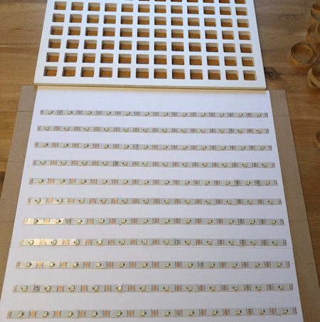

### Solderen

Vertind koperdraad is handig. Soldeer bijvoorbeeld alle 5 V-aansluitingen aan de linkerkant van de strip en alle GND-aansluitingen aan de rechterkant. Boor daarvoor een klein gat door de plaat naast elke 5 V-aansluiting links en naast elke GND rechts. Buig een hoek van 90 graden, steek de draad door het gat en soldeer hem aan de LED-strip.

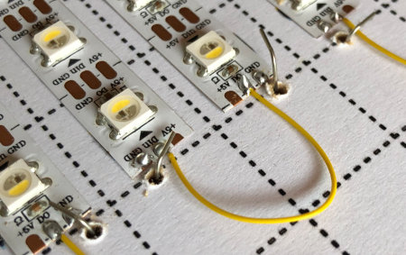

### De frontplaat en de lagen

De woorden (HET, WAS, VIJF enzovoort) worden uitgezaagd of uitgesneden in de frontplaat:

- **MDF van 1 cm** met een figuurzaag. Verf de binnenkant helderwit, anders wordt het witte licht dof.
- **Geschuimd PVC, wit, 10 mm (RAL 9003)** is beter: het is gemakkelijk te snijden, het is wit en het verkleurt niet. Witte verf verkleurt vaak.

Ontwerpen voor de woordplaten staan in de mappen [WordPlateFrontCovers](WordPlateFrontCovers) en [DXFwordplates](DXFwordplates).

De volgorde van de lagen, van de LEDs naar voren:

1. de LED-grondplaat met de strips;
2. de **afstandsplaat** over de LEDs (zodat het licht per letter gescheiden blijft);
3. een vel **wit papier**;
4. de **woordplaat** (frontplaat).

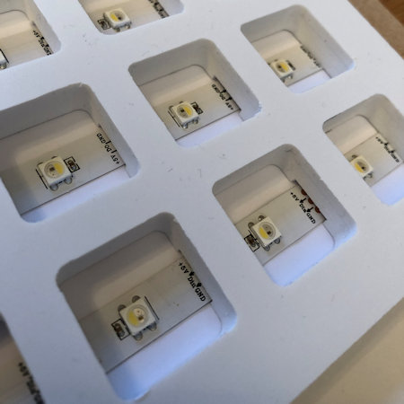

### Bouwinstructies

| Klok | Bouwinstructie |
|---|---|
| Eentalige woordklok met SK6812-LEDs | [ednieuw.com/Woordklok/Bouwpakket/WoordklokSK6812.htm](https://ednieuw.com/Woordklok/Bouwpakket/WoordklokSK6812.htm) |
| Dezelfde bouwbeschrijving in deze repository | De map [Manual-Instructions](Manual-Instructions) (Nederlands en Engels, pdf) |
| 4-talige woordklok met SK6812-LEDs (UK, NL, DE, FR) | [github.com/ednieuw/FourLanguageClock](https://github.com/ednieuw/FourLanguageClock) |
| Selectiepagina voor woordklok-ontwerpen | [github.com/ednieuw/WordclockSelector](https://github.com/ednieuw/WordclockSelector) |

---

# 4. Software installeren

De software draait op een **Arduino Nano ESP32**. Er zijn twee manieren om hem in de klok te krijgen:

| Methode | Wat is nodig | Wanneer |
|---|---|---|
| **Zelf compileren** met de Arduino IDE (4.1 - 4.5) | Arduino IDE, ESP32-core, bibliotheken, USB-C-kabel | Eigen aanpassingen, nieuwe klokvariant of een ander bord |
| **Een `.bin`-bestand uploaden** (4.6) | Alleen WIFI of een USB-kabel. Geen bibliotheken | Voor de meeste gebruikers. Het compileren is al gedaan |

## 4.1 Wat is nodig?

- De [Arduino IDE](https://www.arduino.cc/en/software) (versie 2.x).
- De **ESP32-core** van Espressif, versie **3.3.10 of hoger** (getest met 3.3.11).
- De bibliotheken uit [4.2](#42-de-bibliotheken-installeren).
- Een USB-C-kabel naar de Nano ESP32.

### De ESP32-core installeren

1. Open in de Arduino IDE *Tools → Board → Boards Manager* (of `Ctrl+Shift+B`).
2. Zoek **esp32** (van Espressif Systems) en installeer versie 3.3.10 of hoger.
3. Kies daarna *Tools → Board → esp32 → Arduino Nano ESP32*.

Er zijn twee cores waarmee de Nano ESP32 kan worden geprogrammeerd: de core *Arduino ESP32 Boards* van Arduino zelf, en de core *esp32* van Espressif. Voor V247 moet de **Espressif-core** worden gebruikt. De core van Arduino zelf (versie 2.0.x) werkt niet meer met deze software. De EdSoftLED-bibliotheek compileert alleen met Espressif-core 3.3.x, omdat hij de RMT-functie van de processor gebruikt om de LEDs aan te sturen.

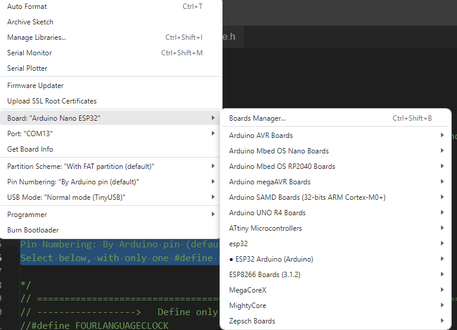

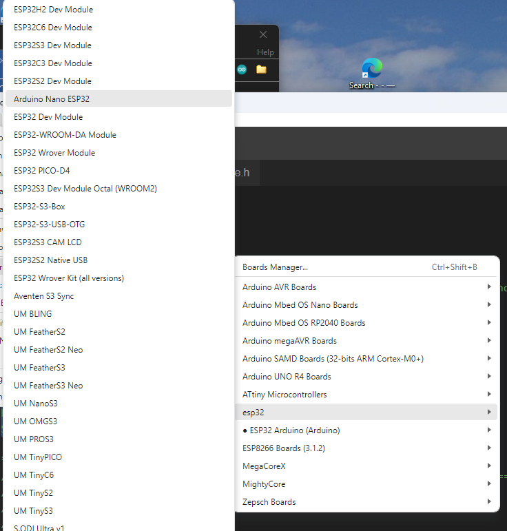

## 4.2 De bibliotheken installeren

Bibliotheken worden voortdurend bijgewerkt, wat na verloop van tijd tot incompatibiliteit met deze broncode kan leiden. Daarom staan de gebruikte versies in het bestand **`librariesV247.zip`** (in de hoofdmap van de repository).

1. Pak het zipbestand uit.
2. Kopieer de mappen naar de map `libraries` binnen de map waar de Arduino IDE de sketches bewaart (meestal `Documenten\Arduino\libraries`).
3. Herstart de Arduino IDE.

Het zipbestand bevat: `Adafruit_BusIO`, `Adafruit_NeoPixel`, `Async_TCP`, `ESP_Async_WebServer`, `EdSoftLED`, `Encoder`, `IRremote`, `Keypad`, `NimBLE-Arduino`, `PubSubClient` en `RTClib`.

| Bibliotheek | Gebruik |
|---|---|
| `EdSoftLED` | LED-strip aansturen (SK6812, WS2812), standaard bij core 3.3 of hoger. [github.com/ednieuw/EdSoftLED](https://github.com/ednieuw/EdSoftLED) |
| `Adafruit_NeoPixel` (met `Adafruit_BusIO`) | Alternatief voor EdSoftLED. Zie [4.4](#44-de-boardinstellingen) |
| `NimBLE-Arduino` | Bluetooth. **Versie 2.x** (voor V060 werkte alleen 1.4.3) |
| `ESP_Async_WebServer`, `Async_TCP` | Webpagina's van de klok |
| `RTClib` | DS3231 RTC-module |
| `Encoder` | Rotary encoder |
| `Keypad` | Drie drukknoppen (membraan) |
| `IRremote` | IR-afstandsbediening |
| `PubSubClient` | MQTT |


## 4.3 De sketch openen en de klokvariant kiezen

1. Pak de programmamap uit (bijvoorbeeld `WordFiboClockV247`) en open het bestand `WordFiboClockV247.ino` in de Arduino IDE. De map moet dezelfde naam hebben als het `.ino`-bestand en alle `.h`-bestanden bevatten.
2. Zoek bovenin de sketch (rond regel 50) de lijst met klokvarianten:

   ```cpp
   #define NL144CLOCK              // Dutch display for 12 x 12 Front
   //#define UK144CLOCK            // English display for 12 x 12 Front
   //#define FR144CLOCK            // French display for 12 x 12 Front
   //#define DE144CLOCK            // German display for 12 x 12 Front
   //#define NL92CLOCK             // Dutch display, one LED-strip behind every word
   //#define FOURLANGUAGECLOCK     // Four-language clock with 625 LEDs
   //#define NLM1M2M3M4L94         // NL clock with four extra LEDs for the minutes
   ...
   //#define FIBONACCI             // Fibonacci / chrono clock
   //#define NOCLOCK               // No display
   ```

3. Haal de `//` weg voor **precies één** variant en zet `//` voor alle andere.

De varianten staan met hun LED-aantal in de [bijlage](#131-klokvarianten-en-bestandsnamen). Enkele veelgebruikte:

| `#define` | Klok |
|---|---|
| `NL144CLOCK` | Eentalige klok met 144 LEDs in een raster van 12 x 12 (standaard Nederlands; `UK144CLOCK`, `FR144CLOCK` en `DE144CLOCK` voor Engels, Frans en Duits) |
| `NLM1M2M3M4L114` en andere `L`-varianten | Eentalige klok met 4 extra LEDs voor de minuten en een iets ander ontwerp |
| `FOURLANGUAGECLOCK` | 4-talenklok met 625 LEDs in een raster van 25 x 25. [Bouwinstructie](https://github.com/ednieuw/FourLanguageClock) |
| `FIBONACCI` | Fibonacci- of chronoklok, zie [hoofdstuk 10](#10-fibonacci-klok-en-noclock) |
| `NOCLOCK` | Geen display. De bestanden `ClockFaces.h`, `WordClock.h` en `Fibonacci.h` kunnen dan worden verwijderd |

De woordklok-frontplaten staan in de map [WordPlateFrontCovers](WordPlateFrontCovers). Wie een eigen ontwerp gebruikt, moet de positie van de LEDs in `ClockFaces.h` aanpassen.


## 4.4 De boardinstellingen

Kies in het menu *Tools*:

| Instelling | Waarde |
|---|---|
| Board | **Arduino Nano ESP32** (onder `esp32`) |
| Port | De COM-poort van de Nano ESP32 |
| Partition Scheme | **With FAT** (*With FAT partition, default*) |
| USB Mode | **Normal mode (TinyUSB)** |
| Pin Numbering | Zie hieronder |

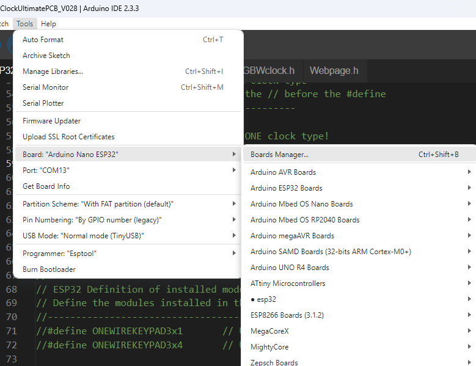

### Pinnummering

Er zijn twee manieren om pinnen te nummeren bij het compileren: de GPIO-nummering van de ESP32-S3 en de Arduino-nummering (D0, D1, ...).

| LED-bibliotheek | Pin Numbering | Opmerking |
|---|---|---|
| **EdSoftLED** (standaard bij core 3.3 of hoger) | Beide zijn goed | De sketch kiest zelf EdSoftLED als de core nieuw genoeg is |
| **Adafruit NeoPixel** | **By GPIO number (legacy)** | Zet daarbij `LED_PIN = 8` in plaats van `D5`. Met *By Arduino pin* geeft het compileren de fout `undefined reference to digitalPinToGPIONumber` |


## 4.5 Compileren en uploaden

1. Sluit de Nano ESP32 met de USB-C-kabel aan op de pc.
2. Kies *Sketch → Upload* (of de pijl linksboven).
3. Open de seriële monitor (115200 baud). Druk op de witte resetknop op de Nano ESP32 als er niets wordt getoond.
4. Stuur bij de **eerste keer uploaden** `RRRRR` voor een totale reset (zie [hoofdstuk 11](#115-resetten)).
5. Stuur `i` om het menu te zien en ga verder met [hoofdstuk 5](#5-eerste-ingebruikname).

## 4.6 Zonder compileren: een `.bin`-bestand uploaden

Dit is de aanbevolen methode als geen eigen aanpassingen nodig zijn. De bibliotheken hoeven niet te worden geïnstalleerd, en over een paar jaar zijn er geen problemen met bibliotheken die niet meer compatibel zijn. Het compileren is al gedaan; het bestand dat naar de klok wordt geüpload is een `.bin`-bestand. Op [GitHub](https://github.com/ednieuw/Arduino-ESP32-Nano-Wordclock) staat standaard het `.bin`-bestand van de variant `NL144`; andere varianten zijn optioneel (zie [13.1](#131-klokvarianten-en-bestandsnamen)) en kunnen zelf worden gecompileerd.

### Als de klok al draait met een versie van deze software

Gebruik de OTA-pagina van de klok, zie [hoofdstuk 11.1](#111-de-software-bijwerken-ota).

### Als de Nano ESP32 nog leeg is

De klok heeft eerst een programma nodig dat de OTA-pagina kan tonen. Daarvoor wordt het voorbeeldprogramma **OTAWebUpdater** van de Arduino IDE gebruikt:

1. Kies als board de Nano ESP32 (*Tools → Board → esp32 → Arduino Nano ESP32*).
2. Open *File → Examples → ArduinoOTA → OTAWebUpdater*.
3. Vul in het voorbeeld de naam en het wachtwoord van de WIFI-router in en kies *Sketch → Upload*.
4. Open de seriële monitor en noteer het IP-adres dat wordt getoond (druk op de resetknop als er niets verschijnt).
5. Typ het IP-adres in een browser, bijvoorbeeld `192.168.0.123`.
6. Log in met gebruikersnaam `admin` en wachtwoord `admin`.
7. Kies het `.bin`-bestand voor de klokvariant, bijvoorbeeld `WordFiboClockV247.NL144.bin`, en druk op *Update*.

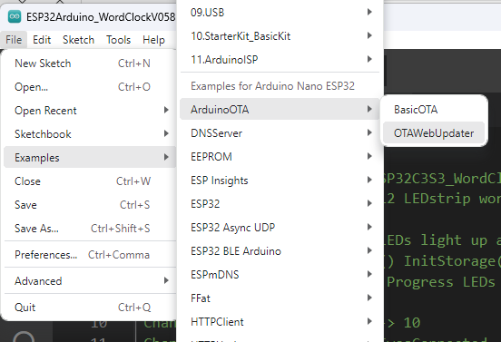

Een eigen `.bin`-bestand maakt de Arduino IDE met *Sketch → Export Compiled Binary*. Een andere mogelijkheid is het hulpmiddel [OTA-webupdater](https://github.com/ednieuw/OTA-webupdater) of het bestand `BinUploader.html` in de repository.

## 4.7 Problemen

| Verschijnsel | Mogelijke oorzaak en oplossing |
|---|---|
| De LEDs gaan niet branden | De pinnummering staat verkeerd. Bij NeoPixel: *By GPIO number (legacy)*. Zie 4.4 |
| De klok toont niet de gewenste taal of het gewenste bord | Er is geen of meer dan één klokvariant geselecteerd bij de `#define`'s rond regel 50 |
| Fout `undefined reference to digitalPinToGPIONumber` | NeoPixel met *By Arduino pin*. Zie 4.4 |
| Bluetooth werkt niet | Er wordt een verkeerde versie van NimBLE gebruikt. Vanaf V060 moet NimBLE **2.x** worden gebruikt |
| Fouten bij het compileren van `EdSoftLED` | De core is te oud. Gebruik Espressif-core 3.3.10 of hoger |
| Upload mislukt, de poort wordt niet gevonden | Zet de Nano ESP32 in bootloader-modus: druk de resetknop **twee keer** in (dubbele tik, rustig, de tweede keer zodra de RGB-LED knippert) tot de LED langzaam pulseert (volgens Arduino groen).<br>Druk na het uploaden nog een keer op reset. Probeer ook een andere USB-kabel; sommige kabels zijn alleen bedoeld voor laden.<br>Zie de [cheat sheet van de Arduino Nano ESP32](https://docs.arduino.cc/tutorials/nano-esp32/cheat-sheet/) |
| Lukt het compileren niet | Gebruik de methode in [4.6](#46-zonder-compileren-een-bin-bestand-uploaden) |


---

# 5. Eerste ingebruikname

Dit hoofdstuk legt uit hoe je een nieuwe klok met WIFI verbindt en hoe je de tijd instelt, met of zonder internet.
De korte versie staat in [hoofdstuk 2](#2-snelle-start).

## 5.1 Welke invoer heeft de klok?

Een klok heeft altijd WIFI en Bluetooth. Daarnaast kan hij **optioneel** zijn uitgerust met:

- een **DS3231 RTC-module**, een zeer nauwkeurige klok die ook zonder internet de tijd bijhoudt;
- een **rotary encoder** (draai-/drukknop), of **drie drukknoppen** (membraan), of een **infrarood-ontvanger** met afstandsbediening;
- een **HC-12** of de BLE-tijdontvanger (zie [hoofdstuk 8](#8-tijdontvanger-en-tijdzender)).

Met menucommando `H` kies je welk apparaat de klok gebruikt:

| Commando | Betekenis |
|---|---|
| `H00` | Geen invoerapparaat. De tijd komt van internet (NTP). |
| `H01` | Rotary encoder |
| `H02` | Drie drukknoppen (membraan) |
| `H03` | Grote IR-afstandsbediening (met cijfers) |
| `H04` | Kleine IR-afstandsbediening (zonder cijfers) |
| `H05` | Tijdontvanger aan/uit (tijd ontvangen via BLE) |
| `H06` | Tijdzender aan/uit (tijd uitzenden via BLE) |
| `H07` | HC-12 tijdzender aan/uit (tijd uitzenden via 433 MHz, V247) |

Herstart de klok na een wijziging met `@`.

- Met `H01` t/m `H04` wordt de DS3231 aangezet en NTP uitgezet: de klok verwacht dat je de tijd zelf instelt.
- Met `H00` worden WIFI en NTP weer aangezet en de DS3231 uitgezet.
- Zet de invoer met `H00` **uit** als er niets is aangesloten. De software controleert anders voortdurend of er een invoer plaatsvindt en kan onbedoelde invoer krijgen.
- Een reset naar fabrieksinstellingen (`R`) laat deze H-instelling ongewijzigd.


## 5.2 Verbinden met WIFI

De klok krijgt de tijd standaard van het internet. Daarvoor heeft hij de naam (SSID) en het wachtwoord van je router nodig. Die worden **eenmalig**
ingevoerd en blijven bewaard in het geheugen van de processor, ook als de stroom uitvalt.

### Fabrieksinstellingen na een reset

Staan er nog oude verbindingsgegevens in de klok? Stuur dan `RRRRR` (vijf keer R) om ze te wissen.<br> 
De klok staat dan op:
```
SSID en wachtwoord zijn leeg
Timezone: CET-1CEST,M3.5.0,M10.5.0/3
WIFI=On  NTP=On  BLE=On
```

### Via de toegangspunt-pagina

Zonder routergegevens en met de W-optie in het menu 'WIFI On/Off' op ON start de klok zijn eigen WIFI-station **StartWordclock** (wachtwoord **wordclock**).


1. Verbind de telefoon, tablet of pc met het station *StartWordclock*.
2. Open een browser en tik in de url **192.168.4.1**.
3. Voer de SSID en het wachtwoord van de router in en druk op *Submit*. Die staan vaak onderop de router.
4. De klok herstart en toont de juiste tijd.

Klopt de routernaam of het wachtwoord niet, dan start de klok na enkele herstarts weer deze pagina.

### Via Bluetooth of een seriële kabel

Met een BLE-app (of de seriële monitor van de Arduino IDE) kun je de gegevens ook zelf sturen:

| Commando | Voorbeeld | Betekenis |
|---|---|---|
| `a` + SSID | `aFRITZ!Box01` | Naam van het WIFI-station |
| `b` + wachtwoord | `bGeHeim1234` | Wachtwoord van de router |
| `c` + naam | `cWoordklok` | Naam van de klok in de Bluetooth-lijst en in de router (standaard na reset: `wordclock`) |
| `@` | | Klok herstarten |

- Hoofdletters en kleine letters maken voor de **commando**-letter niet uit (`A` of `a`). Het wachtwoord zelf is wel hoofdlettergevoelig.
- Stuur geen extra punten of spaties mee.
- Zijn SSID of wachtwoord korter dan 5 tekens, dan wordt WIFI automatisch uitgezet. Gebruik liever minstens 8 tekens.
- Controleer in het menu of `WIFI=On` en `NTP=On` staan.
- Soms moet de klok twee of drie keer worden herstart voordat hij verbinding maakt. Blijft het mislukken, controleer dan het wachtwoord.
- Een groen knipperende LED op de Nano betekent dat WIFI verbonden is.

### Via WPS

Heeft de router een WPS-knop?<br> 
Start dan WPS in de klok met `z` en op de router (soms moet de knop een paar seconden ingedrukt blijven; hoe dat gaat verschilt per router).
Als het goed gaat herstart de klok en staat de tijd gelijk.

### De webpagina van de klok openen

Is de klok verbonden, dan heeft hij van de router een IP-adres gekregen. <br> 
Dat staat in het menu (`i`), bijvoorbeeld `192.168.178.77`.<br> 
Typ het adres in een browser. Of gebruik de naam van de klok met `.local` erachter, bijvoorbeeld `http://wordclock.local` of `http://SteelClock-01.local`.

Werkt de naam met `.local` niet? Installeer dan hostsoftware: voor Linux [Avahi](http://avahi.org/), voor Windows [Bonjour](http://www.apple.com/support/bonjour/). Mac OS X en iOS ondersteunen dit al via Bonjour. Gebruik anders het IP-adres.<br>
Zie [hoofdstuk 6](#6-bediening-en-menu) wat de mogelijkheden van de webpagina zijn.

## 5.3 De tijd instellen

### Met WIFI (NTP)

De tijd en de zomer-/wintertijd komen van het internet, zodra de tijdzone klopt. De standaard tijdzone is Amsterdam. <br> 
Zie [Tijdzone in hoofdstuk 6](#tijdzone) en de tijdzonetabel in de bijlage voor andere zones.

### Met de DS3231 RTC-module (zonder internet)

1. Stuur `J`: de klok gebruikt nu de nauwkeurige interne DS3231 tijdmodule (*Use DS3231 is ON*).
2. Stuur `W` om WIFI uit te zetten en `@` om te herstarten.
3. Stuur de datum, bijvoorbeeld `D09062025`, en de tijd, bijvoorbeeld `T143000` voor half drie. Datum en tijd wijzigen werkt alleen als WIFI en NTP uit staan.
4. Zie je de tijd niet verschijnen? Stuur `!` om de interne kloktijden te zien.
```
 Clock time: 19-Nov-2026 12:28:21
   NTP time: 19-Nov-2026 12:28:21
   UTC time: 19-Nov-2026 11:28:21 
DS3231 time: 29-Oct-2026 09:31:24 
```
Let op: met de DS3231 geldt geen automatische zomertijd.

### Met de rotary encoder

Met de optionele rotary encoder is de draaiknop **60 seconden** actief na het indrukken en kan de tijd ingesteld worden. 

| Drukken | Wat 3x knippert  | Wat stel je in |
|---|---|---|
| 1x | UUR  | Uren: draai de knop |
| 2x | HETISWAS | Minuten (seconden worden 0). Zet de laatste minuut precies op 0 seconden |
| 3x | TWAALF | Lichtintensiteit van de LEDs |
| 4x | NTP en RTC | Omschakelen tussen RTC- en NTP-tijd |
| 9x | | Reset naar fabrieksinstellingen |

### Met drie drukknoppen (membraan)
Deze optionele membraanknop is  **60 seconden** actief na het indrukken van de middelste knop en kan de tijd ingesteld worden.

- Druk op de middelste knop en volg dezelfde stappen als bij de rotary. Met de omhoog- en omlaag-knop verander je de waarde.

### Met drie x vier drukknoppen (membraan)
- Druk op `*`, de knoppen blijven dan 60 seconden actief. Tik daarna de tijd in als **uummss**, bijvoorbeeld `134500` voor kwart voor twee. Na het zesde cijfer wordt de tijd direct ingesteld.

### Met een IR-afstandsbediening

Niet elke afstandsbediening werkt, maar de meeste wel. De klok moet de toetsen eerst leren.

1. Zet de IR-ontvangst aan: `H03` (grote afstandsbediening met cijfers) of `H04` (kleine, zonder cijfers). Herstart met `@`.
2. Stuur `{` om de toetsen te leren. De klok vraagt achtereenvolgens:
   `0 1 2 3 4 5 6 7 8 9 UP DOWN LEFT RIGHT POWER OK ONOFF`.
   Heeft je afstandsbediening een toets niet, kies dan een toets die erop lijkt (bijvoorbeeld *Source* voor ONOFF). Gebruik niet dezelfde toets voor verschillende codes.
3. De klok bewaart de toetsen en gaat in herkenningsmodus: hij reageert alleen nog op deze afstandsbediening.

> In het menu van de sketch staat nog `}` voor *Learn IR remote*. De code gebruikt `{`. `}` schakelt het printen van de ringbuffer aan/uit. (Ed OK!)

Voorbeeld van wat de klok toont tijdens het leren:

```
=== Starting Learning Mode ===
Please press button: 0
Remote identified - Protocol: NEC, Address: 0xBD00
✓ Learned '0' - Protocol: NEC, Command: 0x0041, Address: 0xBD00
Please press button: 1
...
=== Learning Complete & Saved! ===
=== Now in Recognition Mode ===
```

**Tijd instellen met de grote afstandsbediening (H03):**

- Druk `POWER` (POWER ON). Nu werken de cijfertoetsen als tijdinvoer; na **5 minuten** gaat POWER automatisch uit.
- Tik zes cijfers **uummss** en druk `OK`. Kwart voor vier 's middags is `154500`.
- Of gebruik `UP`/`DOWN` voor een uur hoger of lager en `LEFT`/`RIGHT` voor de minuten.
- Druk weer op `POWER` om te stoppen.
- Met POWER **uit** kiezen de cijfertoetsen het kleurschema (Q0 t/m Q9).
- `ONOFF` zet het display aan of uit.

**Met de kleine afstandsbediening (H04):** druk `POWER` en gebruik daarna `MIN-1`, `MIN+1`, `UUR-1` en `UUR+1`. `ONOFF` zet het display aan of uit.

### Met de tijdontvanger

Met `H05` ontvangt de klok de tijd van een tijdzender-app op een iPhone/iPad (BLE). De klok staat na het starten van de app binnen twee minuten op tijd. Zie [hoofdstuk 8](#8-tijdontvanger-en-tijdzender).

---

# 6. Bediening en menu

De klok heeft **één menu** met commando's. Dat menu is op vier manieren te bereiken: via Bluetooth, de webpagina, een seriële kabel en MQTT.
De commando's zijn overal hetzelfde.

## 6.1 Bediening met een Bluetooth-app

Zie [hoofdstuk 2](#stap-1---kies-een-bediening-app) voor de apps. Een klok met Bluetooth meldt zich met de naam die je met `c` hebt ingesteld.

1. Start de app en start een verbinding. Sommige apps tonen direct een verbindingsvenster, bij andere moet je op een verbindingssymbool drukken.
2. Kies de woordklok in de lijst. (In *BLE Serial Pro* moet *nRF52* zijn geselecteerd.)
3. Er verschijnt een venster met een regel waar je commando's kunt typen en versturen.

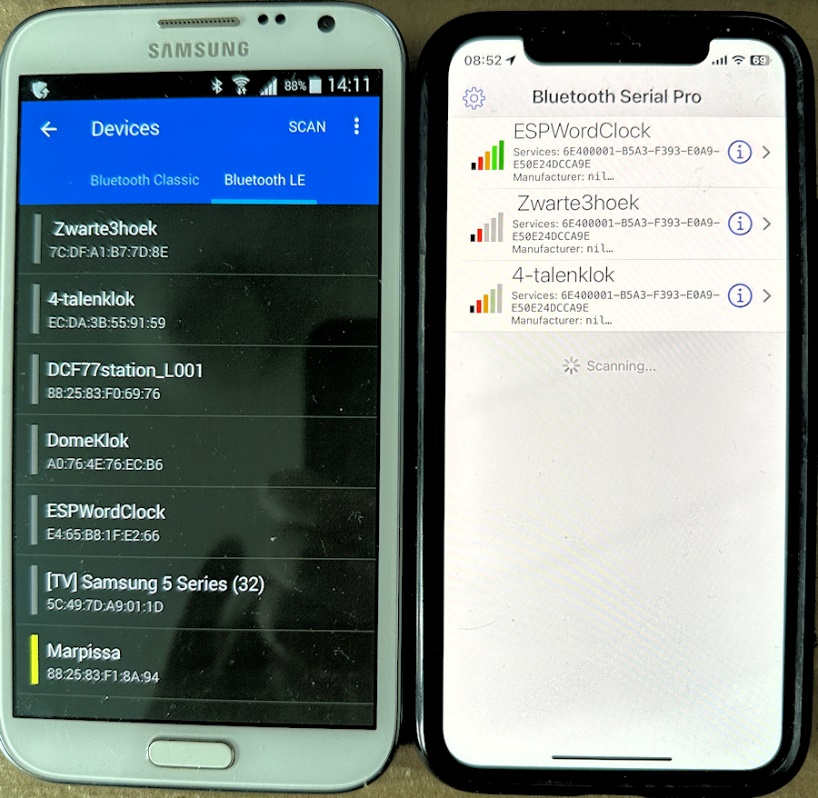

### Als tekst onvolledig of vervormd verschijnt

Bluetooth stuurt standaard pakketten van 20 tekens. Veel apps tonen dan afgekapte regels.

- De iPhone-, iPad- en Mac-apps van de auteur werken met hun standaardinstellingen. Bij andere apps kun je de lettergrootte en de CR/LF-instelling aanpassen.
- Stuur `+` om te wisselen tussen **snelle BLE** (pakketten van 80 tekens of meer, het menu wordt sneller getoond) en **langzame BLE**.
- Is de tekst zo vervormd dat je `+` niet kunt sturen, probeer dan de webpagina van de klok en stuur daar een `+`.
- Als alles mislukt: sluit de klok met een USB-C-kabel aan op een pc, stuur `+` in de seriële monitor van de Arduino IDE, of stuur `R` om terug te gaan naar de standaardinstellingen.

## 6.2 Bediening met de webpagina

Open het IP-adres van de klok (of `http://wordclock.local`) in een browser, zie [hoofdstuk 5](#de-webpagina-van-de-klok-openen).

Tip: Bewaar deze link als favoriet in de browser.

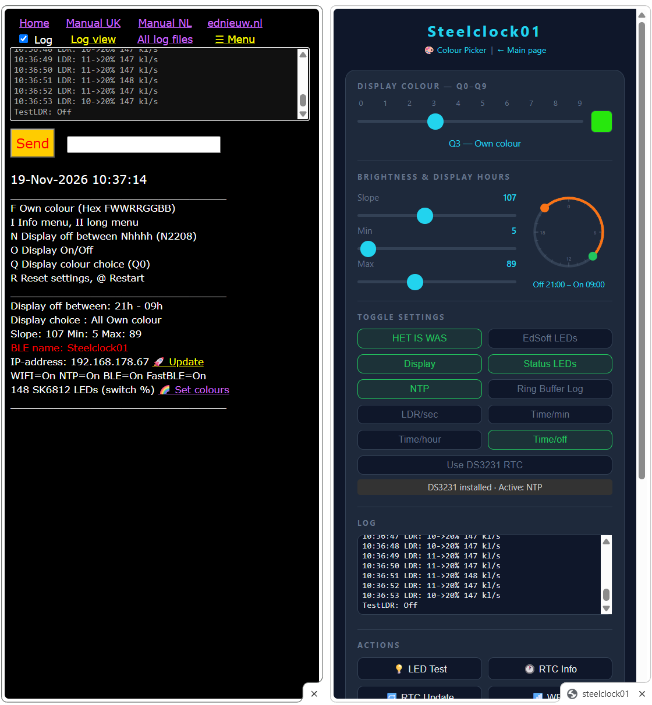

De webpagina heeft een aantal onderdelen:

| Onderdeel | Wat het doet |
|---|---|
| **Invoerveld + Send** | Hier typ je hetzelfde commando als in de Bluetooth-app |
| **Menu** (geel, rechtsboven) | Een bedieningspagina voor met muis of vinger: kleurschema (Q0-Q9) met schuifregelaar, helderheid (Slope, Min, Max), de uren waarin het display uit staat en schakelaars voor onder meer HET IS WAS, EdSoft, display, status-LEDs, NTP, LDR/sec, tijdlog en DS3231. De huidige kleur staat live bij de keuze. |
| **Set colours** (onder in het menu) / `/colourpick` | Kleurkiezer voor de letterkleur. Kies een kleur, druk *Send to clock*. De klok kiest dan automatisch kleurschema Q3 (eigen kleuren). |
| **Log view** | De laatste 500 regels die naar de seriële poort of Bluetooth zijn geprint |
| **All log files** | De laatste vele duizenden regels |
| **Update** | De pagina om nieuwe software te uploaden, zie [hoofdstuk 11](#11-onderhoud-en-problemen-oplossen) |

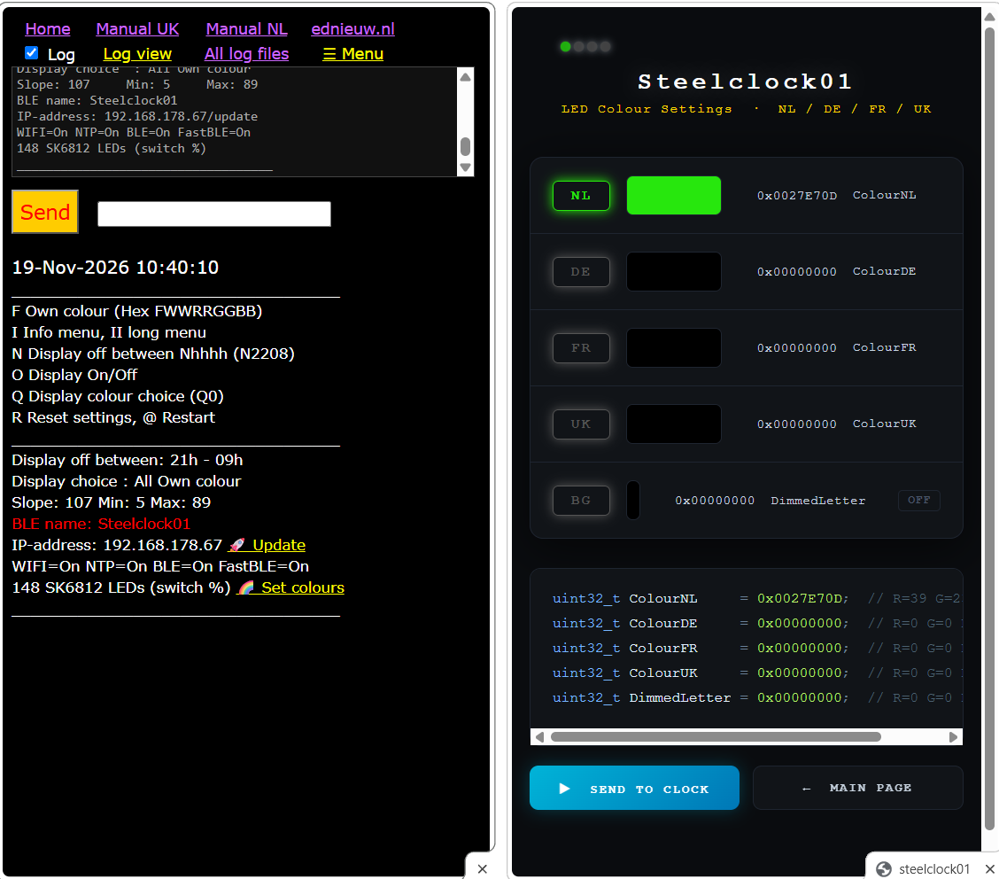

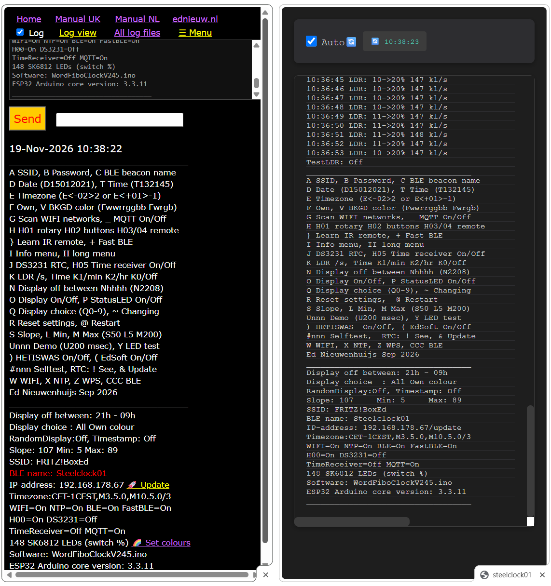

> In veel browsers kan het tabblad worden gesplitst (rechtermuisknop op het tabblad, *Split tab* of iets dergelijks), zodat je de menupagina en de logviewer naast elkaar ziet.

## 6.3 Bediening met een seriële kabel

Sluit de Nano ESP32 met een USB-C-kabel aan op een pc en open de **seriële monitor** van de Arduino IDE (115200 baud).
Bij het opstarten print de klok het opstartlogboek, bijvoorbeeld:

```
Serial started
Rotary NOT used
Found I2C address: 0X57
Found I2C address: 0X68
External RTC module IS found
DS3231 RTC software started
Stored settings loaded
LED strip is SK6812
LED strip started
BLE started
 1: FRITZ!BoxEd -47 * -- Will connect to
[WiFi-event] event: 7  : Obtained IP address: 192.168.178.199
Web page started
WIFI started
```

## 6.4 Bediening met MQTT

Zie [hoofdstuk 9](#9-mqtt-en-home-assistant).

## 6.5 Het menu gebruiken

- Stuur `i` voor het **korte menu** met de alledaagse opties, en `ii` voor het **lange menu** met alle opties.
- Een commando bestaat uit de **eerste letter** van de instelling, eventueel gevolgd door een waarde. Bijvoorbeeld `Q2` (alle woorden wit) of `N2208` (display uit van 22:00 tot 08:00).
- Hoofdletters of kleine letters maken niets uit.
- Sommige commando's schakelen alleen aan en uit, zoals `W` voor WIFI.
- Instellingen worden bewaard in het ESP32-geheugen en blijven na een stroomstoring behouden.
- Met `@` herstart je de klok, met `R` herstel je de standaardinstellingen. De uitleg van elk commando staat in [hoofdstuk 7](#7-menucommandos-a-z).

### Het korte menu (`i`)

```
___________________________________
F Own colour (Hex FWWRRGGBB)
I Info menu, II long menu
N Display off between Nhhhh (N2208)
O Display On/Off
Q Display colour choice (Q0)
R Reset settings, @ Restart
___________________________________
Display off between: 22h - 08h
Display choice  : Default yellow colour
Slope: 69     Min: 11     Max: 37
BLE name: 4-Talenklok
IP-address: 192.168.178.44/update
WIFI=On NTP=On BLE=On FastBLE=Off
625 SK6812 LEDs (switch %)
```

### Het lange menu (`ii`)

```
___________________________________
A SSID, B Password, C BLE beacon name
D Date (D15012021), T Time (T132145)
E Timezone (E<-02>2 or E<+01>-1)
F Own, V BKGD color (Fwwrrggbb Fwrgb)
G Scan WIFI networks, _ MQTT On/Off
H H01 rotary H02 buttons H03/04 remote
} Learn IR remote, + Fast BLE
I Info menu, II long menu
J DS3231 RTC, H05 Time receiver On/Off
K LDR /s, Time K1/min K2/hr K0/Off
N Display off between Nhhhh (N2208)
O Display On/Off, P StatusLED On/Off
Q Display choice (Q0-9), ~ Changing
R Reset settings,  @ Restart
S Slope, L Min, M Max (S50 L5 M200)
Unnn Demo (U200 msec), Y LED test
) HETISWAS  On/Off, ( EdSoft On/Off
#nnn Selftest,  RTC: ! See, & Update
W WIFI, X NTP, Z WPS, CCC BLE
Ed Nieuwenhuijs Sep 2026
___________________________________
Display off between: 22h - 08h
Display choice  : Default yellow colour
RandomDisplay:Off, Timestamp: Off
Slope: 69     Min: 11     Max: 37
SSID: FRITZ!BoxEd
BLE name: 4-Talenklok
IP-address: 192.168.178.44/update
Timezone:CET-1CEST,M3.5.0,M10.5.0/3
WIFI=On NTP=On BLE=On FastBLE=Off
H00=On DS3231=Off
TimeReceiver=Off MQTT=On
625 SK6812 LEDs (switch %)
Software: WordFiboClockV245.ino
ESP32 Arduino core version: 3.3.11
___________________________________
```

Het bovenste deel is de lijst met commando's, het onderste deel toont de **huidige instellingen**:

| Regel | Betekenis |
|---|---|
| `Display off between` | Uren waarin het display uit staat (`N`) |
| `Display choice` | Gekozen kleurschema (`Q`) |
| `RandomDisplay`, `Timestamp` | Wisselen van kleurschema (`~`) en tijdlog per minuut/uur (`K`) |
| `Slope`, `Min`, `Max` | Helderheid (`S`, `L`, `M`) |
| `SSID`, `BLE name`, `IP-address` | Verbindingsgegevens. Achter het IP-adres staat de link om software te updaten (`/update`) |
| `Timezone` | Tijdzone (`E`) |
| `WIFI`, `NTP`, `BLE`, `FastBLE` | Aan/uit-instellingen (`W`, `X`, `CCC`, `+`) |
| `H00=On`, `DS3231` | Gekozen invoerapparaat en gebruik van de DS3231 (`H`, `J`) |
| `TimeReceiver`, `MQTT` | Tijdontvanger (`H05`) en MQTT (`_`) |
| `625 SK6812 LEDs` | Type LED-strip en aantal LEDs (wisselen met `%`) |
| `Software` | Versie van de software |

### Tijdzone

Standaard staat de tijdzone op Amsterdam. Een reset met `R` zet de tijdzone weer op Amsterdam.<br>
Een andere zone stel je in met `E` gevolgd door de tijdzone-string
uit de [tijdzonetabel](#13-bijlagen), bijvoorbeeld `eAEST-10AEDT,M10.1.0,M4.1.0/3` voor Sydney.<br>
De klok past de zomertijd (DST) alleen toe als hij met een NTP-server is verbonden, niet bij gebruik van de DS3231.

## 6.6 De helderheid van het display

De klok meet het omgevingslicht met een LDR (lichtafhankelijke weerstand) en past daar de helderheid van de LEDs op aan. <br>
Drie parameters regelen dat (waarden 0-255):

| Commando | Parameter | Betekenis | Standaard |
|---|---|---|---|
| `Lnnn` | **L**ower, minimum | Hoe helder het display blijft in volledige duisternis | 5 |
| `Mnnn` | **M**aximum | De maximale helderheid | 255 |
| `Snnn` | **S**lope, helling | Hoe snel de maximale helderheid wordt bereikt bij toenemend licht | 80 |

Het display gaat in het donker dus nooit helemaal uit, maar blijft gedimd op de minimale waarde `L`. De opgeslagen waarden staan onderin het menu
(`Slope: 80  Min: 5  Max: 255`). Met `K` toon je de LDR-waarde en de helderheid elke seconde in het log.

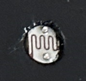

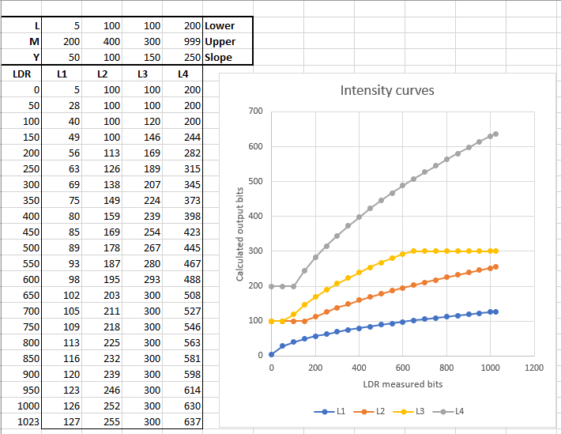

## 6.7 De status-LED's

Op de Nano ESP32 zit een LED die in drie kleuren oplicht:

| Kleur | Betekenis |
|---|---|
| Rood | Het programma draait |
| Groen | WIFI is verbonden |
| Blauw | Er is een Bluetooth-verbinding |
| Geel | Verbonden met een tijdzender (tijdontvanger) |

Met de optie `P` in het menu kunnen de status-LED's aan of uit worden gezet.

---

# 7. Menucommando's A-Z

Dit hoofdstuk is het naslagwerk bij het menu. <br>
Zie [hoofdstuk 6](#65-het-menu-gebruiken) voor de manier waarop commando's worden gestuurd.

- Een commando bestaat uit de **eerste letter** (of het teken), eventueel gevolgd door een waarde, zonder spatie.
- Hoofdletters en kleine letters maken niet uit.
- Commando's langer dan 40 tekens worden genegeerd.
- Na een wijziging die met "herstart" wordt aangeduid, is `@` nodig om de wijziging te activeren.

## 7.1 Overzicht

| Commando | Functie | Voorbeeld |
|---|---|---|
| `A` | SSID van de WIFI-router | `aFRITZ!Box01` |
| `B` | Wachtwoord van de WIFI-router | `bGeHeim1234` |
| `C` / `CCC` | Naam van de klok (BLE) / Bluetooth aan-uit | `cWoordklok`, `CCC` |
| `D` | Datum instellen | `D09062025` |
| `E` | Tijdzone instellen | `eCET-1CEST,M3.5.0,M10.5.0/3` |
| `F` | Eigen kleur / `FF` Fibonacci of Chrono | `F8800FF00`, `F0900` |
| `G` | WIFI-netwerken zoeken | `G` |
| `H` | Invoerapparaat voor de tijd kiezen | `H01` |
| `I` / `II` | Kort menu / lang menu | `i`, `ii` |
| `J` | DS3231 RTC-module aan/uit | `J` |
| `K` | LDR-uitlezing aan/uit; tijdlog `K0`, `K1`, `K2` | `K1` |
| `L` | Minimale helderheid | `L5` |
| `M` | Maximale helderheid | `M200` |
| `N` | Display uit tussen twee uren | `N2208` |
| `O` | Display aan/uit | `O`, `O1`, `O0` |
| `P` | Status-LED's aan/uit | `P` |
| `Q` | Kleurschema kiezen | `Q2` |
| `R` | Instellingen resetten | `R`, `RRR`, `RRRRR` |
| `S` | Helling van de helderheid | `S80` |
| `T` | Tijd instellen | `T143000` |
| `U` | Demo-modus | `U200` |
| `V` | Achtergrondkleur | `V10000000` |
| `W` | WIFI aan/uit | `W` |
| `X` | NTP aan/uit | `X` |
| `Y` | LED-test | `Y` |
| `Z` | WPS starten | `Z` |
| `+` | Snelle BLE aan/uit | `+` |
| `~` | Kleurschema automatisch laten wisselen | `~1`, `~2`, `~0` |
| `!` | NTP-, RTC- en DS3231-tijd tonen | `!` |
| `#` | Zelftest | `#`, `#500` |
| `%` | Wisselen tussen SK6812 en WS2812 | `%` |
| `$` | Haardvuur | `$` |
| `(` | Extra tekst (logo) aan/uit | `(` |
| `)` | HET/IS/WAS aan/uit | `)` |
| `{` | IR-afstandsbediening leren | `{` |
| `}` | Ringbuffer-teller aan/uit | `}` |
| `_` | MQTT aan/uit | `_` |
| `^` | Reset-knop op een GPIO-pin | `^5`, `^0` |
| `=` | Permanente instellingen tonen | `=` |
| `@` | Klok herstarten | `@` |
| `&` | NTP-tijd naar de RTC kopiëren | `&` |
| `uummss` | Tijd instellen (zes cijfers) | `152300` |

## 7.2 Verbinding en netwerk

### A, B, C - SSID, wachtwoord, Bluetooth-naam

- `A` + naam van het WIFI-station: `aFRITZ!Box01`. De naam moet 4 tot 28 tekens lang zijn.
- `B` + wachtwoord: `bGeHeim1234`. Het wachtwoord moet 4 tot 38 tekens lang zijn. Met `B` worden WIFI en NTP automatisch aangezet.
- `C` + naam: de naam waaronder de klok in de Bluetooth-lijst en in de router verschijnt. Standaard na een reset: `wordclock`. De naam moet 4 tot 28 tekens lang zijn.
- Herstart na het invoeren met `@`.

### CCC - Bluetooth aan/uit

`CCC` schakelt Bluetooth (BLE) aan of uit.<br>
Wees voorzichtig en zet bij voorkeur de BLE niet uit: BLE is de primaire draadloze toegang en zonder BLE is de klok alleen nog te bedienen via de webpagina, MQTT of de USB-seriële poort.

### E - Tijdzone

De tijdzone wordt opgegeven als tekenreeks, voorafgegaan door `E`. De standaard is Amsterdam: `CET-1CEST,M3.5.0,M10.5.0/3`. <br>
Voorbeelden en een lijst met zones staan in de [bijlage](#13-bijlagen).

- Sydney: `eAEST-10AEDT,M10.1.0,M4.1.0/3`
- Antarctica/Troll: `E<+00>0<+02>-2,M3.5.0/1,M10.5.0/3`

Kopieer de tekenreeks uit de tabel (zonder de aanhalingstekens) en plak hem achter de `E`.<br>
Na een reset met `R` blijft de tijdzone bewaard; `RRRRR` herstelt naar de tijdzone van Amsterdam.

### G - WIFI-netwerken zoeken

`G` toont de beschikbare WIFI-netwerken in de buurt met de signaalsterkte, en welke de klok gebruikt.

### W en X - WIFI en NTP aan/uit

- `W` zet WIFI aan of uit. Bij uitzetten van WIFI gaat NTP ook uit.
- `X` zet NTP (tijd van internet) aan of uit.
- De stand staat onder in het menu: `WIFI=On NTP=On`. Herstart na wijziging met `@`.
```
___________________________________
Display off between: 21h - 09h
Display choice  : All Own colour
Slope: 50     Min: 5     Max: 10 
BLE name: Steelclock01
IP-address: 192.168.178.67/update
WIFI=On NTP=On BLE=On FastBLE=On
```
### Z - WPS

WPS haalt de WIFI-naam en het wachtwoord rechtstreeks uit de router, als die een WPS-knop heeft.<br>
Start WPS in de klok met `Z` en daarna op de router.<br>
Als het goed gaat, herstart de klok en staat de tijd gelijk.<br>
Soms moet de WPS-knop een paar seconden ingedrukt blijven. Hoe WPS wordt gestart verschilt per router.
```
WiFi access point  stopped
WiFi client started
Starting WPS
WiFi lost connection.
Connected to access point
WPS Successfull, stopping WPS and connecting to: FRITZ!BoxEd: 
Connected to : FRITZ!Box
Obtained IP address: 192.168.178.56
```

### + - Snelle BLE

Het BLE-UART-protocol verstuurt standaard pakketten van 20 bytes, met 50 ms tussen elk pakket.<br>
De iOS-app *BLE Serial Pro* kan pakketten van 80 bytes of meer ontvangen. `+` schakelt tussen lange en korte pakketten.<br>
Met snelle BLE wordt het menu sneller getoond.<br>
Zie ook [hoofdstuk 6](#als-tekst-onvolledig-of-vervormd-verschijnt).

### _ - MQTT aan/uit

`_` schakelt MQTT (Home Assistant) aan of uit. Dit lukt alleen als er een werkende WIFI-verbinding is. Herstart daarna met `@`. Zie [hoofdstuk 9](#9-mqtt-en-home-assistant).

```
MQTT is ON
 *** Restart with @ ***
[MQTT] Connecting...
[MQTT] Connected
[MQTT] Discovery publish OK (320 bytes): homeassistant/sensor/wordclock/cputemp/config
[MQTT] Discovery publish OK (251 bytes): homeassistant/sensor/wordclock/ldr/config
[MQTT] Discovery publish OK (270 bytes): homeassistant/sensor/wordclock/outphotocell/config
[MQTT] Discovery publish OK (345 bytes): homeassistant/sensor/wordclock/rssi/config
...
```

## 7.3 Tijd en datum

### D en T - Datum en tijd instellen

- `D` + `ddmmjjjj`: `D09062025` is 9 juni 2025.
- `T` + `uummss`: `T132145` is 21 minuten en 45 seconden na één uur. `132145` zonder letter geeft hetzelfde resultaat.
- Datum en tijd wijzigen werkt alleen als WIFI en NTP uit staan en een DS3231 is aangesloten.
- Met `T` worden de DS3231 aan, en WIFI en NTP uit gezet, zodra een DS3231 is gevonden.

### J - DS3231 RTC-module

`J` schakelt het gebruik van de optionele DS3231-tijdmodule aan of uit.

- Zonder internet loopt de interne klok van de processor enkele seconden per dag uit de pas. De DS3231 beperkt dat tot een paar seconden per jaar.
- Bij gebruik van de DS3231 knippert de gele LED naast de USB-stekker niet meer.
- De DS3231 wordt alleen aanbevolen als er geen WIFI-ontvangst mogelijk is.
- `J` uitzetten lukt alleen als er geldige WIFI-gegevens zijn ingevoerd.
- Is de tijd niet zichtbaar, stuur dan `!` om de interne kloktijden te zien.

### & - NTP-tijd naar de RTC kopiëren

`&` haalt de tijd bij de NTP-server op en slaat hem op in de interne RTC van de Nano ESP32 en in de DS3231. Dit is handig om de DS3231 meteen goed te zetten.

### ! - Kloktijden tonen

`!` toont de NTP-, RTC- en DS3231-tijd zoals ze in de klok zijn opgeslagen. Er wordt niets bijgewerkt. De DS3231 moet zijn geïnstalleerd voor een zinnige tijd van die module.
```
 Clock time: 19-Nov-2026 12:28:21
   NTP time: 19-Nov-2026 12:28:21
   UTC time: 19-Nov-2026 11:28:21 
DS3231 time: 29-Oct-2026 09:31:24 
```
### uummss - Tijd invoeren met zes cijfers

Zes cijfers die met 0, 1 of 2 beginnen worden als tijd opgevat, bijvoorbeeld `152300`. Hetzelfde als `T152300`.

### H - Invoerapparaat voor de tijd

`H` + twee cijfers kiest het invoerapparaat. De volledige tabel staat in [hoofdstuk 5.1](#51-welke-invoer-heeft-de-klok). <br>
Samenvatting: <br>
 `H00` geen, <br>
 `H01` rotary, <br>
 `H02` Membraan drukknoppen, <br>
 `H03` grote 4x4 membraan drukknoppen IR, <br>
 `H04` kleine IR, <br>
 `H05` tijdontvanger,  <br>
 `H06` tijdzender (BLE), <br>
 `H07` HC-12 tijdzender. <br>
 Herstart daarna met `@`.

### H05 - Tijdontvanger

Met `H05` ontvangt de klok de tijd van een tijdzender. De klok wordt dan binnen twee minuten op tijd gezet. Beschikbaar als tijdzender zijn:

- de iOS-app *BLE UART time* uit de Apple app store;
- de Arduino ESP32-sketch *ESP32 Arduino communications* van [github.com/ednieuw/ESP32Communications](https://github.com/ednieuw/ESP32Communications);
- [een tijdzender-webpagina (Windows en Android).](https://ednieuw.com/Woordklok/TimeSender/TimeSender.html)

[Alle tijdzenders op één pagina](https://github.com/ednieuw/HTML-TimeSender)

### H06 - Tijdzender

Met `H06` stuurt de klok zelf de tijd uit naar andere klokken via een BLE-server met de naam `BLE-UARTtime`.<br>
Een klok die tijdzender is, gebruikt zelf NTP (`H00`) en is dus geen tijdontvanger.<br>
Herstart daarna met `@`. Zie [hoofdstuk 8](#8-tijdontvanger-en-tijdzender).

### H07 - HC-12 tijdzender

Met `H07` (sinds V247) wordt de tijd uitgezonden via een HC-12 433 MHz-module op pin D4, voor een bereik tot ongeveer 1000 meter. `H07` zet de tijdontvanger uit en ook de IR-afstandsbediening (`H03`/`H04`), omdat D4 gedeeld wordt. Omgekeerd zet het kiezen van `H03` of `H04` de HC-12 uit. `H06` en `H07` kunnen tegelijk aan staan.<br>
De tijd wordt elke minuut (`K1`) of elk uur (`K2`) verzonden. `K0` stopt het zenden. Herstart na een wijziging met `@`. Zie [hoofdstuk 8](#84-hc-12-tijdzender-433-mhz).

### { - IR-afstandsbediening leren

Zie [hoofdstuk 5](#met-een-ir-afstandsbediening). <br>
De klok leert de toetsen `0`-`9`, `UP`, `DOWN`, `LEFT`, `RIGHT`, `POWER`, `OK` en `ONOFF`.  <br>
Niet alle afstandsbedieningen zijn bruikbaar. <br>
 `{` werkt alleen als IR aan staat met `H03` of `H04`.

## 7.4 Kleuren en weergave

### Q - Kleurschema

`Q` zonder cijfer toont de lijst met schema's. `Q0` t/m `Q9` kiest een schema:

| Q | Weergave (woordklok) |
|---|---|
| `Q0` | Standaard geel. HET (of IT) verkleurt binnen een uur van groen via geel naar rood. IS of WAS verkleurt binnen een minuut van groen naar rood |
| `Q1` | Elk uur een andere kleur |
| `Q2` | Alle woorden wit |
| `Q3` | Alle woorden in de eigen kleur (zie `F`) |
| `Q4` | Eigen kleur; HET IS/WAS verkleurt van groen naar rood |
| `Q5` | Regenboog (wheel): doorloopt in een uur alle kleuren |
| `Q6` | Digitale weergave (alleen voor klokken met 12 x 12 LEDs) |
| `Q7` | Elk uur een andere kleur; HET IS/WAS verkleurt van groen naar rood |
| `Q8` | Regenboog in 4 minuten |
| `Q9` | Regenboog in 15 seconden |

Bij een Fibonacci-klok hebben `Q0` t/m `Q9` andere betekenissen, zie [hoofdstuk 10](#10-fibonacci-klok-en-noclock).

### ~ - Kleurschema automatisch laten wisselen

- `~1` of `~` wisselt het kleurschema elke minuut.
- `~2` wisselt het kleurschema elk uur.
- `~0` (of nogmaals `~`) schakelt wisselen uit.
- In het lange menu staat `RandomDisplay: On/min`, `On/hour` of `Off`.
- Een keuze met `Q` zet het wisselen uit.

### F - Eigen kleur

De kleur van de woorden voor `Q3` en `Q4`. Twee invoervormen:

- **Decimaal** `Fwrgb`: vier cijfers 0-9 voor wit, rood, groen en blauw. `0` is uit en `9` is 100% aan. `F0900` is rood, `F0009` is blauw, `F0920` is oranjerood.
- **Hexadecimaal** `Fwwrrggbb`: acht hexadecimale tekens (`0-9`, `A-F`), twee per kleur voor wit, rood, groen en blauw. Dat geeft 256 stappen in plaats van 10.

| Kleur | Hexadecimaal (`Fwwrrggbb`) | Cijfers 0-9 (`Fwrgb`) |
|---|---|---|
| Intens rood | `F00FF0000` | `F0900` |
| Intens groen | `F0000FF00` | `F0090` |
| Intens blauw | `F000000FF` | `F0009` |
| Oranjerood | `F00FF3900` | `F0920` |
| 50% wit, 100% groen | `F8800FF00` | `F5090` |

Als richtlijn: `00` is LED uit, `44` is 25%, `88` is 50%, `BB` is 75% en `FF` is 100%.<br>
Met cijfers is grofweg `0` LED uit, `3` is 25%, `5` is 50%, `7` is 75% en `9` is 100%

WS2812-strips hebben geen witte LED, daar heeft het wit-deel geen effect. SK6812-LEDs hebben naast de drie RGB-LEDs een extra witte LED (het gele vlakje). Het type LEDs staat onder in het lange menu, bijvoorbeeld `148 SK6812 LEDs (switch %)`.

Zonder geldige waarde toont `F` de opgeslagen kleur en de invoerformaten. Een kleurkiezer is te vinden op de webpagina (*Set colours*, [hoofdstuk 6](#62-bediening-met-de-webpagina)); op een pc kan `0xff00ff` in de adresbalk van een browser een kleurkiezer tonen.

Maar eenvoudiger natuurlijk met de colourpicker-pagina met 'Set colours' uit het WIFI klokmenu.

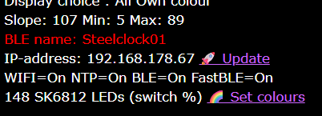

### FF - Fibonacci of Chrono

Bij een Fibonacci-klok schakelt `FF` tussen de Fibonacci-weergave en de Chrono-weergave (met seconden).

### V - Achtergrondkleur

`V` geeft een zwakke achtergrondkleur aan de LEDs die niet branden, zodat alle letters van het klokbord zichtbaar zijn. De invoer is gelijk aan `F`: `Vwwrrggbb` (hexadecimaal) of `Vwrgb` (cijfers 0-9). `V` alleen wist de achtergrondkleur.

### N en O - Display uit en aan

- `Nhhhh` zet het display uit tussen twee uren: `N2208` is uit van 22:00 tot 08:00. `N` alleen schakelt deze functie uit.
- `O` schakelt het display uit en aan. `O1` zet het display aan en `O0` zet het uit. Die laatste vorm gebruikt de MQTT-schakelaar in Home Assistant.

### ) - HET IS WAS aan/uit

`)` schakelt de woorden HET, IS en WAS aan of uit. Bij uit blijven ze altijd uit.

### ( - Extra tekst (logo)

De klok kan optioneel zijn uitgerust met extra LEDs voor een logotekst, bijvoorbeeld de naam van de winkel waarin de klok hangt. `(` zet die tekst aan of uit.

### % - SK6812 of WS2812

`%` wisselt het type LED-strip: SK6812 (met witte LED) of WS2812 (zonder). De klok is met één van beide uitgerust. Herstart daarna met `@`. Een reset met `R` verandert deze keuze niet.

### $ - Haardvuur

`$` toont een haardvuur. Het resultaat is het mooist op een klok met 144 LEDs en minder mooi op andere typen.

## 7.5 Helderheid

Zie [hoofdstuk 6.6](#66-de-helderheid-van-het-display) voor de uitleg.

| Commando | Bereik | Betekenis |
|---|---|---|
| `Snnn` | 1-255 | Helling: hoe snel de maximale helderheid wordt bereikt |
| `Lnnn` | 0-250 | Minimale helderheid in volledige duisternis |
| `Mnnn` | 1-255 | Maximale helderheid |

Voorbeeld: `S50 L5 M200` (elk commando afzonderlijk sturen).

## 7.6 Informatie en logboek

### I - Menu

`i` toont het korte menu en `ii` het lange menu met alle opties.

### K - LDR-meting en tijdlog

- `K` zet het printen van de LDR-uitlezing aan of uit. Elke seconde worden de LDR-waarde, het percentage uitgang en het aantal keren dat het programma per seconde doorlopen wordt (loops per second, `l/s`) getoond:

  ```
  TestLDR: On
  LDR reading, %Out, loops per second and time
  LDR:  1= 1% 205413 l/s 16:06:08
  ```

- `K0` schakelt het printen van de tijd uit, `K1` print de tijd elke minuut (standaard) en `K2` elk uur. In het lange menu staat dan `Timestamp: Off`, `/min` of `/hour`.
- Bij een klok met HC-12 tijdzender (`H07`) bepaalt dezelfde instelling hoe vaak de tijd via HC-12 wordt verzonden.

### } - Ringbuffer-teller

`}` zet het printen van de positie in de ringbuffer (logbuffer) achter elke logregel aan of uit.<br>
Achter `@` staat de huidige schrijfpositie in bytes en achter `->` het aantal bytes dat nog vrij is tot het einde van de buffer. Is het einde bereikt, dan begint de buffer weer vooraan en worden de oudste regels overschreven.

```
Ring buffer counter is ON
TestLDR: On
   Bits, Out, loops per second and time
15:01:17 LDR:  4-> 4% 198 kl/s @5588 ->3251936 
15:01:18 LDR:  4-> 4% 197 kl/s @5636 ->3251888 
15:01:19 LDR:  4-> 4% 199 kl/s @5684 ->3251840 
15:01:20 LDR:  4-> 4% 199 kl/s @5732 ->3251792 
15:01:21 LDR:  4-> 4% 199 kl/s @5780 ->3251744 
```

### = - Permanente instellingen

`=` toont alle opgeslagen instellingen. Elke regel begint met het menucommando waarmee de waarde te wijzigen is:

```
Display choice  : Default yellow colour
Q  DisplayChoice: 0
TurnOffLEDsAtHH: 22
N TurnOnLEDsAtHH: 8
F    Font colour: 0X00FFFFFF
DimmedLetter: 0X10000000
BackGround: 0X00000000
LanguageChoice: 0
S   LightReducer: 69
L  MinBrightness: 11
M  MaxBrightness: 37
CCC        BLEOn: ON
X          NTPOn: ON
W         WIFIOn: ON
...
```

## 7.7 Onderhoud en tests

### R - Instellingen resetten

| Commando | Wat wordt gewist |
|---|---|
| `R` | Alle voorkeuren naar de standaardwaarden. SSID, wachtwoord, BLE-naam en tijdzone blijven bewaard |
| `RRR` | Alleen SSID, wachtwoord, BLE-naam en tijdzone. WIFI, NTP en BLE worden aangezet |
| `RRRRR` | `R` en `RRR` samen: een totale reset |

Het type LED-strip en de keuze van invoerapparaat (`H`) blijven bij een reset ongewijzigd. Voer `RRRRR` uit wanneer de sketch voor de eerste keer naar de Nano ESP32 is geüpload.

### @ - Herstart

`@` herstart de klok. Instellingen blijven behouden. Dit is nodig na het wijzigen van SSID, wachtwoord, BLE-naam en dergelijke.

### ^ - Reset-knop

`^nn` gebruikt een externe drukknop op GPIO-pin `nn` (bijvoorbeeld `^5` of `^22`) als resetknop.<br>
Het getal mag met of zonder voorloopnul worden ingevoerd (`^5` en `^05` zijn gelijk) en ligt tussen 1 en 99.<br>
 `^0` schakelt deze functie uit.<br>
 Herstart daarna met `@`. <br>
 De knop trekt de pin naar GND: de klok reset naar fabrieksinstellingen als de knop 2 seconden ingedrukt blijft.

### Y - LED-test

`Y` laat alle LEDs een regenboog doorlopen met 5% van de maximale intensiteit. `Y` nogmaals stopt de test.

### # - Zelftest

`#` start de zelftest: alle woorden worden na elkaar getoond om te controleren of alle woorden werken. `#nnnn` stelt de vertraging tussen de woorden in milliseconden in. De test stopt vanzelf na één cyclus.

### U - Demo-modus

`Unnn` laat de klok sneller lopen: `U200` is 200 ms per minuut, ongeveer vijf keer sneller dan normaal. `U` alleen schakelt de demo-modus uit.

### P - Status-LED's

`P` zet de status-LED's op de Arduino Nano aan of uit, zie [hoofdstuk 6.7](#67-de-status-leds).


---

# 8. Tijdontvanger en tijdzender

Een klok zonder WIFI en zonder DS3231 kan de tijd van een andere bron krijgen via Bluetooth Low Energy (BLE). De bron heet **tijdzender**, de klok die de tijd ontvangt is de **tijdontvanger**. Een klok kan ook zelf tijdzender zijn voor andere klokken.

| Rol | Commando | Wat gebeurt er |
|---|---|---|
| Tijdontvanger | `H05` | De klok zoekt een tijdzender via BLE en neemt de tijd en datum over |
| Tijdzender (BLE) | `H06` | De klok stuurt zijn eigen tijd en datum naar een tijdontvanger |
| Tijdzender (HC-12) | `H07` | De klok stuurt de tijd via een HC-12 433 MHz-module |

Herstart de klok na elke wijziging met `@`. `H05` en `H06` sluiten elkaar uit: `H06` zet de tijdontvanger uit en zet het invoerapparaat op `H00` (tijd via NTP). `H07` zet de tijdontvanger en een IR-afstandsbediening uit.

## 8.1 Tijdontvanger (H05)

### Instellen

1. Zorg dat Bluetooth aan staat (`CCC` schakelt het aan of uit).
2. Stuur `H05` en herstart met `@`. In het lange menu staat dan `TimeReceiver=On`.
3. Start een tijdzender (zie [8.2](#82-tijdzenders)). Zodra de klok de zender vindt, verbindt hij zich en staat de tijd binnen twee minuten goed.
4. `H05` nogmaals uitgevoerd zet de tijdontvanger weer uit.

### Hoe werkt het?

- De klok scant naar een BLE-apparaat met de naam **`BLE-UARTtime`** en het nRF52-UART-protocol. Zenders met een zwakker signaal dan -90 dBm worden genegeerd: de zender moet dus in de buurt zijn.
- Na het verbinden stuurt de tijdzender elke 10 seconden de tijd (`Thhmmss`) en één seconde later de datum (`Dddmmjjjj`).
- De klok behandelt deze berichten als gewone menucommando's: `T143000` en `D09062025` hebben hetzelfde effect als wanneer ze met de Bluetooth-app zijn ingetypt (zie [commando D en T](#d-en-t---datum-en-tijd-instellen)). Is een DS3231 aanwezig, dan wordt de tijd daarin opgeslagen en worden WIFI en NTP uitgezet.
- Valt de verbinding weg, dan zoekt de klok automatisch opnieuw naar de zender.
- De klok stuurt zijn eigen logregels terug naar de tijdzender. Daarmee zijn de meldingen van de klok ook in de zender-app te volgen.
- Tijdens een verbinding met de tijdzender brandt de status-LED geel (zie [6.7](#67-de-status-leds)).

## 8.2 Tijdzenders

De volgende tijdzenders zijn beschikbaar:

| Tijdzender | Platform | Toelichting |
|---|---|---|
| **[BLE UART time](https://apps.apple.com/nl/app/bluetooth-uart-time/id6760344877)** (iOS-app) | iPhone, iPad | Te vinden in de Apple App Store. Start de app en houd hem geopend tot de klok verbonden is |
| **TimeSender-webpagina** | Windows, Android (Chrome) | [Tijdzender-webpagina](https://ednieuw.com/Woordklok/TimeSender/TimeSender.html), uitleg: [github.com/ednieuw/HTML-TimeSender](https://github.com/ednieuw/HTML-TimeSender) |
| **ESP32 Arduino communications** | Een tweede ESP32 | Sketch op [github.com/ednieuw/ESP32Communications](https://github.com/ednieuw/ESP32Communications) |
| **Een andere klok met `H06`** | WordFiboClock | Zie [8.3](#83-de-klok-als-tijdzender-h06) |

Wat al deze zenders gemeen hebben: ze adverteren een BLE-service met de naam `BLE-UARTtime` en sturen `Thhmmss` en `Dddmmjjjj` naar de klok. Een eigen zender (bijvoorbeeld op een ander microcontroller-bord) hoeft alleen die twee berichten te sturen.

## 8.3 De klok als tijdzender (H06)

Een klok met WIFI en NTP kan de juiste tijd doorgeven aan klokken zonder WIFI.

1. Stuur `H06` en herstart met `@`. In het lange menu staat `TimeSender: ON`.
2. De klok start een BLE-server met de naam `BLE-UARTtime`. Er wordt automatisch `H00` gekozen: de tijd komt via NTP.
3. Zodra een tijdontvanger verbindt en notificaties heeft ingeschakeld, stuurt de klok elke 10 seconden de tijd en één seconde later de datum. In het logboek staat dan `Sending TIME: T143000` en `Sending DATE: D09062025`.
4. `H06` nogmaals uitgevoerd zet de tijdzender uit.

Stuur `H05` niet naar dezelfde klok: een klok is tijdzender of tijdontvanger, niet beide.

## 8.4 HC-12 tijdzender (433 MHz)

Instellen: stuur `H07` en herstart met `@`. Met het commando `=` staat dan `HC12Time: ON`. `H07` nogmaals uitgevoerd zet de HC-12 weer uit. Deze functie is beschikbaar sinds **V247**.

Voor een bereik tot ongeveer 1000 meter kan een **HC-12 433 MHz-module** de tijd doorsturen naar een andere processor met een HC-12-ontvanger. De ontvangstkant staat in het project [github.com/ednieuw/ESP32-HC12](https://github.com/ednieuw/ESP32-HC12).

- De klok zendt alleen (half-duplex). Aansluiting: HC-12 **RXD** aan klokpin **D4** (`HC12_TX`), voeding 3,3 V of 5 V volgens de specificatie van de gebruikte module, en GND. D6 (`HC12_RX`) wordt niet gebruikt.
- D4 wordt ook voor de IR-ontvanger gebruikt: een IR-afstandsbediening en de HC-12 kunnen dus niet tegelijk worden aangesloten.
- De seriële snelheid is 9600 baud, 8N1.
- Per verzending wordt `Thhmmss` plus een regeleinde gestuurd, bijvoorbeeld `T143000`. In het logboek staat `HC-12 time sent`.
- `K1` stuurt de tijd elke minuut, `K2` elk uur en `K0` stopt het zenden.
- `H06` (BLE) en `H07` (HC-12) kunnen tegelijk aan staan.

## 8.5 Problemen oplossen

| Verschijnsel | Mogelijke oorzaak en oplossing |
|---|---|
| Klok vindt de zender niet | Zender te ver weg (zwakker dan -90 dBm) of Bluetooth van de klok staat uit (`CCC`). De naam van de zender moet `BLE-UARTtime` zijn |
| Verbinding valt steeds weg | De klok zoekt zelf opnieuw. Controleer of de zender-app geopend blijft en niet in de slaapstand gaat |
| De tijd verspringt na het ontvangen | Er staat nog een andere tijdbron aan. Kies met `H` het juiste invoerapparaat en zet WIFI/NTP uit als de tijd via de tijdzender moet komen |
| Geen tijd van de HC-12 | HC-12 aan D4 aangesloten? IR niet tegelijk gebruikt? Gelijke instellingen (9600 baud, zelfde kanaal) in zender en ontvanger? |


---

# 9. MQTT en Home Assistant

De klok kan zich via **MQTT** automatisch aanmelden in [Home Assistant](https://www.home-assistant.io/). Er hoeft in Home Assistant niets handmatig te worden ingesteld: de klok meldt zelf al zijn knoppen, schuifregelaars en sensoren aan (*MQTT Discovery*). Het apparaat verschijnt in Home Assistant onder de naam **WordClock**.

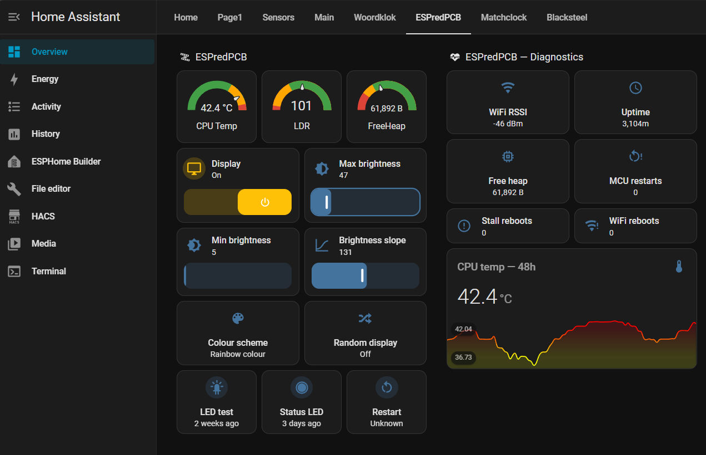

## 9.1 Wat verschijnt er in Home Assistant?

**Bediening**

| Onderdeel | Type | Menucommando | Toelichting |
|---|---|---|---|
| Display | Schakelaar | `O1` / `O0` | De schakelaar toont de werkelijke stand, ook als het display met het menu of de afstandsbediening is uitgezet |
| Max Brightness | Schuifregelaar 1-255 | `M` | Maximale helderheid |
| Min Brightness | Schuifregelaar 0-250 | `L` | Minimale helderheid |
| Brightness Slope | Schuifregelaar 1-255 | `S` | Helling van de helderheid |
| Display Colour Scheme | Keuzelijst | `Q0` - `Q9` | De namen volgen de klokvariant (woordklok of Fibonacci) |
| Random Display | Keuzelijst | `~0`, `~1`, `~2` | Uit, per minuut of per uur wisselen |
| LED Test | Knop | `Y` | Laat alle LEDs een regenboog doorlopen |
| StatusLED On/Off | Knop | `P` | Status-LED's aan of uit |
| Restart | Knop | `@` | Klok herstarten |

**Sensoren**

| Sensor | Eenheid | Toelichting |
|---|---|---|
| CPU Temperature | °C | Interne temperatuursensor van de ESP32 |
| LDR Reading | | Ruwe waarde van de lichtsensor |
| OutPhotocell | 0-255 | Helderheid die naar de LEDs wordt gestuurd, afgeleid van de LDR |
| DS3231 Temperature | °C | Alleen als een DS3231-module is aangesloten |

**Diagnose** (in een apart vak op de apparaatpagina)

| Onderdeel | Eenheid | Toelichting |
|---|---|---|
| WiFi Signal | dBm | De grafiek laat zien of storingen bij de router of bij de klok liggen |
| Uptime | minuten | Tijd sinds de laatste herstart |
| Free Heap | bytes | Vrij werkgeheugen. Een dalende lijn wijst op een geheugenlek |
| MCU Restarts | aantal | Herstarts tijdens het opstarten (`Mem.MCUrestarted`) |
| WiFi Reboots | aantal | Herstarts na een lange periode zonder IP-adres |
| Loop-stall Reboots | aantal | Herstarts doordat het hoofdprogramma bleef hangen |

Zodra de klok offline gaat, staat het hele apparaat in Home Assistant op *niet beschikbaar* in plaats van een oude waarde te tonen.

## 9.2 Wat is nodig?

- Een klok met WIFI-verbinding (zie [hoofdstuk 5](#52-verbinden-met-wifi)).
- Home Assistant met de **Mosquitto broker** (MQTT-server) in hetzelfde netwerk.
- Een klok met software vanaf V236. De opties `_` (MQTT aan/uit) en de schuifregelaars voor minimale en maximale helderheid zijn er sinds V238 en V242.

## 9.3 Instellen in Home Assistant

1. **Mosquitto broker installeren.** Ga naar *Instellingen → Add-ons → Add-on Store → Mosquitto broker → Installeren* en kies *Starten*. Zet *Start bij opstarten* aan.
2. **MQTT-integratie toevoegen.** Gebeurt dat niet automatisch, ga dan naar *Instellingen → Apparaten en diensten → Integratie toevoegen → MQTT*.
3. **Gebruiker voor de klok aanmaken.** Ga naar *Instellingen → Personen → Gebruikers → Gebruiker toevoegen*:
   - Gebruikersnaam: `mqtt_user`
   - Wachtwoord: **het WIFI-wachtwoord van de router** (hetzelfde als in de klok met `B` is ingevoerd)
   - Vink *Mag alleen inloggen vanaf het lokale netwerk* aan.

## 9.4 Instellen in de klok

1. Stuur `_` om MQTT aan te zetten. Dit lukt alleen als de klok met WIFI is verbonden; anders volgt de melding *No WIFI connection. MQTT remains OFF*.
2. Herstart met `@`.
3. In het logboek (of de seriële monitor) verschijnt:

   ```
   [MQTT] Connecting...
   [MQTT] Connected
   ```

4. In Home Assistant verschijnt de klok onder *Instellingen → Apparaten en diensten → MQTT* als apparaat **WordClock**.

Met `_` nogmaals wordt MQTT weer uitgezet. De stand staat in het lange menu als `MQTT=On` of `MQTT=Off`.

> Meerdere klokken in één Home Assistant kunnen allemaal MQTT gebruiken, als elke klok een **eigen Bluetooth-naam** heeft (commando `c`, zie [hoofdstuk 5](#via-bluetooth-of-een-seriële-kabel)). Die naam, in kleine letters en met `_` in plaats van spaties, vormt de apparaat-id en de naam van het gedeelte in de MQTT-berichten.

## 9.5 Een andere broker, gebruikersnaam of wachtwoord

De MQTT-instellingen staan niet in het menu maar bovenin de sketch:

```cpp
const char*    MQTT_SERVER   = "homeassistant.local";   // of het IP-adres van de broker, bijvoorbeeld "192.168.1.10"
const uint16_t MQTT_PORT     = 1883;
const char*    MQTT_USER     = "mqtt_user";             // MQTT-gebruikersnaam
const char*    MQTT_PASSWORD = Mem.Password;            // gebruikt het WIFI-wachtwoord
```

Pas deze regels aan als de broker een ander adres, een andere gebruikersnaam of een ander wachtwoord heeft, en compileer en upload de sketch opnieuw. Voor een eigen wachtwoord:

```cpp
const char* MQTT_PASSWORD = "MijnGeheim123";
```

> **Let op:** zolang `MQTT_PASSWORD = Mem.Password` staat, verandert het MQTT-wachtwoord mee als het WIFI-wachtwoord in de klok met `B` wordt gewijzigd. Het wachtwoord van `mqtt_user` in Home Assistant moet dan ook worden aangepast, of er moet een vast wachtwoord in de sketch worden gezet.

## 9.6 Hoe werkt het?

### Verbinding

- De klok maakt verbinding met `homeassistant.local` op poort 1883. Als dat mislukt, volgt elke 5 seconden een nieuwe poging; het hoofdprogramma blijft ondertussen gewoon draaien.
- Als clientnaam gebruikt de klok zijn Bluetooth-naam.
- Na het verbinden zendt de klok één keer alle aanmeldberichten (*discovery*) en meteen alle waarden, zodat er niets op *onbekend* staat. Daarna worden de waarden **elke minuut** vernieuwd en direct na elk commando uit Home Assistant.

### MQTT Discovery

Voor elk onderdeel stuurt de klok één JSON-bericht naar een speciaal onderwerp (*topic*):

```
homeassistant/<type>/<apparaat-id>/<naam>/config
```

Hierin is `<type>` een van `sensor`, `button`, `switch`, `number` of `select`, en `<apparaat-id>` de Bluetooth-naam in kleine letters, bijvoorbeeld `wordclock`. Home Assistant leest het bericht en maakt het onderdeel aan. In het bericht staan nooit meetwaarden; alleen **waar** de waarden komen en **hoe** commando's worden gestuurd.

Alle onderdelen delen dezelfde vaste onderwerpen:

| Onderwerp | Richting | Inhoud |
|---|---|---|
| `wordclock/status` | klok → HA | `online` bij verbinden. De broker zet `offline` als de klok wegvalt (*Last Will*) |
| `wordclock/cmnd` | HA → klok | Het menucommando, bijvoorbeeld `@`, `O1`, `M200`, `Q3`, `~1` |
| `wordclock/display`, `.../maxbrightness`, `.../displaychoice` enzovoort | klok → HA | De werkelijke stand van het onderdeel |

De commando's komen terecht in dezelfde commandoverwerking als de seriële monitor, Bluetooth en de webpagina (maximaal 40 tekens per commando).

### De vijf soorten onderdelen

**Sensor** (bijvoorbeeld WIFI-signaal)

```json
{
  "name": "WiFi Signal",
  "state_topic": "wordclock/rssi",
  "unit_of_measurement": "dBm",
  "device_class": "signal_strength",
  "entity_category": "diagnostic",
  "availability_topic": "wordclock/status",
  "state_class": "measurement",
  "unique_id": "wordclock_rssi",
  "device": { "identifiers": ["wordclock"], "name": "WordClock",
              "manufacturer": "EdNieuw", "model": "WordClock" }
}
```

- `state_topic`: hier leest Home Assistant de waarde (bijvoorbeeld `-67`).
- `device_class` en `unit_of_measurement`: bepalen pictogram en opmaak.
- `state_class: measurement`: bewaart minimum, gemiddelde en maximum in de statistieken van Home Assistant.
- `entity_category: diagnostic`: zet het onderdeel in het diagnosevak.
- `availability_topic`: zorgt voor *niet beschikbaar* als de klok offline is.
- `unique_id`: de sleutel van Home Assistant. Zolang die gelijk blijft, wordt een opnieuw verzonden bericht gebruikt om hetzelfde onderdeel bij te werken in plaats van een dubbel onderdeel aan te maken. Een onderdeel wordt verwijderd door een **leeg** bericht met *retain* naar het configuratie-onderwerp te sturen.
- `device`: alle onderdelen met dezelfde `identifiers` horen bij één apparaat.

**Knop** (bijvoorbeeld Restart): bevat `command_topic` en `payload_press`. Een druk stuurt `@` naar `wordclock/cmnd`. Er is geen terugmelding.

**Schakelaar** (Display): een knop met geheugen.

```json
"command_topic": "wordclock/cmnd",
"payload_on":  "O1",
"payload_off": "O0",
"state_topic": "wordclock/display",
"state_on":  "ON",
"state_off": "OFF"
```

Home Assistant stuurt `O1` of `O0`; de klok meldt de werkelijke stand terug met `ON` of `OFF`.

**Schuifregelaar** (Max Brightness):

```json
"command_topic": "wordclock/cmnd",
"command_template": "M{{ value }}",
"state_topic": "wordclock/maxbrightness",
"min": 1, "max": 255, "step": 1
```

`{{ value }}` wordt door Home Assistant ingevuld: schuiven naar 200 stuurt `M200`, een gewoon menucommando.

**Keuzelijst** (Display Colour Scheme, Random Display): Home Assistant stuurt de gekozen optie als **tekst**, bijvoorbeeld `Rainbow colour`. De klok vertaalt die tekst naar het commando (`Q8`, `~1` enzovoort). De klok meldt de gekozen optie terug als tekst, dus niet als cijfer.

### Bewaren van de berichten

Alle configuratieberichten gaan met *retain* naar de broker. Home Assistant kent daardoor na een herstart direct alle onderdelen, zonder dat de klok iets hoeft te doen.

## 9.7 Handmatig testen

Met een MQTT-programma (bijvoorbeeld *MQTT Explorer*, of in Home Assistant onder *Instellingen → Apparaten en diensten → MQTT → Configureren*) kan een commando rechtstreeks naar de klok worden gestuurd:

| Onderwerp | Bericht | Gevolg |
|---|---|---|
| `wordclock/cmnd` | `Y` | LED-test |
| `wordclock/cmnd` | `Q2` | Alle woorden wit |
| `wordclock/cmnd` | `O0` | Display uit |

Het onderwerp begint met de Bluetooth-naam van de klok in kleine letters, met `_` in plaats van spaties.

## 9.8 Een dashboard in Home Assistant

In de map met de sketch staat het script `make-clock-view.sh`. Dat maakt een kant-en-klare klokpagina voor het Home Assistant-dashboard uit het bestand `HA-clock-view-template.yaml`:

```bash
./make-clock-view.sh <apparaat-id> [Weergavenaam]
./make-clock-view.sh espredpcb "ESPredPCB"
```

De apparaat-id is de Bluetooth-naam in kleine letters met `_` in plaats van spaties. De uitvoer wordt in de *ruwe configuratie-editor* van het dashboard geplakt, onder `views:` en op dezelfde inspringing als de andere pagina's.

De pagina bevat zes kaarten: bediening (display, kleurschema, helderheid), acties (LED-test, status-LED, herstart), meters voor CPU-temperatuur en LED-helderheid, een grafiek van licht en temperatuur, de diagnose (WIFI-signaal, uptime, geheugen en herstarttellers) en een grafiek van WIFI-signaal en geheugen.

> De entity-id's in het template zijn afgeleid van de namen waarmee de klok zich aanmeldt, bijvoorbeeld `number.wordclock_max_brightness`. Controleer ze eenmalig in Home Assistant onder *Instellingen → Apparaten en diensten → Entiteiten* en pas het template aan als ze afwijken.

### Een eigen dashboard laten maken met een AI

Het meegeleverde template is een voorbeeld. Een AI-assistent (zoals Claude of ChatGPT) kan er in een paar seconden een pagina van maken die precies bij de eigen wensen past, bijvoorbeeld met andere kaarten, een andere taal of alleen de onderdelen die worden gebruikt. Een AI met toegang tot de bestanden kan daarvoor het script `make-clock-view.sh` en het template gebruiken, of zelf een nieuwe YAML schrijven. Zonder toegang tot de bestanden moeten de inhoud van het template en de lijst met onderdelen (zie [9.1](#91-wat-verschijnt-er-in-home-assistant)) in de vraag worden geplakt.

De vraag aan de AI moet bevatten:

1. wat het is: een Home Assistant-dashboardpagina (*view*) voor een woordklok die via MQTT Discovery is aangemeld;
2. de **apparaat-id** en de gewenste naam van de pagina;
3. de lijst met onderdelen (bediening, sensoren en diagnose uit 9.1) of het bestand `HA-clock-view-template.yaml` als voorbeeld;
4. de gewenste indeling en taal;
5. de eis dat de uitvoer **alleen de YAML van één view** is, bedoeld om in de *ruwe configuratie-editor* van het dashboard onder `views:` te plakken.

Voorbeeld van een vraag:

```text
Maak een Home Assistant-dashboardpagina (view, YAML) voor mijn woordklok.
Apparaat-id: wordclock_keuken, naam van de pagina: "Klok keuken".
De klok meldt zich aan via MQTT Discovery met deze onderdelen:
- switch Display, select Display Colour Scheme, select Random Display
- number Max Brightness, Min Brightness en Brightness Slope
- button LED Test, StatusLED On/Off en Restart
- sensor CPU Temperature, LDR Reading, OutPhotocell
- diagnose: WiFi Signal, Uptime, Free Heap, MCU Restarts, WiFi Reboots, Loop-stall Reboots
Gebruik het bijgevoegde HA-clock-view-template.yaml als voorbeeld, maar zet bovenaan
de bediening, daaronder één grafiek met licht en temperatuur, en laat de diagnose weg.
Geef alleen de YAML van de view terug, zodat ik die onder "views:" in de
raw-configuratie-editor kan plakken. Controleer dat de entity-id's de vorm
domein.<apparaat-id>_<naam> hebben, bijvoorbeeld switch.wordclock_keuken_display.
```

Daarna de uitvoer in Home Assistant plakken en de entity-id's controleren (zie hierboven). Een AI kan de entity-id's alleen afleiden uit de namen; de werkelijke id's staan in Home Assistant onder *Instellingen → Apparaten en diensten → Entiteiten*.

## 9.9 Problemen oplossen

| Verschijnsel | Mogelijke oorzaak en oplossing |
|---|---|
| `_` geeft *No WIFI connection* | De klok is niet met WIFI verbonden. Eerst WIFI instellen (hoofdstuk 5) |
| Logboek toont steeds `[MQTT] Connect failed, rc=-2` | De broker is niet bereikbaar. Controleer of Mosquitto draait en of `homeassistant.local` bereikbaar is; gebruik anders in de sketch het IP-adres |
| `rc=4` of `rc=5` | Gebruikersnaam of wachtwoord wordt geweigerd. Controleer de gebruiker `mqtt_user` in Home Assistant en vergelijk zijn wachtwoord met het WIFI-wachtwoord in de klok |
| Klok verschijnt niet in Home Assistant | Is de MQTT-integratie toegevoegd en luistert hij naar `homeassistant/#`? Herstart de klok met `@` om de aanmeldberichten opnieuw te sturen |
| Onderdelen staan op *onbekend* | Wacht maximaal een minuut of stuur een commando. Dan worden alle waarden opnieuw verstuurd |
| Een oud onderdeel blijft staan | Verwijder het onderdeel in Home Assistant, of stuur een leeg bericht met *retain* naar het configuratie-onderwerp |


---

# 10. Fibonacci-klok en NOCLOCK

Dezelfde software kan, naast de woordklok, een **Fibonacci-klok** aansturen of draaien **zonder display** (NOCLOCK). De variant wordt bij het compileren gekozen met een `#define` (zie [hoofdstuk 4](#4-software-installeren)).<br>
Alle menucommando's, WIFI, Bluetooth, MQTT, tijdontvanger en tijdzender werken bij alle varianten hetzelfde. Alleen de weergave en de kleurschema's verschillen.

## 10.1 Fibonacci-klok

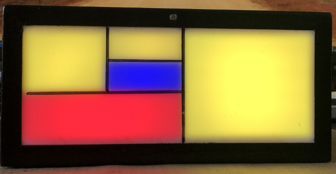

### Hoe wordt de tijd afgelezen?

De klok heeft vijf rechthoeken (cellen) met de oppervlakten **1, 1, 2, 3 en 5**, de eerste getallen uit de Fibonacci-reeks.<br>
Elke cel kan vier toestanden hebben:

| Toestand | Betekenis |
|---|---|
| Uit | De cel telt niet mee |
| Uren | De cel telt mee voor de **uren** |
| Minuten | De cel telt mee voor de **minuten** |
| Beide | De cel telt mee voor zowel de uren als de minuten |

Zo wordt de tijd afgelezen:

1. Tel de oppervlakten van alle cellen die de **uren**-kleur of de **beide**-kleur hebben. Dat is het aantal **uren** (1 tot en met 12).
2. Tel de oppervlakten van alle cellen die de **minuten**-kleur of de **beide**-kleur hebben en vermenigvuldig dat met **5**. Dat is het aantal **minuten**, in stappen van 5 minuten.

Een paar voorbeelden met het standaardschema Q0 (uren rood, minuten geel, beide blauw, uit wit):

| Tijd | Uren | Minuten |
|---|---|---|
| 3:00 | 3 = 3, of 2 + 1 | 0 |
| 5:30 | 5 | 30 = 5 x 6 = 5 + 1 |
| 7:15 | 5 + 2, of 3 + 2 + 1 + 1 | 15 = 5 x 3 = 3 |

Een uur of een aantal minuten kan op meerdere manieren met de cellen worden gevormd.<br>
De klok kiest bij elke minuutwisseling **willekeurig** een van de mogelijke combinaties.<br>
Het patroon kan dus per minuut veranderen terwijl de tijd gelijk blijft.<br>
Van 12:00 tot 12:04 zijn alle vijf cellen in de uren-kleur verlicht.

### Chrono-weergave

Met `FF` wordt omgeschakeld naar de **Chrono-weergave**. Daarbij worden de LED's 0 t/m 11 als een staaf gebruikt: het aantal verlichte LED's in de uren-kleur is het aantal uren, het aantal LED's in de minuten-kleur is het aantal minuten gedeeld door 5. Waar beide overlappen, wordt de kleur *beide* gebruikt. Stuur `FF` nogmaals om weer naar de Fibonacci-weergave terug te gaan. In het logboek staat `Display is Fibonacci` of `Display is Chrono`.

> Na een reset (`R`) staat de klok in de **Chrono**-weergave. Stuur eenmalig `FF` voor de Fibonacci-weergave.


### Kleurschema's (Q0 - Q9)

De kleurschema's worden met `Q` gekozen. Zonder cijfer toont `Q` de lijst. Ook een cel die *uit* is heeft een kleur, meestal wit.

| Q | Naam | Uit | Uren | Minuten | Beide |
|---|---|---|---|---|---|
| `Q0` | Mondriaan1 | wit | rood | geel | blauw |
| `Q1` | Mondriaan2 | wit | rood | donkergeel | blauw |
| `Q2` | RGB | wit | rood | groen | blauw |
| `Q3` | Own | *eigen kleuren, zie [Eigen kleuren](#eigen-kleuren-q3-met-de-kleurkiezer)* | | | |
| `Q4` | Pastel | wit | rood | lichtgroen | paars |
| `Q5` | Modern | wit | oranje | groen | azuurblauw |
| `Q6` | Cold | wit | hemelsblauw | paars | blauw |
| `Q7` | Warm | wit | rood | geel | oranje |
| `Q8` | Mondriaan3 | lichtgrijs | rood | donkergeel | blauw |
| `Q9` | Greens | wit | appelgroen | groen | lichtgroen |

Met `~` wisselt het kleurschema automatisch per minuut of per uur (zie [commando ~](#---kleurschema-automatisch-laten-wisselen)).

### Eigen kleuren (Q3) met de kleurkiezer

Voor `Q3` worden de kleuren zelf bepaald met de kleurkiezer in de webpagina van de klok (`/colourpick` of de link *Set colours*, zie [hoofdstuk 6](#62-bediening-met-de-webpagina)). Daar zijn vijf kleuren in te stellen:

| Veld | Betekenis |
|---|---|
| OFF | Cel uit |
| HRS | Cel telt voor de uren |
| MIN | Cel telt voor de minuten |
| BOTH | Cel telt voor uren en minuten |
| SEC | Kleur voor de seconden (Chrono) |

Een kleur kiezen en op *Send to clock* drukken past de kleur direct aan. De klok kiest daarna automatisch `Q3`.

### LED-indeling

Het aantal LEDs en hoe ze over de cellen zijn verdeeld wordt in de sketch ingesteld met de constante `NUM_LEDS` bovenin `Fibonacci.h` (standaard 17). Er zijn de volgende indelingen:

| NUM_LEDS | Aantal LED's per cel (1, 1, 2, 3, 5) | Toelichting |
|---|---|---|
| 12 | 1, 1, 2, 3, 5 | Eén LED per eenheid |
| 14 | 1, 1, 2, 4, 6 | |
| 17 | 1, 1, 2, 4, 9 | Standaard |
| 24 | 2, 2, 4, 6, 10 | |
| 32 | 2, 2, 4, 8, 16 | Vier strips van 8 LED's, symmetrisch verdeeld |
| 36 | 3, 3, 6, 9, 15 | Kast met 3 x 12 LED's |
| 174 | 16, 16, 32, 40, 70 | Kast van 50 x 50 cm |

Een andere waarde valt terug op de indeling van 14 LEDs. Na het wijzigen van `NUM_LEDS` moet de sketch opnieuw worden gecompileerd en geüpload.

### Welke commando's werken?

Alle commando's voor tijd, WIFI, Bluetooth, helderheid (`S`, `L`, `M`), display uit tussen twee uren (`N`), `O`, `P`, `Q`, `~`, `R`, `@`, `K`, `Y` (LED-test) en de tijdzenders werken zoals bij de woordklok.<br>
Commando's die alleen bij een woordklok horen hebben bij de Fibonacci-klok geen effect: `)` (HET IS WAS), `$` (haardvuur), `#` (zelftest) en `U` (demo).

### Het webmenu van de Fibonacci-klok

De menupagina (`/menu`) toont een schuifregelaar voor het kleurschema met drie kleurvlakjes (uren, minuten, beide).<br>
Een tik op een vlakje opent de kleurkiezer.<br>
Verder staan er de schuifregelaars voor helderheid, de uren waarin het display uit staat en schakelaars, onder meer **Fibonacci / Chrono** (commando `FF`).

## 10.2 Klok zonder display (NOCLOCK)

Met `#define NOCLOCK` wordt de software zonder klokweergave gebouwd.<br>
Er is dan geen LED-strip nodig: de sketch gebruikt één virtuele LED en alle weergavefuncties doen niets.<br>

Wat blijft werken:

- WIFI, NTP en de hoofdpagina van de klok (invoerveld voor commando's);
- Bluetooth en alle menucommando's;
- MQTT en Home Assistant, met de sensoren (CPU-temperatuur, LDR, diagnose) en de bediening die bij het ontbreken van een display zinvol is;
- de status-LED op de Nano ESP32;
- de tijdontvanger (`H05`) en de tijdzenders (`H06`, `H07`), zodat de processor als zelfstandige tijdbron kan dienen;
- de DS3231, zodat de tijd ook zonder internet goed blijft.

Toepassingen zijn bijvoorbeeld een zelfstandige **tijdzender** voor meerdere klokken, een meetpunt voor Home Assistant (temperatuur, licht) of een eigen project dat de menu-, WIFI-, MQTT- en BLE-code als basis gebruikt.

De pagina's `/menu` (menupagina met schuifregelaars) en `/colourpick` (kleurkiezer) zijn bij NOCLOCK **niet beschikbaar**: de klok antwoordt *Not found*. Commando's kunnen wel worden gestuurd via het invoerveld op de hoofdpagina, Bluetooth, de seriële poort of MQTT.<br>
Bij NOCLOCK heeft het commando `Q` maar één keuze (*None*). De bestanden `ClockFaces.h`, `WordClock.h` en `Fibonacci.h` zijn dan niet nodig en kunnen worden verwijderd.


---

# 11. Onderhoud en problemen oplossen

## 11.1 De software bijwerken (OTA)

Zolang de klok met WIFI is verbonden, kan nieuwe software 'Over The Air' (OTA) worden geüpload. De USB-kabel is dan niet nodig en de bibliotheken hoeven niet te worden geïnstalleerd: het compileren is al gedaan en het `.bin`-bestand wordt direct naar de klok gestuurd.

### Stappen

1. Zoek het IP-adres van de klok in het menu (`i`). Het staat achter `IP-address:`, gevolgd door `/update` of de link *Update*.
2. Typ het adres, direct gevolgd door `/update`, in een browser, bijvoorbeeld `192.168.178.141/update`. Of gebruik de naam van de klok: `http://wordclock.local/update` (soms kan `http://` worden weggelaten).
3. Kies *Kies bestand* (*Choose file*) en selecteer het juiste `.bin`-bestand.
4. Druk **één keer** op *Upload*. De voortgangsbalk loopt naar 100%.
5. Wacht ongeveer **20 seconden**. De klok herstart zelf en het klokmenu verschijnt weer.

| Menu met IP-adres en de link /update | De uploadpagina van de klok |
|---|---|
| 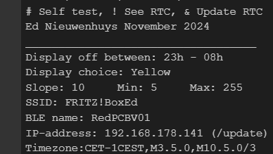 | 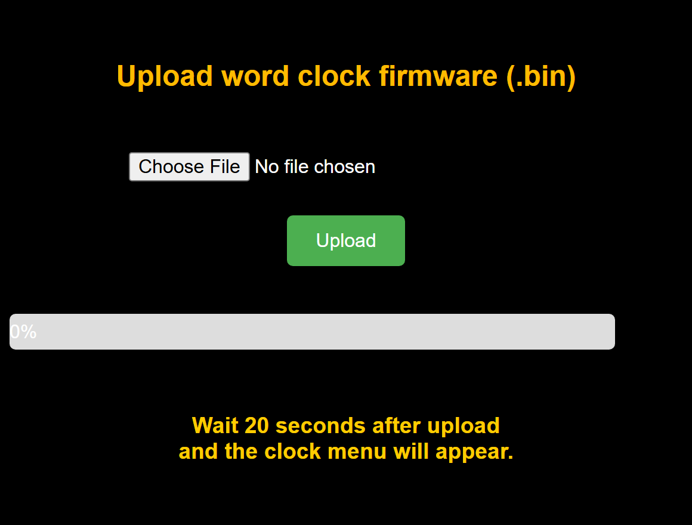 |

### Welk bestand?

Een `.bin`-bestand is gemaakt voor één klokvariant, bijvoorbeeld `WordFiboClockV247.NL144.bin`. De `.bin`-bestanden zijn optioneel: standaard wordt de variant `NL144` meegeleverd. Andere varianten kunnen zelf worden gecompileerd ([hoofdstuk 4](#4-software-installeren)).<br>
Het deel na de versie geeft de klokvariant aan (zie de [bijlage](#13-bijlagen)).<br>
Kies het bestand dat bij de klok past: een `.bin` voor de verkeerde variant geeft een klok met een verkeerd bord of een verkeerd aantal LEDs.<br>
Het kan worden hersteld met een `.bin` van de juiste variant of via de USB-kabel.

### Wat blijft er behouden?

De instellingen staan in het geheugen van de ESP32 en blijven bij een update behouden: WIFI-gegevens, tijdzone, kleuren en helderheid.<br>
Is de opslag na een update niet herkenbaar (andere indeling), dan herstelt de klok de standaardwaarden (logboek: `Checksum (25065) invalid ... Resetting to default values`).<br>
De WIFI-gegevens blijven in dat geval bewaard.<br>
Stuur zo nodig `RRRRR` voor een volledig schone start (zie [11.5](#115-resetten)).

### Als de update mislukt

| Verschijnsel | Mogelijke oorzaak en oplossing |
|---|---|
| Melding *FAIL* of *Error* | Het bestand is onvolledig of voor een ander bord. Download het bestand opnieuw en probeer nog eens |
| Klok herstart niet | Wacht minimaal 20 seconden. Stuur anders `@` of haal de voeding even los |
| Meldingen *OTA rejected: an update is already in progress* in het logboek | Er liep al een upload (bijvoorbeeld een dubbele klik). Wacht een minuut en probeer opnieuw |
| Pagina laadt niet | Is de klok in het WIFI verbonden? Gebruik het IP-adres in plaats van de naam |

## 11.2 De software bijwerken met een USB-kabel

Zie [hoofdstuk 4](#4-software-installeren). Een USB-kabel is nodig als de klok niet met WIFI is verbonden of als een `.bin`-bestand de klok onbruikbaar heeft gemaakt.

## 11.3 Logboek en diagnose

De klok bewaart zijn meldingen in een ringbuffer in het geheugen. Dat is hetzelfde als wat in de seriële monitor of in de Bluetooth-app wordt getoond.

| Hoe | Wat |
|---|---|
| **Log view** op de webpagina (`/log`) | De laatste 500 regels. Een vinkje (*Auto*) ververst de weergave elke paar seconden |
| **All log files** op de webpagina | Alle regels uit de buffer (duizenden regels) |
| `…/tekstdownload` | Dezelfde buffer als tekstbestand `<naam>-log.txt`, om in te sturen of te bewaren |
| `K` | Print elke seconde de LDR-waarde, het percentage helderheid en het aantal programma-doorlopen per seconde (`kl/s`) |
| `K0`, `K1`, `K2` | Het tijdstempel in het logboek uit, per minuut (standaard) of per uur |
| `}` | Print de positie in de ringbuffer achter elke regel |
| `=` | Toont alle opgeslagen instellingen, inclusief de herstarttellers |
| `!` | Toont de NTP-, RTC- en DS3231-tijd |

De ringbuffer is groot (enkele MB in PSRAM) maar niet oneindig: de oudste regels worden overschreven.<br>
Wie een probleem wil onderzoeken, kan het beste direct na het verschijnsel het bestand `tekstdownload` opslaan.

### Herstarttellers

In het logboek en met het commando `=` staan drie tellers:

| Teller | Betekenis | In Home Assistant |
|---|---|---|
| `MCUrestarted` | Herstarts vlak na het opstarten (binnen 2 minuten). Wordt gewist zodra de klok 2 minuten stabiel loopt | MCU Restarts |
| `WIFInoConnection` | Herstarts doordat er 30 uur lang geen IP-adres was | WiFi Reboots |
| `LoopRebooted` | Herstarts doordat het hoofdprogramma bleef hangen (minder dan 10 doorlopen per seconde) | Loop-stall Reboots |

Een teller die steeds hoger wordt, wijst op een structureel probleem (zwak WIFI-signaal, voeding, defecte module).

## 11.4 Automatische bewaking

De klok herstelt zich in drie situaties zelf:

- **Geen WIFI.** Er wordt elk uur gecontroleerd of er een IP-adres is. Is er langer dan 30 uur geen verbinding, dan herstart de klok (teller `WIFInoConnection`).<br>Bij een verbroken verbinding probeert de klok eerst opnieuw te verbinden.
- **Hoofdprogramma hangt.** Zijn er minder dan 10 doorlopen per seconde en is er een WIFI-netwerk beschikbaar, dan herstart de klok (teller `LoopRebooted`).
- **Steeds opnieuw herstarten.** Herstart de klok vaker dan 5 keer kort na het opstarten, dan worden de instellingen op de standaardwaarden gezet (zie [11.5](#115-resetten)). De teller wordt gewist als de klok 2 minuten stabiel heeft gedraaid.


## 11.5 Resetten

| Methode | Wat gebeurt er |
|---|---|
| `R` | Alle voorkeuren naar de standaardwaarden. SSID, wachtwoord, BLE-naam en tijdzone blijven bewaard.<br>WIFI, NTP en BLE staan aan |
| `RRR` | Alleen SSID, wachtwoord, BLE-naam en tijdzone worden gewist en op de standaard gezet |
| `RRRRR` | `R` en `RRR` samen: een totale reset. Gebruik dit na de eerste keer uploaden van de sketch |
| Rotary encoder | 9 keer drukken reset de klok naar de fabrieksinstellingen |
| Reset-knop (`^nn`) | 2 seconden ingedrukt houden herstelt de fabrieksinstellingen (inclusief de WIFI-gegevens) en herstart de klok |
| `@` | Herstart alleen; alle instellingen blijven behouden |

Het type LED-strip (`%`) en de keuze van het invoerapparaat (`H`) blijven bij een reset ongewijzigd.

## 11.6 Problemen oplossen

### De LEDs branden niet of verkeerd

| Verschijnsel | Mogelijke oorzaak en oplossing |
|---|---|
| Geen enkele LED brandt | **Pin Numbering** in de Arduino IDE staat verkeerd (bij NeoPixel moet het *By GPIO number (legacy)* zijn, zie [hoofdstuk 4](#4-software-installeren)).<br>Er is niet precies één klok gekozen bij de `#define`'s bovenin de sketch. Ook de voeding van de LED-strip en de datalijn controleren |
| Display is uit | Staat `N` op een tijdsbereik? `N` alleen schakelt dat uit. Staat het display met `O` uit? Stuur `O1` |
| Kleuren kloppen niet (geen wit) | Verkeerd LED-type: wissel met `%` (SK6812 of WS2812) en herstart met `@` |
| Letters en woorden komen niet overeen | Verkeerde klokvariant in de sketch, of een `.bin` voor een andere variant (zie [11.1](#111-de-software-bijwerken-ota)) |
| Helderheid te laag of te hoog | Zie `S`, `L`, `M` in [hoofdstuk 6.6](#66-de-helderheid-van-het-display) |

### De tijd klopt niet

| Verschijnsel | Mogelijke oorzaak en oplossing |
|---|---|
| Een uur verschil | Verkeerde tijdzone (`E`, zie [hoofdstuk 7](#e---tijdzone)). Bij gebruik van de DS3231 wordt de zomertijd niet automatisch toegepast.<br>Of de DS3231 wordt gebruikt ipv WIFI. Controleer in menu of DS3231 op OFF staat en WIFI en NTP op ON |
| De tijd loopt snel mis zonder WIFI | De interne klok loopt enkele seconden per dag uit de pas. Gebruik een DS3231 (`J`) of de tijdontvanger (`H05`) |
| De tijd lijkt niet te veranderen | Stuur `!` om de NTP-, RTC- en DS3231-tijd te zien. Stuur `&` om de NTP-tijd naar de DS3231 te kopiëren |
| Tijd instellen met `T` lukt niet | Datum en tijd kunnen alleen worden gewijzigd als WIFI en NTP uit staan (`W`, `X`) |

### WIFI en webpagina

| Verschijnsel | Mogelijke oorzaak en oplossing |
|---|---|
| Klok verbindt niet met WIFI | SSID of wachtwoord onjuist of korter dan 5 tekens.<br>Stuur `G` om de netwerken in de buurt te zien. De ESP32 gebruikt alleen WIFI op 2,4 GHz.<br>Stuur zo nodig `RRRRR` en voer de gegevens opnieuw in (zie [hoofdstuk 5](#52-verbinden-met-wifi)) |
| Klok start steeds de toegangspunt-pagina (`StartWordclock`) | Geen geldige routergegevens. Zie hierboven |
| Webpagina niet bereikbaar | Gebruik het IP-adres uit het menu in plaats van `naam.local`. Staat `WIFI=On`? |
| Verbinding valt vaak weg | Zwak signaal. De klok verbindt zelf opnieuw. Kijk naar de teller `WIFInoConnection` en de sensor *WiFi Signal* in Home Assistant |

### Bluetooth

| Verschijnsel | Mogelijke oorzaak en oplossing |
|---|---|
| Klok verschijnt niet in de app | Staat Bluetooth aan (`CCC`)? <br> Gebruik een app die de nRF52-UART ondersteunt ([hoofdstuk 2](#stap-1---kies-een-bediening-app)). |
| Tekst onvolledig of vervormd | Stuur `+` om te wisselen tussen snelle en langzame BLE, zie [hoofdstuk 6](#als-tekst-onvolledig-of-vervormd-verschijnt) |
| Compileren geeft Bluetooth-fouten | Vanaf V060 moet de bibliotheek **NimBLE versie 2.x** worden gebruikt. Voor V060 werkte alleen NimBLE 1.4.3 |

### Invoerapparaten

| Verschijnsel | Mogelijke oorzaak en oplossing |
|---|---|
| Rotary, drukknoppen of IR werken niet | Is het apparaat gekozen met `H01` - `H04` en de klok herstart met `@`? Zie [hoofdstuk 5.1](#51-welke-invoer-heeft-de-klok) |
| Onbedoelde invoer of knipperende woorden | Er is geen invoerapparaat aangesloten maar `H01` - `H04` staat aan: stuur `H00` |
| IR-afstandsbediening reageert niet | Alle toetsen opnieuw laten leren met `{` ([hoofdstuk 5](#met-een-ir-afstandsbediening)). Niet alle afstandsbedieningen zijn geschikt |
| HC-12 en IR samen | Beide gebruiken pin D4 en kunnen niet tegelijk worden gebruikt |

### MQTT

Zie [hoofdstuk 9.9](#99-problemen-oplossen).

## 11.7 Contact en meer informatie

- Bijdragen en vragen: [github.com/ednieuw/Arduino-ESP32-Nano-Wordclock](https://github.com/ednieuw/Arduino-ESP32-Nano-Wordclock)
- Bouwpagina: [ednieuw.com/Woordklok/Bouwpakket/WoordklokSK6812.htm](https://ednieuw.com/Woordklok/Bouwpakket/WoordklokSK6812.htm)


---

# 12. Programmauitleg

De opbouw van de sketch (bestanden, klokvarianten, opslag, tijdstappen, invoer en uitvoer, WIFI, MQTT, bewaking) en hoe de software kan worden aangepast.

## 12.1 Overzicht

De sketch is één groot programma met bewust zoveel mogelijk **globale variabelen**. Variabelen zijn per onderdeel gegroepeerd, zodat met *zoeken* in de IDE snel alles te vinden is. Functies krijgen weinig parameters. Dat is geen aanbeveling voor grote projecten met meerdere ontwikkelaars, maar houdt dit programma eenvoudig te lezen.

Alle functies staan in dezelfde volgorde in de sketch, gegroepeerd met een commentaarregel als `// COMMON`, `// LED`, `// WIFI`, `// BLE`, `// MQTT`, `// CLOCK` voor de functienaam. Zo is zichtbaar of een functie voor alle klokvarianten (`COMMON`) of voor één onderdeel geldt.

Het programma is **cooperatief**: er wordt nergens lang gewacht. `loop()` doet bijna niets zelf en roept routines aan die elke seconde, minuut, uur en dag iets uitvoeren. Daardoor is de processor grotendeels vrij: met `K` (LDR-uitlezing) wordt het aantal doorlopen per seconde getoond, ongeveer 200 kl/s (200.000 per seconde).

## 12.2 Bestanden en klokvarianten

| Bestand | Inhoud |
|---|---|
| `WordFiboClockV247.ino` | Alles wat voor alle varianten geldt: opstarten, menu, WIFI, BLE, MQTT, tijd, LED-hulpfuncties, opslag |
| `WordClock.h` | Weergave van de woordklok (`Displaytime()`, de taalfuncties `Dutch()`, `English()`...), kleurkiezer en menupagina |
| `ClockFaces.h` | LED-posities van elk woord, per klokvariant |
| `Fibonacci.h` | Weergave van de Fibonacci-klok, kleurkiezer en menupagina |
| `NoClock.h` | Lege functies voor de variant zonder display |
| `Webpage.h`, `SoftAP.h`, `OTAhtml.h`, `LogViewer.h` | HTML-pagina's van de klok |

### De variant kiezen

Bovenin de sketch wordt met `#define` één variant gekozen. Daaruit volgt welk `.h`-bestand wordt ingevoegd, aan het einde van de definities (onder de menutabel):

```cpp
#if   defined(WORDCLOCK)
  #include "WordClock.h"      // Woordklok: Displaytime(), ColourPick_html[], menu_html[]
#elif defined(FIBONACCI)
  #include "Fibonacci.h"      // Fibonacci
#elif defined(NOCLOCK)
  #include "NoClock.h"        // Geen display
#endif
```

`WORDCLOCK` wordt automatisch gedefinieerd zodra geen `FIBONACCI` of `NOCLOCK` is gekozen.

Elk variantbestand levert dezelfde onderdelen, zodat de hoofdsketch er niets van hoeft te weten:

| Onderdeel | Doel |
|---|---|
| `Displaytime()` | Zet de tijd op de LEDs |
| `QchoiceNames[]` en `LASTITEM` | Namen van de kleurschema's voor het commando `Q` (en voor Home Assistant) |
| `CLOCK_VARIANT` | Naam van de variant in het logboek |
| `NUM_LEDS`, `MATRIX_WIDTH`, `MATRIX_HEIGHT`, `LEDNEARLDR` | Afmetingen en LED-posities |
| `ColourPick_html[]`, `menu_html[]` | Pagina's `/colourpick` en `/menu` |
| `PrintDisplayChoice()`, `SetSecondColour()`, `Demomode()`, `FireMode()`, `Selftest()`, `RotPressOne/Two/Three()` | Hulpfuncties. Waar een variant ze niet nodig heeft, zijn het lege functies |

Dit is de reden dat commando's als `$` (haardvuur) of `#` (zelftest) bij de Fibonacci-klok niets doen.

## 12.3 Bibliotheken

```cpp
#include <EdSoftLED.h>          // LED-strip (core 3.3+); anders <Adafruit_NeoPixel.h>
#include <Preferences.h>        // Permanente opslag
#include <NimBLEDevice.h>       // Bluetooth Low Energy (NimBLE 2.x)
#include <WiFi.h>               // WIFI
#include <esp_sntp.h>           // NTP
#include <esp_wps.h>            // WPS
#include <ESPAsyncWebServer.h>  // Webpagina's
#include <Update.h>             // OTA
#include <ESPmDNS.h>            // naam.local
#include <DNSServer.h>          // Toegangspuntpagina
#include <Wire.h>               // I2C
#include <RTClib.h>             // DS3231
#include <Encoder.h>            // Rotary encoder
#include <Keypad.h>             // Drie drukknoppen
#include <IRremote.hpp>         // IR-afstandsbediening
#include <PubSubClient.h>       // MQTT
```

De LED-bibliotheek wordt automatisch gekozen: bij ESP32-core 3.3.0 of hoger `USEEDSOFTLED` (EdSoftLED), anders NeoPixel. Zie [hoofdstuk 4 van de handleiding](#4-software-installeren) voor de bijbehorende pinnummering.

## 12.4 Globale variabelen en permanente opslag

### De struct `Mem`

Alle instellingen staan in één struct, `EEPROMstorage`, met de variabele `Mem`:

```cpp
struct EEPROMstorage {
  byte DisplayChoice = 0;
  byte TurnOffLEDsAtHH = 0;
  ...
  char SSID[30];
  char Password[40];
  char BLEbroadcastName[30];
  char Timezone[50];
  int  Checksum = 0;
  ...
} Mem;
```

De velden worden met `Mem.<naam>` aangesproken, bijvoorbeeld `Mem.DisplayChoice = 3;`. De hele struct wordt in één keer met de bibliotheek `Preferences` opgeslagen en teruggelezen:

| Functie | Taak |
|---|---|
| `InitStorage()` | Leest de struct en controleert de waarden. Is `Mem.Checksum` niet 25065, dan volgt `Reset()` |
| `StoreStructInFlashMemory()` | Slaat de struct op. Gebeurt na elk commando en elke dag |
| `GetStructFromFlashMemory()` | Leest de struct uit het geheugen |
| `Reset()` | Zet alle waarden op de standaard (behalve WIFI-gegevens, BLE-naam en tijdzone) |
| `ResetCredentials()` | Wist SSID, wachtwoord, BLE-naam en tijdzone |
| `StoreIRRemoteInFlashMemory()`, `GetIRRemoteFromFlashMemory()` | De geleerde IR-toetsen (aparte opslag) |

De struct bevat reservevelden (`byteFuture…`, `IntFuture…`, `Extra…`, `ExtraSpace`), zodat een nieuwe instelling zonder verandering van de indeling kan worden toegevoegd.

> Wordt de indeling van de struct gewijzigd, dan klopt de opslag in bestaande klokken niet meer en volgt een reset naar de standaardwaarden bij de eerste start. Neem daarom een nieuw veld liever in een reserveveld op.

### Een nieuwe instelling toevoegen

1. Voeg het veld toe in de struct (of gebruik een reserveveld).
2. Zet de standaardwaarde in `Reset()`.
3. Voeg het toe aan `PrintMem()` zodat het met `=` zichtbaar is.
4. Schrijf het commando in `ReworkInputString()` (zie [12.16](#1216-aanpassen-en-uitbreiden)).

### De menutabel

Het menu dat in de seriële monitor, de Bluetooth-app en op de webpagina wordt getoond staat als twee tabellen, `menu[]` (lang) en `menusmall[]` (kort). De regels zijn maximaal 40 tekens lang. `SWversion()` print het menu en de huidige instellingen, `PrintLine()` tekent de scheidingslijnen.

## 12.5 Opstarten: `setup()`

`setup()` start de onderdelen in deze volgorde. Elke stap toont een eigen kleur op de LED-strip, zodat zichtbaar is waar het opstarten hangt (`LEDstartup()`):

1. Seriële poort (115200 baud) en I2C.
2. `InitStorage()`: opslag lezen en controleren, ringbuffer voor het logboek (`InitLogBuffer()`).
3. `StartLeds()` en `InitStatusLEDs()`.
4. Wachten op de seriële verbinding (maximaal 3 seconden).
5. `++Mem.MCUrestarted`: te vaak herstarten leidt tot een reset (zie [12.15](#1215-bewaking-en-herstel)).
6. Invoerapparaat: rotary (`TimeInput` 1), drukknoppen (2) of IR (3 en 4).
7. BLE (`StartBLEService()`), WIFI (`ConnectWIFI()`), tijdsysteem (`InitTimeSystem()`).
8. Tijdontvanger (`H05`), BLE-tijdzender (`H06`), HC-12 (`H07`), resetknop (`^nn`).
9. Eerste LDR-meting, eerste weergave van de tijd en het menu.

## 12.6 Het hoofdprogramma: `loop()` en de tijdstappen

```cpp
void loop()
{
 Loopcounter++;
 if (Demo)            Demomode();
 else if(FireDisplay) FireMode();
 else                 EverySecondCheck();   // laat de seconde tikken en draait de klok
 CheckDevices();
}
```

`CheckDevices()` kijkt of er invoer is, elke keer dat `loop()` draait:

```cpp
void CheckDevices(void)
{
 CheckBLE();                 // Bluetooth-invoer?
 SerialCheck();              // Seriële invoer?
 CheckWIFIcommand();         // Commando van de webpagina?
 if(Mem.MQTT) CheckMQTT();   // MQTT onderhouden
 if (Mem.TimeInput==1) RotaryEncoderCheck();
 if (Mem.TimeInput==2) Keypad3x1Check();
 if (Mem.TimeInput==3 || Mem.TimeInput==4) IrReceiverDecode();
 if (ntpJustSynced) CheckandPrintNTPsynced();
}
```

`EverySecondCheck()` doet één keer per seconde (als `millis() - msTick > 999`) het volgende werk:

- tijd lezen met `GetTijd()`, status-LED's bijwerken, kleur van HET IS WAS per seconde (`SetSecondColour()`);
- resetknop controleren, tijdontvanger- en tijdzender-client onderhouden (`CheckTimeReceiverClient()`, `CheckTimeSender()`);
- `DimLeds()`: helderheid op basis van de LDR;
- na een OTA-update of herstartopdracht: MQTT op *offline* zetten en met `ESP.restart()` herstarten;
- is de minuut veranderd: `EveryMinuteUpdate()`.

De tijdstappen lopen in een cascade:

| Routine | Wanneer | Taak |
|---|---|---|
| `EveryMinuteUpdate()` | Elke minuut | Weergave bijwerken, tijdlog (`K1`), HC-12, willekeurig kleurschema (`~1`), `PublishMQTTStates()` |
| `EveryHourUpdate()` | Elk uur | Display aan/uit volgens `N`, `CheckRestoreWIFIconnectivity()`, gemiddelde LDR per uur, `~2` |
| `EveryDayUpdate()` | Elke dag | LDR-minimum en -maximum terugzetten, tijd printen, `StoreStructInFlashMemory()` |

## 12.7 Uitvoer: de `Tekstprint`-functies en het logboek

Alle uitvoer loopt via één plaats, zodat hij is om te leiden:

```cpp
void Tekstprint(char const *tekst)
{
 if(Serial) Serial.print(tekst);
 SendMessageTimeReceiver(tekst);   // naar de tijdzender (BLE)
 SendMessageBLE(tekst);            // naar de Bluetooth-app
 AddLog(tekst);                    // in de ringbuffer
}
```

Hiervan zijn `Tekstprintln`, `Tekstprintf` en `Tekstprintlnf` varianten met regeleinde en `printf`-opmaak. Een tweede reeks, `WTekstprint…`, bouwt het HTML-blok voor de webpagina op, met optioneel voor- en achtervoegsel zodat een regel alleen op de webpagina een link kan bevatten (bijvoorbeeld `/update`).

### Het logboek (ringbuffer)

`InitLogBuffer()` reserveert bij het opstarten een groot geheugenblok, bij voorkeur in PSRAM. `AddLog()` schrijft de tekst cyclisch in dat blok; aan het einde begint het weer vooraan. Twee routes tonen het logboek:

| Route | Functie | Inhoud |
|---|---|---|
| `/tekstprint` | `HandleTekstPrint()` | De laatste ongeveer 500 regels |
| `/tekstdownload` | `HandleTekstDownload()` | De hele buffer als bestand `<naam>-log.txt` |

Met `}` (`Mem.Ringbufcnt`) wordt achter elke regel de positie in de buffer geprint.

## 12.8 Invoer: alle commando's via `ReworkInputString()`

Alle invoerbronnen komen samen in één functie, `ReworkInputString(String InputString)`:

| Bron | Waar |
|---|---|
| Seriële monitor | `SerialCheck()` |
| Bluetooth | `CheckBLE()` |
| Webpagina | `CheckWIFIcommand()` (via `PendingCommand`) |
| MQTT | `MQTTCallback()` |
| Tijdzender (BLE) | `TimeReceiverNotifyCB()` |

De functie

- negeert invoer langer dan 40 tekens;
- kijkt naar het eerste teken (`toupper(InputString[0])`) en kiest met een `switch` het commando;
- zet het resultaat in `sptext`, dat aan het einde met `Tekstprintln` wordt getoond;
- slaat `Mem` op met `StoreStructInFlashMemory()` en forceert een nieuwe weergave (`lastminute = 99`).

Hierdoor werkt elk commando overal hetzelfde: een knop in Home Assistant, een tik op de webpagina en een letter in de Bluetooth-app roepen dezelfde code aan.

Hulpfuncties bij de invoer: `SConstrainInt()` (getal uit een tekenreeks met begrenzing), `ParseColourInput()` (kleuren in hex en cijfers, voor `F` en `V`), `HexToDec()`.

## 12.9 Tijd

`GetTijd()` haalt de tijd uit de beste beschikbare bron en zet hem in de standaard C-structuur `timeinfo`.

| Bron | Functies |
|---|---|
| NTP via WIFI | `StartWIFI_NTP()`, `initSNTP()`, `setTimezone()`, `wait4SNTP()`, `NTPnotify()`, `GetNTPtime()` |
| DS3231 (I2C) | `IsDS3231I2Cconnected()`, `GetDS3231Time()`, `SetDS3231Time()`, `GetDS3231Temp()` |
| Interne RTC van de ESP32 | `SetRTCTime()`, `SetSystemTime()` |
| Handmatig | commando's `D`, `T` en `uummss` |
| Tijdontvanger | commando's `T` en `D` via BLE |

Met `J` (`Mem.UseDS3231`) en `X` (`Mem.NTPOn`) wordt de bron gekozen. `InitTimeSystem()` start de bronnen op. `PrintAllClockTimes()` (commando `!`) toont alle tijden naast elkaar. De zomertijd komt van de tijdzone-string (POSIX-formaat) en geldt alleen voor NTP, niet voor de DS3231.

## 12.10 LEDs en helderheid

### De LED-strip

Alle aanroepen voor de strip staan in hulpfuncties, zodat de rest van de code los staat van de bibliotheek (EdSoftLED of NeoPixel):

| Functie | Taak |
|---|---|
| `StartLeds()` | Kiest SK6812 (met wit) of WS2812 volgens `Mem.LEDstrip` |
| `ColorLeds(tekst, eerste, laatste, kleur)` | Zet een reeks LEDs aan en toont de tekst in het logboek |
| `ColorLed()`, `LedsOff()`, `ShowLeds()`, `SetBrightnessLeds()`, `Stripfill()`, `ClearScreen()` | Basisbewerkingen |
| `LEDstartup()` | Toont tijdens het opstarten een kleur op de strip |
| `LEDtest()` | Het regenboogprogramma van `Y` (onderbreekbaar met `Y`) |

Een kleur is een 32-bit waarde `0xWWRRGGBB`. Bij een SK6812 bepaalt de hoogste byte de witte LED, bij een WS2812 wordt die genegeerd.

### Lichtgevoeligheid

`ReadLDR()` leest de LDR (0-4095) en schaalt naar 0-255. `DimLeds()` verwerkt de meting tot de helderheid van de LEDs (`OutPhotocell`) met de parameters `Mem.LightReducer` (`S`), `Mem.LowerBrightness` (`L`) en `Mem.UpperBrightness` (`M`). De waarde wordt gekwadrateerd, zodat de curve beter aansluit op de reactie van het oog dan een rechte lijn.

### Status-LED's

`UpdateStatusLEDs()` bestuurt de RGB-LED op de Nano ESP32 en twee LED's op de PCB. De kleur toont de toestand (programma loopt, WIFI, Bluetooth). Op de Nano ESP32 is een lage PWM-waarde *aan*; `InitStatusLEDs()` stelt daarom de resolutie en frequentie van de PWM-pinnen expliciet in (9 bit, 5 kHz), omdat de standaardwaarden tussen core-versies zijn gewijzigd.

## 12.11 Het klokbord

### Woordklok

Elk woord is een macro die `ColorLeds()` aanroept met de eerste en laatste LED van het woord. Ze staan in `ClockFaces.h`, per variant:

```cpp
#define PRECIES ColorLeds("precies", 16, 22, LetterColor);
#define MTIEN   ColorLeds("tien",    25, 28, LetterColor);
#define KWART   ColorLeds("kwart",   32, 36, LetterColor);
#define VOOR    ColorLeds("voor",    38, 41, LetterColor);
```

De taalfuncties in `WordClock.h` zetten de woorden voor de tijd met alleen die macro's:

```cpp
void Dutch(void)
{
 HET;                                          // HET is altijd aan
 switch (timeinfo.tm_min)
   {
    case  0: IS;  PRECIES; break;
    case  4: case 5: case 6: IS; MVIJF; OVER; break;
    ...
   }
}
```

`Displaytime()` roept per variant de juiste taalfuncties aan (`Dutch()`, `English()`, `German()`, `French()`; bij de 4-talenklok alle vier). Dat een taal soms twee mogelijke lezingen heeft ("half negen" is 8:30 of 9:30) is in de taalfuncties opgelost.

De kleuren van de woorden volgen uit `SetSecondColour()` en het gekozen kleurschema (`Mem.DisplayChoice`, de `Q`-opdracht).

### Fibonacci

`Fibonacci.h` bevat `LEDsetTime()` (Fibonacci-weergave), `MakeChronoList()` (Chrono-weergave), `MakeFibonacciList()` (willekeurige combinatie van cellen die een getal vormt) en `setPixel()`, dat per `NUM_LEDS` de LED-indeling van elke cel bepaalt. Zie [hoofdstuk 10](#10-fibonacci-klok-en-noclock) van de handleiding.

### Een nieuwe klokvariant toevoegen (woordklok)

1. Voeg in `ClockFaces.h` een blok toe voor de nieuwe `#define`, met `NUM_LEDS`, `LEDNEARLDR`, `MATRIX_WIDTH`, `MATRIX_HEIGHT` en de macro's voor elk woord.
2. Voeg de naam toe aan de lijst `CLOCK_VARIANT` in `WordClock.h`.
3. Voeg de `#define`-regel toe in de lijst bovenin de sketch.

## 12.12 Bluetooth, tijdontvanger en tijdzender

### Bluetooth

De klok gebruikt de Nordic **nRF UART-service** van NimBLE, niet de TI CC2541-service (`FFE0`) van chips als de HM-10.

| Functie | Taak |
|---|---|
| `StartBLEService()` | Start de UART-service |
| `SendMessageBLE()` | Stuurt tekst in pakketjes van 20 tekens (of langer met snelle BLE, `+`) |
| `CheckBLE()` | Leest invoer en geeft die aan `ReworkInputString()` |
| `DisconnectBLE()` | Verbreekt de verbinding |

### Tijdontvanger (`H05`)

De klok is dan BLE-**client** en zoekt een BLE-apparaat met de naam `BLE-UARTtime`.

| Functie | Taak |
|---|---|
| `StartTimeReceiverScan()` | Start het scannen |
| `Connect_TimeReceiver()` | Maakt verbinding (drie pogingen) en abonneert op notificaties |
| `CheckTimeReceiverClient()` | Hoofdlus: verwerkt opruimwerk na een verbinding die wegvalt, time-outs en periodiek opnieuw scannen |
| `StopTimeReceiver()`, `ReconnectTimeReceiver()` | Stoppen en opnieuw verbinden |
| `TimeReceiverNotifyCB()` | Ontvangt tekst en geeft die aan `ReworkInputString()` |

Alle opruimwerk na een verbroken verbinding wordt in `loop()` uitgevoerd, niet in de callback zelf. Dat voorkomt crashes in NimBLE.

### Tijdzender (`H06`, `H07`)

| Functie | Taak |
|---|---|
| `BLETimeSenderStart()`, `BLETimeSenderStop()` | BLE-**server** met de naam `BLE-UARTtime` |
| `CheckTimeSender()` | Stuurt elke 10 seconden `Thhmmss` en 1 seconde later `Dddmmjjjj` zodra een client is verbonden en notificaties heeft ingeschakeld |
| `InitHC12()`, `SendHC12TimeString()` | HC-12 op D4, 9600 baud, `Thhmmss` per minuut (`K1`) of uur (`K2`) |

## 12.13 WIFI, webpagina's en OTA

### WIFI en NTP

| Functie | Taak |
|---|---|
| `ConnectWIFI()` | Verbindt met SSID en wachtwoord uit `Mem` |
| `StartWIFI_NTP()` | Start WIFI en NTP |
| `CheckforWIFINetwork()`, `ScanWIFI()` | Netwerken zoeken (`G`) |
| `StartAPMode()` | Toegangspunt `StartWordclock` met de pagina `SoftAP.h` |
| `wpsInitConfig()`, `wpsStart()`, `wpsStop()` | WPS (`Z`) |
| `WiFiEvent()` | Verwerkt WIFI-gebeurtenissen |
| `CheckRestoreWIFIconnectivity()` | Elk uur: herstelt de verbinding (zie [12.15](#1215-bewaking-en-herstel)) |

### De routes van de webserver

`WebPage()` registreert alle routes op de ESPAsyncWebServer:

| Route | Pagina of functie |
|---|---|
| `/` | Hoofdpagina (`Webpage.h`): invoerveld, menu en live logvenster |
| `/log` | Volledig logboek (`LogViewer.h`) |
| `/tekstprint`, `/tekstdownload` | Logboek als tekst, zie [12.7](#127-uitvoer-de-tekstprint-functies-en-het-logboek) |
| `/menu` | Aanraakbare menupagina (`menu_html[]` uit het variantbestand) |
| `/menustate` | JSON met de stand van de schakelaars voor de menupagina |
| `/colourpick`, `/setcolours` | Kleurkiezer en het verwerken van de gekozen kleuren |
| `/get` | Commando van het invoerveld. Het commando wordt in `PendingCommand` gezet (de webserver is asynchroon) en de browser wordt naar `/wait` gestuurd |
| `/wait` | Toont *Processing command...* en ververst elke seconde tot het commando is verwerkt in `CheckWIFIcommand()`; daarna terug naar `/` |
| `/update` (GET en POST) | OTA-pagina en het uploaden van het `.bin`-bestand |

De pagina's staan als *raw string literals* in de `.h`-bestanden (`R"rawliteral( … )rawliteral"`). Waarden die de klok moet invullen staan als plaatshouder (`%%COLNL%%`, `%%CNAME%%`…) en worden bij het opvragen vervangen. Het hoofdmenu en het menu van `/menu` hebben een klein **live logvenster** dat elke seconde `/tekstprint` ophaalt, de laatste 50 regels toont en alleen automatisch meescrollt als de lezer onderaan staat.

Een HTML-pagina kan in een gewone teksteditor (bijvoorbeeld Notepad++) of met een AI-assistent worden gemaakt en daarna tussen `R"rawliteral(` en `)rawliteral";` in een `.h`-bestand worden geplakt.

### OTA

Het uploaden van een `.bin` verloopt in `/update` (POST) met de functies van `Update.h`. De sketch beschermt tegen twee gelijktijdige uploads: een tweede upload wordt geweigerd zolang een eerste actief is (`OTAupdateInProgress`, V244). Na een geslaagde update wordt `shouldReboot` gezet; `EverySecondCheck()` herstart de klok dan na twee seconden.

## 12.14 MQTT en Home Assistant

| Functie | Taak |
|---|---|
| `CheckMQTT()` | Houdt de verbinding aan (niet-blokkerend, elke 5 seconden een nieuwe poging) |
| `publishMQTTDiscovery()` | Eén keer na het verbinden: stuurt de aanmeldberichten |
| `publishDiscoverySensor/Button/Switch/Number/Select()` | Hulpfuncties per type |
| `PublishMQTTStates()` | Stuurt alle waarden: elke minuut, na elk commando en direct na het verbinden |
| `MQTTCallback()` | Ontvangt commando's van `<id>/cmnd` en geeft ze aan `ReworkInputString()` |
| `MQTTDeviceId()` | Apparaat-id: Bluetooth-naam in kleine letters, spaties en schuine strepen als `_` |

De MQTT-instellingen (`MQTT_SERVER`, `MQTT_PORT`, `MQTT_USER`, `MQTT_PASSWORD`) staan als constanten bovenin de sketch. Zie [hoofdstuk 9 van de handleiding](#9-mqtt-en-home-assistant) en [MQTT-HomeAssistant-setup.md](MQTT-HomeAssistant-setup.md).

## 12.15 Bewaking en herstel

| Mechanisme | Waar | Gedrag |
|---|---|---|
| Geen WIFI | `CheckRestoreWIFIconnectivity()` (elk uur) | Opnieuw verbinden. Na 30 uur zonder IP: herstart (`Mem.WIFInoConnection`) |
| Hoofdprogramma hangt | Zelfde routine | Minder dan 10 doorlopen per seconde met een WIFI-netwerk in de buurt: herstart (`Mem.LoopRebooted`) |
| Te vaak herstarten | `setup()` | Meer dan 5 herstarts kort na het opstarten: `Reset()`. `CheckMCURestartCounter()` wist de teller als de klok 2 minuten stabiel loopt |
| Resetknop | `CheckResetPin()` | 2 seconden ingedrukt: fabrieksinstellingen en herstart |
| Opslag ongeldig | `InitStorage()` | `Mem.Checksum` niet 25065: standaardwaarden |

## 12.16 Aanpassen en uitbreiden

### Een nieuw menucommando toevoegen

1. Kies een vrij teken en voeg een `case` toe in `ReworkInputString()` (zie bij de bestaande cases `'V'`, `'^'` en `'_'` als voorbeeld).
2. Zet de waarde in `Mem` (zie [12.4](#een-nieuwe-instelling-toevoegen)) en geef een melding via `snprintf(sptext, …)`.
3. Voeg het commando toe aan `menu[]` (maximaal 40 tekens per regel).
4. Voeg het toe aan de webmenu-pagina als er een schakelaar bij hoort (`menu_html[]` in het variantbestand en `/menustate`).
5. Overweeg een onderdeel in Home Assistant (zie `publishDiscovery…` en `PublishMQTTStates()`).

### Een nieuwe invoerbron toevoegen

Zorg dat de bron een tekenreeks aan `ReworkInputString()` geeft. Meer is niet nodig, het commando werkt dan verder overal.

### Een nieuw kleurschema voor de Fibonacci-klok

Voeg een rij toe aan de tabel `colors[][5]` in `Fibonacci.h`, een naam aan `QchoiceNames[]`, en `LASTITEM` volgt vanzelf.

## 12.17 Functieoverzicht

In de map met de sketch staat het bestand `FunctionListV247.txt` met alle functies per bestand en een korte omschrijving per functie. De lijst is voor V247 bijgewerkt. Ten opzichte van de lijst voor V237 zijn dit de wijzigingen:

| Functie | Wijziging |
|---|---|
| `ParseColourInput()` | Hernoemd (was `parseColourInput`) |
| `PublishMQTTStates()` | Vervangt `PublishCPUTemperature()`, `PublishLDRreading()` en `PublishDisplayChoiceState()` (V244) |
| `publishDiscoveryNumber()`, `publishDiscoverySwitch()` | Nieuw (schuifregelaars en schakelaar in Home Assistant) |
| `publishDiscoverySensor()`, `publishDiscoverySelect()` | Extra parameters (diagnostiek, lijst met opties) |
| `CheckResetPin()` | Leest nu `Mem.ResetPin` (V246) |
| `InitHC12()`, `SendHC12TimeString()` | Worden nu aangeroepen via `H07` (V247) |

---

# 13. Bijlagen

## 13.1 Klokvarianten en bestandsnamen

Bij het compileren wordt precies één klokvariant gekozen met een `#define` bovenin de sketch (zie [hoofdstuk 4](#4-software-installeren)). De LED-aantallen volgen uit `ClockFaces.h`.

| `#define` | Klok | LEDs (`NUM_LEDS`) | Raster |
|---|---|---|---|
| `NL144CLOCK` | Nederlands, 12 x 12 | 148 (144 + 4 voor de minuten) | 12 x 12 |
| `UK144CLOCK` | Engels, 12 x 12 | 144 | 12 x 12 |
| `FR144CLOCK` | Frans, 12 x 12 | 144 | 12 x 12 |
| `DE144CLOCK` | Duits, 12 x 12 | 144 | 12 x 12 |
| `NL92CLOCK` | Nederlands, een LED-strip achter elk woord | 92 | 10 x 10 |
| `NLM1M2M3M4L94` | Nederlands met vier minuut-LEDs | 94 | 10 x 10 |
| `NLM1M2M3M4L114` | Nederlands met vier minuut-LEDs | 124 (114 + 10) | 11 x 10 |
| `NLM1M2M3M4L144` | Nederlands met vier minuut-LEDs | 144 | 12 x 12 |
| `NLM1M2M3M4L161` | Nederlands, EdSoft Qclock-ontwerp | 161 | 13 x 13 |
| `NLM1M2M3M4L256` | Nederlands met vier minuut-LEDs | 256 | geen matrix |
| `NLM1M2M3M4L294` | Nederlands met vier minuut-LEDs | 294 | geen matrix |
| `FOURLANGUAGECLOCK` | 4-talenklok (NL, UK, DE, FR) | 625 | 25 x 25 |
| `VIERTALENKLOK` | Viertalenklok (Ulrich) | 676 | 26 x 26 |
| `FIBONACCI` | Fibonacci- / chronoklok | 12, 14, 17, 24, 32, 36 of 174 (standaard 17) | zie [hoofdstuk 10](#10-fibonacci-klok-en-noclock) |
| `NOCLOCK` | Geen display | 1 (virtueel) | |

### Namen van de .bin-bestanden

Een `.bin`-bestand heet `WordFiboClock<versie>.<variant>.bin`, bijvoorbeeld `WordFiboClockV247.NL144.bin`. Standaard wordt de variant `NL144` meegeleverd. Andere `.bin`-bestanden zijn optioneel en niet altijd aanwezig:

| Bestandsdeel | Klok |
|---|---|
| `NL144` | Nederlandse klok met 144 LEDs |
| `Ed4Talen` | 4-talenklok, uitvoering van de auteur |


## 13.2 Aansluitingen van de Arduino Nano ESP32

De pinnen zoals ze in de sketch zijn vastgelegd (Arduino-pinnummering, zie [hoofdstuk 4](#4-software-installeren) voor de pinnummering-instelling):

| Pin | Gebruik |
|---|---|
| D0 / D1 | Seriële poort RX / TX |
| D2 (D8 op de grote PCB) | Rotary encoder, pin B (CLK) |
| D3 | Rotary encoder, pin A (DT) |
| D4 | Rotary-drukknop (SW), **of** IR-ontvanger, **of** HC-12 TX (nooit meer dan één tegelijk) |
| D5 | Data naar de LED-strip (SK6812 / WS2812) |
| D6 | Resetknop (optioneel, `^nn`) en HC-12 RX (niet gebruikt voor zenden) |
| D9, D10 | PCB-LED's |
| D12 | Dummy bij de drukknoppen (keypad) |
| D13 | Status-LED (seconden) |
| A2 | LDR (lichtsensor) |
| A4 / A5 | SDA / SCL (I2C) voor de DS3231 RTC-module |


## 13.3 Bestanden bij de sketch

| Bestand | Inhoud |
|---|---|
| `WordFiboClockV247.ino` | De hoofdsketch: menu, WIFI, BLE, MQTT, tijd, helderheid |
| `ClockFaces.h` | De LED-indeling per woordklokvariant |
| `WordClock.h` | Weergave en menupagina van de woordklok |
| `Fibonacci.h` | Weergave, kleurkiezer en menupagina van de Fibonacci-klok |
| `NoClock.h` | Lege weergavefuncties voor NOCLOCK |
| `Webpage.h` | Webpagina van de klok |
| `LogViewer.h` | Pagina `/log` met de logweergave |
| `OTAhtml.h` | Pagina `/update` voor het uploaden van software |
| `SoftAP.h` | Pagina voor de WIFI-gegevens (toegangspunt `StartWordclock`) |
| `FunctionListV247.txt` | Lijst van alle functies in de sketch met een korte omschrijving |
| [`MQTT-HomeAssistant-setup.md`](MQTT-HomeAssistant-setup.md) | Uitgebreide uitleg over MQTT en Home Assistant (zie [hoofdstuk 9](#9-mqtt-en-home-assistant)). Staat in de hoofdmap naast `README.md`, niet bij de sketch |
| `make-clock-view.sh`, `HA-clock-view-template.yaml` | Dashboardpagina voor Home Assistant |
| `WordFiboClockV247.NL144.bin` (en optioneel andere `.bin`-bestanden) | Gecompileerde software voor een klokvariant. NL144 wordt standaard meegeleverd |
| `librariesV247.zip` | De bibliotheken om de sketch te compileren |
| `BinUploader.html` | Hulpmiddel voor het uploaden van `.bin`-bestanden met `esptool` |


## 13.4 Versiegeschiedenis

Een selectie uit de wijzigingslijst bovenin de sketch (de volledige lijst staat in het `.ino`-bestand):

| Versie | Wijziging |
|---|---|
| V094 | NimBLE vervangen door ESP32 BLE |
| V130 | Oude code verwijderd; NeoPixel en ESPAsyncWebServer. 203.222 l/s in plaats van 140.000 |
| V131 | H04: kleine IR-afstandsbediening |
| V133 - V135 | Herstel bij verloren WIFI-verbinding, controle elk uur |
| V136 - V147 | Logviewer (`/log`), ringbuffer, 500 regels |
| V160 - V190 | BLE-tijdzender en -ontvanger |
| V187 | `CheckWIFIcommand()`: voorkomt WIFI-crashes bij lange opdrachten |
| V193 - V195 | Herstarttelling en logverfijning. V195: opschoning |
| V199 | Webpagina en menu herschreven |
| V228 | Controle van alle klokdefinities. `ClearTestStrip()` |
| V229 | Nieuwe naam **WordFiboClock**. Woordklok en Fibonacci-klok samengevoegd. Tijdzender H06 |
| V230 | Kleurkiezer voor de Fibonacci-klok |
| V232 | NOCLOCK |
| V235 | Live kleur in het webmenu. Bredere logweergave |
| V236 - V237 | MQTT en Home Assistant |
| V238 | MQTT instelbaar met `_` |
| V242 | MQTT: minimale helderheid en helling |
| V244 | MQTT: OutPhotocell. OTA-pagina beveiligd tegen dubbelklikken |
| V245 | Opschoning |
| V246 | Reset-knop (`^nn`) leest nu de ingestelde pin |
| V247 | `H07`: HC-12 tijdzender |

## 13.5 Gerelateerde projecten

| Project | Adres |
|---|---|
| Deze repository (software, PCB's, bouwtekeningen) | [github.com/ednieuw/Arduino-ESP32-Nano-Wordclock](https://github.com/ednieuw/Arduino-ESP32-Nano-Wordclock) |
| Vierstaligenklok | [github.com/ednieuw/FourLanguageClock](https://github.com/ednieuw/FourLanguageClock) |
| Fibonacci-klok | [github.com/ednieuw/Fibonacci-Nano-ESP32-clock](https://github.com/ednieuw/Fibonacci-Nano-ESP32-clock) |
| Woordklokselectie | [github.com/ednieuw/WordclockSelector](https://github.com/ednieuw/WordclockSelector) |
| EdSoftLED-bibliotheek | [github.com/ednieuw/EdSoftLED](https://github.com/ednieuw/EdSoftLED) |
| HC-12 tijdzender | [github.com/ednieuw/ESP32-HC12](https://github.com/ednieuw/ESP32-HC12) |
| Tijdzender-webpagina | [github.com/ednieuw/HTML-TimeSender](https://github.com/ednieuw/HTML-TimeSender) |
| BLE seriële terminal in een browser | [github.com/ednieuw/HTML-BLEserial](https://github.com/ednieuw/HTML-BLEserial) |
| BLE op een mobiel gebruiken | [github.com/ednieuw/nRF-ESP32](https://github.com/ednieuw/nRF-ESP32) |
| ESP32-communicatie (tijdzender-sketch) | [github.com/ednieuw/ESP32Communications](https://github.com/ednieuw/ESP32Communications) |
| Alle BLE-terminals | [ednieuw.com/BLESerial](https://ednieuw.com/BLESerial/) |
| Bouwpagina SK6812-woordklok | [ednieuw.com/Woordklok/Bouwpakket/WoordklokSK6812.htm](https://ednieuw.com/Woordklok/Bouwpakket/WoordklokSK6812.htm) |

## 13.6 Tijdzones

Kopieer de tekst tussen de aanhalingstekens en plak deze direct na het teken `E` (of `e`) in het menu, zonder spaties. Voor Nederland en België: `eCET-1CEST,M3.5.0,M10.5.0/3`. Een tekenreeks tussen `<` en `>` moet precies zo worden overgenomen. Zie ook [commando E](#e---tijdzone).

Voorbeeld: Australië (Sydney): `eAEST-10AEDT,M10.1.0,M4.1.0/3`.

<pre>
Africa/Abidjan,"GMT0"
Africa/Accra,"GMT0"
Africa/Addis_Ababa,"EAT-3"
Africa/Algiers,"CET-1"
Africa/Asmara,"EAT-3"
Africa/Bamako,"GMT0"
Africa/Bangui,"WAT-1"
Africa/Banjul,"GMT0"
Africa/Bissau,"GMT0"
Africa/Blantyre,"CAT-2"
Africa/Brazzaville,"WAT-1"
Africa/Bujumbura,"CAT-2"
Africa/Cairo,"EET-2"
Africa/Casablanca,"&lt;+01&gt;-1"
Africa/Ceuta,"CET-1CEST,M3.5.0,M10.5.0/3"
Africa/Conakry,"GMT0"
Africa/Dakar,"GMT0"
Africa/Dar_es_Salaam,"EAT-3"
Africa/Djibouti,"EAT-3"
Africa/Douala,"WAT-1"
Africa/El_Aaiun,"&lt;+01&gt;-1"
Africa/Freetown,"GMT0"
Africa/Gaborone,"CAT-2"
Africa/Harare,"CAT-2"
Africa/Johannesburg,"SAST-2"
Africa/Juba,"CAT-2"
Africa/Kampala,"EAT-3"
Africa/Khartoum,"CAT-2"
Africa/Kigali,"CAT-2"
Africa/Kinshasa,"WAT-1"
Africa/Lagos,"WAT-1"
Africa/Libreville,"WAT-1"
Africa/Lome,"GMT0"
Africa/Luanda,"WAT-1"
Africa/Lubumbashi,"CAT-2"
Africa/Lusaka,"CAT-2"
Africa/Malabo,"WAT-1"
Africa/Maputo,"CAT-2"
Africa/Maseru,"SAST-2"
Africa/Mbabane,"SAST-2"
Africa/Mogadishu,"EAT-3"
Africa/Monrovia,"GMT0"
Africa/Nairobi,"EAT-3"
Africa/Ndjamena,"WAT-1"
Africa/Niamey,"WAT-1"
Africa/Nouakchott,"GMT0"
Africa/Ouagadougou,"GMT0"
Africa/Porto-Novo,"WAT-1"
Africa/Sao_Tome,"GMT0"
Africa/Tripoli,"EET-2"
Africa/Tunis,"CET-1"
Africa/Windhoek,"CAT-2"
America/Adak,"HST10HDT,M3.2.0,M11.1.0"
America/Anchorage,"AKST9AKDT,M3.2.0,M11.1.0"
America/Anguilla,"AST4"
America/Antigua,"AST4"
America/Araguaina,"&lt;-03&gt;3"
America/Argentina/Buenos_Aires,"&lt;-03&gt;3"
America/Argentina/Catamarca,"&lt;-03&gt;3"
America/Argentina/Cordoba,"&lt;-03&gt;3"
America/Argentina/Jujuy,"&lt;-03&gt;3"
America/Argentina/La_Rioja,"&lt;-03&gt;3"
America/Argentina/Mendoza,"&lt;-03&gt;3"
America/Argentina/Rio_Gallegos,"&lt;-03&gt;3"
America/Argentina/Salta,"&lt;-03&gt;3"
America/Argentina/San_Juan,"&lt;-03&gt;3"
America/Argentina/San_Luis,"&lt;-03&gt;3"
America/Argentina/Tucuman,"&lt;-03&gt;3"
America/Argentina/Ushuaia,"&lt;-03&gt;3"
America/Aruba,"AST4"
America/Asuncion,"&lt;-04&gt;4&lt;-03&gt;,M10.1.0/0,M3.4.0/0"
America/Atikokan,"EST5"
America/Bahia,"&lt;-03&gt;3"
America/Bahia_Banderas,"CST6CDT,M4.1.0,M10.5.0"
America/Barbados,"AST4"
America/Belem,"&lt;-03&gt;3"
America/Belize,"CST6"
America/Blanc-Sablon,"AST4"
America/Boa_Vista,"&lt;-04&gt;4"
America/Bogota,"&lt;-05&gt;5"
America/Boise,"MST7MDT,M3.2.0,M11.1.0"
America/Cambridge_Bay,"MST7MDT,M3.2.0,M11.1.0"
America/Campo_Grande,"&lt;-04&gt;4"
America/Cancun,"EST5"
America/Caracas,"&lt;-04&gt;4"
America/Cayenne,"&lt;-03&gt;3"
America/Cayman,"EST5"
America/Chicago,"CST6CDT,M3.2.0,M11.1.0"
America/Chihuahua,"MST7MDT,M4.1.0,M10.5.0"
America/Costa_Rica,"CST6"
America/Creston,"MST7"
America/Cuiaba,"&lt;-04&gt;4"
America/Curacao,"AST4"
America/Danmarkshavn,"GMT0"
America/Dawson,"MST7"
America/Dawson_Creek,"MST7"
America/Denver,"MST7MDT,M3.2.0,M11.1.0"
America/Detroit,"EST5EDT,M3.2.0,M11.1.0"
America/Dominica,"AST4"
America/Edmonton,"MST7MDT,M3.2.0,M11.1.0"
America/Eirunepe,"&lt;-05&gt;5"
America/El_Salvador,"CST6"
America/Fortaleza,"&lt;-03&gt;3"
America/Fort_Nelson,"MST7"
America/Glace_Bay,"AST4ADT,M3.2.0,M11.1.0"
America/Godthab,"&lt;-03&gt;3&lt;-02&gt;,M3.5.0/-2,M10.5.0/-1"
America/Goose_Bay,"AST4ADT,M3.2.0,M11.1.0"
America/Grand_Turk,"EST5EDT,M3.2.0,M11.1.0"
America/Grenada,"AST4"
America/Guadeloupe,"AST4"
America/Guatemala,"CST6"
America/Guayaquil,"&lt;-05&gt;5"
America/Guyana,"&lt;-04&gt;4"
America/Halifax,"AST4ADT,M3.2.0,M11.1.0"
America/Havana,"CST5CDT,M3.2.0/0,M11.1.0/1"
America/Hermosillo,"MST7"
America/Indiana/Indianapolis,"EST5EDT,M3.2.0,M11.1.0"
America/Indiana/Knox,"CST6CDT,M3.2.0,M11.1.0"
America/Indiana/Marengo,"EST5EDT,M3.2.0,M11.1.0"
America/Indiana/Petersburg,"EST5EDT,M3.2.0,M11.1.0"
America/Indiana/Tell_City,"CST6CDT,M3.2.0,M11.1.0"
America/Indiana/Vevay,"EST5EDT,M3.2.0,M11.1.0"
America/Indiana/Vincennes,"EST5EDT,M3.2.0,M11.1.0"
America/Indiana/Winamac,"EST5EDT,M3.2.0,M11.1.0"
America/Inuvik,"MST7MDT,M3.2.0,M11.1.0"
America/Iqaluit,"EST5EDT,M3.2.0,M11.1.0"
America/Jamaica,"EST5"
America/Juneau,"AKST9AKDT,M3.2.0,M11.1.0"
America/Kentucky/Louisville,"EST5EDT,M3.2.0,M11.1.0"
America/Kentucky/Monticello,"EST5EDT,M3.2.0,M11.1.0"
America/Kralendijk,"AST4"
America/La_Paz,"&lt;-04&gt;4"
America/Lima,"&lt;-05&gt;5"
America/Los_Angeles,"PST8PDT,M3.2.0,M11.1.0"
America/Lower_Princes,"AST4"
America/Maceio,"&lt;-03&gt;3"
America/Managua,"CST6"
America/Manaus,"&lt;-04&gt;4"
America/Marigot,"AST4"
America/Martinique,"AST4"
America/Matamoros,"CST6CDT,M3.2.0,M11.1.0"
America/Mazatlan,"MST7MDT,M4.1.0,M10.5.0"
America/Menominee,"CST6CDT,M3.2.0,M11.1.0"
America/Merida,"CST6CDT,M4.1.0,M10.5.0"
America/Metlakatla,"AKST9AKDT,M3.2.0,M11.1.0"
America/Mexico_City,"CST6CDT,M4.1.0,M10.5.0"
America/Miquelon,"&lt;-03&gt;3&lt;-02&gt;,M3.2.0,M11.1.0"
America/Moncton,"AST4ADT,M3.2.0,M11.1.0"
America/Monterrey,"CST6CDT,M4.1.0,M10.5.0"
America/Montevideo,"&lt;-03&gt;3"
America/Montreal,"EST5EDT,M3.2.0,M11.1.0"
America/Montserrat,"AST4"
America/Nassau,"EST5EDT,M3.2.0,M11.1.0"
America/New_York,"EST5EDT,M3.2.0,M11.1.0"
America/Nipigon,"EST5EDT,M3.2.0,M11.1.0"
America/Nome,"AKST9AKDT,M3.2.0,M11.1.0"
America/Noronha,"&lt;-02&gt;2"
America/North_Dakota/Beulah,"CST6CDT,M3.2.0,M11.1.0"
America/North_Dakota/Center,"CST6CDT,M3.2.0,M11.1.0"
America/North_Dakota/New_Salem,"CST6CDT,M3.2.0,M11.1.0"
America/Nuuk,"&lt;-03&gt;3&lt;-02&gt;,M3.5.0/-2,M10.5.0/-1"
America/Ojinaga,"MST7MDT,M3.2.0,M11.1.0"
America/Panama,"EST5"
America/Pangnirtung,"EST5EDT,M3.2.0,M11.1.0"
America/Paramaribo,"&lt;-03&gt;3"
America/Phoenix,"MST7"
America/Port-au-Prince,"EST5EDT,M3.2.0,M11.1.0"
America/Port_of_Spain,"AST4"
America/Porto_Velho,"&lt;-04&gt;4"
America/Puerto_Rico,"AST4"
America/Punta_Arenas,"&lt;-03&gt;3"
America/Rainy_River,"CST6CDT,M3.2.0,M11.1.0"
America/Rankin_Inlet,"CST6CDT,M3.2.0,M11.1.0"
America/Recife,"&lt;-03&gt;3"
America/Regina,"CST6"
America/Resolute,"CST6CDT,M3.2.0,M11.1.0"
America/Rio_Branco,"&lt;-05&gt;5"
America/Santarem,"&lt;-03&gt;3"
America/Santiago,"&lt;-04&gt;4&lt;-03&gt;,M9.1.6/24,M4.1.6/24"
America/Santo_Domingo,"AST4"
America/Sao_Paulo,"&lt;-03&gt;3"
America/Scoresbysund,"&lt;-01&gt;1&lt;+00&gt;,M3.5.0/0,M10.5.0/1"
America/Sitka,"AKST9AKDT,M3.2.0,M11.1.0"
America/St_Barthelemy,"AST4"
America/St_Johns,"NST3:30NDT,M3.2.0,M11.1.0"
America/St_Kitts,"AST4"
America/St_Lucia,"AST4"
America/St_Thomas,"AST4"
America/St_Vincent,"AST4"
America/Swift_Current,"CST6"
America/Tegucigalpa,"CST6"
America/Thule,"AST4ADT,M3.2.0,M11.1.0"
America/Thunder_Bay,"EST5EDT,M3.2.0,M11.1.0"
America/Tijuana,"PST8PDT,M3.2.0,M11.1.0"
America/Toronto,"EST5EDT,M3.2.0,M11.1.0"
America/Tortola,"AST4"
America/Vancouver,"PST8PDT,M3.2.0,M11.1.0"
America/Whitehorse,"MST7"
America/Winnipeg,"CST6CDT,M3.2.0,M11.1.0"
America/Yakutat,"AKST9AKDT,M3.2.0,M11.1.0"
America/Yellowknife,"MST7MDT,M3.2.0,M11.1.0"
Antarctica/Casey,"&lt;+11&gt;-11"
Antarctica/Davis,"&lt;+07&gt;-7"
Antarctica/DumontDUrville,"&lt;+10&gt;-10"
Antarctica/Macquarie,"AEST-10AEDT,M10.1.0,M4.1.0/3"
Antarctica/Mawson,"&lt;+05&gt;-5"
Antarctica/McMurdo,"NZST-12NZDT,M9.5.0,M4.1.0/3"
Antarctica/Palmer,"&lt;-03&gt;3"
Antarctica/Rothera,"&lt;-03&gt;3"
Antarctica/Syowa,"&lt;+03&gt;-3"
Antarctica/Troll,"&lt;+00&gt;0&lt;+02&gt;-2,M3.5.0/1,M10.5.0/3"
Antarctica/Vostok,"&lt;+06&gt;-6"
Arctic/Longyearbyen,"CET-1CEST,M3.5.0,M10.5.0/3"
Asia/Aden,"&lt;+03&gt;-3"
Asia/Almaty,"&lt;+06&gt;-6"
Asia/Amman,"EET-2EEST,M2.5.4/24,M10.5.5/1"
Asia/Anadyr,"&lt;+12&gt;-12"
Asia/Aqtau,"&lt;+05&gt;-5"
Asia/Aqtobe,"&lt;+05&gt;-5"
Asia/Ashgabat,"&lt;+05&gt;-5"
Asia/Atyrau,"&lt;+05&gt;-5"
Asia/Baghdad,"&lt;+03&gt;-3"
Asia/Bahrain,"&lt;+03&gt;-3"
Asia/Baku,"&lt;+04&gt;-4"
Asia/Bangkok,"&lt;+07&gt;-7"
Asia/Barnaul,"&lt;+07&gt;-7"
Asia/Beirut,"EET-2EEST,M3.5.0/0,M10.5.0/0"
Asia/Bishkek,"&lt;+06&gt;-6"
Asia/Brunei,"&lt;+08&gt;-8"
Asia/Chita,"&lt;+09&gt;-9"
Asia/Choibalsan,"&lt;+08&gt;-8"
Asia/Colombo,"&lt;+0530&gt;-5:30"
Asia/Damascus,"EET-2EEST,M3.5.5/0,M10.5.5/0"
Asia/Dhaka,"&lt;+06&gt;-6"
Asia/Dili,"&lt;+09&gt;-9"
Asia/Dubai,"&lt;+04&gt;-4"
Asia/Dushanbe,"&lt;+05&gt;-5"
Asia/Famagusta,"EET-2EEST,M3.5.0/3,M10.5.0/4"
Asia/Gaza,"EET-2EEST,M3.4.4/48,M10.5.5/1"
Asia/Hebron,"EET-2EEST,M3.4.4/48,M10.5.5/1"
Asia/Ho_Chi_Minh,"&lt;+07&gt;-7"
Asia/Hong_Kong,"HKT-8"
Asia/Hovd,"&lt;+07&gt;-7"
Asia/Irkutsk,"&lt;+08&gt;-8"
Asia/Jakarta,"WIB-7"
Asia/Jayapura,"WIT-9"
Asia/Jerusalem,"IST-2IDT,M3.4.4/26,M10.5.0"
Asia/Kabul,"&lt;+0430&gt;-4:30"
Asia/Kamchatka,"&lt;+12&gt;-12"
Asia/Karachi,"PKT-5"
Asia/Kathmandu,"&lt;+0545&gt;-5:45"
Asia/Khandyga,"&lt;+09&gt;-9"
Asia/Kolkata,"IST-5:30"
Asia/Krasnoyarsk,"&lt;+07&gt;-7"
Asia/Kuala_Lumpur,"&lt;+08&gt;-8"
Asia/Kuching,"&lt;+08&gt;-8"
Asia/Kuwait,"&lt;+03&gt;-3"
Asia/Macau,"CST-8"
Asia/Magadan,"&lt;+11&gt;-11"
Asia/Makassar,"WITA-8"
Asia/Manila,"PST-8"
Asia/Muscat,"&lt;+04&gt;-4"
Asia/Nicosia,"EET-2EEST,M3.5.0/3,M10.5.0/4"
Asia/Novokuznetsk,"&lt;+07&gt;-7"
Asia/Novosibirsk,"&lt;+07&gt;-7"
Asia/Omsk,"&lt;+06&gt;-6"
Asia/Oral,"&lt;+05&gt;-5"
Asia/Phnom_Penh,"&lt;+07&gt;-7"
Asia/Pontianak,"WIB-7"
Asia/Pyongyang,"KST-9"
Asia/Qatar,"&lt;+03&gt;-3"
Asia/Qyzylorda,"&lt;+05&gt;-5"
Asia/Riyadh,"&lt;+03&gt;-3"
Asia/Sakhalin,"&lt;+11&gt;-11"
Asia/Samarkand,"&lt;+05&gt;-5"
Asia/Seoul,"KST-9"
Asia/Shanghai,"CST-8"
Asia/Singapore,"&lt;+08&gt;-8"
Asia/Srednekolymsk,"&lt;+11&gt;-11"
Asia/Taipei,"CST-8"
Asia/Tashkent,"&lt;+05&gt;-5"
Asia/Tbilisi,"&lt;+04&gt;-4"
Asia/Tehran,"&lt;+0330&gt;-3:30&lt;+0430&gt;,J79/24,J263/24"
Asia/Thimphu,"&lt;+06&gt;-6"
Asia/Tokyo,"JST-9"
Asia/Tomsk,"&lt;+07&gt;-7"
Asia/Ulaanbaatar,"&lt;+08&gt;-8"
Asia/Urumqi,"&lt;+06&gt;-6"
Asia/Ust-Nera,"&lt;+10&gt;-10"
Asia/Vientiane,"&lt;+07&gt;-7"
Asia/Vladivostok,"&lt;+10&gt;-10"
Asia/Yakutsk,"&lt;+09&gt;-9"
Asia/Yangon,"&lt;+0630&gt;-6:30"
Asia/Yekaterinburg,"&lt;+05&gt;-5"
Asia/Yerevan,"&lt;+04&gt;-4"
Atlantic/Azores,"&lt;-01&gt;1&lt;+00&gt;,M3.5.0/0,M10.5.0/1"
Atlantic/Bermuda,"AST4ADT,M3.2.0,M11.1.0"
Atlantic/Canary,"WET0WEST,M3.5.0/1,M10.5.0"
Atlantic/Cape_Verde,"&lt;-01&gt;1"
Atlantic/Faroe,"WET0WEST,M3.5.0/1,M10.5.0"
Atlantic/Madeira,"WET0WEST,M3.5.0/1,M10.5.0"
Atlantic/Reykjavik,"GMT0"
Atlantic/South_Georgia,"&lt;-02&gt;2"
Atlantic/Stanley,"&lt;-03&gt;3"
Atlantic/St_Helena,"GMT0"
Australia/Adelaide,"ACST-9:30ACDT,M10.1.0,M4.1.0/3"
Australia/Brisbane,"AEST-10"
Australia/Broken_Hill,"ACST-9:30ACDT,M10.1.0,M4.1.0/3"
Australia/Currie,"AEST-10AEDT,M10.1.0,M4.1.0/3"
Australia/Darwin,"ACST-9:30"
Australia/Eucla,"&lt;+0845&gt;-8:45"
Australia/Hobart,"AEST-10AEDT,M10.1.0,M4.1.0/3"
Australia/Lindeman,"AEST-10"
Australia/Lord_Howe,"&lt;+1030&gt;-10:30&lt;+11&gt;-11,M10.1.0,M4.1.0"
Australia/Melbourne,"AEST-10AEDT,M10.1.0,M4.1.0/3"
Australia/Perth,"AWST-8"
Australia/Sydney,"AEST-10AEDT,M10.1.0,M4.1.0/3"
Europe/Amsterdam,"CET-1CEST,M3.5.0,M10.5.0/3"
Europe/Andorra,"CET-1CEST,M3.5.0,M10.5.0/3"
Europe/Astrakhan,"&lt;+04&gt;-4"
Europe/Athens,"EET-2EEST,M3.5.0/3,M10.5.0/4"
Europe/Belgrade,"CET-1CEST,M3.5.0,M10.5.0/3"
Europe/Berlin,"CET-1CEST,M3.5.0,M10.5.0/3"
Europe/Bratislava,"CET-1CEST,M3.5.0,M10.5.0/3"
Europe/Brussels,"CET-1CEST,M3.5.0,M10.5.0/3"
Europe/Bucharest,"EET-2EEST,M3.5.0/3,M10.5.0/4"
Europe/Budapest,"CET-1CEST,M3.5.0,M10.5.0/3"
Europe/Busingen,"CET-1CEST,M3.5.0,M10.5.0/3"
Europe/Chisinau,"EET-2EEST,M3.5.0,M10.5.0/3"
Europe/Copenhagen,"CET-1CEST,M3.5.0,M10.5.0/3"
Europe/Dublin,"IST-1GMT0,M10.5.0,M3.5.0/1"
Europe/Gibraltar,"CET-1CEST,M3.5.0,M10.5.0/3"
Europe/Guernsey,"GMT0BST,M3.5.0/1,M10.5.0"
Europe/Helsinki,"EET-2EEST,M3.5.0/3,M10.5.0/4"
Europe/Isle_of_Man,"GMT0BST,M3.5.0/1,M10.5.0"
Europe/Istanbul,"&lt;+03&gt;-3"
Europe/Jersey,"GMT0BST,M3.5.0/1,M10.5.0"
Europe/Kaliningrad,"EET-2"
Europe/Kiev,"EET-2EEST,M3.5.0/3,M10.5.0/4"
Europe/Kirov,"&lt;+03&gt;-3"
Europe/Lisbon,"WET0WEST,M3.5.0/1,M10.5.0"
Europe/Ljubljana,"CET-1CEST,M3.5.0,M10.5.0/3"
Europe/London,"GMT0BST,M3.5.0/1,M10.5.0"
Europe/Luxembourg,"CET-1CEST,M3.5.0,M10.5.0/3"
Europe/Madrid,"CET-1CEST,M3.5.0,M10.5.0/3"
Europe/Malta,"CET-1CEST,M3.5.0,M10.5.0/3"
Europe/Mariehamn,"EET-2EEST,M3.5.0/3,M10.5.0/4"
Europe/Minsk,"&lt;+03&gt;-3"
Europe/Monaco,"CET-1CEST,M3.5.0,M10.5.0/3"
Europe/Moscow,"MSK-3"
Europe/Oslo,"CET-1CEST,M3.5.0,M10.5.0/3"
Europe/Paris,"CET-1CEST,M3.5.0,M10.5.0/3"
Europe/Podgorica,"CET-1CEST,M3.5.0,M10.5.0/3"
Europe/Prague,"CET-1CEST,M3.5.0,M10.5.0/3"
Europe/Riga,"EET-2EEST,M3.5.0/3,M10.5.0/4"
Europe/Rome,"CET-1CEST,M3.5.0,M10.5.0/3"
Europe/Samara,"&lt;+04&gt;-4"
Europe/San_Marino,"CET-1CEST,M3.5.0,M10.5.0/3"
Europe/Sarajevo,"CET-1CEST,M3.5.0,M10.5.0/3"
Europe/Saratov,"&lt;+04&gt;-4"
Europe/Simferopol,"MSK-3"
Europe/Skopje,"CET-1CEST,M3.5.0,M10.5.0/3"
Europe/Sofia,"EET-2EEST,M3.5.0/3,M10.5.0/4"
Europe/Stockholm,"CET-1CEST,M3.5.0,M10.5.0/3"
Europe/Tallinn,"EET-2EEST,M3.5.0/3,M10.5.0/4"
Europe/Tirane,"CET-1CEST,M3.5.0,M10.5.0/3"
Europe/Ulyanovsk,"&lt;+04&gt;-4"
Europe/Uzhgorod,"EET-2EEST,M3.5.0/3,M10.5.0/4"
Europe/Vaduz,"CET-1CEST,M3.5.0,M10.5.0/3"
Europe/Vatican,"CET-1CEST,M3.5.0,M10.5.0/3"
Europe/Vienna,"CET-1CEST,M3.5.0,M10.5.0/3"
Europe/Vilnius,"EET-2EEST,M3.5.0/3,M10.5.0/4"
Europe/Volgograd,"&lt;+03&gt;-3"
Europe/Warsaw,"CET-1CEST,M3.5.0,M10.5.0/3"
Europe/Zagreb,"CET-1CEST,M3.5.0,M10.5.0/3"
Europe/Zaporozhye,"EET-2EEST,M3.5.0/3,M10.5.0/4"
Europe/Zurich,"CET-1CEST,M3.5.0,M10.5.0/3"
Indian/Antananarivo,"EAT-3"
Indian/Chagos,"&lt;+06&gt;-6"
Indian/Christmas,"&lt;+07&gt;-7"
Indian/Cocos,"&lt;+0630&gt;-6:30"
Indian/Comoro,"EAT-3"
Indian/Kerguelen,"&lt;+05&gt;-5"
Indian/Mahe,"&lt;+04&gt;-4"
Indian/Maldives,"&lt;+05&gt;-5"
Indian/Mauritius,"&lt;+04&gt;-4"
Indian/Mayotte,"EAT-3"
Indian/Reunion,"&lt;+04&gt;-4"
Pacific/Apia,"&lt;+13&gt;-13"
Pacific/Auckland,"NZST-12NZDT,M9.5.0,M4.1.0/3"
Pacific/Bougainville,"&lt;+11&gt;-11"
Pacific/Chatham,"&lt;+1245&gt;-12:45&lt;+1345&gt;,M9.5.0/2:45,M4.1.0/3:45"
Pacific/Chuuk,"&lt;+10&gt;-10"
Pacific/Easter,"&lt;-06&gt;6&lt;-05&gt;,M9.1.6/22,M4.1.6/22"
Pacific/Efate,"&lt;+11&gt;-11"
Pacific/Enderbury,"&lt;+13&gt;-13"
Pacific/Fakaofo,"&lt;+13&gt;-13"
Pacific/Fiji,"&lt;+12&gt;-12&lt;+13&gt;,M11.2.0,M1.2.3/99"
Pacific/Funafuti,"&lt;+12&gt;-12"
Pacific/Galapagos,"&lt;-06&gt;6"
Pacific/Gambier,"&lt;-09&gt;9"
Pacific/Guadalcanal,"&lt;+11&gt;-11"
Pacific/Guam,"ChST-10"
Pacific/Honolulu,"HST10"
Pacific/Kiritimati,"&lt;+14&gt;-14"
Pacific/Kosrae,"&lt;+11&gt;-11"
Pacific/Kwajalein,"&lt;+12&gt;-12"
Pacific/Majuro,"&lt;+12&gt;-12"
Pacific/Marquesas,"&lt;-0930&gt;9:30"
Pacific/Midway,"SST11"
Pacific/Nauru,"&lt;+12&gt;-12"
Pacific/Niue,"&lt;-11&gt;11"
Pacific/Norfolk,"&lt;+11&gt;-11&lt;+12&gt;,M10.1.0,M4.1.0/3"
Pacific/Noumea,"&lt;+11&gt;-11"
Pacific/Pago_Pago,"SST11"
Pacific/Palau,"&lt;+09&gt;-9"
Pacific/Pitcairn,"&lt;-08&gt;8"
Pacific/Pohnpei,"&lt;+11&gt;-11"
Pacific/Port_Moresby,"&lt;+10&gt;-10"
Pacific/Rarotonga,"&lt;-10&gt;10"
Pacific/Saipan,"ChST-10"
Pacific/Tahiti,"&lt;-10&gt;10"
Pacific/Tarawa,"&lt;+12&gt;-12"
Pacific/Tongatapu,"&lt;+13&gt;-13"
Pacific/Wake,"&lt;+12&gt;-12"
Pacific/Wallis,"&lt;+12&gt;-12"
Etc/GMT,"GMT0"
Etc/GMT-0,"GMT0"
Etc/GMT-1,"&lt;+01&gt;-1"
Etc/GMT-2,"&lt;+02&gt;-2"
Etc/GMT-3,"&lt;+03&gt;-3"
Etc/GMT-4,"&lt;+04&gt;-4"
Etc/GMT-5,"&lt;+05&gt;-5"
Etc/GMT-6,"&lt;+06&gt;-6"
Etc/GMT-7,"&lt;+07&gt;-7"
Etc/GMT-8,"&lt;+08&gt;-8"
Etc/GMT-9,"&lt;+09&gt;-9"
Etc/GMT-10,"&lt;+10&gt;-10"
Etc/GMT-11,"&lt;+11&gt;-11"
Etc/GMT-12,"&lt;+12&gt;-12"
Etc/GMT-13,"&lt;+13&gt;-13"
Etc/GMT-14,"&lt;+14&gt;-14"
Etc/GMT0,"GMT0"
Etc/GMT+0,"GMT0"
Etc/GMT+1,"&lt;-01&gt;1"
Etc/GMT+2,"&lt;-02&gt;2"
Etc/GMT+3,"&lt;-03&gt;3"
Etc/GMT+4,"&lt;-04&gt;4"
Etc/GMT+5,"&lt;-05&gt;5"
Etc/GMT+6,"&lt;-06&gt;6"
Etc/GMT+7,"&lt;-07&gt;7"
Etc/GMT+8,"&lt;-08&gt;8"
Etc/GMT+9,"&lt;-09&gt;9"
Etc/GMT+10,"&lt;-10&gt;10"
Etc/GMT+11,"&lt;-11&gt;11"
Etc/GMT+12,"&lt;-12&gt;12"
Etc/UCT,"UTC0"
Etc/UTC,"UTC0"
Etc/Greenwich,"GMT0"
Etc/Universal,"UTC0"
Etc/Zulu,"UTC0"
</pre>

---
