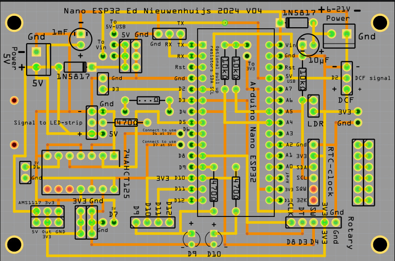
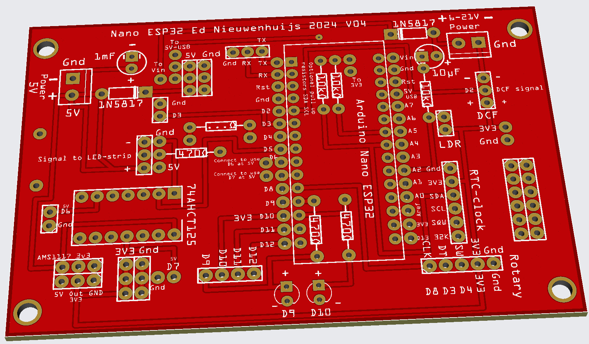
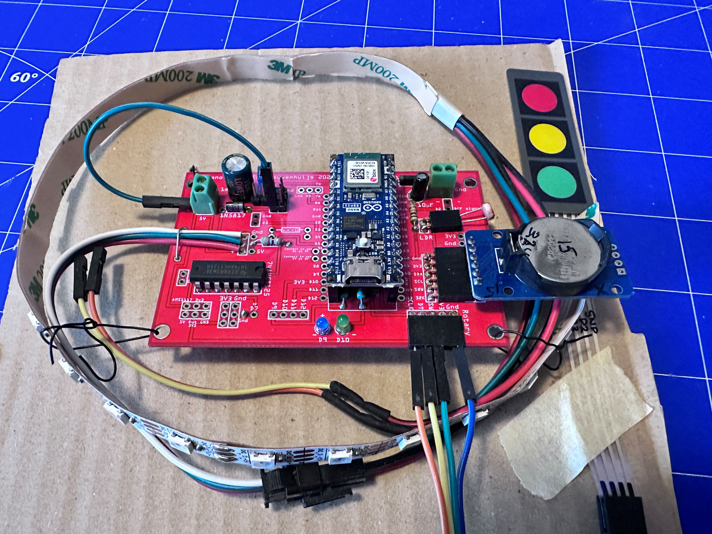
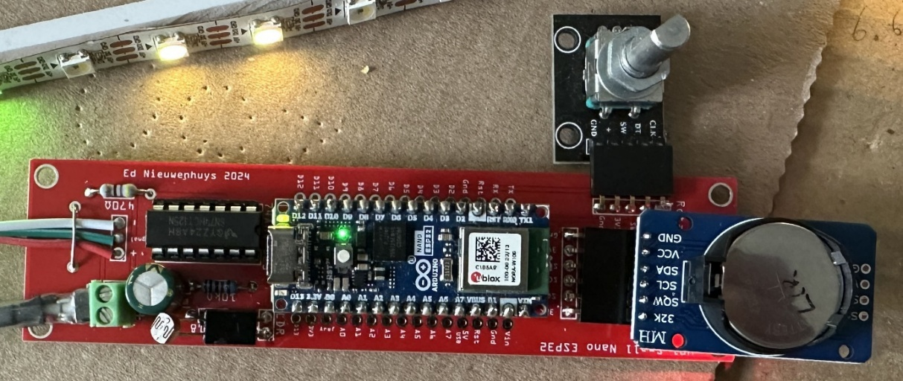
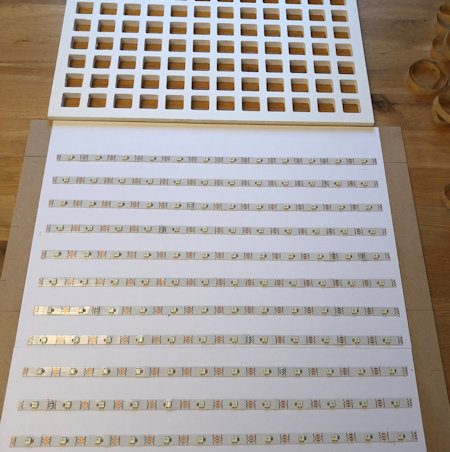
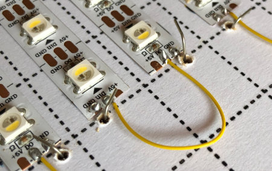
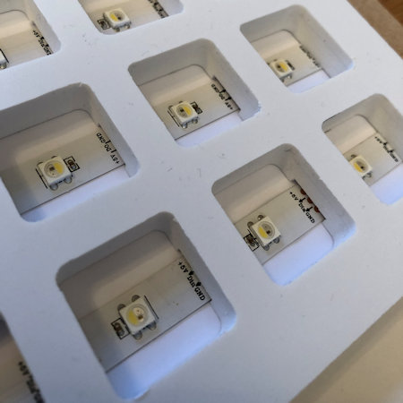

# Hardware en bouw van de woordklok

Dit document beschrijft de hardware van de Arduino ESP32-Nano woordklok: de onderdelen, de printplaten (PCB's), de voeding, de aansluitingen en de bouw van de klokkast. Voor de software: zie de [Handleiding](Handleiding.md). De wijze waarop de software de pinnen gebruikt staat in [bijlage 13.2 van de handleiding](Handleiding.md#132-aansluitingen-van-de-arduino-nano-esp32).

[English](Hardware_EN.md) · [README](READMENL.md) · [Handleiding](Handleiding.md)

## Inhoud

1. [Overzicht van de onderdelen](#1-overzicht-van-de-onderdelen)
2. [De LED-strip en het datasignaal](#2-de-led-strip-en-het-datasignaal)
3. [De printplaten](#3-de-printplaten)
4. [Onderdelenlijst (Bill of Materials)](#4-onderdelenlijst-bill-of-materials)
5. [Voeding](#5-voeding)
6. [Aansluitingen op de printplaat](#6-aansluitingen-op-de-printplaat)
7. [De optionele onderdelen](#7-de-optionele-onderdelen)
8. [De LED-grondplaat en de klokkast](#8-de-led-grondplaat-en-de-klokkast)

---

## 1. Overzicht van de onderdelen

| Onderdeel | Doel | Verplicht? |
|---|---|---|
| **Arduino Nano ESP32** | Processor met WIFI en Bluetooth | Ja |
| **LED-strip SK6812 RGBW of WS2812 RGB** | Het display | Ja |
| **LDR (lichtgevoelige weerstand)** met 10 kΩ | Meet het omgevingslicht voor de automatische helderheid | Aanbevolen |
| **Level shifter 74HCT125** (of 74AHCT125) | Zet het 3,3 V datasignaal om naar 5 V voor de LED-strip | Aanbevolen |
| **DS3231 RTC-module** | Nauwkeurige klok voor gebruik zonder internet | Optioneel |
| **Rotary encoder** (KY-034) of **membraanschakelaar met drie knoppen** | Tijd instellen zonder WIFI of Bluetooth | Optioneel |
| **IR-ontvanger** met afstandsbediening | Tijd en kleurschema instellen | Optioneel |
| **Resetknop** | Fabrieksinstellingen herstellen | Optioneel |
| **HC-12 433 MHz-module** | Tijd versturen naar andere klokken | Optioneel |
| **DCF77-ontvanger** of ander apparaat dat pulsen levert | Aansluiting op de PCB aanwezig | Optioneel |
| **Voeding 5 V, > 1 A** | LED-strip en processor | Ja |

De klok werkt ook zonder een van de optionele onderdelen: met WIFI komt de tijd van het internet (NTP), en alle instellingen kunnen met Bluetooth, de webpagina of MQTT worden gedaan. Zie [hoofdstuk 5.1 van de handleiding](Handleiding.md#51-welke-invoer-heeft-de-klok) voor de keuze van het invoerapparaat.

## 2. De LED-strip en het datasignaal

De SK6812 RGBW- of WS2812 RGB-LED-strip werkt op **5 V**. Het datasignaal van de Nano ESP32 is **3,3 V**. Dat is voor sommige strips te laag om betrouwbaar te werken.

- **Aanbevolen: een level shifter.** De 74HCT125 (vier poorten) zet het signaal om van 3,3 V naar 5 V. De andere drie poorten van de IC kunnen voor andere doeleinden worden gebruikt; het PCB-ontwerp doet dat.
- **Optocouplers werken niet.** Pogingen om het datasignaal met optocouplers te versterken zijn mislukt. Zie het [experiment met een optocoupler](https://ednieuw.com/ElecProj/OptoSK6812/OptocouplerSK6812.html).
- **Zonder level shifter** werkte een SK6812 RGBW-strip met 14 LEDs ook goed, met de datalijn direct op de 3,3 V-uitgang van de Nano ESP32. Strips met meer LEDs zijn niet getest.

Voor een strip zonder level shifter geldt als vuistregel: een weerstand van **470 Ω** in de datalijn en een condensator van **200 - 1000 µF** over 5 V en GND, direct op de strip. Succes is dan niet gegarandeerd.

### Soorten strips

| Strip | LEDs | Opmerking |
|---|---|---|
| **SK6812 RGBW** | Rood, groen, blauw en wit | De witte LED (het gele vlakje) geeft een mooi wit. Selecteer in het menu `%` voor het type |
| **WS2812 RGB** | Rood, groen, blauw | Geen witte LED; het wit-deel in kleurcommando's heeft geen effect |

## 3. De printplaten

De printplaten zijn ontworpen met de gratis software [Fritzing](https://fritzing.org/). Fritzing exporteert **Gerber-bestanden** die naar een PCB-fabrikant kunnen worden gestuurd. In Europa gemaakte printplaten kunnen met de Fritzing-app zelf worden besteld.

Een goedkope en goede ervaring is [PCBWay](https://www.pcbway.com/): 10 printplaten voor ongeveer $5, met ongeveer $25 verzend- en invoerkosten. De printplaten zijn binnen een week ontvangen en de kwaliteit was uitstekend. Upload het zipbestand met de Gerber-bestanden en betaal de kosten.

De ontwerpen (`.fzz`-bestand en Gerber-bestanden) staan in de map [PCB](PCB) van deze repository, en ook op [github.com/ednieuw/NanoESP32PCB](https://github.com/ednieuw/NanoESP32PCB).

| PCB | Map | Gebruik |
|---|---|---|
| **Grote PCB V04** | [PCB/Arduino Nano ESP32 PCB](<PCB/Arduino Nano ESP32 PCB>) | Alle aansluitingen: rotary of drukknoppen, DS3231, DCF77, LDR, IR, resetknop, level shifter |
| **Kleine PCB V03** | [PCB/Arduino Nano ESP32 small PCB](<PCB/Arduino Nano ESP32 small PCB>) | Minimaal ontwerp voor kleine ruimtes |
| **Ultimate PCB V005** | [PCB/Arduino Nano ESP32Ultimate PCB](<PCB/Arduino Nano ESP32Ultimate PCB>) | Uitgebreide uitvoering |
| **Universele PCB** | [Nano ESP32 RGBW BW PCB](https://github.com/ednieuw/NanoESP32-BW-RGBW-clock) | Voor RGB(W)-LEDs en witte 2835-LED-strips met schuifregisters, met één broncode |

*Alle onderdelen op PCB V04, inclusief membraantoetsenbord.*

## 4. Onderdelenlijst (Bill of Materials)

### Grote PCB V04

| Aantal | Onderdeel | Waarde / specificatie | Aanduiding |
|---|---|---|---|
| 1 | Arduino Nano ESP32 | | Processor |
| 3 | Weerstand | 470 Ω, ±5% | Voor de LED-strip en de 3 mm LED |
| 3 | Weerstand | 10 kΩ, ±5% | LDR; 2 optioneel voor I2C |
| 1 | Elektrolytische condensator | 1000 µF, 16 V | 1mF |
| 1 | Elektrolytische condensator | 10 µF | 10uF |
| 1 | LDR | GL5516 | LDR |
| 1 | Rotary encoder of membraantoetsenbord | KY-034 | Rotary |
| 1 | RTC-module | DS3231 | RTC-clock |
| 1 | RGB(W) LED-strip | WS2812 of SK6812 | LED-strip |
| 2 | Diode | 1N5817 | 1N5817 |
| 1 | LED, 3 mm | Rood (633 nm) | D9 |
| 1 | LED, 3 mm | Geel (592 nm) | D10 |
| 1 | IC | 74AHCT125 | Level shifter |
| 2 | Schroefklem, 2-polig, 3,5 mm | POWER | J1, J2 |
| 2 | Female pin header, 15-polig, 0,1" | Aansluiting voor de Arduino Nano ESP32 | Nano ESP32 |
| 1 | Female pin header, 6-polig | DS3231 (GND, 5V, SDA, SCL op de I2C van de Arduino) | RTC-clock |
| 1 | Female pin header, 5-polig | Rotary encoder | Rotary |
| 1 | Female pin header, 3-polig | DCF77-ontvanger | DCF |
| 1 | Female pin header, 3-polig | Optionele 3,3 V-regelaar (GND, 5V, ingang-GND) | AMS1117 3v3 |
| 1 | Male pin header, 4-polig | 5 V naar Vin of USB | |
| 1 | Male pin header, 3-polig | Alle drie de pinnen aan 5 V | RTCclock12 |
| 1 | Male pin header, 3-polig | Alle drie de pinnen aan GND | RTCclock13 |
| 1 | Female pin header, 3-polig | GND, GND en één poot van R5 | RTCclock6 |
| 1 | Female pin header, 2-polig | LDR | LDR |
| 1 | Jumper, 2-polig | Kiest 5 V naar Vin of naar USB 5 V | Power shunt |
| 1 | Male pin header, 3-polig | TX/RX en GND van de Arduino | TX-RX |

### Kleine PCB V03

| Aantal | Onderdeel | Waarde / specificatie | Aanduiding |
|---|---|---|---|
| 1 | Arduino Nano ESP32 | | Processor |
| 1 | LDR | GL5516 | LDR |
| 1 | Rotary encoder of membraantoetsenbord | KY-034 | Rotary |
| 1 | RTC-module | DS3231 | RTC-clock |
| 1 | RGB(W) LED-strip | WS2812 of SK6812 | LED-strip |
| 1 | Weerstand | 470 Ω, ±5% | LED-strip |
| 1 | Weerstand | 10 kΩ, ±5% | LDR |
| 1 | Elektrolytische condensator | 1000 µF, 16 V | Bij de voeding |
| 1 | Diode | 1N5817 | Bij de voeding |
| 1 | IC | 74AHCT125 | Level shifter |
| 1 | Schroefklem, 2-polig, 3,5 mm | | Power |
| 2 | Female pin header, 15-polig | Aansluiting voor de Arduino Nano ESP32 | Nano ESP32 |
| 1 | Female pin header, 6-polig | DS3231 | RTC-clock |
| 1 | Female pin header, 5-polig | Rotary encoder | Rotary |
| 1 | Female pin header, 2-polig | LDR | LDR |

> **Opmerking over de diode.** Op de printplaat staat "1N5817", maar de onderliggende Fritzing-onderdeelinformatie noemt "1N4001". Dat zijn verschillende diodes: de 1N5817 is een Schottky-diode met een spanningsval van ongeveer 0,45 V, de 1N4001 een gewone gelijkrichter met ongeveer 0,7 V. De **1N5817** heeft de voorkeur. De volledige lijsten staan ook in [BillOfMaterials_PCBv04.md](PCB/BillOfMaterials_PCBv04.md) en [BillOfMaterials_smallPCB.md](PCB/BillOfMaterials_smallPCB.md).

## 5. Voeding

### Voeding van de LED-strip en de Nano

De LED-strip heeft **5 V** nodig. Dat kan op drie manieren, afhankelijk van hoe de PCB is aangesloten:

| Voeding | Aansluiting | Opmerking |
|---|---|---|
| **5 V-voeding > 1 A** | Schroefklem linksboven op de PCB (5 V) | Voedt de LED-strip rechtstreeks. Aanbevolen voor klokken met veel LEDs |
| **6 - 21 V** | Aansluiting *Power 6-21V* naar de VIN-pin van de Nano | Voedt ook de Nano. Zie de waarschuwing hieronder |
| **USB-C** | De USB-C-poort van de Nano ESP32 | De pin VBUS levert 5 V zodra via USB wordt gevoed. De LEDs worden dan via de PCB gevoed |

Welke voeding de LED-strip krijgt, wordt op de PCB bepaald met overbruggingen (zie de afbeelding): kortsluiten van de **rode** verbinding voedt de LED-strip met 5 V via de aansluiting *Power 6-21V* (VIN); kortsluiten van de **gele** verbinding voedt de LEDs via de USB-C-voeding.

> **Let op.** De 5 V-aansluiting gaat **rechtstreeks naar de LED-strip**. Wordt daar een voeding met een hogere spanning aangesloten, dan worden de LEDs vernield terwijl de Nano gewoon aangaat.

> **Stroom via USB-C.** De LEDs voeden via de USB-C-poort is prima voor ongeveer 20 LEDs, maar waarschijnlijk niet voor langere strips. De stroom loopt dan door de dunne koperbanen van de PCB. USB-C-voedingen kunnen meer dan 20 A leveren; dat kan de koperbanen laten smelten. Gebruik daarom bij langere strips een aparte 5 V-voeding op de schroefklem.

> **VIN en VBUS.** Wordt de Nano via de VIN-pin gevoed, dan is VBUS uitgeschakeld. Er is dan geen 5 V van het bord af te nemen. Een USB-voeding van 5 V op VIN werkt, hoewel als minimale spanning 6 V is opgegeven: de diode 1N5817 verlaagt de spanning nog met ongeveer 0,5 V naar 4,5 V.

### Condensator en weerstand

Een condensator van 1000 µF over 5 V en GND bij de LED-strip vangt stroompieken op. De weerstand van 470 Ω in de datalijn beschermt de eerste LED.

## 6. Aansluitingen op de printplaat

### Grote PCB

Met de klok mee, vanaf rechtsboven:

| Aansluiting | Pin of functie |
|---|---|
| Voedingsingang 6 - 21 V | Naar Vin op de Nano ESP32 |
| DCF | D2, 3V3 en GND |
| LDR | A2 en 3V3 |
| RTC-klok (DS3231) | GND, 3V3, A4 (SDA) en A5 (SCL) |
| Rotary encoder of drieknops-schakelaar | D8, D3, D4, 3V3 en GND |
| Resetknop | D6 en GND (of D7) |
| IR-afstandsbediening | D4, 3V3 en GND |
| LEDs | D10 en D9 |
| Connector | D12, D11, D10 en D9 |
| D7 | Met 5 V via 3V3 → 5V-niveauomzetter |
| Connector | GND en 3V3 |
| Connector | AMS1117 5V → 3V3 1 A-spanningsregelaar |
| D6 | Met 5 V via 3V3 → 5V-niveauomzetter |
| LED-strip SK6812/WS2812 | 5V, D5 en GND |
| D3 | Met 3V3 naar D3 en GND |
| 5 V-voedingsingang | Naar 5V-USB of Vin op de ESP32 en naar de LED-strip |
| 5V- en GND-connector | Naar Vin en 5V-USB op de Arduino Nano ESP32 |
| Connector | GND, RX en TX |

### Kleine PCB

Met de klok mee, vanaf linksboven:

| Aansluiting | Pin of functie |
|---|---|
| LDR | A2 en 3V3 |
| 5 V-voedingsingang | Naar 5V-USB op de ESP32 en naar de LED-strip |
| LED-strip SK6812/WS2812 | 5V, D5 en GND |
| Rotary encoder of drieknops-schakelaar | D2, D3, D4, 3V3 en GND |
| Resetknop | D6 en GND (of D7) |
| IR-afstandsbediening | D4, 3V3 en GND |
| RTC-klok (DS3231) | GND, 3V3, A4 en A5 |

> Op de **grote PCB** zit de rotary-pin B op **D8** (zie de sketch: `encoderPinBL`), op de **kleine PCB** op **D2**.

### De Nano ESP32

## 7. De optionele onderdelen

### LDR (lichtsensor)

De LDR is aangesloten op **A2** en 3,3 V, met een weerstand van 10 kΩ. De software meet het licht en regelt daarmee de helderheid van de LEDs (zie [hoofdstuk 6.6 van de handleiding](Handleiding.md#66-de-helderheid-van-het-display)).

### DS3231 RTC-module

De module wordt via I2C aangesloten: **SDA op A4, SCL op A5**, plus 3,3 V en GND. Hij houdt de tijd zeer nauwkeurig bij (enkele seconden per jaar) en heeft een knoopcel als reservebatterij. Gebruik in het menu `J` om de DS3231 te kiezen ([hoofdstuk 5.3](Handleiding.md#met-de-ds3231-rtc-module-zonder-internet)).

### Rotary encoder of drie drukknoppen

| Onderdeel | Pinnen | Kiezen met |
|---|---|---|
| Rotary encoder (KY-034) | Grote PCB D8, D3 en D4 (SW). Kleine PCB D2, D3 en D4 | `H01` |
| Membraanschakelaar met drie knoppen | Zelfde connector | `H02` |

### IR-ontvanger

De IR-ontvanger wordt op **D4**, 3,3 V en GND aangesloten (dezelfde pin als de drukknop van de rotary; beide kunnen niet tegelijk). Kies met `H03` (grote afstandsbediening) of `H04` (kleine) en laat de klok de toetsen leren met `{` ([hoofdstuk 5](Handleiding.md#met-een-ir-afstandsbediening)).

### Resetknop

Een drukknop tussen een GPIO-pin en GND (op de PCB D6 of D7). Stel de pin in met `^nn` en herstart met `@` ([commando ^](Handleiding.md#---reset-knop)). Twee seconden indrukken herstelt de fabrieksinstellingen.

### HC-12 (433 MHz tijdzender)

De HC-12 wordt met zijn RXD-pin aan **D4** aangesloten, plus voeding en GND, en met `H07` ingeschakeld ([hoofdstuk 8.4](Handleiding.md#84-hc-12-tijdzender-433-mhz)). D4 wordt ook voor IR en de rotary-drukknop gebruikt; er kan maar één van de drie tegelijk worden aangesloten.

### Bluetooth en WIFI

De Nano ESP32 heeft zelf Bluetooth en WIFI. Er is geen extra hardware voor nodig.

## 8. De LED-grondplaat en de klokkast

### De LED-strip

De afstand tussen de LEDs op de strip is geschikt voor een klok van **25 x 25 cm** (60 LEDs/m) of **50 x 50 cm** (30 LEDs/m).

Er zijn twee mogelijkheden voor de 144 LEDs van de klok:

| Opstelling | Voordeel | Nadeel |
|---|---|---|
| **12 rijen van 12 LEDs** | Weinig soldeerpunten; eenvoudig | |
| **Alleen een LED achter elke letter die moet oplichten** | Minder LEDs en minder gaten in de afstandsplaat | Veel meer soldeerpunten, die elk storingen kunnen geven. Een onvolkomen soldering op de strip kan na verloop van tijd loskomen |

De software heeft ook een **digitale tijdweergave** (`Q6`) waarvoor de 144 LEDs (12 x 12) worden gebruikt.

### De strips plakken

Plak de strips van links naar rechts op de oneven rijen en van rechts naar links op de even rijen. **Volg de pijlen op de strip**: elke tweede rij wordt dus omgedraaid. Daardoor zijn er geen lange datalijnen van het rechter uiteinde van de strip naar het linker uiteinde van de volgende rij, en hoeft de software niet voor nieuwe posities te worden aangepast.

### Solderen

Vertind koperdraad is handig. Soldeer bijvoorbeeld alle 5 V-aansluitingen aan de linkerkant van de strip en alle GND-aansluitingen aan de rechterkant. Boor daarvoor een klein gat door de plaat naast elke 5 V-aansluiting links en naast elke GND rechts. Buig een hoek van 90 graden, steek de draad door het gat en soldeer hem aan de LED-strip.

### De frontplaat en de lagen

De woorden (HET, WAS, VIJF enzovoort) worden uitgezaagd of uitgesneden in de frontplaat:

- **MDF van 1 cm** met een figuurzaag. Verf de binnenkant helderwit, anders wordt het witte licht dof.
- **Geschuimd PVC, wit, 10 mm (RAL 9003)** is beter: het is gemakkelijk te snijden, het is wit en het verkleurt niet. Witte verf verkleurt vaak.

Ontwerpen voor de woordplaten staan in de mappen [WordPlateFrontCovers](WordPlateFrontCovers) en [DXFwordplates](DXFwordplates).

De volgorde van de lagen, van de LEDs naar voren:

1. de LED-grondplaat met de strips;
2. de **afstandsplaat** over de LEDs (zodat het licht per letter gescheiden blijft);
3. een vel **wit papier**;
4. de **woordplaat** (frontplaat).

### Bouwinstructies

| Klok | Bouwinstructie |
|---|---|
| Eentalige woordklok met SK6812-LEDs | [ednieuw.com/Woordklok/Bouwpakket/WoordklokSK6812.htm](https://ednieuw.com/Woordklok/Bouwpakket/WoordklokSK6812.htm) |
| Dezelfde bouwbeschrijving in deze repository | De map [Manual-Instructions](Manual-Instructions) (Nederlands en Engels, pdf) |
| 4-talige woordklok met SK6812-LEDs (UK, NL, DE, FR) | [github.com/ednieuw/FourLanguageClock](https://github.com/ednieuw/FourLanguageClock) |
| Selectiepagina voor woordklok-ontwerpen | [github.com/ednieuw/WordclockSelector](https://github.com/ednieuw/WordclockSelector) |

