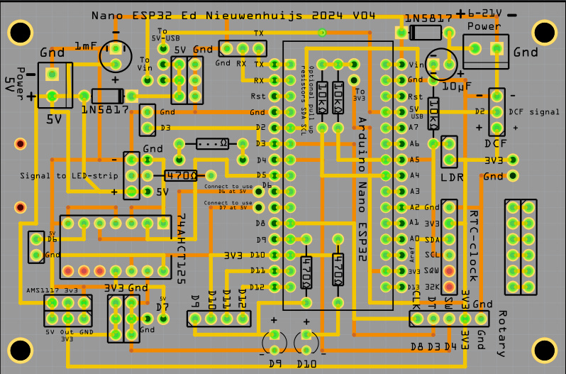
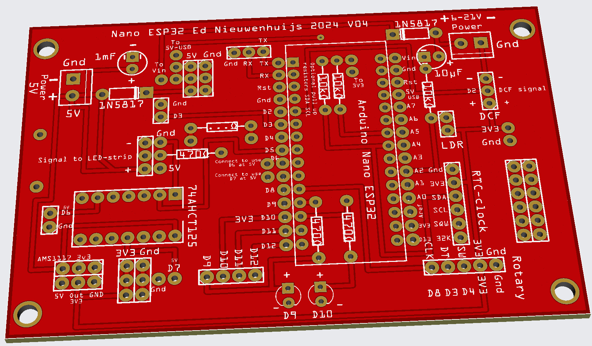
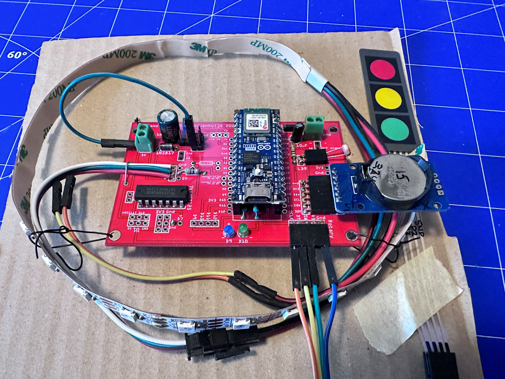
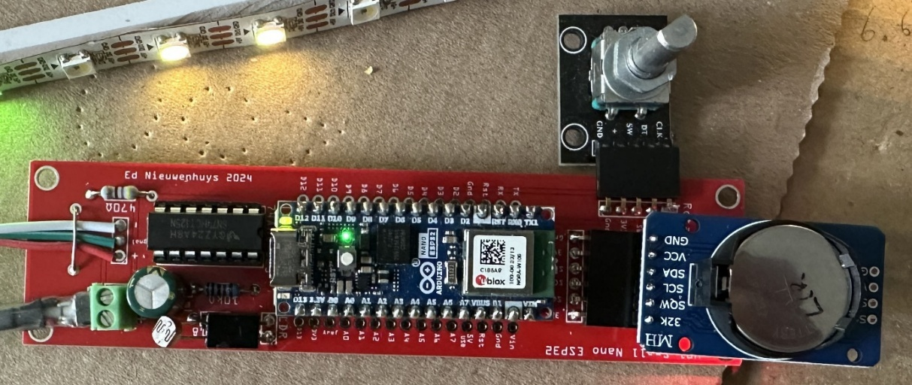
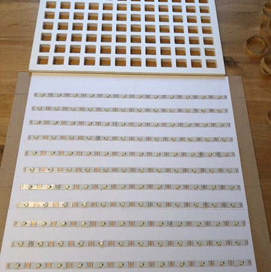
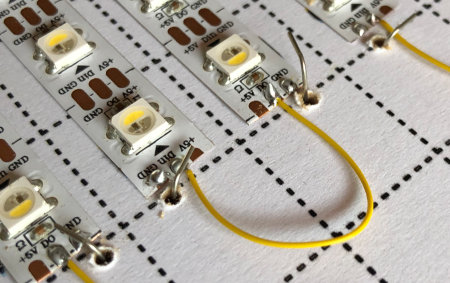
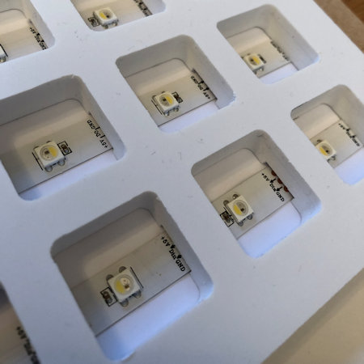

# Hardware and construction of the word clock

This document describes the hardware of the Arduino ESP32-Nano word clock: the components, the printed circuit boards (PCBs), the power supply, the connections and the construction of the clock case. For the software: see the [Manual](Manual.md). How the software uses the pins is described in [appendix 13.2 of the manual](Manual.md#132-connections-of-the-arduino-nano-esp32).

[Nederlands](Hardware.md) · [README](README.md) · [Manual](Manual.md)

## Contents

1. [Overview of the components](#1-overview-of-the-components)
2. [The LED strip and the data signal](#2-the-led-strip-and-the-data-signal)
3. [The printed circuit boards](#3-the-printed-circuit-boards)
4. [Bill of Materials](#4-bill-of-materials)
5. [Power supply](#5-power-supply)
6. [Connections on the printed circuit board](#6-connections-on-the-printed-circuit-board)
7. [The optional components](#7-the-optional-components)
8. [The LED base plate and the clock case](#8-the-led-base-plate-and-the-clock-case)

---

## 1. Overview of the components

| Component | Purpose | Required? |
|---|---|---|
| **Arduino Nano ESP32** | Processor with WIFI and Bluetooth | Yes |
| **LED strip SK6812 RGBW or WS2812 RGB** | The display | Yes |
| **LDR (light-dependent resistor)** with 10 kΩ | Measures the ambient light for the automatic brightness | Recommended |
| **Level shifter 74HCT125** (or 74AHCT125) | Converts the 3.3 V data signal to 5 V for the LED strip | Recommended |
| **DS3231 RTC module** | Accurate clock for use without internet | Optional |
| **Rotary encoder** (KY-034) or **membrane switch with three buttons** | Setting the time without WIFI or Bluetooth | Optional |
| **IR receiver** with remote control | Setting the time and colour scheme | Optional |
| **Reset button** | Restoring the factory settings | Optional |
| **HC-12 433 MHz module** | Sending the time to other clocks | Optional |
| **DCF77 receiver** or another device that delivers pulses | Connection present on the PCB | Optional |
| **Power supply 5 V, > 1 A** | LED strip and processor | Yes |

The clock also works without any of the optional components: with WIFI the time comes from the internet (NTP), and all settings can be made with Bluetooth, the web page or MQTT. See [chapter 5.1 of the manual](Manual.md#51-which-input-does-the-clock-have) for the choice of input device.

## 2. The LED strip and the data signal

The SK6812 RGBW or WS2812 RGB LED strip works on **5 V**. The data signal of the Nano ESP32 is **3.3 V**. For some strips that is too low to work reliably.

- **Recommended: a level shifter.** The 74HCT125 (four gates) converts the signal from 3.3 V to 5 V. The other three gates of the IC can be used for other purposes; the PCB design does that.
- **Optocouplers do not work.** Attempts to boost the data signal with optocouplers failed. See the [experiment with an optocoupler](https://ednieuw.com/ElecProj/OptoSK6812/OptocouplerSK6812.html).
- **Without a level shifter** an SK6812 RGBW strip with 14 LEDs also worked well, with the data line directly on the 3.3 V output of the Nano ESP32. Strips with more LEDs have not been tested.

For a strip without a level shifter the rule of thumb is: a resistor of **470 Ω** in the data line and a capacitor of **200 - 1000 µF** across 5 V and GND, directly on the strip. Success is then not guaranteed.

### Types of strips

| Strip | LEDs | Remark |
|---|---|---|
| **SK6812 RGBW** | Red, green, blue and white | The white LED (the yellow square) gives a nice white. Select the type with `%` in the menu |
| **WS2812 RGB** | Red, green, blue | No white LED; the white part in colour commands has no effect |

## 3. The printed circuit boards

The printed circuit boards were designed with the free software [Fritzing](https://fritzing.org/). Fritzing exports **Gerber files** that can be sent to a PCB manufacturer. PCBs made in Europe can be ordered with the Fritzing app itself.

A cheap and good experience is [PCBWay](https://www.pcbway.com/): 10 printed circuit boards for about $5, with about $25 shipping and import costs. The boards were received within a week and the quality was excellent. Upload the zip file with the Gerber files and pay the costs.

The designs (`.fzz` file and Gerber files) are in the folder [PCB](PCB) of this repository, and also at [github.com/ednieuw/NanoESP32PCB](https://github.com/ednieuw/NanoESP32PCB).

| PCB | Folder | Use |
|---|---|---|
| **Large PCB V04** | [PCB/Arduino Nano ESP32 PCB](<PCB/Arduino Nano ESP32 PCB>) | All connections: rotary or push buttons, DS3231, DCF77, LDR, IR, reset button, level shifter |
| **Small PCB V03** | [PCB/Arduino Nano ESP32 small PCB](<PCB/Arduino Nano ESP32 small PCB>) | Minimal design for small spaces |
| **Ultimate PCB V005** | [PCB/Arduino Nano ESP32Ultimate PCB](<PCB/Arduino Nano ESP32Ultimate PCB>) | Extended version |
| **Universal PCB** | [Nano ESP32 RGBW BW PCB](https://github.com/ednieuw/NanoESP32-BW-RGBW-clock) | For RGB(W) LEDs and white 2835 LED strips with shift registers, with one source code |

*All components on PCB V04, including the membrane keypad.*

## 4. Bill of Materials

### Large PCB V04

| Quantity | Component | Value / specification | Designation |
|---|---|---|---|
| 1 | Arduino Nano ESP32 | | Processor |
| 3 | Resistor | 470 Ω, ±5% | In front of the LED strip and the 3 mm LED |
| 3 | Resistor | 10 kΩ, ±5% | LDR; 2 optional for I2C |
| 1 | Electrolytic capacitor | 1000 µF, 16 V | 1mF |
| 1 | Electrolytic capacitor | 10 µF | 10uF |
| 1 | LDR | GL5516 | LDR |
| 1 | Rotary encoder or membrane keypad | KY-034 | Rotary |
| 1 | RTC module | DS3231 | RTC-clock |
| 1 | RGB(W) LED strip | WS2812 or SK6812 | LED-strip |
| 2 | Diode | 1N5817 | 1N5817 |
| 1 | LED, 3 mm | Red (633 nm) | D9 |
| 1 | LED, 3 mm | Yellow (592 nm) | D10 |
| 1 | IC | 74AHCT125 | Level shifter |
| 2 | Screw terminal, 2-pin, 3.5 mm | POWER | J1, J2 |
| 2 | Female pin header, 15-pin, 0.1" | Connection for the Arduino Nano ESP32 | Nano ESP32 |
| 1 | Female pin header, 6-pin | DS3231 (GND, 5V, SDA, SCL on the I2C of the Arduino) | RTC-clock |
| 1 | Female pin header, 5-pin | Rotary encoder | Rotary |
| 1 | Female pin header, 3-pin | DCF77 receiver | DCF |
| 1 | Female pin header, 3-pin | Optional 3.3 V regulator (GND, 5V, input-GND) | AMS1117 3v3 |
| 1 | Male pin header, 4-pin | 5 V to Vin or USB | |
| 1 | Male pin header, 3-pin | All three pins to 5 V | RTCclock12 |
| 1 | Male pin header, 3-pin | All three pins to GND | RTCclock13 |
| 1 | Female pin header, 3-pin | GND, GND and one leg of R5 | RTCclock6 |
| 1 | Female pin header, 2-pin | LDR | LDR |
| 1 | Jumper, 2-pin | Selects 5 V to Vin or to USB 5 V | Power shunt |
| 1 | Male pin header, 3-pin | TX/RX and GND of the Arduino | TX-RX |

### Small PCB V03

| Quantity | Component | Value / specification | Designation |
|---|---|---|---|
| 1 | Arduino Nano ESP32 | | Processor |
| 1 | LDR | GL5516 | LDR |
| 1 | Rotary encoder or membrane keypad | KY-034 | Rotary |
| 1 | RTC module | DS3231 | RTC-clock |
| 1 | RGB(W) LED strip | WS2812 or SK6812 | LED-strip |
| 1 | Resistor | 470 Ω, ±5% | LED-strip |
| 1 | Resistor | 10 kΩ, ±5% | LDR |
| 1 | Electrolytic capacitor | 1000 µF, 16 V | Near the power supply |
| 1 | Diode | 1N5817 | Near the power supply |
| 1 | IC | 74AHCT125 | Level shifter |
| 1 | Screw terminal, 2-pin, 3.5 mm | | Power |
| 2 | Female pin header, 15-pin | Connection for the Arduino Nano ESP32 | Nano ESP32 |
| 1 | Female pin header, 6-pin | DS3231 | RTC-clock |
| 1 | Female pin header, 5-pin | Rotary encoder | Rotary |
| 1 | Female pin header, 2-pin | LDR | LDR |

> **Remark on the diode.** The printed circuit board says "1N5817", but the underlying Fritzing part information says "1N4001". Those are different diodes: the 1N5817 is a Schottky diode with a voltage drop of about 0.45 V, the 1N4001 an ordinary rectifier with about 0.7 V. The **1N5817** is preferred. The complete lists are also in [BillOfMaterials_PCBv04.md](PCB/BillOfMaterials_PCBv04.md) and [BillOfMaterials_smallPCB.md](PCB/BillOfMaterials_smallPCB.md).

## 5. Power supply

### Power for the LED strip and the Nano

The LED strip needs **5 V**. That can be supplied in three ways, depending on how the PCB is connected:

| Supply | Connection | Remark |
|---|---|---|
| **5 V supply > 1 A** | Screw terminal at the top left of the PCB (5 V) | Powers the LED strip directly. Recommended for clocks with many LEDs |
| **6 - 21 V** | Connection *Power 6-21V* to the VIN pin of the Nano | Also powers the Nano. See the warning below |
| **USB-C** | The USB-C port of the Nano ESP32 | The pin VBUS supplies 5 V as soon as power comes through USB. The LEDs are then powered through the PCB |

Which supply the LED strip gets is determined on the PCB with bridges (see the image): shorting the **red** connection powers the LED strip with 5 V through the connection *Power 6-21V* (VIN); shorting the **yellow** connection powers the LEDs from the USB-C supply.

> **Attention.** The 5 V connection goes **directly to the LED strip**. If a supply with a higher voltage is connected there, the LEDs are destroyed while the Nano happily switches on.

> **Current through USB-C.** Powering the LEDs through the USB-C port is fine for about 20 LEDs, but probably not for longer strips. The current then flows through the thin copper tracks of the PCB. USB-C supplies can deliver more than 20 A; that can melt the copper tracks. For longer strips, therefore, use a separate 5 V supply on the screw terminal.

> **VIN and VBUS.** If the Nano is powered through the VIN pin, VBUS is switched off. No 5 V can then be taken from the board. A USB supply of 5 V on VIN works, although 6 V is specified as the minimum voltage: the diode 1N5817 still lowers the voltage by about 0.5 V to 4.5 V.

### Capacitor and resistor

A capacitor of 1000 µF across 5 V and GND at the LED strip absorbs current peaks. The resistor of 470 Ω in the data line protects the first LED.

## 6. Connections on the printed circuit board

### Large PCB

Clockwise, from the top right:

| Connection | Pin or function |
|---|---|
| Power input 6 - 21 V | To Vin on the Nano ESP32 |
| DCF | D2, 3V3 and GND |
| LDR | A2 and 3V3 |
| RTC clock (DS3231) | GND, 3V3, A4 (SDA) and A5 (SCL) |
| Rotary encoder or three-button switch | D8, D3, D4, 3V3 and GND |
| Reset button | D6 and GND (or D7) |
| IR remote control | D4, 3V3 and GND |
| LEDs | D10 and D9 |
| Connector | D12, D11, D10 and D9 |
| D7 | With 5 V through 3V3 → 5V level converter |
| Connector | GND and 3V3 |
| Connector | AMS1117 5V → 3V3 1 A voltage regulator |
| D6 | With 5 V through 3V3 → 5V level converter |
| LED strip SK6812/WS2812 | 5V, D5 and GND |
| D3 | With 3V3 to D3 and GND |
| 5 V power input | To 5V-USB or Vin on the ESP32 and to the LED strip |
| 5V and GND connector | To Vin and 5V-USB on the Arduino Nano ESP32 |
| Connector | GND, RX and TX |

### Small PCB

Clockwise, from the top left:

| Connection | Pin or function |
|---|---|
| LDR | A2 and 3V3 |
| 5 V power input | To 5V-USB on the ESP32 and to the LED strip |
| LED strip SK6812/WS2812 | 5V, D5 and GND |
| Rotary encoder or three-button switch | D2, D3, D4, 3V3 and GND |
| Reset button | D6 and GND (or D7) |
| IR remote control | D4, 3V3 and GND |
| RTC clock (DS3231) | GND, 3V3, A4 and A5 |

> On the **large PCB** rotary pin B is on **D8** (see the sketch: `encoderPinBL`), on the **small PCB** on **D2**.

### The Nano ESP32

## 7. The optional components

### LDR (light sensor)

The LDR is connected to **A2** and 3.3 V, with a resistor of 10 kΩ. The software measures the light and uses it to control the brightness of the LEDs (see [chapter 6.6 of the manual](Manual.md#66-the-brightness-of-the-display)).

### DS3231 RTC module

The module is connected through I2C: **SDA on A4, SCL on A5**, plus 3.3 V and GND. It keeps very accurate time (a few seconds per year) and has a coin cell as back-up battery. Use `J` in the menu to choose the DS3231 ([chapter 5.3](Manual.md#with-the-ds3231-rtc-module-without-internet)).

### Rotary encoder or three push buttons

| Component | Pins | Select with |
|---|---|---|
| Rotary encoder (KY-034) | Large PCB D8, D3 and D4 (SW). Small PCB D2, D3 and D4 | `H01` |
| Membrane switch with three buttons | Same connector | `H02` |

### IR receiver

The IR receiver is connected to **D4**, 3.3 V and GND (the same pin as the push button of the rotary; both cannot be used at the same time). Choose with `H03` (large remote control) or `H04` (small) and have the clock learn the keys with `{` ([chapter 5](Manual.md#with-an-ir-remote-control)).

### Reset button

A push button between a GPIO pin and GND (on the PCB D6 or D7). Set the pin with `^nn` and restart with `@` ([command ^](Manual.md#---reset-button)). Pressing for two seconds restores the factory settings.

### HC-12 (433 MHz time sender)

The HC-12 is connected with its RXD pin to **D4**, plus power and GND, and is switched on with `H07` ([chapter 8.4](Manual.md#84-hc-12-time-sender-433-mhz)). D4 is also used for IR and the rotary push button; only one of the three can be connected at a time.

### Bluetooth and WIFI

The Nano ESP32 itself has Bluetooth and WIFI. No extra hardware is needed for them.

## 8. The LED base plate and the clock case

### The LED strip

The distance between the LEDs on the strip is suitable for a clock of **25 x 25 cm** (60 LEDs/m) or **50 x 50 cm** (30 LEDs/m).

There are two possibilities for the 144 LEDs of the clock:

| Arrangement | Advantage | Disadvantage |
|---|---|---|
| **12 rows of 12 LEDs** | Few solder points; simple | |
| **Only one LED behind every letter that has to light up** | Fewer LEDs and fewer holes in the spacer plate | Many more solder points, each of which can cause faults. An imperfect solder joint on the strip can come loose over time |

The software also has a **digital time display** (`Q6`) for which the 144 LEDs (12 x 12) are used.

### Gluing the strips

Glue the strips from left to right on the odd rows and from right to left on the even rows. **Follow the arrows on the strip**: every second row is therefore turned around. As a result there are no long data lines from the right end of the strip to the left end of the next row, and the software does not have to be adapted for new positions.

### Soldering

Tinned copper wire is handy. For example, solder all 5 V connections on the left side of the strip and all GND connections on the right side. For that, drill a small hole through the plate next to every 5 V connection on the left and next to every GND on the right. Bend a 90-degree angle, push the wire through the hole and solder it to the LED strip.

### The front plate and the layers

The words (HET, WAS, VIJF and so on) are sawn or cut out in the front plate:

- **MDF of 1 cm** with a jigsaw. Paint the inside bright white, otherwise the white light becomes dull.
- **Foamed PVC, white, 10 mm (RAL 9003)** is better: it is easy to cut, it is white and it does not discolour. White paint often discolours.

Designs for the word plates are in the folders [WordPlateFrontCovers](WordPlateFrontCovers) and [DXFwordplates](DXFwordplates).

The order of the layers, from the LEDs to the front:

1. the LED base plate with the strips;
2. the **spacer plate** over the LEDs (so that the light stays separated per letter);
3. a sheet of **white paper**;
4. the **word plate** (front plate).

### Building instructions

| Clock | Building instructions |
|---|---|
| Single-language word clock with SK6812 LEDs | [ednieuw.com/Woordklok/Bouwpakket/WoordklokSK6812.htm](https://ednieuw.com/Woordklok/Bouwpakket/WoordklokSK6812.htm) |
| The same building description in this repository | The folder [Manual-Instructions](Manual-Instructions) (Dutch and English, pdf) |
| Four-language word clock with SK6812 LEDs (UK, NL, DE, FR) | [github.com/ednieuw/FourLanguageClock](https://github.com/ednieuw/FourLanguageClock) |
| Selection page for word clock designs | [github.com/ednieuw/WordclockSelector](https://github.com/ednieuw/WordclockSelector) |
