# Manual Arduino ESP32-Nano word clock - complete

*Software WordFiboClock V247 - all chapters in one file*

[Nederlands](Handleiding_Compleet.md) · [README](README.md) · [Short user guide](UserGuide.md)

This file contains the full manual, the hardware and construction (chapter 3) and the program explanation (chapter 12). It is assembled automatically from `Manual.md`, `Hardware_EN.md` and `ProgramExplanation.md`.

## Contents

- **[1. Introduction](#1-introduction)**
  - [1.1 What is a word clock?](#11-what-is-a-word-clock)
  - [1.2 What can the clock do?](#12-what-can-the-clock-do)
  - [1.3 Three variants in one program](#13-three-variants-in-one-program)
  - [1.4 Operating the clock](#14-operating-the-clock)
  - [1.5 New in V247 (compared with V195)](#15-new-in-v247-compared-with-v195)
  - [1.6 More information](#16-more-information)
- **[2. Quick start](#2-quick-start)**
  - [What is needed?](#what-is-needed)
  - [Step 1 - Choose a control app](#step-1---choose-a-control-app)
  - [Step 2 - Connect the power](#step-2---connect-the-power)
  - [Step 3 - Connect the clock to WIFI](#step-3---connect-the-clock-to-wifi)
  - [Step 4 - Done, or without WIFI](#step-4---done-or-without-wifi)
  - [What next?](#what-next)
- **[3. Hardware and construction](#3-hardware-and-construction)**
  - [3.1 Overview of the components](#31-overview-of-the-components)
  - [3.2 The LED strip and the data signal](#32-the-led-strip-and-the-data-signal)
  - [3.3 The printed circuit boards](#33-the-printed-circuit-boards)
  - [3.4 Bill of Materials](#34-bill-of-materials)
  - [3.5 Power supply](#35-power-supply)
  - [3.6 Connections on the printed circuit board](#36-connections-on-the-printed-circuit-board)
  - [3.7 The optional components](#37-the-optional-components)
  - [3.8 The LED base plate and the clock case](#38-the-led-base-plate-and-the-clock-case)
- **[4. Installing the software](#4-installing-the-software)**
  - [4.1 What is needed?](#41-what-is-needed)
  - [4.2 Installing the libraries](#42-installing-the-libraries)
  - [4.3 Opening the sketch and choosing the clock variant](#43-opening-the-sketch-and-choosing-the-clock-variant)
  - [4.4 The board settings](#44-the-board-settings)
  - [4.5 Compiling and uploading](#45-compiling-and-uploading)
  - [4.6 Without compiling: uploading a `.bin` file](#46-without-compiling-uploading-a-bin-file)
  - [4.7 Problems](#47-problems)
- **[5. First use](#5-first-use)**
  - [5.1 Which input does the clock have?](#51-which-input-does-the-clock-have)
  - [5.2 Connecting to WIFI](#52-connecting-to-wifi)
  - [5.3 Setting the time](#53-setting-the-time)
- **[6. Operation and menu](#6-operation-and-menu)**
  - [6.1 Operating with a Bluetooth app](#61-operating-with-a-bluetooth-app)
  - [6.2 Operating with the web page](#62-operating-with-the-web-page)
  - [6.3 Operating with a serial cable](#63-operating-with-a-serial-cable)
  - [6.4 Operating with MQTT](#64-operating-with-mqtt)
  - [6.5 Using the menu](#65-using-the-menu)
  - [6.6 The brightness of the display](#66-the-brightness-of-the-display)
  - [6.7 The status LEDs](#67-the-status-leds)
- **[7. Menu commands A-Z](#7-menu-commands-a-z)**
  - [7.1 Overview](#71-overview)
  - [7.2 Connection and network](#72-connection-and-network)
  - [7.3 Time and date](#73-time-and-date)
  - [7.4 Colours and display](#74-colours-and-display)
  - [7.5 Brightness](#75-brightness)
  - [7.6 Information and log](#76-information-and-log)
  - [7.7 Maintenance and tests](#77-maintenance-and-tests)
- **[8. Time receiver and time sender](#8-time-receiver-and-time-sender)**
  - [8.1 Time receiver (H05)](#81-time-receiver-h05)
  - [8.2 Time senders](#82-time-senders)
  - [8.3 The clock as time sender (H06)](#83-the-clock-as-time-sender-h06)
  - [8.4 HC-12 time sender (433 MHz)](#84-hc-12-time-sender-433-mhz)
  - [8.5 Troubleshooting](#85-troubleshooting)
- **[9. MQTT and Home Assistant](#9-mqtt-and-home-assistant)**
  - [9.1 What appears in Home Assistant?](#91-what-appears-in-home-assistant)
  - [9.2 What is needed?](#92-what-is-needed)
  - [9.3 Setting up in Home Assistant](#93-setting-up-in-home-assistant)
  - [9.4 Setting up in the clock](#94-setting-up-in-the-clock)
  - [9.5 A different broker, user name or password](#95-a-different-broker-user-name-or-password)
  - [9.6 How does it work?](#96-how-does-it-work)
  - [9.7 Testing by hand](#97-testing-by-hand)
  - [9.8 A dashboard in Home Assistant](#98-a-dashboard-in-home-assistant)
  - [9.9 Troubleshooting](#99-troubleshooting)
- **[10. Fibonacci clock and NOCLOCK](#10-fibonacci-clock-and-noclock)**
  - [10.1 Fibonacci clock](#101-fibonacci-clock)
  - [10.2 Clock without a display (NOCLOCK)](#102-clock-without-a-display-noclock)
- **[11. Maintenance and troubleshooting](#11-maintenance-and-troubleshooting)**
  - [11.1 Updating the software (OTA)](#111-updating-the-software-ota)
  - [11.2 Updating the software with a USB cable](#112-updating-the-software-with-a-usb-cable)
  - [11.3 Log and diagnostics](#113-log-and-diagnostics)
  - [11.4 Automatic monitoring](#114-automatic-monitoring)
  - [11.5 Resetting](#115-resetting)
  - [11.6 Troubleshooting](#116-troubleshooting)
  - [11.7 Contact and more information](#117-contact-and-more-information)
- **[12. Program explanation](#12-program-explanation)**
  - [12.1 Overview](#121-overview)
  - [12.2 Files and clock variants](#122-files-and-clock-variants)
  - [12.3 Libraries](#123-libraries)
  - [12.4 Global variables and permanent storage](#124-global-variables-and-permanent-storage)
  - [12.5 Starting up: `setup()`](#125-starting-up-setup)
  - [12.6 The main program: `loop()` and the time steps](#126-the-main-program-loop-and-the-time-steps)
  - [12.7 Output: the `Tekstprint` functions and the log](#127-output-the-tekstprint-functions-and-the-log)
  - [12.8 Input: all commands through `ReworkInputString()`](#128-input-all-commands-through-reworkinputstring)
  - [12.9 Time](#129-time)
  - [12.10 LEDs and brightness](#1210-leds-and-brightness)
  - [12.11 The clock face](#1211-the-clock-face)
  - [12.12 Bluetooth, time receiver and time sender](#1212-bluetooth-time-receiver-and-time-sender)
  - [12.13 WIFI, web pages and OTA](#1213-wifi-web-pages-and-ota)
  - [12.14 MQTT and Home Assistant](#1214-mqtt-and-home-assistant)
  - [12.15 Monitoring and recovery](#1215-monitoring-and-recovery)
  - [12.16 Modifying and extending](#1216-modifying-and-extending)
  - [12.17 Function overview](#1217-function-overview)
- **[13. Appendices](#13-appendices)**
  - [13.1 Clock variants and file names](#131-clock-variants-and-file-names)
  - [13.2 Connections of the Arduino Nano ESP32](#132-connections-of-the-arduino-nano-esp32)
  - [13.3 Files with the sketch](#133-files-with-the-sketch)
  - [13.4 Version history](#134-version-history)
  - [13.5 Related projects](#135-related-projects)
  - [13.6 Time zones](#136-time-zones)

---

# 1. Introduction

## 1.1 What is a word clock?

A clock that shows the time in words, with WS2812 RGB or SK6812 RGBW LEDs and an
[Arduino Nano ESP32](https://docs.arduino.cc/hardware/nano-esp32/) as its heart.

There are single-language clocks (Dutch, English, French or German) with 144 LEDs in a grid of 12 x 12 LEDs, and a large [four-language clock](https://github.com/ednieuw/FourLanguageClock) with 625 LEDs in a grid of 25 x 25.
The same software is designed so that it can also drive a Fibonacci clock, or run without any clock function so that the software can be used for other projects, such as switching a load or taking measurements.

With some modifications the sketch also works on other ESP32 boards, with a different pin numbering.

| Four-language clock | Dutch clock | Corten steel clock |
|---|---|---|
| 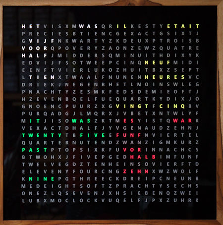 | 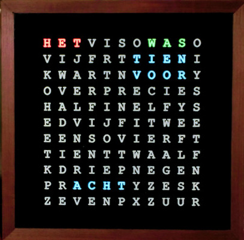 | 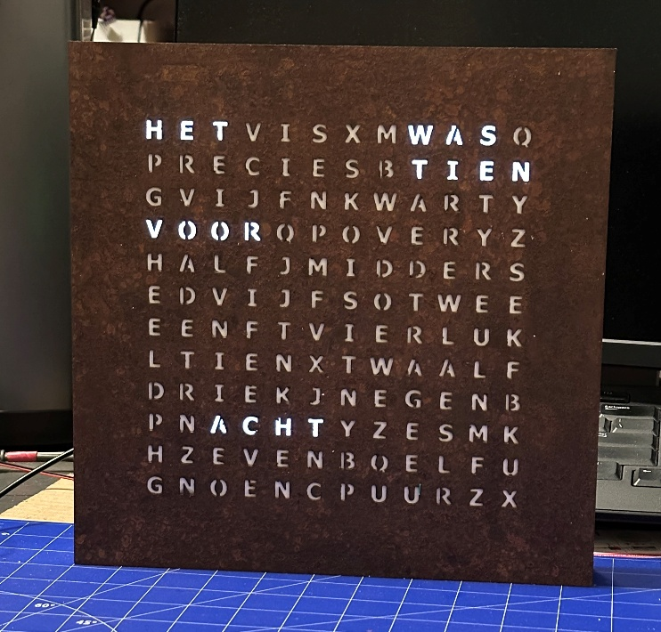 |

> See [the selection page](https://github.com/ednieuw/WordclockSelector) to compare other word clock designs.

## 1.2 What can the clock do?

- **Time from the internet.** The clock gets the time with the Network Time Protocol (NTP), accurate to the second, with automatic summer/winter time once a time zone has been entered.
- **Time without internet.** A DS3231 RTC module on the printed circuit board keeps very accurate time. The time can be set with a rotary encoder, three push buttons (membrane), almost any infrared remote control, or a time sender app.
- **Automatic brightness.** An LDR (light-dependent resistor) controls the brightness of the LEDs.
- **Many colour schemes.** A calm default colour, hourly changing colours, rainbow, own colours and more (the Q options in the menu).
- **Updating without a cable.** New software can be uploaded 'Over the Air' (OTA) through a web page.
- **Controlled and read out through MQTT,** for example with Home Assistant.

## 1.3 Three variants in one program

Since V230 the word clock software has been combined with the
[Fibonacci clock](https://github.com/ednieuw/Fibonacci-Nano-ESP32-clock) (V229/V230). When compiling, choose exactly one
variant with a `#define`:

| Variant | What it is |
|---|---|
| Word clock | The time in words, in 12 x 12 LEDs or in other formats (see the appendix on clock variants) |
| `FIBONACCI` | Fibonacci or chrono clock with five areas (1, 1, 2, 3, 5) |
| `NOCLOCK` | No display: BLE and/or HC-12 only, for example as a time sender |

## 1.4 Operating the clock

The clock can be operated in these ways:

- [BLE web page](https://github.com/ednieuw/HTML-BLEserial)
- [BLE terminal in a browser](https://ednieuw.com/BLESerial/BLE_UART_Terminal.html)
- [BLE serial terminal app](https://ednieuw.com/BLESerial/IOSappMain.html) (iOS, Android)
- Serial cable (USB-C) to a PC and the Arduino IDE
- The web page of the clock itself (menu, colour picker and log viewer), as soon as the clock is connected to WIFI
- Rotary encoder, (membrane) push buttons or IR remote control
- MQTT, for example through Home Assistant
- [Time sender app (iOS) or web page (Windows/Android)](https://ednieuw.com/Woordklok/TimeSender/TimeSender.html), with [explanation](https://github.com/ednieuw/HTML-TimeSender)

An [HC-12 time sender](https://github.com/ednieuw/ESP32-HC12) can forward the NTP time up to about 1000 metres to one or more other clocks or processors with an HC-12 module.

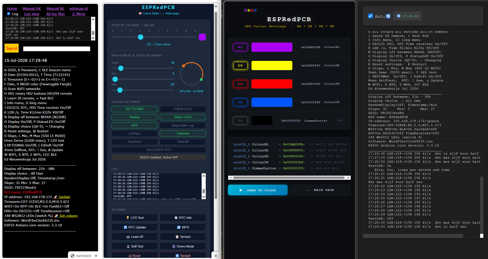

*All menus in a browser (since V235). In many browsers the tab can be split, so that the menu and the log view are shown side by side.*

## 1.5 New in V247 (compared with V195)

- New name **WordFiboClock**: word clock and Fibonacci clock in one program (V229).
- **MQTT / Home Assistant**: the clock registers itself with buttons, sliders and sensors (V236 - V244).
- **Time sender H06 (BLE) and H07 (HC-12, 433 MHz)**: the clock sends the time to other clocks (V229, H07 since V247).
- New menu options: `_` (MQTT), `V` (background colour), `FF` (Fibonacci/chrono), `^` (reset button), `O1`/`O0` (display on/off).
- Web page with live colour, colour picker (`/colourpick`) and a wider log view (V235 - V239).
- OTA page with protection against double clicks (V244).
- New clock variants and `.bin` files.

## 1.6 More information

- Software, PCBs and building drawings: [github.com/ednieuw/Arduino-ESP32-Nano-Wordclock](https://github.com/ednieuw/Arduino-ESP32-Nano-Wordclock)
- Using BLE on a mobile phone to operate the ESP32: [github.com/ednieuw/nRF-ESP32](https://github.com/ednieuw/nRF-ESP32)
- All BLE terminals in one place: [ednieuw.com/BLESerial](https://ednieuw.com/BLESerial/)

> **Note on Bluetooth.** Bluetooth LE exists in two variants for serial communication: the TI CC2541 service (`FFE0`) and the
> Nordic nRF52 service (`6e400001-b5a3-...`). This clock uses the **nRF52 service**. Choose the nRF setting in the terminal app accordingly.

---

# 2. Quick start

In four steps from a new clock to a clock showing the correct time.

## What is needed?

- The clock with a power supply (USB-C or the connection on the printed circuit board).
- A phone, tablet or PC.
- To use WIFI: the name (SSID) and password of the WIFI router. These are often printed on the underside of the router.
  Tip: the hotspot of a phone can also be used.

## Step 1 - Choose a control app

The app sends commands to the clock. Look for one of these apps in the app store:

| Platform | App |
|---|---|
| iPhone / iPad / Mac | **BLE Serial Pro** or **BLESerial nRF** |
| Android | **BLE Serial Pro or Serial Bluetooth Terminal** (turn *timestamp* off in the menu) |
| Windows / Linux / macOS / Android (browser) | [BLE UART Terminal](https://ednieuw.com/BLESerial/BLE_UART_Terminal.html) |

| BLE Serial Pro | BLESerial nRF | Serial Bluetooth Terminal |
|---|---|---|
| 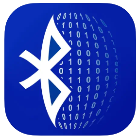 | 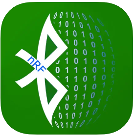 | 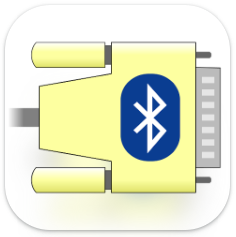 |

If an app cannot be installed, use the access point page in step 3A, or connect the clock to a PC with a USB-C cable
and use the serial monitor of the Arduino IDE.

## Step 2 - Connect the power

As soon as the clock is on, the red status LED lights up (the program is running). A green dot means: WIFI connected. A blue dot:
Bluetooth connected.

Without WIFI or Bluetooth, the time can be set with the buttons on the clock (see chapter 5).

## Step 3 - Connect the clock to WIFI

A new clock expects WIFI and NTP. If no router name and password have been entered yet, the clock starts its own WIFI station, which becomes visible in the list of WIFI networks.
Choose one of the following three methods.

### 3A - Through the access point page (without an app)

1. On a PC, phone or tablet, open the WIFI settings and select the station **StartWordclock**.
2. The password is **wordclock**.
3. Open the browser, type **192.168.4.1** and press enter.
4. Enter the name and password of the WIFI router and press **Submit**.
5. The clock restarts and shows the correct time.

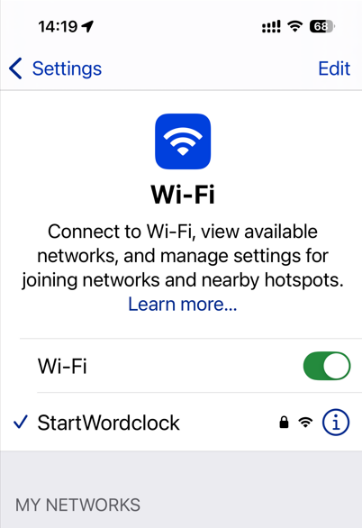

### 3B - Through the Bluetooth app

Setting up is easiest with the Bluetooth app.

1. Open the app. The iOS app shows a list of Bluetooth stations. If that takes too long, press the wheel at the top left (select *nRF52*) and press *Done*. In Android: *Scan* and then *Connect* to the word clock.
2. Send `i` to see the menu.
3. Send `a` followed by the name of the router, for example `aROUTERNAME`. No extra dots or spaces.
4. Send `b` followed by the password, for example `bSecret1234`.
5. Send `@` to restart the clock.

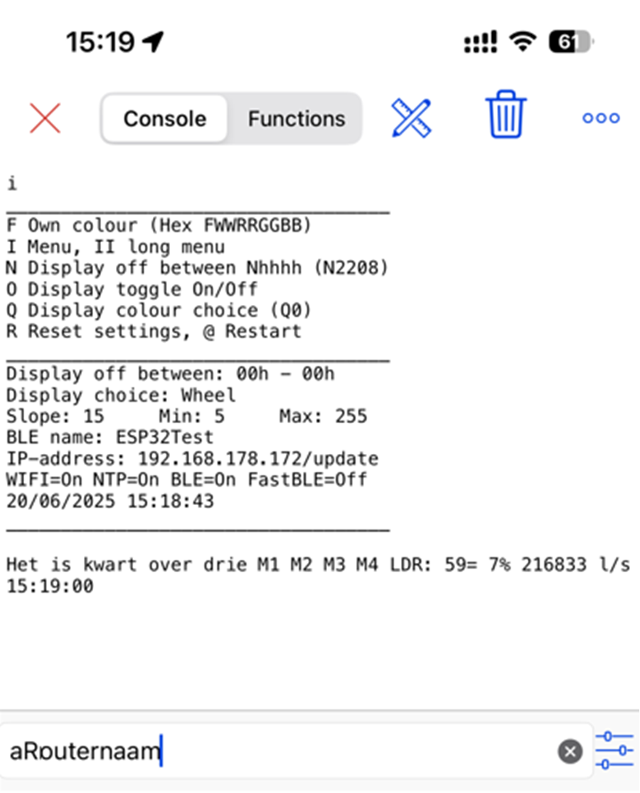

### 3C - Through WPS

Does the router have a WPS button? Then press the WPS button on the router and afterwards send `z` in the Bluetooth app. Sometimes the button on the router has to be held for a few seconds. How WPS is started differs per router. If all goes well the clock restarts and the time is correct.

> **Does it not work?** If the router name or password is not correct, the clock starts the access point page again after a few restarts. The
> data can then be entered again through that page, Bluetooth or USB. Send `RRRRR` to erase all old connection data.

## Step 4 - Done, or without WIFI

**With WIFI:** the clock gets the time from the internet by itself. The menu can now also be opened in a browser through the IP address of the clock
(shown in the menu with `i`) or through its name, for example `http://wordclock.local`.

**Without WIFI:**

1. Send `J` in the menu: the DS3231 RTC module is used (*Use DS3231 is ON. WIFI ON, NTP OFF*).
2. Send `W` to turn WIFI off and `@` to restart the clock.
3. Send the time and date, for example `T143000` for half past two and `D090625` for 9 June 2025.

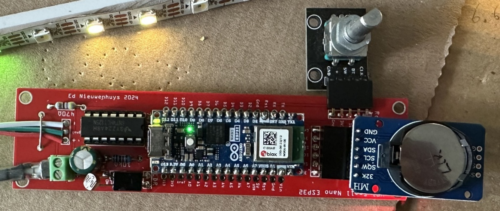

*Small PCB design with rotary encoder and DS3231 RTC module.*

## What next?

- Operation and menu: chapters 6 and 7.
- Building or modifying the clock: chapters 3 and 4.
- Problems with WIFI or Bluetooth: chapter 11.

---

# 3. Hardware and construction

The components, the printed circuit boards (PCBs), the power supply, the connections and the construction of the clock case.

## 3.1 Overview of the components

| Component | Purpose | Required? |
|---|---|---|
| **Arduino Nano ESP32** | Processor with WIFI and Bluetooth | Yes |
| **LED strip SK6812 RGBW or WS2812 RGB** | The display | Yes |
| **LDR (light-dependent resistor)** with 10 kΩ | Measures the ambient light for the automatic brightness | Recommended |
| **Level shifter 74HCT125** (or 74AHCT125) | Converts the 3.3 V data signal to 5 V for the LED strip | Recommended |
| **DS3231 RTC module** | Accurate clock for use without internet | Optional |
| **Rotary encoder** (KY-034) or **membrane switch with three buttons** | Setting the time without WIFI or Bluetooth | Optional |
| **IR receiver** with remote control | Setting the time and colour scheme | Optional |
| **Reset button** | Restoring the factory settings | Optional |
| **HC-12 433 MHz module** | Sending the time to other clocks | Optional |
| **DCF77 receiver** or another device that delivers pulses | Connection present on the PCB | Optional |
| **Power supply 5 V, > 1 A** | LED strip and processor | Yes |

The clock also works without any of the optional components: with WIFI the time comes from the internet (NTP), and all settings can be made with Bluetooth, the web page or MQTT. See [chapter 5.1 of the manual](#51-which-input-does-the-clock-have) for the choice of input device.

## 3.2 The LED strip and the data signal

The SK6812 RGBW or WS2812 RGB LED strip works on **5 V**. The data signal of the Nano ESP32 is **3.3 V**. For some strips that is too low to work reliably.

- **Recommended: a level shifter.** The 74HCT125 (four gates) converts the signal from 3.3 V to 5 V. The other three gates of the IC can be used for other purposes; the PCB design does that.
- **Optocouplers do not work.** Attempts to boost the data signal with optocouplers failed. See the [experiment with an optocoupler](https://ednieuw.com/ElecProj/OptoSK6812/OptocouplerSK6812.html).
- **Without a level shifter** an SK6812 RGBW strip with 14 LEDs also worked well, with the data line directly on the 3.3 V output of the Nano ESP32. Strips with more LEDs have not been tested.

For a strip without a level shifter the rule of thumb is: a resistor of **470 Ω** in the data line and a capacitor of **200 - 1000 µF** across 5 V and GND, directly on the strip. Success is then not guaranteed.

### Types of strips

| Strip | LEDs | Remark |
|---|---|---|
| **SK6812 RGBW** | Red, green, blue and white | The white LED (the yellow square) gives a nice white. Select the type with `%` in the menu |
| **WS2812 RGB** | Red, green, blue | No white LED; the white part in colour commands has no effect |

## 3.3 The printed circuit boards

The printed circuit boards were designed with the free software [Fritzing](https://fritzing.org/). Fritzing exports **Gerber files** that can be sent to a PCB manufacturer. PCBs made in Europe can be ordered with the Fritzing app itself.

A cheap and good experience is [PCBWay](https://www.pcbway.com/): 10 printed circuit boards for about $5, with about $25 shipping and import costs. The boards were received within a week and the quality was excellent. Upload the zip file with the Gerber files and pay the costs.

The designs (`.fzz` file and Gerber files) are in the folder [PCB](PCB) of this repository, and also at [github.com/ednieuw/NanoESP32PCB](https://github.com/ednieuw/NanoESP32PCB).

| PCB | Folder | Use |
|---|---|---|
| **Large PCB V04** | [PCB/Arduino Nano ESP32 PCB](<PCB/Arduino Nano ESP32 PCB>) | All connections: rotary or push buttons, DS3231, DCF77, LDR, IR, reset button, level shifter |
| **Small PCB V03** | [PCB/Arduino Nano ESP32 small PCB](<PCB/Arduino Nano ESP32 small PCB>) | Minimal design for small spaces |
| **Ultimate PCB V005** | [PCB/Arduino Nano ESP32Ultimate PCB](<PCB/Arduino Nano ESP32Ultimate PCB>) | Extended version |
| **Universal PCB** | [Nano ESP32 RGBW BW PCB](https://github.com/ednieuw/NanoESP32-BW-RGBW-clock) | For RGB(W) LEDs and white 2835 LED strips with shift registers, with one source code |

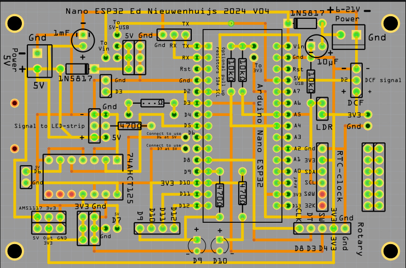

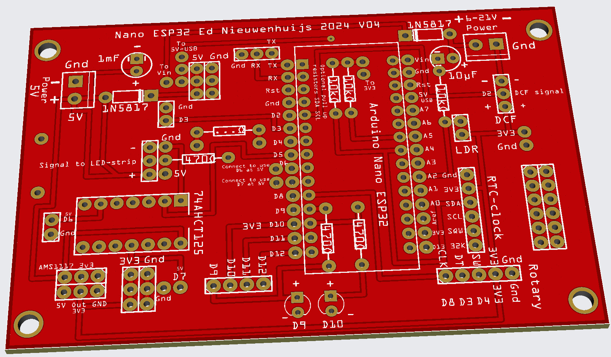


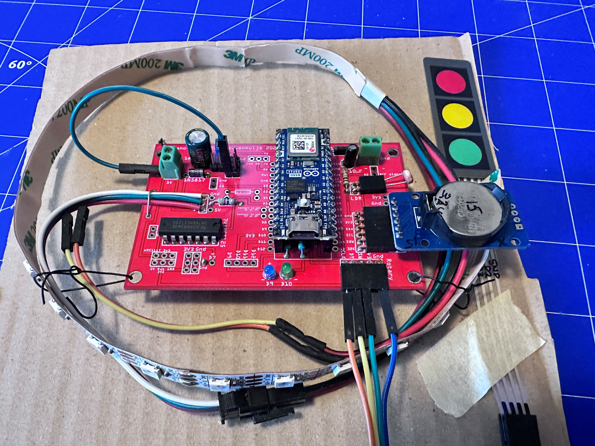

*All components on PCB V04, including the membrane keypad.*

## 3.4 Bill of Materials

### Large PCB V04

| Quantity | Component | Value / specification | Designation |
|---|---|---|---|
| 1 | Arduino Nano ESP32 | | Processor |
| 3 | Resistor | 470 Ω, ±5% | In front of the LED strip and the 3 mm LED |
| 3 | Resistor | 10 kΩ, ±5% | LDR; 2 optional for I2C |
| 1 | Electrolytic capacitor | 1000 µF, 16 V | 1mF |
| 1 | Electrolytic capacitor | 10 µF | 10uF |
| 1 | LDR | GL5516 | LDR |
| 1 | Rotary encoder or membrane keypad | KY-034 | Rotary |
| 1 | RTC module | DS3231 | RTC-clock |
| 1 | RGB(W) LED strip | WS2812 or SK6812 | LED-strip |
| 2 | Diode | 1N5817 | 1N5817 |
| 1 | LED, 3 mm | Red (633 nm) | D9 |
| 1 | LED, 3 mm | Yellow (592 nm) | D10 |
| 1 | IC | 74AHCT125 | Level shifter |
| 2 | Screw terminal, 2-pin, 3.5 mm | POWER | J1, J2 |
| 2 | Female pin header, 15-pin, 0.1" | Connection for the Arduino Nano ESP32 | Nano ESP32 |
| 1 | Female pin header, 6-pin | DS3231 (GND, 5V, SDA, SCL on the I2C of the Arduino) | RTC-clock |
| 1 | Female pin header, 5-pin | Rotary encoder | Rotary |
| 1 | Female pin header, 3-pin | DCF77 receiver | DCF |
| 1 | Female pin header, 3-pin | Optional 3.3 V regulator (GND, 5V, input-GND) | AMS1117 3v3 |
| 1 | Male pin header, 4-pin | 5 V to Vin or USB | |
| 1 | Male pin header, 3-pin | All three pins to 5 V | RTCclock12 |
| 1 | Male pin header, 3-pin | All three pins to GND | RTCclock13 |
| 1 | Female pin header, 3-pin | GND, GND and one leg of R5 | RTCclock6 |
| 1 | Female pin header, 2-pin | LDR | LDR |
| 1 | Jumper, 2-pin | Selects 5 V to Vin or to USB 5 V | Power shunt |
| 1 | Male pin header, 3-pin | TX/RX and GND of the Arduino | TX-RX |

### Small PCB V03

| Quantity | Component | Value / specification | Designation |
|---|---|---|---|
| 1 | Arduino Nano ESP32 | | Processor |
| 1 | LDR | GL5516 | LDR |
| 1 | Rotary encoder or membrane keypad | KY-034 | Rotary |
| 1 | RTC module | DS3231 | RTC-clock |
| 1 | RGB(W) LED strip | WS2812 or SK6812 | LED-strip |
| 1 | Resistor | 470 Ω, ±5% | LED-strip |
| 1 | Resistor | 10 kΩ, ±5% | LDR |
| 1 | Electrolytic capacitor | 1000 µF, 16 V | Near the power supply |
| 1 | Diode | 1N5817 | Near the power supply |
| 1 | IC | 74AHCT125 | Level shifter |
| 1 | Screw terminal, 2-pin, 3.5 mm | | Power |
| 2 | Female pin header, 15-pin | Connection for the Arduino Nano ESP32 | Nano ESP32 |
| 1 | Female pin header, 6-pin | DS3231 | RTC-clock |
| 1 | Female pin header, 5-pin | Rotary encoder | Rotary |
| 1 | Female pin header, 2-pin | LDR | LDR |

> **Remark on the diode.** The printed circuit board says "1N5817", but the underlying Fritzing part information says "1N4001". Those are different diodes: the 1N5817 is a Schottky diode with a voltage drop of about 0.45 V, the 1N4001 an ordinary rectifier with about 0.7 V. The **1N5817** is preferred. The complete lists are also in [BillOfMaterials_PCBv04.md](PCB/BillOfMaterials_PCBv04.md) and [BillOfMaterials_smallPCB.md](PCB/BillOfMaterials_smallPCB.md).

## 3.5 Power supply

### Power for the LED strip and the Nano

The LED strip needs **5 V**. That can be supplied in three ways, depending on how the PCB is connected:

| Supply | Connection | Remark |
|---|---|---|
| **5 V supply > 1 A** | Screw terminal at the top left of the PCB (5 V) | Powers the LED strip directly. Recommended for clocks with many LEDs |
| **6 - 21 V** | Connection *Power 6-21V* to the VIN pin of the Nano | Also powers the Nano. See the warning below |
| **USB-C** | The USB-C port of the Nano ESP32 | The pin VBUS supplies 5 V as soon as power comes through USB. The LEDs are then powered through the PCB |

Which supply the LED strip gets is determined on the PCB with bridges (see the image): shorting the **red** connection powers the LED strip with 5 V through the connection *Power 6-21V* (VIN); shorting the **yellow** connection powers the LEDs from the USB-C supply.


> **Attention.** The 5 V connection goes **directly to the LED strip**. If a supply with a higher voltage is connected there, the LEDs are destroyed while the Nano happily switches on.

> **Current through USB-C.** Powering the LEDs through the USB-C port is fine for about 20 LEDs, but probably not for longer strips. The current then flows through the thin copper tracks of the PCB. USB-C supplies can deliver more than 20 A; that can melt the copper tracks. For longer strips, therefore, use a separate 5 V supply on the screw terminal.

> **VIN and VBUS.** If the Nano is powered through the VIN pin, VBUS is switched off. No 5 V can then be taken from the board. A USB supply of 5 V on VIN works, although 6 V is specified as the minimum voltage: the diode 1N5817 still lowers the voltage by about 0.5 V to 4.5 V.

### Capacitor and resistor

A capacitor of 1000 µF across 5 V and GND at the LED strip absorbs current peaks. The resistor of 470 Ω in the data line protects the first LED.

## 3.6 Connections on the printed circuit board

### Large PCB

Clockwise, from the top right:

| Connection | Pin or function |
|---|---|
| Power input 6 - 21 V | To Vin on the Nano ESP32 |
| DCF | D2, 3V3 and GND |
| LDR | A2 and 3V3 |
| RTC clock (DS3231) | GND, 3V3, A4 (SDA) and A5 (SCL) |
| Rotary encoder or three-button switch | D8, D3, D4, 3V3 and GND |
| Reset button | D6 and GND (or D7) |
| IR remote control | D4, 3V3 and GND |
| LEDs | D10 and D9 |
| Connector | D12, D11, D10 and D9 |
| D7 | With 5 V through 3V3 → 5V level converter |
| Connector | GND and 3V3 |
| Connector | AMS1117 5V → 3V3 1 A voltage regulator |
| D6 | With 5 V through 3V3 → 5V level converter |
| LED strip SK6812/WS2812 | 5V, D5 and GND |
| D3 | With 3V3 to D3 and GND |
| 5 V power input | To 5V-USB or Vin on the ESP32 and to the LED strip |
| 5V and GND connector | To Vin and 5V-USB on the Arduino Nano ESP32 |
| Connector | GND, RX and TX |

### Small PCB

Clockwise, from the top left:

| Connection | Pin or function |
|---|---|
| LDR | A2 and 3V3 |
| 5 V power input | To 5V-USB on the ESP32 and to the LED strip |
| LED strip SK6812/WS2812 | 5V, D5 and GND |
| Rotary encoder or three-button switch | D2, D3, D4, 3V3 and GND |
| Reset button | D6 and GND (or D7) |
| IR remote control | D4, 3V3 and GND |
| RTC clock (DS3231) | GND, 3V3, A4 and A5 |

> On the **large PCB** rotary pin B is on **D8** (see the sketch: `encoderPinBL`), on the **small PCB** on **D2**.


### The Nano ESP32


## 3.7 The optional components

### LDR (light sensor)

The LDR is connected to **A2** and 3.3 V, with a resistor of 10 kΩ. The software measures the light and uses it to control the brightness of the LEDs (see [chapter 6.6 of the manual](#66-the-brightness-of-the-display)).

### DS3231 RTC module

The module is connected through I2C: **SDA on A4, SCL on A5**, plus 3.3 V and GND. It keeps very accurate time (a few seconds per year) and has a coin cell as back-up battery. Use `J` in the menu to choose the DS3231 ([chapter 5.3](#with-the-ds3231-rtc-module-without-internet)).


### Rotary encoder or three push buttons

| Component | Pins | Select with |
|---|---|---|
| Rotary encoder (KY-034) | Large PCB D8, D3 and D4 (SW). Small PCB D2, D3 and D4 | `H01` |
| Membrane switch with three buttons | Same connector | `H02` |

### IR receiver

The IR receiver is connected to **D4**, 3.3 V and GND (the same pin as the push button of the rotary; both cannot be used at the same time). Choose with `H03` (large remote control) or `H04` (small) and have the clock learn the keys with `{` ([chapter 5](#with-an-ir-remote-control)).

### Reset button

A push button between a GPIO pin and GND (on the PCB D6 or D7). Set the pin with `^nn` and restart with `@` ([command ^](#---reset-button)). Pressing for two seconds restores the factory settings.

### HC-12 (433 MHz time sender)

The HC-12 is connected with its RXD pin to **D4**, plus power and GND, and is switched on with `H07` ([chapter 8.4](#84-hc-12-time-sender-433-mhz)). D4 is also used for IR and the rotary push button; only one of the three can be connected at a time.

### Bluetooth and WIFI

The Nano ESP32 itself has Bluetooth and WIFI. No extra hardware is needed for them.

## 3.8 The LED base plate and the clock case

### The LED strip

The distance between the LEDs on the strip is suitable for a clock of **25 x 25 cm** (60 LEDs/m) or **50 x 50 cm** (30 LEDs/m).

There are two possibilities for the 144 LEDs of the clock:

| Arrangement | Advantage | Disadvantage |
|---|---|---|
| **12 rows of 12 LEDs** | Few solder points; simple | |
| **Only one LED behind every letter that has to light up** | Fewer LEDs and fewer holes in the spacer plate | Many more solder points, each of which can cause faults. An imperfect solder joint on the strip can come loose over time |

The software also has a **digital time display** (`Q6`) for which the 144 LEDs (12 x 12) are used.

### Gluing the strips

Glue the strips from left to right on the odd rows and from right to left on the even rows. **Follow the arrows on the strip**: every second row is therefore turned around. As a result there are no long data lines from the right end of the strip to the left end of the next row, and the software does not have to be adapted for new positions.

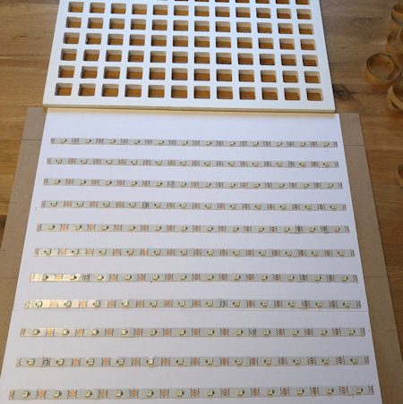

### Soldering

Tinned copper wire is handy. For example, solder all 5 V connections on the left side of the strip and all GND connections on the right side. For that, drill a small hole through the plate next to every 5 V connection on the left and next to every GND on the right. Bend a 90-degree angle, push the wire through the hole and solder it to the LED strip.

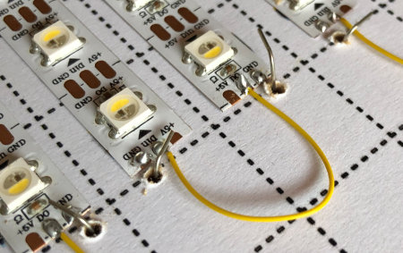

### The front plate and the layers

The words (HET, WAS, VIJF and so on) are sawn or cut out in the front plate:

- **MDF of 1 cm** with a jigsaw. Paint the inside bright white, otherwise the white light becomes dull.
- **Foamed PVC, white, 10 mm (RAL 9003)** is better: it is easy to cut, it is white and it does not discolour. White paint often discolours.

Designs for the word plates are in the folders [WordPlateFrontCovers](WordPlateFrontCovers) and [DXFwordplates](DXFwordplates).

The order of the layers, from the LEDs to the front:

1. the LED base plate with the strips;
2. the **spacer plate** over the LEDs (so that the light stays separated per letter);
3. a sheet of **white paper**;
4. the **word plate** (front plate).

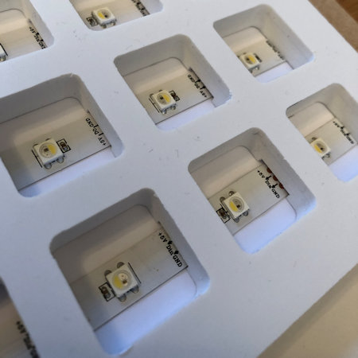

### Building instructions

| Clock | Building instructions |
|---|---|
| Single-language word clock with SK6812 LEDs | [ednieuw.com/Woordklok/Bouwpakket/WoordklokSK6812.htm](https://ednieuw.com/Woordklok/Bouwpakket/WoordklokSK6812.htm) |
| The same building description in this repository | The folder [Manual-Instructions](Manual-Instructions) (Dutch and English, pdf) |
| Four-language word clock with SK6812 LEDs (UK, NL, DE, FR) | [github.com/ednieuw/FourLanguageClock](https://github.com/ednieuw/FourLanguageClock) |
| Selection page for word clock designs | [github.com/ednieuw/WordclockSelector](https://github.com/ednieuw/WordclockSelector) |

---

# 4. Installing the software

The software runs on an **Arduino Nano ESP32**. There are two ways to get it into the clock:

| Method | What is needed | When |
|---|---|---|
| **Compile it yourself** with the Arduino IDE (4.1 - 4.5) | Arduino IDE, ESP32 core, libraries, USB-C cable | Own modifications, a new clock variant or a different board |
| **Upload a `.bin` file** (4.6) | Only WIFI or a USB cable. No libraries | For most users. The compiling has already been done |

## 4.1 What is needed?

- The [Arduino IDE](https://www.arduino.cc/en/software) (version 2.x).
- The **ESP32 core** from Espressif, version **3.3.10 or higher** (tested with 3.3.11).
- The libraries from [4.2](#42-installing-the-libraries).
- A USB-C cable to the Nano ESP32.

### Installing the ESP32 core

1. In the Arduino IDE, open *Tools → Board → Boards Manager* (or `Ctrl+Shift+B`).
2. Search for **esp32** (by Espressif Systems) and install version 3.3.10 or higher.
3. Then choose *Tools → Board → esp32 → Arduino Nano ESP32*.

There are two cores with which the Nano ESP32 can be programmed: the core *Arduino ESP32 Boards* from Arduino itself, and the core *esp32* from Espressif. V247 requires the **Espressif core**. The core from Arduino itself (version 2.0.x) no longer works with this software. The EdSoftLED library only compiles with Espressif core 3.3.x, because it uses the RMT function of the processor to drive the LEDs.

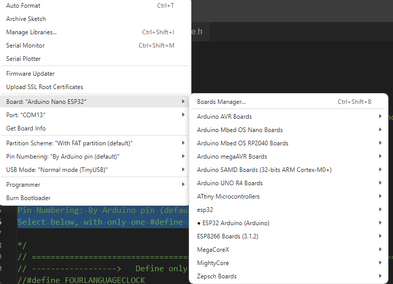

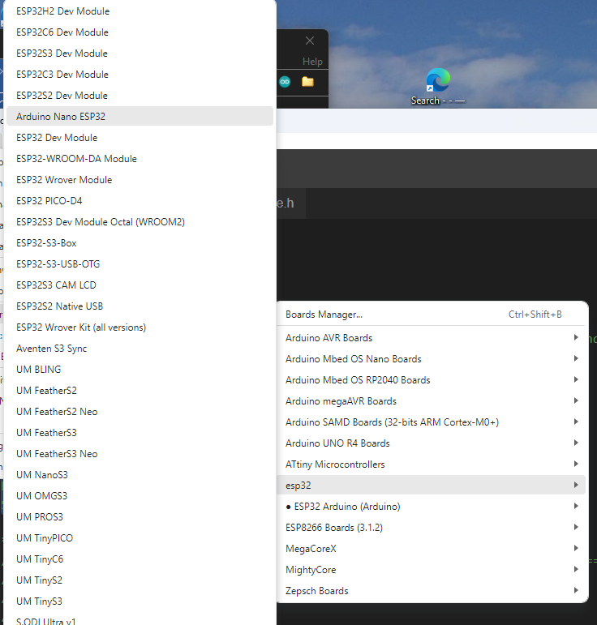

## 4.2 Installing the libraries

Libraries are updated all the time, which can lead to incompatibility with this source code over time. For that reason the versions that are used are included in the file **`librariesV247.zip`** (in the main folder of the repository).

1. Unzip the zip file.
2. Copy the folders into the `libraries` folder inside the folder where the Arduino IDE stores the sketches (usually `Documents\Arduino\libraries`).
3. Restart the Arduino IDE.

The zip file contains: `Adafruit_BusIO`, `Adafruit_NeoPixel`, `Async_TCP`, `ESP_Async_WebServer`, `EdSoftLED`, `Encoder`, `IRremote`, `Keypad`, `NimBLE-Arduino`, `PubSubClient` and `RTClib`.

| Library | Use |
|---|---|
| `EdSoftLED` | Driving the LED strip (SK6812, WS2812), the default with core 3.3 or higher. [github.com/ednieuw/EdSoftLED](https://github.com/ednieuw/EdSoftLED) |
| `Adafruit_NeoPixel` (with `Adafruit_BusIO`) | Alternative to EdSoftLED. See [4.4](#44-the-board-settings) |
| `NimBLE-Arduino` | Bluetooth. **Version 2.x** (before V060 only 1.4.3 worked) |
| `ESP_Async_WebServer`, `Async_TCP` | Web pages of the clock |
| `RTClib` | DS3231 RTC module |
| `Encoder` | Rotary encoder |
| `Keypad` | Three push buttons (membrane) |
| `IRremote` | IR remote control |
| `PubSubClient` | MQTT |

## 4.3 Opening the sketch and choosing the clock variant

1. Unzip the program folder (for example `WordFiboClockV247`) and open the file `WordFiboClockV247.ino` in the Arduino IDE. The folder must have the same name as the `.ino` file and contain all `.h` files.
2. At the top of the sketch (around line 50), find the list of clock variants:

   ```cpp
   #define NL144CLOCK              // Dutch display for 12 x 12 Front
   //#define UK144CLOCK            // English display for 12 x 12 Front
   //#define FR144CLOCK            // French display for 12 x 12 Front
   //#define DE144CLOCK            // German display for 12 x 12 Front
   //#define NL92CLOCK             // Dutch display, one LED-strip behind every word
   //#define FOURLANGUAGECLOCK     // Four-language clock with 625 LEDs
   //#define NLM1M2M3M4L94         // NL clock with four extra LEDs for the minutes
   ...
   //#define FIBONACCI             // Fibonacci / chrono clock
   //#define NOCLOCK               // No display
   ```

3. Remove the `//` in front of **exactly one** variant and put `//` in front of all the others.

The variants are listed with their number of LEDs in the [appendix](#131-clock-variants-and-file-names). A few commonly used ones:

| `#define` | Clock |
|---|---|
| `NL144CLOCK` | Single-language clock with 144 LEDs in a grid of 12 x 12 (Dutch by default; `UK144CLOCK`, `FR144CLOCK` and `DE144CLOCK` for English, French and German) |
| `NLM1M2M3M4L114` and other `L` variants | Single-language clock with 4 extra LEDs for the minutes and a slightly different design |
| `FOURLANGUAGECLOCK` | Four-language clock with 625 LEDs in a grid of 25 x 25. [Building instructions](https://github.com/ednieuw/FourLanguageClock) |
| `FIBONACCI` | Fibonacci or chrono clock, see [chapter 10](#10-fibonacci-clock-and-noclock) |
| `NOCLOCK` | No display. The files `ClockFaces.h`, `WordClock.h` and `Fibonacci.h` can then be deleted |

The word clock front plates are in the folder [WordPlateFrontCovers](WordPlateFrontCovers). Anyone who uses their own design has to adapt the positions of the LEDs in `ClockFaces.h`.


## 4.4 The board settings

In the *Tools* menu, choose:

| Setting | Value |
|---|---|
| Board | **Arduino Nano ESP32** (under `esp32`) |
| Port | The COM port of the Nano ESP32 |
| Partition Scheme | **With FAT** (*With FAT partition, default*) |
| USB Mode | **Normal mode (TinyUSB)** |
| Pin Numbering | See below |

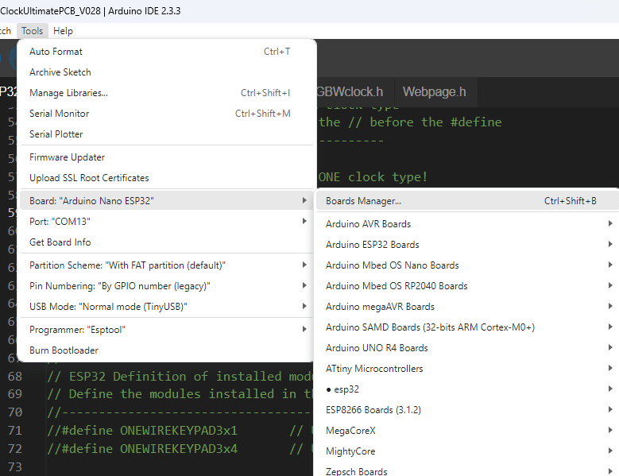

### Pin numbering

There are two ways to number the pins when compiling: the GPIO numbering of the ESP32-S3 and the Arduino numbering (D0, D1, ...).

| LED library | Pin Numbering | Remark |
|---|---|---|
| **EdSoftLED** (default with core 3.3 or higher) | Both are fine | The sketch selects EdSoftLED by itself if the core is new enough |
| **Adafruit NeoPixel** | **By GPIO number (legacy)** | Also set `LED_PIN = 8` instead of `D5`. With *By Arduino pin* compiling gives the error `undefined reference to digitalPinToGPIONumber` |


## 4.5 Compiling and uploading

1. Connect the Nano ESP32 to the PC with the USB-C cable.
2. Choose *Sketch → Upload* (or the arrow at the top left).
3. Open the serial monitor (115200 baud). Press the white reset button on the Nano ESP32 if nothing is shown.
4. When uploading **for the first time**, send `RRRRR` for a total reset (see [chapter 11](#115-resetting)).
5. Send `i` to see the menu and continue with [chapter 5](#5-first-use).

## 4.6 Without compiling: uploading a `.bin` file

This is the recommended method when no modifications are needed. The libraries do not have to be installed, and in a few years there will be no problems with libraries that are no longer compatible. The compiling has already been done; the file that is uploaded to the clock is a `.bin` file. The `.bin` file of the `NL144` variant is on [GitHub](https://github.com/ednieuw/Arduino-ESP32-Nano-Wordclock) by default; other variants are optional (see [13.1](#131-clock-variants-and-file-names)) and can be compiled oneself.

### If the clock is already running a version of this software

Use the OTA page of the clock, see [chapter 11.1](#111-updating-the-software-ota).

### If the Nano ESP32 is still empty

The clock first needs a program that can show the OTA page. For that, the example program **OTAWebUpdater** of the Arduino IDE is used:

1. Choose the Nano ESP32 as the board (*Tools → Board → esp32 → Arduino Nano ESP32*).
2. Open *File → Examples → ArduinoOTA → OTAWebUpdater*.
3. In the example, enter the name and password of the WIFI router and choose *Sketch → Upload*.
4. Open the serial monitor and note the IP address that is shown (press the reset button if nothing appears).
5. Type the IP address in a browser, for example `192.168.0.123`.
6. Log in with user name `admin` and password `admin`.
7. Choose the `.bin` file for the clock variant, for example `WordFiboClockV247.NL144.bin`, and press *Update*.

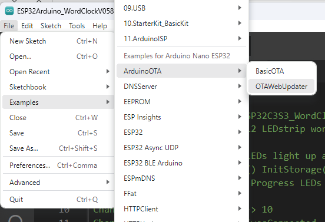

A `.bin` file of modified code is created with *Sketch → Export Compiled Binary* in the Arduino IDE. Another possibility is the tool [OTA-webupdater](https://github.com/ednieuw/OTA-webupdater) or the file `BinUploader.html` in the repository.

## 4.7 Problems

| Symptom | Possible cause and solution |
|---|---|
| The LEDs do not light up | The pin numbering is wrong. With NeoPixel: *By GPIO number (legacy)*. See 4.4 |
| The clock does not show the expected language or board | No clock variant, or more than one, is selected at the `#define`s around line 50 |
| Error `undefined reference to digitalPinToGPIONumber` | NeoPixel with *By Arduino pin*. See 4.4 |
| Bluetooth does not work | The wrong version of NimBLE is used. From V060 on, NimBLE **2.x** must be used |
| Errors when compiling `EdSoftLED` | The core is too old. Use Espressif core 3.3.10 or higher |
| Upload fails, the port is not found | Put the Nano ESP32 in bootloader mode: press the reset button **twice** (a double tap, calmly, the second time as soon as the RGB LED flashes) until the LED pulses slowly (green, according to Arduino).<br>After uploading, press reset once more. Also try another USB cable; some cables are only meant for charging.<br>See the [cheat sheet of the Arduino Nano ESP32](https://docs.arduino.cc/tutorials/nano-esp32/cheat-sheet/) |
| Compiling does not succeed | Use the method in [4.6](#46-without-compiling-uploading-a-bin-file) |

---

# 5. First use

This chapter explains how to connect a new clock to WIFI and how to set the time, with or without internet.
The short version is in [chapter 2](#2-quick-start).

## 5.1 Which input does the clock have?

A clock always has WIFI and Bluetooth. In addition it can **optionally** be equipped with:

- a **DS3231 RTC module**, a very accurate clock that keeps the time even without internet;
- a **rotary encoder** (turn/push knob), or **three push buttons** (membrane), or an **infrared receiver** with a remote control;
- an **HC-12** or the BLE time receiver (see [chapter 8](#8-time-receiver-and-time-sender)).

With menu command `H` the device is chosen that the clock uses:

| Command | Meaning |
|---|---|
| `H00` | No input device. The time comes from the internet (NTP). |
| `H01` | Rotary encoder |
| `H02` | Three push buttons (membrane) |
| `H03` | Large IR remote control (with digits) |
| `H04` | Small IR remote control (without digits) |
| `H05` | Time receiver on/off (receiving the time through BLE) |
| `H06` | Time sender on/off (sending the time through BLE) |
| `H07` | HC-12 time sender on/off (sending the time through 433 MHz, V247) |

Restart the clock after a change with `@`.

- With `H01` to `H04` the DS3231 is switched on and NTP is switched off: the clock expects the time to be set by hand.
- With `H00` WIFI and NTP are switched on again and the DS3231 is switched off.
- Switch the input **off** with `H00` if nothing is connected. Otherwise the software keeps checking whether there is any input and can pick up unintended input.
- A reset to factory settings (`R`) leaves this H setting unchanged.


## 5.2 Connecting to WIFI

By default the clock gets the time from the internet. For that it needs the name (SSID) and the password of the router. These are entered **once**
and stay stored in the memory of the processor, even if the power fails.

### Factory settings after a reset

Is there still old connection data in the clock? Then send `RRRRR` (five times R) to erase it.<br>
The clock is then set to:
```
SSID and password are empty
Timezone: CET-1CEST,M3.5.0,M10.5.0/3
WIFI=On  NTP=On  BLE=On
```

### Through the access point page

Without router data, and with the W option in the menu 'WIFI On/Off' set to ON, the clock starts its own WIFI station **StartWordclock** (password **wordclock**).

1. Connect the phone, tablet or PC to the station *StartWordclock*.
2. Open a browser and type the URL **192.168.4.1**.
3. Enter the SSID and password of the router and press *Submit*. These are often printed on the underside of the router.
4. The clock restarts and shows the correct time.

If the router name or password is not correct, the clock starts this page again after a few restarts.

### Through Bluetooth or a serial cable

With a BLE app (or the serial monitor of the Arduino IDE) the data can also be sent by hand:

| Command | Example | Meaning |
|---|---|---|
| `a` + SSID | `aFRITZ!Box01` | Name of the WIFI station |
| `b` + password | `bSecret1234` | Password of the router |
| `c` + name | `cWordclock` | Name of the clock in the Bluetooth list and in the router (default after reset: `wordclock`) |
| `@` | | Restart the clock |

- Upper and lower case do not matter for the **command** letter (`A` or `a`). The password itself is case-sensitive.
- Do not send extra dots or spaces.
- If the SSID or the password is shorter than 5 characters, WIFI is switched off automatically. Preferably use at least 8 characters.
- Check in the menu that `WIFI=On` and `NTP=On`.
- Sometimes the clock has to be restarted two or three times before it connects. If it keeps failing, check the password.
- A green flashing LED on the Nano means that WIFI is connected.

### Through WPS

Does the router have a WPS button?<br>
Then start WPS in the clock with `z` and on the router (sometimes the button has to be held for a few seconds; how that works differs per router).
If all goes well the clock restarts and the time is correct.

### Opening the web page of the clock

When the clock is connected, it has received an IP address from the router. <br>
That address is shown in the menu (`i`), for example `192.168.178.77`.<br>
Type the address in a browser. Or use the name of the clock followed by `.local`, for example `http://wordclock.local` or `http://SteelClock-01.local`.

If the name with `.local` does not work, install host software: for Linux [Avahi](http://avahi.org/), for Windows [Bonjour](http://www.apple.com/support/bonjour/). Mac OS X and iOS already support this through Bonjour. Otherwise use the IP address.<br>
See [chapter 6](#6-operation-and-menu) for the possibilities of the web page.

## 5.3 Setting the time

### With WIFI (NTP)

The time and the summer/winter time come from the internet, as soon as the time zone is correct. The default time zone is Amsterdam. <br>
See [Time zone in chapter 6](#time-zone) and the time zone table in the appendix for other zones.

### With the DS3231 RTC module (without internet)

1. Send `J`: the clock now uses the accurate DS3231 time module (*Use DS3231 is ON*).
2. Send `W` to switch WIFI off and `@` to restart.
3. Send the date, for example `D09062025`, and the time, for example `T143000` for half past two. Changing the date and time only works when WIFI and NTP are off.
4. Is the time not appearing? Send `!` to see the internal clock times.
```
 Clock time: 19-Nov-2026 12:28:21
   NTP time: 19-Nov-2026 12:28:21
   UTC time: 19-Nov-2026 11:28:21 
DS3231 time: 29-Oct-2026 09:31:24 
```
Note: with the DS3231 there is no automatic summer time.

### With the rotary encoder

With the optional rotary encoder the knob is active for **60 seconds** after pressing it, and the time can be set.

| Presses | What flashes 3 times | What is set |
|---|---|---|
| 1x | UUR (HOUR) | Hours: turn the knob |
| 2x | HETISWAS | Minutes (seconds are set to 0). Set the last minute exactly at 0 seconds |
| 3x | TWAALF (TWELVE) | Light intensity of the LEDs |
| 4x | NTP and RTC | Switching between RTC and NTP time |
| 9x | | Reset to factory settings |

### With three push buttons (membrane)
This optional membrane keypad is active for **60 seconds** after pressing the middle button, and the time can be set.

- Press the middle button and follow the same steps as with the rotary encoder. The up and down buttons change the value.

### With three by four push buttons (membrane)
- Press `*`; the buttons then stay active for 60 seconds. Then enter the time as **hhmmss**, for example `134500` for a quarter to two. After the sixth digit the time is set immediately.

### With an IR remote control

Not every remote control works, but most do. The clock has to learn the keys first.

1. Switch IR reception on: `H03` (large remote with digits) or `H04` (small, without digits). Restart with `@`.
2. Send `{` to learn the keys. The clock asks one after the other for:
   `0 1 2 3 4 5 6 7 8 9 UP DOWN LEFT RIGHT POWER OK ONOFF`.
   If the remote control lacks a key, choose a similar key (for example *Source* for ONOFF). Do not use the same key for different codes.
3. The clock stores the keys and enters recognition mode: it only reacts to this remote control from then on.

> In the menu of the sketch `}` is still shown for *Learn IR remote*. The code uses `{`. `}` switches the printing of the ring buffer on/off.

Example of what the clock shows while learning:

```
=== Starting Learning Mode ===
Please press button: 0
Remote identified - Protocol: NEC, Address: 0xBD00
✓ Learned '0' - Protocol: NEC, Command: 0x0041, Address: 0xBD00
Please press button: 1
...
=== Learning Complete & Saved! ===
=== Now in Recognition Mode ===
```

**Setting the time with the large remote control (H03):**

- Press `POWER` (POWER ON). The digit keys now work as time entry; after **5 minutes** POWER switches off automatically.
- Enter six digits **hhmmss** and press `OK`. A quarter to four in the afternoon is `154500`.
- Or use `UP`/`DOWN` for one hour more or less and `LEFT`/`RIGHT` for the minutes.
- Press `POWER` again to stop.
- With POWER **off** the digit keys choose the colour scheme (Q0 to Q9).
- `ONOFF` switches the display on or off.

**With the small remote control (H04):** press `POWER` and then use `MIN-1`, `MIN+1`, `HOUR-1` and `HOUR+1`. `ONOFF` switches the display on or off.

### With the time receiver

With `H05` the clock receives the time from a time sender app on an iPhone/iPad (BLE). After the app has been started the clock shows the correct time within two minutes. See [chapter 8](#8-time-receiver-and-time-sender).

---

# 6. Operation and menu

The clock has **one menu** of commands. That menu can be reached in four ways: through Bluetooth, the web page, a serial cable and MQTT.
The commands are the same everywhere.

## 6.1 Operating with a Bluetooth app

See [chapter 2](#step-1---choose-a-control-app) for the apps. A clock with Bluetooth announces itself with the name that was set with `c`.

1. Start the app and start a connection. Some apps show a connection window directly; with others a connection symbol must be pressed.
2. Choose the word clock in the list. (In *BLE Serial Pro*, *nRF52* must be selected.)
3. A window appears with a line where commands can be typed and sent.

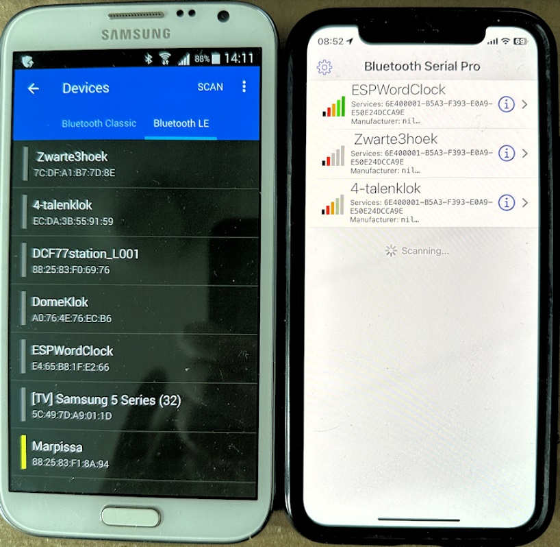

### If text appears incomplete or distorted

Bluetooth sends packets of 20 characters by default. Many apps then show truncated lines.

- The iPhone, iPad and Mac apps of the author work with their default settings. With other apps the font size and the CR/LF setting can be adjusted.
- Send `+` to switch between **fast BLE** (packets of 80 characters or more, the menu is shown faster) and **slow BLE**.
- If the text is so distorted that `+` cannot be sent, try the web page of the clock and send a `+` there.
- If all else fails: connect the clock to a PC with a USB-C cable, send `+` in the serial monitor of the Arduino IDE, or send `R` to go back to the default settings.

## 6.2 Operating with the web page

Open the IP address of the clock (or `http://wordclock.local`) in a browser, see [chapter 5](#opening-the-web-page-of-the-clock).

Tip: save this link as a favourite in the browser.

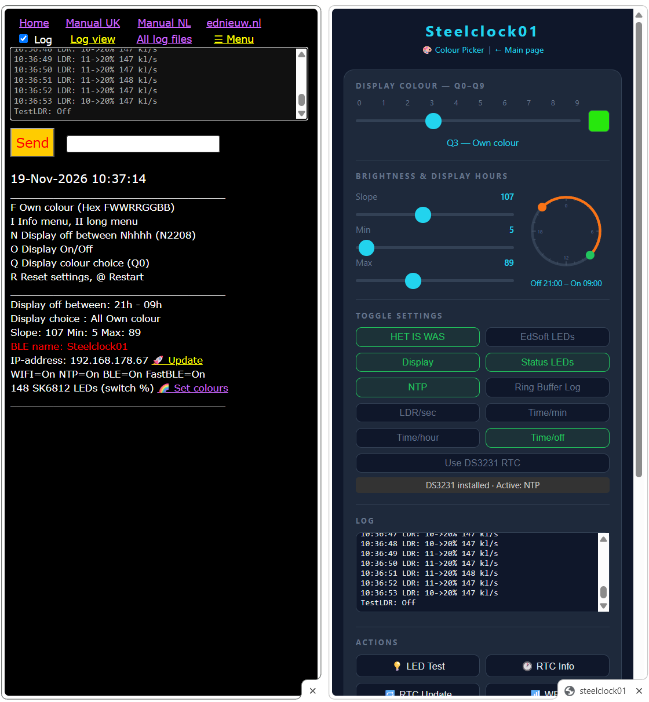

The web page has a number of parts:

| Part | What it does |
|---|---|
| **Input field + Send** | Type here the same command as in the Bluetooth app |
| **Menu** (yellow, top right) | An operating page for use with a mouse or finger: colour scheme (Q0-Q9) with a slider, brightness (Slope, Min, Max), the hours during which the display is off and switches for, among other things, HET IS WAS, EdSoft, display, status LEDs, NTP, LDR/sec, time log and DS3231. The current colour is shown live next to the choice. |
| **Set colours** (bottom of the menu) / `/colourpick` | Colour picker for the letter colour. Choose a colour, press *Send to clock*. The clock then automatically chooses colour scheme Q3 (own colours). |
| **Log view** | The last 500 lines that were printed to the serial port or Bluetooth |
| **All log files** | The last many thousands of lines |
| **Update** | The page for uploading new software, see [chapter 11](#11-maintenance-and-troubleshooting) |

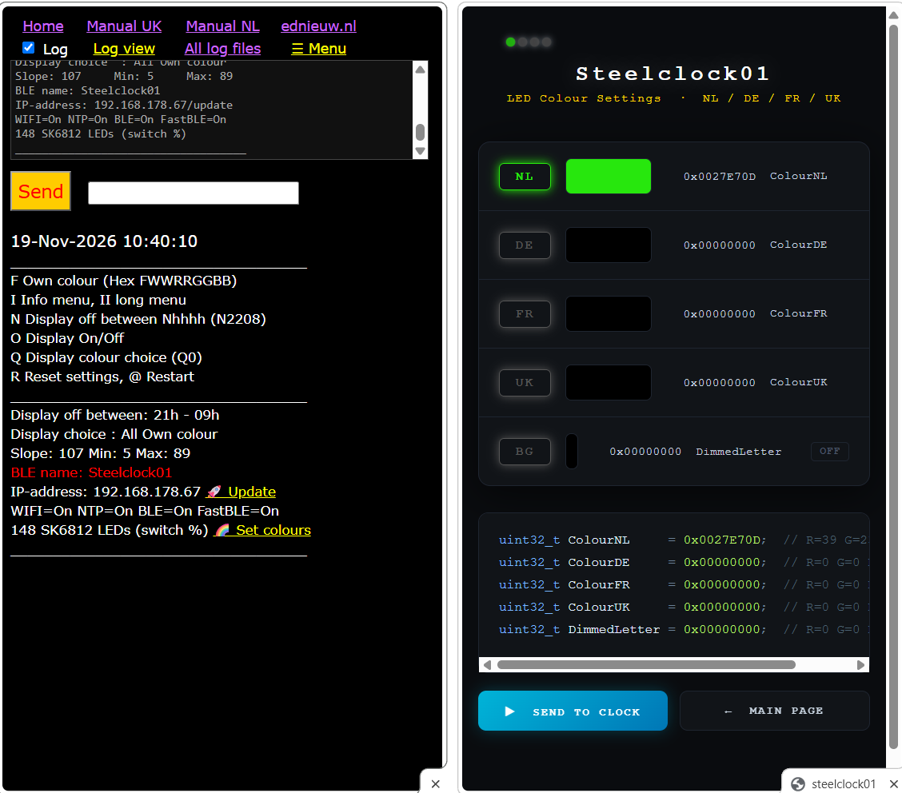

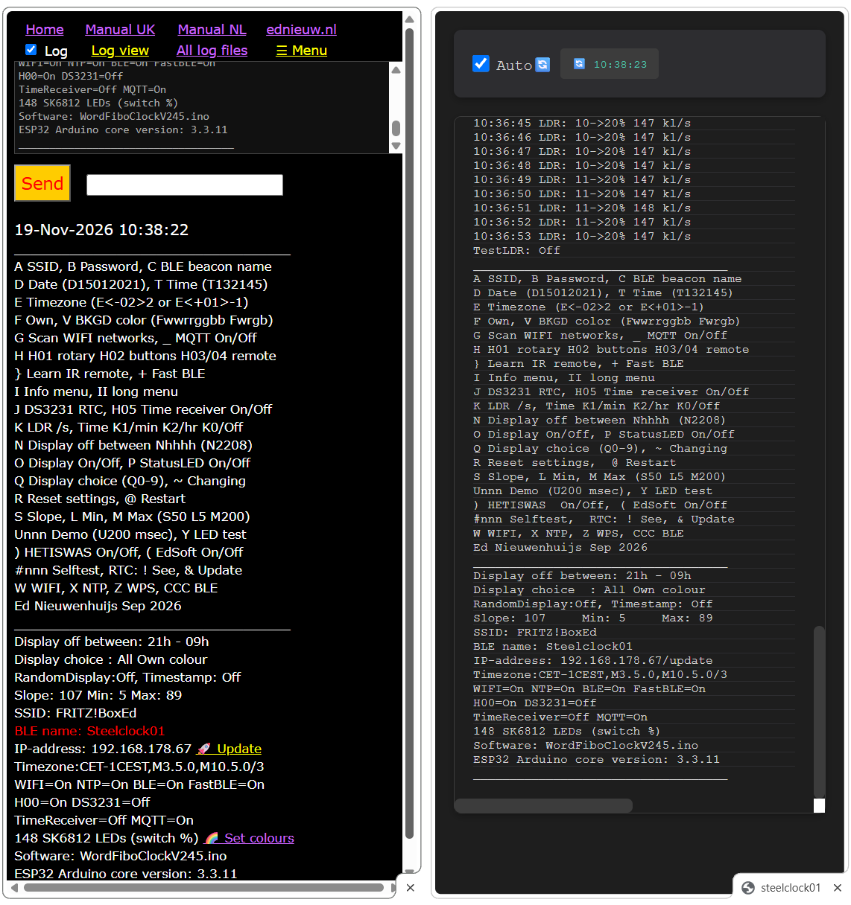

> In many browsers the tab can be split (right-click on the tab, *Split tab* or something similar), so that the menu page and the log viewer are visible side by side.

## 6.3 Operating with a serial cable

Connect the Nano ESP32 to a PC with a USB-C cable and open the **serial monitor** of the Arduino IDE (115200 baud).
At start-up the clock prints the start-up log, for example:

```
Serial started
Rotary NOT used
Found I2C address: 0X57
Found I2C address: 0X68
External RTC module IS found
DS3231 RTC software started
Stored settings loaded
LED strip is SK6812
LED strip started
BLE started
 1: FRITZ!BoxEd -47 * -- Will connect to
[WiFi-event] event: 7  : Obtained IP address: 192.168.178.199
Web page started
WIFI started
```

## 6.4 Operating with MQTT

See [chapter 9](#9-mqtt-and-home-assistant).

## 6.5 Using the menu

- Send `i` for the **short menu** with the everyday options, and `ii` for the **long menu** with all options.
- A command consists of the **first letter** of the setting, optionally followed by a value. For example `Q2` (all words white) or `N2208` (display off from 22:00 to 08:00).
- Upper or lower case makes no difference.
- Some commands only switch on and off, such as `W` for WIFI.
- Settings are stored in the ESP32 memory and are kept after a power failure.
- With `@` the clock is restarted, with `R` the default settings are restored. The explanation of each command is in [chapter 7](#7-menu-commands-a-z).

### The short menu (`i`)

```
___________________________________
F Own colour (Hex FWWRRGGBB)
I Info menu, II long menu
N Display off between Nhhhh (N2208)
O Display On/Off
Q Display colour choice (Q0)
R Reset settings, @ Restart
___________________________________
Display off between: 22h - 08h
Display choice  : Default yellow colour
Slope: 69     Min: 11     Max: 37
BLE name: 4-Talenklok
IP-address: 192.168.178.44/update
WIFI=On NTP=On BLE=On FastBLE=Off
625 SK6812 LEDs (switch %)
```

### The long menu (`ii`)

```
___________________________________
A SSID, B Password, C BLE beacon name
D Date (D15012021), T Time (T132145)
E Timezone (E<-02>2 or E<+01>-1)
F Own, V BKGD color (Fwwrrggbb Fwrgb)
G Scan WIFI networks, _ MQTT On/Off
H H01 rotary H02 buttons H03/04 remote
} Learn IR remote, + Fast BLE
I Info menu, II long menu
J DS3231 RTC, H05 Time receiver On/Off
K LDR /s, Time K1/min K2/hr K0/Off
N Display off between Nhhhh (N2208)
O Display On/Off, P StatusLED On/Off
Q Display choice (Q0-9), ~ Changing
R Reset settings,  @ Restart
S Slope, L Min, M Max (S50 L5 M200)
Unnn Demo (U200 msec), Y LED test
) HETISWAS  On/Off, ( EdSoft On/Off
#nnn Selftest,  RTC: ! See, & Update
W WIFI, X NTP, Z WPS, CCC BLE
Ed Nieuwenhuijs Sep 2026
___________________________________
Display off between: 22h - 08h
Display choice  : Default yellow colour
RandomDisplay:Off, Timestamp: Off
Slope: 69     Min: 11     Max: 37
SSID: FRITZ!BoxEd
BLE name: 4-Talenklok
IP-address: 192.168.178.44/update
Timezone:CET-1CEST,M3.5.0,M10.5.0/3
WIFI=On NTP=On BLE=On FastBLE=Off
H00=On DS3231=Off
TimeReceiver=Off MQTT=On
625 SK6812 LEDs (switch %)
Software: WordFiboClockV245.ino
ESP32 Arduino core version: 3.3.11
___________________________________
```

The upper part is the list of commands, the lower part shows the **current settings**:

| Line | Meaning |
|---|---|
| `Display off between` | Hours during which the display is off (`N`) |
| `Display choice` | Chosen colour scheme (`Q`) |
| `RandomDisplay`, `Timestamp` | Changing colour scheme (`~`) and time log per minute/hour (`K`) |
| `Slope`, `Min`, `Max` | Brightness (`S`, `L`, `M`) |
| `SSID`, `BLE name`, `IP-address` | Connection data. Behind the IP address is the link to update the software (`/update`) |
| `Timezone` | Time zone (`E`) |
| `WIFI`, `NTP`, `BLE`, `FastBLE` | On/off settings (`W`, `X`, `CCC`, `+`) |
| `H00=On`, `DS3231` | Chosen input device and use of the DS3231 (`H`, `J`) |
| `TimeReceiver`, `MQTT` | Time receiver (`H05`) and MQTT (`_`) |
| `625 SK6812 LEDs` | Type of LED strip and number of LEDs (switch with `%`) |
| `Software` | Version of the software |

### Time zone

By default the time zone is set to Amsterdam. A reset with `R` sets the time zone back to Amsterdam.<br>
Another zone is set with `E` followed by the time zone string
from the [time zone table](#13-appendices), for example `eAEST-10AEDT,M10.1.0,M4.1.0/3` for Sydney.<br>
The clock only applies summer time (DST) when it is connected to an NTP server, not when the DS3231 is used.

## 6.6 The brightness of the display

The clock measures the ambient light with an LDR (light-dependent resistor) and adjusts the brightness of the LEDs accordingly. <br>
Three parameters control this (values 0-255):

| Command | Parameter | Meaning | Default |
|---|---|---|---|
| `Lnnn` | **L**ower, minimum | How bright the display stays in complete darkness | 5 |
| `Mnnn` | **M**aximum | The maximum brightness | 255 |
| `Snnn` | **S**lope | How fast the maximum brightness is reached with increasing light | 80 |

In the dark the display therefore never goes out completely, but stays dimmed at the minimum value `L`. The stored values are at the bottom of the menu
(`Slope: 80  Min: 5  Max: 255`). With `K` the LDR value and the brightness are shown every second in the log.

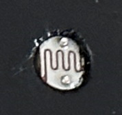

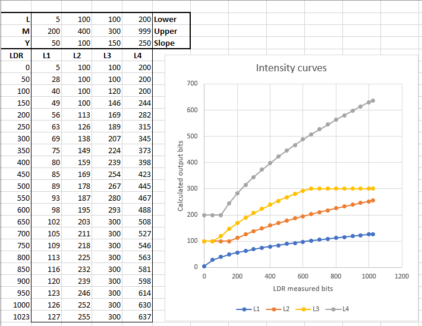

## 6.7 The status LEDs

On the Nano ESP32 there is an LED that lights up in three colours:

| Colour | Meaning |
|---|---|
| Red | The program is running |
| Green | WIFI is connected |
| Blue | There is a Bluetooth connection |
| Yellow | Connected to a time sender (time receiver) |

With the option `P` in the menu the status LEDs can be switched on or off.

---

# 7. Menu commands A-Z

This chapter is the reference for the menu. <br>
See [chapter 6](#65-using-the-menu) for the way commands are sent.

- A command consists of the **first letter** (or character), optionally followed by a value, without a space.
- Upper and lower case do not matter.
- Commands longer than 40 characters are ignored.
- After a change that is marked with "restart", `@` is needed to activate the change.

## 7.1 Overview

| Command | Function | Example |
|---|---|---|
| `A` | SSID of the WIFI router | `aFRITZ!Box01` |
| `B` | Password of the WIFI router | `bSecret1234` |
| `C` / `CCC` | Name of the clock (BLE) / Bluetooth on-off | `cWordclock`, `CCC` |
| `D` | Set the date | `D09062025` |
| `E` | Set the time zone | `eCET-1CEST,M3.5.0,M10.5.0/3` |
| `F` | Own colour / `FF` Fibonacci or Chrono | `F8800FF00`, `F0900` |
| `G` | Search for WIFI networks | `G` |
| `H` | Choose the input device for the time | `H01` |
| `I` / `II` | Short menu / long menu | `i`, `ii` |
| `J` | DS3231 RTC module on/off | `J` |
| `K` | LDR read-out on/off; time log `K0`, `K1`, `K2` | `K1` |
| `L` | Minimum brightness | `L5` |
| `M` | Maximum brightness | `M200` |
| `N` | Display off between two hours | `N2208` |
| `O` | Display on/off | `O`, `O1`, `O0` |
| `P` | Status LEDs on/off | `P` |
| `Q` | Choose the colour scheme | `Q2` |
| `R` | Reset the settings | `R`, `RRR`, `RRRRR` |
| `S` | Slope of the brightness | `S80` |
| `T` | Set the time | `T143000` |
| `U` | Demo mode | `U200` |
| `V` | Background colour | `V10000000` |
| `W` | WIFI on/off | `W` |
| `X` | NTP on/off | `X` |
| `Y` | LED test | `Y` |
| `Z` | Start WPS | `Z` |
| `+` | Fast BLE on/off | `+` |
| `~` | Change the colour scheme automatically | `~1`, `~2`, `~0` |
| `!` | Show NTP, RTC and DS3231 time | `!` |
| `#` | Self test | `#`, `#500` |
| `%` | Switch between SK6812 and WS2812 | `%` |
| `$` | Fireplace | `$` |
| `(` | Extra text (logo) on/off | `(` |
| `)` | HET/IS/WAS on/off | `)` |
| `{` | Learn the IR remote control | `{` |
| `}` | Ring buffer counter on/off | `}` |
| `_` | MQTT on/off | `_` |
| `^` | Reset button on a GPIO pin | `^5`, `^0` |
| `=` | Show the permanent settings | `=` |
| `@` | Restart the clock | `@` |
| `&` | Copy the NTP time to the RTC | `&` |
| `hhmmss` | Set the time (six digits) | `152300` |

## 7.2 Connection and network

### A, B, C - SSID, password, Bluetooth name

- `A` + name of the WIFI station: `aFRITZ!Box01`. The name must be 4 to 28 characters long.
- `B` + password: `bSecret1234`. The password must be 4 to 38 characters long. With `B`, WIFI and NTP are switched on automatically.
- `C` + name: the name under which the clock appears in the Bluetooth list and in the router. Default after a reset: `wordclock`. The name must be 4 to 28 characters long.
- Restart after entering with `@`.

### CCC - Bluetooth on/off

`CCC` switches Bluetooth (BLE) on or off.<br>
Be careful and preferably do not switch BLE off: BLE is the primary wireless access, and without BLE the clock can only be operated through the web page, MQTT or the USB serial port.

### E - Time zone

The time zone is given as a string, preceded by `E`. The default is Amsterdam: `CET-1CEST,M3.5.0,M10.5.0/3`. <br>
Examples and a list of zones are in the [appendix](#13-appendices).

- Sydney: `eAEST-10AEDT,M10.1.0,M4.1.0/3`
- Antarctica/Troll: `E<+00>0<+02>-2,M3.5.0/1,M10.5.0/3`

Copy the string from the table (without the quotation marks) and paste it after the `E`.<br>
After a reset with `R` the time zone is kept; `RRRRR` restores the time zone of Amsterdam.

### G - Search for WIFI networks

`G` shows the available WIFI networks in the neighbourhood with their signal strength, and which one the clock uses.

### W and X - WIFI and NTP on/off

- `W` switches WIFI on or off. When WIFI is switched off, NTP also goes off.
- `X` switches NTP (time from the internet) on or off.
- The state is at the bottom of the menu: `WIFI=On NTP=On`. Restart after a change with `@`.
```
___________________________________
Display off between: 21h - 09h
Display choice  : All Own colour
Slope: 50     Min: 5     Max: 10 
BLE name: Steelclock01
IP-address: 192.168.178.67/update
WIFI=On NTP=On BLE=On FastBLE=On
```
### Z - WPS

WPS gets the WIFI name and password directly from the router, if the router has a WPS button.<br>
Start WPS in the clock with `Z` and then on the router.<br>
If all goes well, the clock restarts and the time is correct.<br>
Sometimes the WPS button has to be held for a few seconds. How WPS is started differs per router.
```
WiFi access point  stopped
WiFi client started
Starting WPS
WiFi lost connection.
Connected to access point
WPS Successfull, stopping WPS and connecting to: FRITZ!BoxEd: 
Connected to : FRITZ!Box
Obtained IP address: 192.168.178.56
```

### + - Fast BLE

The BLE UART protocol sends packets of 20 bytes by default, with 50 ms between each packet.<br>
The iOS app *BLE Serial Pro* can receive packets of 80 bytes or more. `+` switches between long and short packets.<br>
With fast BLE the menu is shown faster.<br>
See also [chapter 6](#if-text-appears-incomplete-or-distorted).

### _ - MQTT on/off

`_` switches MQTT (Home Assistant) on or off. This only works if there is a working WIFI connection. Restart afterwards with `@`. See [chapter 9](#9-mqtt-and-home-assistant).

```
MQTT is ON
 *** Restart with @ ***
[MQTT] Connecting...
[MQTT] Connected
[MQTT] Discovery publish OK (320 bytes): homeassistant/sensor/wordclock/cputemp/config
[MQTT] Discovery publish OK (251 bytes): homeassistant/sensor/wordclock/ldr/config
[MQTT] Discovery publish OK (270 bytes): homeassistant/sensor/wordclock/outphotocell/config
[MQTT] Discovery publish OK (345 bytes): homeassistant/sensor/wordclock/rssi/config
...
```

## 7.3 Time and date

### D and T - Setting the date and time

- `D` + `ddmmyyyy`: `D09062025` is 9 June 2025.
- `T` + `hhmmss`: `T132145` is 21 minutes and 45 seconds past one. `132145` without a letter gives the same result.
- Changing the date and time only works when WIFI and NTP are off and a DS3231 is connected.
- With `T` the DS3231 is switched on, and WIFI and NTP are switched off, as soon as a DS3231 has been found.

### J - DS3231 RTC module

`J` switches the use of the optional DS3231 time module on or off.

- Without internet the internal clock of the processor drifts a few seconds per day. The DS3231 limits that to a few seconds per year.
- When the DS3231 is used, the yellow LED next to the USB connector no longer flashes.
- The DS3231 is only recommended if WIFI reception is not possible.
- Switching `J` off only works if valid WIFI data has been entered.
- Is the time not visible? Then send `!` to see the internal clock times.

### & - Copying the NTP time to the RTC

`&` fetches the time from the NTP server and stores it in the internal RTC of the Nano ESP32 and in the DS3231. This is useful to set the DS3231 correctly right away.

### ! - Showing the clock times

`!` shows the NTP, RTC and DS3231 time as they are stored in the clock. Nothing is updated. The DS3231 must be installed for a sensible time from that module.
```
 Clock time: 19-Nov-2026 12:28:21
   NTP time: 19-Nov-2026 12:28:21
   UTC time: 19-Nov-2026 11:28:21 
DS3231 time: 29-Oct-2026 09:31:24 
```
### hhmmss - Entering the time with six digits

Six digits that begin with 0, 1 or 2 are taken as a time, for example `152300`. The same as `T152300`.

### H - Input device for the time

`H` + two digits chooses the input device. The complete table is in [chapter 5.1](#51-which-input-does-the-clock-have). <br>
Summary: <br>
 `H00` none, <br>
 `H01` rotary, <br>
 `H02` membrane push buttons, <br>
 `H03` large 4x4 membrane push buttons IR, <br>
 `H04` small IR, <br>
 `H05` time receiver,  <br>
 `H06` time sender (BLE), <br>
 `H07` HC-12 time sender. <br>
 Restart afterwards with `@`.

### H05 - Time receiver

With `H05` the clock receives the time from a time sender. The clock is then set to the correct time within two minutes. Available as time senders are:

- the iOS app *BLE UART time* from the Apple app store;
- the Arduino ESP32 sketch *ESP32 Arduino communications* from [github.com/ednieuw/ESP32Communications](https://github.com/ednieuw/ESP32Communications);
- [a time sender web page (Windows and Android).](https://ednieuw.com/Woordklok/TimeSender/TimeSender.html)

[All time senders on one page](https://github.com/ednieuw/HTML-TimeSender)

### H06 - Time sender

With `H06` the clock itself sends out the time to other clocks through a BLE server with the name `BLE-UARTtime`.<br>
A clock that is a time sender uses NTP itself (`H00`) and is therefore not a time receiver.<br>
Restart afterwards with `@`. See [chapter 8](#8-time-receiver-and-time-sender).

### H07 - HC-12 time sender

With `H07` (since V247) the time is sent out through an HC-12 433 MHz module on pin D4, for a range of up to about 1000 metres. `H07` switches the time receiver off and also the IR remote control (`H03`/`H04`), because D4 is shared. Conversely, choosing `H03` or `H04` switches the HC-12 off. `H06` and `H07` can both be on at the same time.<br>
The time is sent every minute (`K1`) or every hour (`K2`). `K0` stops the sending. Restart after a change with `@`. See [chapter 8](#84-hc-12-time-sender-433-mhz).

### { - Learning the IR remote control

See [chapter 5](#with-an-ir-remote-control). <br>
The clock learns the keys `0`-`9`, `UP`, `DOWN`, `LEFT`, `RIGHT`, `POWER`, `OK` and `ONOFF`.  <br>
Not all remote controls can be used. <br>
 `{` only works if IR is switched on with `H03` or `H04`.

## 7.4 Colours and display

### Q - Colour scheme

`Q` without a digit shows the list of schemes. `Q0` to `Q9` chooses a scheme:

| Q | Display (word clock) |
|---|---|
| `Q0` | Default yellow. HET (or IT) changes colour from green via yellow to red within an hour. IS or WAS changes colour from green to red within a minute |
| `Q1` | A different colour every hour |
| `Q2` | All words white |
| `Q3` | All words in the own colour (see `F`) |
| `Q4` | Own colour; HET IS/WAS changes colour from green to red |
| `Q5` | Rainbow (wheel): runs through all colours in an hour |
| `Q6` | Digital display (only for clocks with 12 x 12 LEDs) |
| `Q7` | A different colour every hour; HET IS/WAS changes colour from green to red |
| `Q8` | Rainbow in 4 minutes |
| `Q9` | Rainbow in 15 seconds |

With a Fibonacci clock `Q0` to `Q9` have other meanings, see [chapter 10](#10-fibonacci-clock-and-noclock).

### ~ - Changing the colour scheme automatically

- `~1` or `~` changes the colour scheme every minute.
- `~2` changes the colour scheme every hour.
- `~0` (or `~` again) switches the changing off.
- In the long menu `RandomDisplay: On/min`, `On/hour` or `Off` is shown.
- A choice with `Q` switches the changing off.

### F - Own colour

The colour of the words for `Q3` and `Q4`. Two input forms:

- **Decimal** `Fwrgb`: four digits 0-9 for white, red, green and blue. `0` is off and `9` is 100% on. `F0900` is red, `F0009` is blue, `F0920` is orange-red.
- **Hexadecimal** `Fwwrrggbb`: eight hexadecimal characters (`0-9`, `A-F`), two for each of white, red, green and blue. That gives 256 steps instead of 10.

| Colour | Hexadecimal (`Fwwrrggbb`) | Digits 0-9 (`Fwrgb`) |
|---|---|---|
| Intense red | `F00FF0000` | `F0900` |
| Intense green | `F0000FF00` | `F0090` |
| Intense blue | `F000000FF` | `F0009` |
| Orange-red | `F00FF3900` | `F0920` |
| 50% white, 100% green | `F8800FF00` | `F5090` |

As a guideline: `00` is LED off, `44` is 25%, `88` is 50%, `BB` is 75% and `FF` is 100%.<br>
With digits, roughly `0` is LED off, `3` is 25%, `5` is 50%, `7` is 75% and `9` is 100%

WS2812 strips have no white LED, so the white part has no effect. SK6812 LEDs have an extra white LED (the yellow square) next to the three RGB LEDs. The type of LEDs is at the bottom of the long menu, for example `148 SK6812 LEDs (switch %)`.

Without a valid value `F` shows the stored colour and the input formats. A colour picker is available on the web page (*Set colours*, [chapter 6](#62-operating-with-the-web-page)); on a PC, `0xff00ff` in the address bar of a browser can show a colour picker.

But simpler of course with the colour picker page with 'Set colours' from the WIFI clock menu.

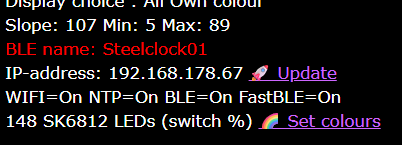

### FF - Fibonacci or Chrono

With a Fibonacci clock `FF` switches between the Fibonacci display and the Chrono display (with seconds).

### V - Background colour

`V` gives a faint background colour to the LEDs that are not lit, so that all the letters on the clock face are visible. The input is the same as for `F`: `Vwwrrggbb` (hexadecimal) or `Vwrgb` (digits 0-9). `V` alone erases the background colour.

### N and O - Display off and on

- `Nhhhh` switches the display off between two hours: `N2208` is off from 22:00 to 08:00. `N` alone switches this function off.
- `O` switches the display off and on. `O1` switches the display on and `O0` switches it off. The latter form is used by the MQTT switch in Home Assistant.

### ) - HET IS WAS on/off

`)` switches the words HET, IS and WAS on or off. When off, they always stay off.

### ( - Extra text (logo)

The clock can optionally be equipped with extra LEDs for a logo text, for example the name of the shop in which the clock hangs. `(` switches that text on or off.

### % - SK6812 or WS2812

`%` switches the type of LED strip: SK6812 (with white LED) or WS2812 (without). The clock is equipped with one of the two. Restart afterwards with `@`. A reset with `R` does not change this choice.

### $ - Fireplace

`$` shows a fireplace. The result is most beautiful on a clock with 144 LEDs and less beautiful on other types.

## 7.5 Brightness

See [chapter 6.6](#66-the-brightness-of-the-display) for the explanation.

| Command | Range | Meaning |
|---|---|---|
| `Snnn` | 1-255 | Slope: how fast the maximum brightness is reached |
| `Lnnn` | 0-250 | Minimum brightness in complete darkness |
| `Mnnn` | 1-255 | Maximum brightness |

Example: `S50 L5 M200` (send each command separately).

## 7.6 Information and log

### I - Menu

`i` shows the short menu and `ii` the long menu with all options.

### K - LDR measurement and time log

- `K` switches the printing of the LDR read-out on or off. Every second the LDR value, the output percentage and the number of times the program is run through per second (loops per second, `l/s`) are shown:

  ```
  TestLDR: On
  LDR reading, %Out, loops per second and time
  LDR:  1= 1% 205413 l/s 16:06:08
  ```

- `K0` switches the printing of the time off, `K1` prints the time every minute (default) and `K2` every hour. In the long menu `Timestamp: Off`, `/min` or `/hour` is then shown.
- On a clock with an HC-12 time sender (`H07`) the same setting determines how often the time is sent through the HC-12.

### } - Ring buffer counter

`}` switches the printing of the position in the ring buffer (log buffer) behind each log line on or off.<br>
Behind `@` is the current write position in bytes and behind `->` the number of bytes that are still free up to the end of the buffer. When the end has been reached, the buffer starts again at the beginning and the oldest lines are overwritten.

```
Ring buffer counter is ON
TestLDR: On
   Bits, Out, loops per second and time
15:01:17 LDR:  4-> 4% 198 kl/s @5588 ->3251936 
15:01:18 LDR:  4-> 4% 197 kl/s @5636 ->3251888 
15:01:19 LDR:  4-> 4% 199 kl/s @5684 ->3251840 
15:01:20 LDR:  4-> 4% 199 kl/s @5732 ->3251792 
15:01:21 LDR:  4-> 4% 199 kl/s @5780 ->3251744 
```

### = - Permanent settings

`=` shows all stored settings. Each line starts with the menu command with which the value can be changed:

```
Display choice  : Default yellow colour
Q  DisplayChoice: 0
TurnOffLEDsAtHH: 22
N TurnOnLEDsAtHH: 8
F    Font colour: 0X00FFFFFF
DimmedLetter: 0X10000000
BackGround: 0X00000000
LanguageChoice: 0
S   LightReducer: 69
L  MinBrightness: 11
M  MaxBrightness: 37
CCC        BLEOn: ON
X          NTPOn: ON
W         WIFIOn: ON
...
```

## 7.7 Maintenance and tests

### R - Resetting the settings

| Command | What is erased |
|---|---|
| `R` | All preferences to the default values. SSID, password, BLE name and time zone are kept |
| `RRR` | Only SSID, password, BLE name and time zone. WIFI, NTP and BLE are switched on |
| `RRRRR` | `R` and `RRR` together: a total reset |

The type of LED strip and the choice of input device (`H`) remain unchanged with a reset. Perform `RRRRR` when the sketch is uploaded to the Nano ESP32 for the first time.

### @ - Restart

`@` restarts the clock. Settings are kept. This is needed after changing the SSID, password, BLE name and the like.

### ^ - Reset button

`^nn` uses an external push button on GPIO pin `nn` (for example `^5` or `^22`) as a reset button.<br>
The number may be entered with or without a leading zero (`^5` and `^05` are the same) and lies between 1 and 99.<br>
 `^0` switches this function off.<br>
 Restart afterwards with `@`. <br>
 The button pulls the pin to GND: the clock resets to factory settings if the button is held down for 2 seconds.

### Y - LED test

`Y` lets all LEDs run through a rainbow at 5% of the maximum intensity. `Y` again stops the test.

### # - Self test

`#` starts the self test: all words are shown one after the other to check that all words work. `#nnnn` sets the delay between the words in milliseconds. The test stops by itself after one cycle.

### U - Demo mode

`Unnn` makes the clock run faster: `U200` is 200 ms per minute, about five times faster than normal. `U` alone switches the demo mode off.

### P - Status LEDs

`P` switches the status LEDs on the Arduino Nano on or off, see [chapter 6.7](#67-the-status-leds).

---

# 8. Time receiver and time sender

A clock without WIFI and without a DS3231 can get the time from another source through Bluetooth Low Energy (BLE). The source is called the **time sender**; the clock that receives the time is the **time receiver**. A clock can also be a time sender itself, for other clocks.

| Role | Command | What happens |
|---|---|---|
| Time receiver | `H05` | The clock looks for a time sender through BLE and takes over the time and date |
| Time sender (BLE) | `H06` | The clock sends its own time and date to a time receiver |
| Time sender (HC-12) | `H07` | The clock sends the time through an HC-12 433 MHz module |

Restart the clock after every change with `@`. `H05` and `H06` exclude each other: `H06` switches the time receiver off and sets the input device to `H00` (time through NTP). `H07` switches the time receiver and an IR remote control off.

## 8.1 Time receiver (H05)

### Setting up

1. Make sure Bluetooth is on (`CCC` switches it on or off).
2. Send `H05` and restart with `@`. The long menu then shows `TimeReceiver=On`.
3. Start a time sender (see [8.2](#82-time-senders)). As soon as the clock finds the sender it connects, and the time is correct within two minutes.
4. Executing `H05` again switches the time receiver off.

### How does it work?

- The clock scans for a BLE device with the name **`BLE-UARTtime`** and the nRF52 UART protocol. Senders with a weaker signal than -90 dBm are ignored: the sender must therefore be nearby.
- After connecting, the time sender sends the time (`Thhmmss`) every 10 seconds and the date (`Dddmmyyyy`) one second later.
- The clock treats these messages as ordinary menu commands: `T143000` and `D09062025` have the same effect as when they are typed with the Bluetooth app (see [command D and T](#d-and-t---setting-the-date-and-time)). If a DS3231 is present, the time is stored in it and WIFI and NTP are switched off.
- If the connection is lost, the clock automatically searches for the sender again.
- The clock sends its own log lines back to the time sender. In this way the messages of the clock can also be followed in the sender app.
- While there is a connection with the time sender, the status LED is yellow (see [6.7](#67-the-status-leds)).

## 8.2 Time senders

The following time senders are available:

| Time sender | Platform | Remarks |
|---|---|---|
| **[BLE UART time](https://apps.apple.com/nl/app/bluetooth-uart-time/id6760344877)** (iOS app) | iPhone, iPad | Available in the Apple App Store. Start the app and keep it open until the clock is connected |
| **TimeSender web page** | Windows, Android (Chrome) | [Time sender web page](https://ednieuw.com/Woordklok/TimeSender/TimeSender.html), explanation: [github.com/ednieuw/HTML-TimeSender](https://github.com/ednieuw/HTML-TimeSender) |
| **ESP32 Arduino communications** | A second ESP32 | Sketch at [github.com/ednieuw/ESP32Communications](https://github.com/ednieuw/ESP32Communications) |
| **Another clock with `H06`** | WordFiboClock | See [8.3](#83-the-clock-as-time-sender-h06) |

What all these senders have in common: they advertise a BLE service with the name `BLE-UARTtime` and send `Thhmmss` and `Dddmmyyyy` to the clock. A sender of one's own (for example on a different microcontroller board) only has to send those two messages.

## 8.3 The clock as time sender (H06)

A clock with WIFI and NTP can pass on the correct time to clocks without WIFI.

1. Send `H06` and restart with `@`. The long menu then shows `TimeSender: ON`.
2. The clock starts a BLE server with the name `BLE-UARTtime`. `H00` is chosen automatically: the time comes through NTP.
3. As soon as a time receiver connects and has enabled notifications, the clock sends the time every 10 seconds and the date one second later. The log then shows `Sending TIME: T143000` and `Sending DATE: D09062025`.
4. Executing `H06` again switches the time sender off.

Do not send `H05` to the same clock: a clock is a time sender or a time receiver, not both.

## 8.4 HC-12 time sender (433 MHz)

Setting up: send `H07` and restart with `@`. The command `=` then shows `HC12Time: ON`. Executing `H07` again switches the HC-12 off. This function is available since **V247**.

For a range of up to about 1000 metres, an **HC-12 433 MHz module** can pass on the time to another processor with an HC-12 receiver. The receiving side is in the project [github.com/ednieuw/ESP32-HC12](https://github.com/ednieuw/ESP32-HC12).

- The clock only transmits (half duplex). Connection: HC-12 **RXD** to clock pin **D4** (`HC12_TX`), supply 3.3 V or 5 V according to the specification of the module used, and GND. D6 (`HC12_RX`) is not used.
- D4 is also used for the IR receiver: an IR remote control and the HC-12 can therefore not be connected at the same time.
- The serial speed is 9600 baud, 8N1.
- Per transmission, `Thhmmss` plus a line ending is sent, for example `T143000`. The log shows `HC-12 time sent`.
- `K1` sends the time every minute, `K2` every hour and `K0` stops the sending.
- `H06` (BLE) and `H07` (HC-12) can both be on at the same time.

## 8.5 Troubleshooting

| Symptom | Possible cause and solution |
|---|---|
| The clock does not find the sender | Sender too far away (weaker than -90 dBm) or Bluetooth of the clock is off (`CCC`). The name of the sender must be `BLE-UARTtime` |
| The connection keeps dropping | The clock searches again by itself. Check that the sender app stays open and does not go to sleep |
| The time jumps after receiving | Another time source is still on. Choose the correct input device with `H` and switch WIFI/NTP off if the time must come through the time sender |
| No time from the HC-12 | HC-12 connected to D4? IR not used at the same time? Same settings (9600 baud, same channel) in sender and receiver? |

---

# 9. MQTT and Home Assistant

The clock can register itself automatically in [Home Assistant](https://www.home-assistant.io/) through **MQTT**. Nothing has to be set up manually in Home Assistant: the clock itself announces all its buttons, sliders and sensors (*MQTT Discovery*). The device appears in Home Assistant under the name **WordClock**.

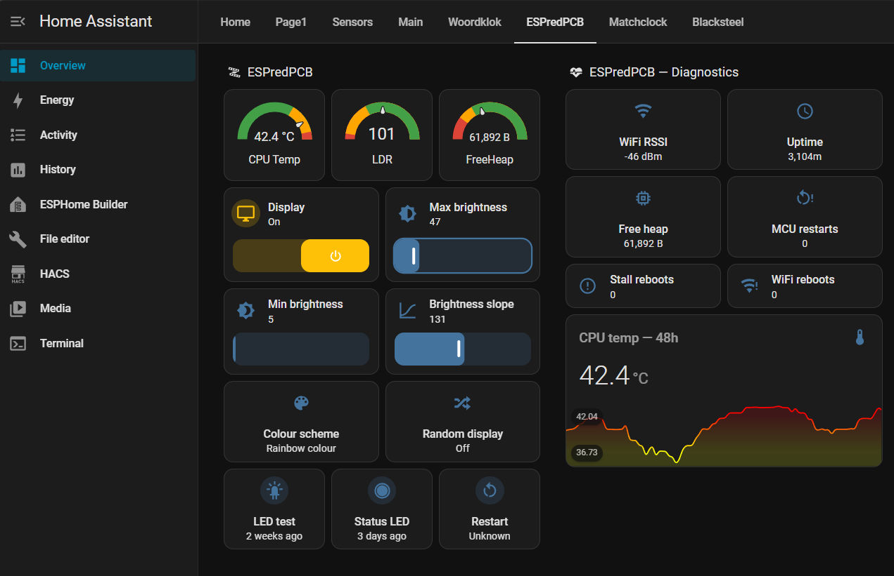

## 9.1 What appears in Home Assistant?

**Controls**

| Item | Type | Menu command | Remarks |
|---|---|---|---|
| Display | Switch | `O1` / `O0` | The switch shows the real state, even if the display was switched off with the menu or the remote control |
| Max Brightness | Slider 1-255 | `M` | Maximum brightness |
| Min Brightness | Slider 0-250 | `L` | Minimum brightness |
| Brightness Slope | Slider 1-255 | `S` | Slope of the brightness |
| Display Colour Scheme | Selection list | `Q0` - `Q9` | The names follow the clock variant (word clock or Fibonacci) |
| Random Display | Selection list | `~0`, `~1`, `~2` | Off, change per minute or per hour |
| LED Test | Button | `Y` | Lets all LEDs run through a rainbow |
| StatusLED On/Off | Button | `P` | Status LEDs on or off |
| Restart | Button | `@` | Restart the clock |

**Sensors**

| Sensor | Unit | Remarks |
|---|---|---|
| CPU Temperature | °C | Internal temperature sensor of the ESP32 |
| LDR Reading | | Raw value of the light sensor |
| OutPhotocell | 0-255 | Brightness that is sent to the LEDs, derived from the LDR |
| DS3231 Temperature | °C | Only if a DS3231 module is connected |

**Diagnostics** (in a separate box on the device page)

| Item | Unit | Remarks |
|---|---|---|
| WiFi Signal | dBm | The graph shows whether disturbances are at the router or at the clock |
| Uptime | minutes | Time since the last restart |
| Free Heap | bytes | Free working memory. A falling line points to a memory leak |
| MCU Restarts | count | Restarts during start-up (`Mem.MCUrestarted`) |
| WiFi Reboots | count | Restarts after a long period without an IP address |
| Loop-stall Reboots | count | Restarts because the main program hung |

As soon as the clock goes offline, the whole device is shown in Home Assistant as *unavailable* instead of showing an old value.

## 9.2 What is needed?

- A clock with a WIFI connection (see [chapter 5](#52-connecting-to-wifi)).
- Home Assistant with the **Mosquitto broker** (MQTT server) in the same network.
- A clock with software from V236. The options `_` (MQTT on/off) and the sliders for minimum and maximum brightness are there since V238 and V242.

## 9.3 Setting up in Home Assistant

1. **Install the Mosquitto broker.** Go to *Settings → Add-ons → Add-on Store → Mosquitto broker → Install* and choose *Start*. Switch *Start on boot* on.
2. **Add the MQTT integration.** If that does not happen automatically, go to *Settings → Devices & services → Add integration → MQTT*.
3. **Create a user for the clock.** Go to *Settings → People → Users → Add user*:
   - User name: `mqtt_user`
   - Password: **the WIFI password of the router** (the same as entered in the clock with `B`)
   - Tick *Can only log in from the local network*.

## 9.4 Setting up in the clock

1. Send `_` to switch MQTT on. This only works if the clock is connected to WIFI; otherwise the message *No WIFI connection. MQTT remains OFF* follows.
2. Restart with `@`.
3. In the log (or the serial monitor) the following appears:

   ```
   [MQTT] Connecting...
   [MQTT] Connected
   ```

4. In Home Assistant the clock appears under *Settings → Devices & services → MQTT* as the device **WordClock**.

With `_` again, MQTT is switched off. The state is in the long menu as `MQTT=On` or `MQTT=Off`.

> Several clocks in one Home Assistant can all use MQTT, provided each clock has its **own Bluetooth name** (command `c`, see [chapter 5](#through-bluetooth-or-a-serial-cable)). That name, in lower case and with `_` instead of spaces, forms the device id and the name of the section in the MQTT messages.

## 9.5 A different broker, user name or password

The MQTT settings are not in the menu but at the top of the sketch:

```cpp
const char*    MQTT_SERVER   = "homeassistant.local";   // or the IP address of the broker, for example "192.168.1.10"
const uint16_t MQTT_PORT     = 1883;
const char*    MQTT_USER     = "mqtt_user";             // MQTT user name
const char*    MQTT_PASSWORD = Mem.Password;            // uses the WIFI password
```

Adjust these lines if the broker has a different address, a different user name or a different password, and compile and upload the sketch again. For a password of its own:

```cpp
const char* MQTT_PASSWORD = "MySecret123";
```

> **Note:** as long as `MQTT_PASSWORD = Mem.Password` is used, the MQTT password changes along when the WIFI password is changed in the clock with `B`. The password of `mqtt_user` in Home Assistant then also has to be changed, or a fixed password has to be put in the sketch.

## 9.6 How does it work?

### Connection

- The clock connects to `homeassistant.local` on port 1883. If that fails, a new attempt follows every 5 seconds; the main program keeps running in the meantime.
- As its client name the clock uses its Bluetooth name.
- After connecting, the clock sends all registration messages (*discovery*) once, and immediately all values, so that nothing is shown as *unknown*. After that the values are renewed **every minute** and directly after every command from Home Assistant.

### MQTT Discovery

For every item the clock sends one JSON message to a special topic:

```
homeassistant/<type>/<device-id>/<name>/config
```

Here `<type>` is one of `sensor`, `button`, `switch`, `number` or `select`, and `<device-id>` is the Bluetooth name in lower case, for example `wordclock`. Home Assistant reads the message and creates the item. The message never contains measured values; only **where** the values come from and **how** commands are sent.

All items share the same fixed topics:

| Topic | Direction | Content |
|---|---|---|
| `wordclock/status` | clock → HA | `online` when connecting. The broker sets `offline` if the clock drops out (*Last Will*) |
| `wordclock/cmnd` | HA → clock | The menu command, for example `@`, `O1`, `M200`, `Q3`, `~1` |
| `wordclock/display`, `.../maxbrightness`, `.../displaychoice` and so on | clock → HA | The real state of the item |

The commands end up in the same command processing as the serial monitor, Bluetooth and the web page (at most 40 characters per command).

### The five kinds of items

**Sensor** (for example WIFI signal)

```json
{
  "name": "WiFi Signal",
  "state_topic": "wordclock/rssi",
  "unit_of_measurement": "dBm",
  "device_class": "signal_strength",
  "entity_category": "diagnostic",
  "availability_topic": "wordclock/status",
  "state_class": "measurement",
  "unique_id": "wordclock_rssi",
  "device": { "identifiers": ["wordclock"], "name": "WordClock",
              "manufacturer": "EdNieuw", "model": "WordClock" }
}
```

- `state_topic`: this is where Home Assistant reads the value (for example `-67`).
- `device_class` and `unit_of_measurement`: determine the icon and the formatting.
- `state_class: measurement`: keeps minimum, mean and maximum in the statistics of Home Assistant.
- `entity_category: diagnostic`: puts the item in the diagnostics box.
- `availability_topic`: gives *unavailable* when the clock is offline.
- `unique_id`: the key of Home Assistant. As long as it stays the same, a message that is sent again is used to update the same item instead of creating a duplicate. An item is removed by sending an **empty** message with *retain* to the configuration topic.
- `device`: all items with the same `identifiers` belong to one device.

**Button** (for example Restart): contains `command_topic` and `payload_press`. A press sends `@` to `wordclock/cmnd`. There is no feedback.

**Switch** (Display): a button with memory.

```json
"command_topic": "wordclock/cmnd",
"payload_on":  "O1",
"payload_off": "O0",
"state_topic": "wordclock/display",
"state_on":  "ON",
"state_off": "OFF"
```

Home Assistant sends `O1` or `O0`; the clock reports the real state back with `ON` or `OFF`.

**Slider** (Max Brightness):

```json
"command_topic": "wordclock/cmnd",
"command_template": "M{{ value }}",
"state_topic": "wordclock/maxbrightness",
"min": 1, "max": 255, "step": 1
```

`{{ value }}` is filled in by Home Assistant: sliding to 200 sends `M200`, an ordinary menu command.

**Selection list** (Display Colour Scheme, Random Display): Home Assistant sends the chosen option as **text**, for example `Rainbow colour`. The clock translates that text into the command (`Q8`, `~1` and so on). The clock reports the chosen option back as text, so not as a number.

### Keeping the messages

All configuration messages go to the broker with *retain*. Home Assistant therefore knows all items directly after a restart, without the clock having to do anything.

## 9.7 Testing by hand

With an MQTT program (for example *MQTT Explorer*, or in Home Assistant under *Settings → Devices & services → MQTT → Configure*) a command can be sent directly to the clock:

| Topic | Message | Result |
|---|---|---|
| `wordclock/cmnd` | `Y` | LED test |
| `wordclock/cmnd` | `Q2` | All words white |
| `wordclock/cmnd` | `O0` | Display off |

The topic begins with the Bluetooth name of the clock in lower case, with `_` instead of spaces.

## 9.8 A dashboard in Home Assistant

In the folder with the sketch is the script `make-clock-view.sh`. It makes a ready-made clock page for the Home Assistant dashboard from the file `HA-clock-view-template.yaml`:

```bash
./make-clock-view.sh <device-id> [Display name]
./make-clock-view.sh espredpcb "ESPredPCB"
```

The device id is the Bluetooth name in lower case with `_` instead of spaces. The output is pasted into the *raw configuration editor* of the dashboard, under `views:` and at the same indentation as the other pages.

The page contains six cards: controls (display, colour scheme, brightness), actions (LED test, status LED, restart), gauges for CPU temperature and LED brightness, a graph of light and temperature, the diagnostics (WIFI signal, uptime, memory and restart counters) and a graph of WIFI signal and memory.

> The entity ids in the template are derived from the names under which the clock registers itself, for example `number.wordclock_max_brightness`. Check them once in Home Assistant under *Settings → Devices & services → Entities* and adapt the template if they differ.

### Having an AI make a dashboard of one's own

The supplied template is an example. An AI assistant (such as Claude or ChatGPT) can make a page from it in a few seconds that fits one's own wishes exactly, for example with other cards, another language or only the items that are used. An AI with access to the files can use the script `make-clock-view.sh` and the template for that, or write a new YAML itself. Without access to the files, the contents of the template and the list of items (see [9.1](#91-what-appears-in-home-assistant)) have to be pasted into the question.

The question to the AI must contain:

1. what it is: a Home Assistant dashboard page (*view*) for a word clock that has been registered through MQTT Discovery;
2. the **device id** and the desired name of the page;
3. the list of items (controls, sensors and diagnostics from 9.1) or the file `HA-clock-view-template.yaml` as an example;
4. the desired layout and language;
5. the requirement that the output is **only the YAML of one view**, meant to be pasted into the *raw configuration editor* of the dashboard under `views:`.

Example of a question:

```text
Make a Home Assistant dashboard page (view, YAML) for my word clock.
Device id: wordclock_kitchen, name of the page: "Clock kitchen".
The clock registers itself through MQTT Discovery with these items:
- switch Display, select Display Colour Scheme, select Random Display
- number Max Brightness, Min Brightness and Brightness Slope
- button LED Test, StatusLED On/Off and Restart
- sensor CPU Temperature, LDR Reading, OutPhotocell
- diagnostics: WiFi Signal, Uptime, Free Heap, MCU Restarts, WiFi Reboots, Loop-stall Reboots
Use the attached HA-clock-view-template.yaml as an example, but put the controls
at the top, below that one graph with light and temperature, and leave out the diagnostics.
Return only the YAML of the view, so that I can paste it under "views:" in the
raw configuration editor. Check that the entity ids have the form
domain.<device-id>_<name>, for example switch.wordclock_kitchen_display.
```

Then paste the output into Home Assistant and check the entity ids (see above). An AI can only derive the entity ids from the names; the real ids are in Home Assistant under *Settings → Devices & services → Entities*.

## 9.9 Troubleshooting

| Symptom | Possible cause and solution |
|---|---|
| `_` gives *No WIFI connection* | The clock is not connected to WIFI. Set up WIFI first (chapter 5) |
| The log keeps showing `[MQTT] Connect failed, rc=-2` | The broker cannot be reached. Check whether Mosquitto is running and whether `homeassistant.local` can be reached; otherwise use the IP address in the sketch |
| `rc=4` or `rc=5` | User name or password is refused. Check the user `mqtt_user` in Home Assistant and compare its password with the WIFI password in the clock |
| The clock does not appear in Home Assistant | Has the MQTT integration been added and is it listening to `homeassistant/#`? Restart the clock with `@` to send the registration messages again |
| Items show *unknown* | Wait at most a minute or send a command. Then all values are sent again |
| An old item remains | Remove the item in Home Assistant, or send an empty message with *retain* to the configuration topic |

---

# 10. Fibonacci clock and NOCLOCK

The same software can, besides the word clock, drive a **Fibonacci clock** or run **without a display** (NOCLOCK). The variant is chosen when compiling with a `#define` (see [chapter 4](#4-installing-the-software)).<br>
All menu commands, WIFI, Bluetooth, MQTT, time receiver and time sender work the same for all variants. Only the display and the colour schemes differ.

## 10.1 Fibonacci clock

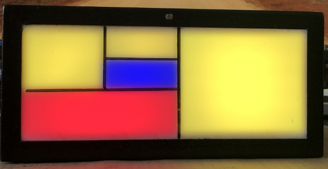

### How is the time read?

The clock has five rectangles (cells) with the areas **1, 1, 2, 3 and 5**, the first numbers of the Fibonacci sequence.<br>
Each cell can have four states:

| State | Meaning |
|---|---|
| Off | The cell does not count |
| Hours | The cell counts for the **hours** |
| Minutes | The cell counts for the **minutes** |
| Both | The cell counts for both the hours and the minutes |

This is how the time is read:

1. Add the areas of all cells that have the **hours** colour or the **both** colour. That is the number of **hours** (1 to 12).
2. Add the areas of all cells that have the **minutes** colour or the **both** colour and multiply that by **5**. That is the number of **minutes**, in steps of 5 minutes.

A few examples with the default scheme Q0 (hours red, minutes yellow, both blue, off white):

| Time | Hours | Minutes |
|---|---|---|
| 3:00 | 3 = 3, or 2 + 1 | 0 |
| 5:30 | 5 | 30 = 5 x 6 = 5 + 1 |
| 7:15 | 5 + 2, or 3 + 2 + 1 + 1 | 15 = 5 x 3 = 3 |

An hour or a number of minutes can be formed in several ways with the cells.<br>
At every change of minute the clock chooses one of the possible combinations **at random**.<br>
The pattern can therefore change every minute while the time stays the same.<br>
From 12:00 to 12:04 all five cells are lit in the hours colour.

### Chrono display

With `FF` the display switches to the **Chrono display**. Here LEDs 0 to 11 are used as a bar: the number of lit LEDs in the hours colour is the number of hours, the number of LEDs in the minutes colour is the number of minutes divided by 5. Where both overlap, the colour *both* is used. Send `FF` again to return to the Fibonacci display. The log shows `Display is Fibonacci` or `Display is Chrono`.

> After a reset (`R`) the clock is in the **Chrono** display. Send `FF` once for the Fibonacci display.

### Colour schemes (Q0 - Q9)

The colour schemes are chosen with `Q`. Without a digit `Q` shows the list. A cell that is *off* also has a colour, usually white.

| Q | Name | Off | Hours | Minutes | Both |
|---|---|---|---|---|---|
| `Q0` | Mondriaan1 | white | red | yellow | blue |
| `Q1` | Mondriaan2 | white | red | dark yellow | blue |
| `Q2` | RGB | white | red | green | blue |
| `Q3` | Own | *own colours, see [Own colours](#own-colours-q3-with-the-colour-picker)* | | | |
| `Q4` | Pastel | white | red | light green | purple |
| `Q5` | Modern | white | orange | green | azure blue |
| `Q6` | Cold | white | sky blue | purple | blue |
| `Q7` | Warm | white | red | yellow | orange |
| `Q8` | Mondriaan3 | light grey | red | dark yellow | blue |
| `Q9` | Greens | white | apple green | green | light green |

With `~` the colour scheme changes automatically per minute or per hour (see [command ~](#---changing-the-colour-scheme-automatically)).

### Own colours (Q3) with the colour picker

For `Q3` the colours are determined with the colour picker in the web page of the clock (`/colourpick` or the link *Set colours*, see [chapter 6](#62-operating-with-the-web-page)). Five colours can be set there:

| Field | Meaning |
|---|---|
| OFF | Cell off |
| HRS | Cell counts for the hours |
| MIN | Cell counts for the minutes |
| BOTH | Cell counts for hours and minutes |
| SEC | Colour for the seconds (Chrono) |

Choosing a colour and pressing *Send to clock* adjusts the colour immediately. The clock then automatically chooses `Q3`.

### LED layout

The number of LEDs and how they are divided over the cells is set in the sketch with the constant `NUM_LEDS` at the top of `Fibonacci.h` (default 17). The following layouts exist:

| NUM_LEDS | Number of LEDs per cell (1, 1, 2, 3, 5) | Remarks |
|---|---|---|
| 12 | 1, 1, 2, 3, 5 | One LED per unit |
| 14 | 1, 1, 2, 4, 6 | |
| 17 | 1, 1, 2, 4, 9 | Default |
| 24 | 2, 2, 4, 6, 10 | |
| 32 | 2, 2, 4, 8, 16 | Four strips of 8 LEDs, divided symmetrically |
| 36 | 3, 3, 6, 9, 15 | Case with 3 x 12 LEDs |
| 174 | 16, 16, 32, 40, 70 | Case of 50 x 50 cm |

Any other value falls back to the layout of 14 LEDs. After changing `NUM_LEDS` the sketch has to be compiled and uploaded again.

### Which commands work?

All commands for time, WIFI, Bluetooth, brightness (`S`, `L`, `M`), display off between two hours (`N`), `O`, `P`, `Q`, `~`, `R`, `@`, `K`, `Y` (LED test) and the time senders work as with the word clock.<br>
Commands that belong only to a word clock have no effect on the Fibonacci clock: `)` (HET IS WAS), `$` (fireplace), `#` (self test) and `U` (demo).

### The web menu of the Fibonacci clock

The menu page (`/menu`) shows a slider for the colour scheme with three colour swatches (hours, minutes, both).<br>
A tap on a swatch opens the colour picker.<br>
In addition there are the sliders for brightness, the hours during which the display is off, and switches, among them **Fibonacci / Chrono** (command `FF`).

## 10.2 Clock without a display (NOCLOCK)

With `#define NOCLOCK` the software is built without a clock display.<br>
No LED strip is then needed: the sketch uses one virtual LED and all display functions do nothing.<br>

What keeps working:

- WIFI, NTP and the main page of the clock (input field for commands);
- Bluetooth and all menu commands;
- MQTT and Home Assistant, with the sensors (CPU temperature, LDR, diagnostics) and the controls that make sense when there is no display;
- the status LED on the Nano ESP32;
- the time receiver (`H05`) and the time senders (`H06`, `H07`), so that the processor can serve as a stand-alone time source;
- the DS3231, so that the time stays accurate even without internet.

Applications are, for example, a stand-alone **time sender** for several clocks, a measuring point for Home Assistant (temperature, light) or a project of one's own that uses the menu, WIFI, MQTT and BLE code as a basis.

The pages `/menu` (menu page with sliders) and `/colourpick` (colour picker) are **not available** with NOCLOCK: the clock answers *Not found*. Commands can still be sent through the input field on the main page, Bluetooth, the serial port or MQTT.<br>
With NOCLOCK the command `Q` has only one choice (*None*). The files `ClockFaces.h`, `WordClock.h` and `Fibonacci.h` are then not needed and can be deleted.


---

# 11. Maintenance and troubleshooting

## 11.1 Updating the software (OTA)

As long as the clock is connected to WIFI, new software can be uploaded 'Over The Air' (OTA). The USB cable is then not needed and the libraries do not have to be installed: the compiling has already been done and the `.bin` file is sent directly to the clock.

### Steps

1. Find the IP address of the clock in the menu (`i`). It is behind `IP-address:`, followed by `/update` or the link *Update*.
2. Type the address, directly followed by `/update`, in a browser, for example `192.168.178.141/update`. Or use the name of the clock: `http://wordclock.local/update` (sometimes `http://` can be left out).
3. Choose *Choose file* and select the correct `.bin` file.
4. Press *Upload* **once**. The progress bar runs to 100%.
5. Wait about **20 seconds**. The clock restarts by itself and the clock menu appears again.

| Menu with IP address and the link /update | The upload page of the clock |
|---|---|
| 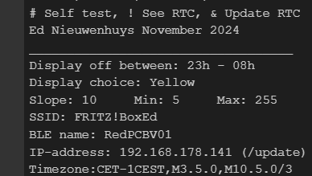 | 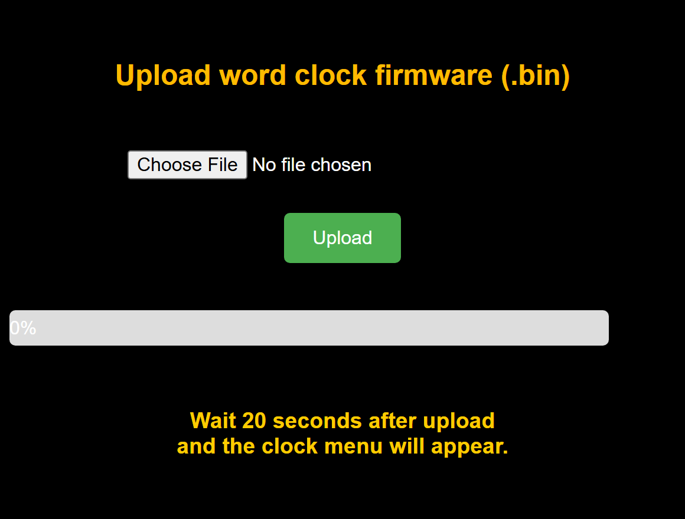 |

### Which file?

A `.bin` file is made for one clock variant, for example `WordFiboClockV247.NL144.bin`. The `.bin` files are optional: the `NL144` variant is supplied by default. Other variants can be compiled oneself ([chapter 4](#4-installing-the-software)).<br>
The part after the version indicates the clock variant (see the [appendix](#13-appendices)).<br>
Choose the file that fits the clock: a `.bin` for the wrong variant gives a clock with a wrong board or a wrong number of LEDs.<br>
It can be repaired with a `.bin` of the correct variant or through the USB cable.

### What is kept?

The settings are in the memory of the ESP32 and are kept during an update: WIFI data, time zone, colours and brightness.<br>
If the storage is not recognisable after an update (different layout), the clock restores the default values (log: `Checksum (25065) invalid ... Resetting to default values`).<br>
The WIFI data is kept in that case.<br>
If needed, send `RRRRR` for a completely clean start (see [11.5](#115-resetting)).

### If the update fails

| Symptom | Possible cause and solution |
|---|---|
| Message *FAIL* or *Error* | The file is incomplete or for another board. Download the file again and try once more |
| Clock does not restart | Wait at least 20 seconds. Otherwise send `@` or disconnect the power briefly |
| Messages *OTA rejected: an update is already in progress* in the log | An upload was already running (for example a double click). Wait a minute and try again |
| Page does not load | Is the clock connected to WIFI? Use the IP address instead of the name |

## 11.2 Updating the software with a USB cable

See [chapter 4](#4-installing-the-software). A USB cable is needed if the clock is not connected to WIFI or if a `.bin` file has made the clock unusable.

## 11.3 Log and diagnostics

The clock keeps its messages in a ring buffer in memory. That is the same as what is shown in the serial monitor or in the Bluetooth app.

| How | What |
|---|---|
| **Log view** on the web page (`/log`) | The last 500 lines. A tick (*Auto*) refreshes the display every few seconds |
| **All log files** on the web page | All lines from the buffer (thousands of lines) |
| `…/tekstdownload` | The same buffer as a text file `<name>-log.txt`, to send in or to keep |
| `K` | Prints every second the LDR value, the brightness percentage and the number of program loops per second (`kl/s`) |
| `K0`, `K1`, `K2` | The time stamp in the log off, per minute (default) or per hour |
| `}` | Prints the position in the ring buffer behind every line |
| `=` | Shows all stored settings, including the restart counters |
| `!` | Shows the NTP, RTC and DS3231 time |

The ring buffer is large (a few MB in PSRAM) but not infinite: the oldest lines are overwritten.<br>
Anyone who wants to investigate a problem is best advised to save the file `tekstdownload` directly after the symptom occurs.

### Restart counters

In the log and with the command `=` there are three counters:

| Counter | Meaning | In Home Assistant |
|---|---|---|
| `MCUrestarted` | Restarts shortly after start-up (within 2 minutes). Cleared as soon as the clock has run stably for 2 minutes | MCU Restarts |
| `WIFInoConnection` | Restarts because there was no IP address for 30 hours | WiFi Reboots |
| `LoopRebooted` | Restarts because the main program hung (fewer than 10 loops per second) | Loop-stall Reboots |

A counter that keeps increasing points to a structural problem (weak WIFI signal, power supply, defective module).

## 11.4 Automatic monitoring

The clock recovers by itself in three situations:

- **No WIFI.** Every hour a check is made whether there is an IP address. If there has been no connection for more than 30 hours, the clock restarts (counter `WIFInoConnection`).<br>If a connection is lost, the clock first tries to reconnect.
- **Main program hangs.** If there are fewer than 10 loops per second and a WIFI network is available, the clock restarts (counter `LoopRebooted`).
- **Restarting again and again.** If the clock restarts more than 5 times shortly after start-up, the settings are set to the default values (see [11.5](#115-resetting)). The counter is cleared when the clock has run stably for 2 minutes.

## 11.5 Resetting

| Method | What happens |
|---|---|
| `R` | All preferences to the default values. SSID, password, BLE name and time zone are kept.<br>WIFI, NTP and BLE are on |
| `RRR` | Only SSID, password, BLE name and time zone are erased and set to the default |
| `RRRRR` | `R` and `RRR` together: a total reset. Use this after uploading the sketch for the first time |
| Rotary encoder | Pressing 9 times resets the clock to factory settings |
| Reset button (`^nn`) | Holding it down for 2 seconds restores the factory settings (including the WIFI data) and restarts the clock |
| `@` | Restart only; all settings are kept |

The type of LED strip (`%`) and the choice of input device (`H`) remain unchanged with a reset.

## 11.6 Troubleshooting

### The LEDs do not light up or light up wrongly

| Symptom | Possible cause and solution |
|---|---|
| No LED lights up | **Pin Numbering** in the Arduino IDE is wrong (with NeoPixel it must be *By GPIO number (legacy)*, see [chapter 4](#4-installing-the-software)).<br>Not exactly one clock has been chosen at the `#define`s at the top of the sketch. Also check the power supply of the LED strip and the data line |
| Display is off | Is `N` set to a time range? `N` alone switches that off. Is the display off with `O`? Send `O1` |
| Colours are not right (no white) | Wrong LED type: switch with `%` (SK6812 or WS2812) and restart with `@` |
| Letters and words do not match | Wrong clock variant in the sketch, or a `.bin` for another variant (see [11.1](#111-updating-the-software-ota)) |
| Brightness too low or too high | See `S`, `L`, `M` in [chapter 6.6](#66-the-brightness-of-the-display) |

### The time is not correct

| Symptom | Possible cause and solution |
|---|---|
| One hour difference | Wrong time zone (`E`, see [chapter 7](#e---time-zone)). When the DS3231 is used, summer time is not applied automatically.<br>Or the DS3231 is being used instead of WIFI. Check in the menu that DS3231 is OFF and that WIFI and NTP are ON |
| The time soon goes wrong without WIFI | The internal clock drifts a few seconds per day. Use a DS3231 (`J`) or the time receiver (`H05`) |
| The time does not seem to change | Send `!` to see the NTP, RTC and DS3231 time. Send `&` to copy the NTP time to the DS3231 |
| Setting the time with `T` does not work | The date and time can only be changed when WIFI and NTP are off (`W`, `X`) |

### WIFI and web page

| Symptom | Possible cause and solution |
|---|---|
| Clock does not connect to WIFI | SSID or password incorrect or shorter than 5 characters.<br>Send `G` to see the networks in the neighbourhood. The ESP32 only uses WIFI on 2.4 GHz.<br>If needed send `RRRRR` and enter the data again (see [chapter 5](#52-connecting-to-wifi)) |
| Clock keeps starting the access point page (`StartWordclock`) | No valid router data. See above |
| Web page cannot be reached | Use the IP address from the menu instead of `name.local`. Is `WIFI=On`? |
| Connection drops often | Weak signal. The clock reconnects by itself. Look at the counter `WIFInoConnection` and the sensor *WiFi Signal* in Home Assistant |

### Bluetooth

| Symptom | Possible cause and solution |
|---|---|
| Clock does not appear in the app | Is Bluetooth on (`CCC`)? <br> Use an app that supports the nRF52 UART ([chapter 2](#step-1---choose-a-control-app)). |
| Text incomplete or distorted | Send `+` to switch between fast and slow BLE, see [chapter 6](#if-text-appears-incomplete-or-distorted) |
| Compiling gives Bluetooth errors | From V060 on, the library **NimBLE version 2.x** must be used. Before V060 only NimBLE 1.4.3 worked |

### Input devices

| Symptom | Possible cause and solution |
|---|---|
| Rotary, push buttons or IR do not work | Has the device been chosen with `H01` - `H04` and the clock restarted with `@`? See [chapter 5.1](#51-which-input-does-the-clock-have) |
| Unintended input or flashing words | No input device is connected but `H01` - `H04` is on: send `H00` |
| IR remote control does not respond | Have all keys learned again with `{` ([chapter 5](#with-an-ir-remote-control)). Not all remote controls are suitable |
| HC-12 and IR together | Both use pin D4 and cannot be used at the same time |

### MQTT

See [chapter 9.9](#99-troubleshooting).

## 11.7 Contact and more information

- Contributions and questions: [github.com/ednieuw/Arduino-ESP32-Nano-Wordclock](https://github.com/ednieuw/Arduino-ESP32-Nano-Wordclock)
- Building page: [ednieuw.com/Woordklok/Bouwpakket/WoordklokSK6812.htm](https://ednieuw.com/Woordklok/Bouwpakket/WoordklokSK6812.htm)

---

# 12. Program explanation

The structure of the sketch (files, clock variants, storage, time steps, input and output, WIFI, MQTT, monitoring) and how the software can be modified.

## 12.1 Overview

The sketch is one large program with, on purpose, as many **global variables** as possible. Variables are grouped per part, so that *find* in the IDE quickly locates everything. Functions take few parameters. That is not a recommendation for large projects with several developers, but it keeps this program easy to read.

All functions are in the same order in the sketch, grouped by a comment line such as `// COMMON`, `// LED`, `// WIFI`, `// BLE`, `// MQTT`, `// CLOCK` in front of the function name. In this way it is visible whether a function applies to all clock variants (`COMMON`) or to one part.

The program is **cooperative**: nowhere is there a long wait. `loop()` hardly does anything itself and calls routines that do something every second, minute, hour and day. As a result the processor is mostly free: with `K` (LDR read-out) the number of loops per second is shown, about 200 kl/s (200,000 per second).

## 12.2 Files and clock variants

| File | Contents |
|---|---|
| `WordFiboClockV247.ino` | Everything that applies to all variants: start-up, menu, WIFI, BLE, MQTT, time, LED helper functions, storage |
| `WordClock.h` | Display of the word clock (`Displaytime()`, the language functions `Dutch()`, `English()`...), colour picker and menu page |
| `ClockFaces.h` | LED positions of every word, per clock variant |
| `Fibonacci.h` | Display of the Fibonacci clock, colour picker and menu page |
| `NoClock.h` | Empty functions for the variant without a display |
| `Webpage.h`, `SoftAP.h`, `OTAhtml.h`, `LogViewer.h` | HTML pages of the clock |

### Choosing the variant

At the top of the sketch one variant is chosen with `#define`. That determines which `.h` file is included, at the end of the definitions (below the menu table):

```cpp
#if   defined(WORDCLOCK)
  #include "WordClock.h"      // Word clock: Displaytime(), ColourPick_html[], menu_html[]
#elif defined(FIBONACCI)
  #include "Fibonacci.h"      // Fibonacci
#elif defined(NOCLOCK)
  #include "NoClock.h"        // No display
#endif
```

`WORDCLOCK` is defined automatically as soon as neither `FIBONACCI` nor `NOCLOCK` is chosen.

Every variant file supplies the same parts, so that the main sketch does not need to know anything about them:

| Part | Purpose |
|---|---|
| `Displaytime()` | Puts the time on the LEDs |
| `QchoiceNames[]` and `LASTITEM` | Names of the colour schemes for the command `Q` (and for Home Assistant) |
| `CLOCK_VARIANT` | Name of the variant in the log |
| `NUM_LEDS`, `MATRIX_WIDTH`, `MATRIX_HEIGHT`, `LEDNEARLDR` | Dimensions and LED positions |
| `ColourPick_html[]`, `menu_html[]` | Pages `/colourpick` and `/menu` |
| `PrintDisplayChoice()`, `SetSecondColour()`, `Demomode()`, `FireMode()`, `Selftest()`, `RotPressOne/Two/Three()` | Helper functions. Where a variant does not need them, they are empty functions |

This is the reason why commands such as `$` (fireplace) or `#` (self test) do nothing on the Fibonacci clock.

## 12.3 Libraries

```cpp
#include <EdSoftLED.h>          // LED strip (core 3.3+); otherwise <Adafruit_NeoPixel.h>
#include <Preferences.h>        // Permanent storage
#include <NimBLEDevice.h>       // Bluetooth Low Energy (NimBLE 2.x)
#include <WiFi.h>               // WIFI
#include <esp_sntp.h>           // NTP
#include <esp_wps.h>            // WPS
#include <ESPAsyncWebServer.h>  // Web pages
#include <Update.h>             // OTA
#include <ESPmDNS.h>            // name.local
#include <DNSServer.h>          // Access point page
#include <Wire.h>               // I2C
#include <RTClib.h>             // DS3231
#include <Encoder.h>            // Rotary encoder
#include <Keypad.h>             // Three push buttons
#include <IRremote.hpp>         // IR remote control
#include <PubSubClient.h>       // MQTT
```

The LED library is chosen automatically: with ESP32 core 3.3.0 or higher `USEEDSOFTLED` (EdSoftLED), otherwise NeoPixel. See [chapter 4 of the manual](#4-installing-the-software) for the corresponding pin numbering.

## 12.4 Global variables and permanent storage

### The struct `Mem`

All settings are in one struct, `EEPROMstorage`, with the variable `Mem`:

```cpp
struct EEPROMstorage {
  byte DisplayChoice = 0;
  byte TurnOffLEDsAtHH = 0;
  ...
  char SSID[30];
  char Password[40];
  char BLEbroadcastName[30];
  char Timezone[50];
  int  Checksum = 0;
  ...
} Mem;
```

The fields are addressed with `Mem.<name>`, for example `Mem.DisplayChoice = 3;`. The whole struct is stored and read back in one go with the library `Preferences`:

| Function | Task |
|---|---|
| `InitStorage()` | Reads the struct and checks the values. If `Mem.Checksum` is not 25065, `Reset()` follows |
| `StoreStructInFlashMemory()` | Stores the struct. Happens after every command and every day |
| `GetStructFromFlashMemory()` | Reads the struct from memory |
| `Reset()` | Sets all values to the default (except WIFI data, BLE name and time zone) |
| `ResetCredentials()` | Erases SSID, password, BLE name and time zone |
| `StoreIRRemoteInFlashMemory()`, `GetIRRemoteFromFlashMemory()` | The learned IR keys (separate storage) |

The struct contains spare fields (`byteFuture…`, `IntFuture…`, `Extra…`, `ExtraSpace`), so that a new setting can be added without changing the layout.

> If the layout of the struct is changed, the storage in existing clocks no longer matches and a reset to the default values follows at the first start. So preferably put a new field in a spare field.

### Adding a new setting

1. Add the field in the struct (or use a spare field).
2. Put the default value in `Reset()`.
3. Add it to `PrintMem()` so that it is visible with `=`.
4. Write the command in `ReworkInputString()` (see [12.16](#1216-modifying-and-extending)).

### The menu table

The menu that is shown in the serial monitor, the Bluetooth app and on the web page is held in two tables, `menu[]` (long) and `menusmall[]` (short). The lines are at most 40 characters long. `SWversion()` prints the menu and the current settings, `PrintLine()` draws the divider lines.

## 12.5 Starting up: `setup()`

`setup()` starts the parts in this order. Each step shows its own colour on the LED strip, so that it is visible where the start-up hangs (`LEDstartup()`):

1. Serial port (115200 baud) and I2C.
2. `InitStorage()`: read and check the storage, ring buffer for the log (`InitLogBuffer()`).
3. `StartLeds()` and `InitStatusLEDs()`.
4. Waiting for the serial connection (at most 3 seconds).
5. `++Mem.MCUrestarted`: restarting too often leads to a reset (see [12.15](#1215-monitoring-and-recovery)).
6. Input device: rotary (`TimeInput` 1), push buttons (2) or IR (3 and 4).
7. BLE (`StartBLEService()`), WIFI (`ConnectWIFI()`), time system (`InitTimeSystem()`).
8. Time receiver (`H05`), BLE time sender (`H06`), HC-12 (`H07`), reset button (`^nn`).
9. First LDR measurement, first display of the time and the menu.

## 12.6 The main program: `loop()` and the time steps

```cpp
void loop()
{
 Loopcounter++;
 if (Demo)            Demomode();
 else if(FireDisplay) FireMode();
 else                 EverySecondCheck();   // let the second tick and run the clock
 CheckDevices();
}
```

`CheckDevices()` checks whether there is input, every time `loop()` runs:

```cpp
void CheckDevices(void)
{
 CheckBLE();                 // Bluetooth input?
 SerialCheck();              // Serial input?
 CheckWIFIcommand();         // Command from the web page?
 if(Mem.MQTT) CheckMQTT();   // Maintain MQTT
 if (Mem.TimeInput==1) RotaryEncoderCheck();
 if (Mem.TimeInput==2) Keypad3x1Check();
 if (Mem.TimeInput==3 || Mem.TimeInput==4) IrReceiverDecode();
 if (ntpJustSynced) CheckandPrintNTPsynced();
}
```

`EverySecondCheck()` does the following work once per second (when `millis() - msTick > 999`):

- reading the time with `GetTijd()`, updating the status LEDs, colour of HET IS WAS per second (`SetSecondColour()`);
- checking the reset button, maintaining the time receiver and time sender client (`CheckTimeReceiverClient()`, `CheckTimeSender()`);
- `DimLeds()`: brightness based on the LDR;
- after an OTA update or restart command: setting MQTT to *offline* and restarting with `ESP.restart()`;
- if the minute has changed: `EveryMinuteUpdate()`.

The time steps run in a cascade:

| Routine | When | Task |
|---|---|---|
| `EveryMinuteUpdate()` | Every minute | Update the display, time log (`K1`), HC-12, random colour scheme (`~1`), `PublishMQTTStates()` |
| `EveryHourUpdate()` | Every hour | Display on/off according to `N`, `CheckRestoreWIFIconnectivity()`, average LDR per hour, `~2` |
| `EveryDayUpdate()` | Every day | Reset LDR minimum and maximum, print the time, `StoreStructInFlashMemory()` |

## 12.7 Output: the `Tekstprint` functions and the log

All output goes through one place, so that it can be redirected:

```cpp
void Tekstprint(char const *tekst)
{
 if(Serial) Serial.print(tekst);
 SendMessageTimeReceiver(tekst);   // to the time sender (BLE)
 SendMessageBLE(tekst);            // to the Bluetooth app
 AddLog(tekst);                    // into the ring buffer
}
```

`Tekstprintln`, `Tekstprintf` and `Tekstprintlnf` are variants of this with a line ending and `printf` formatting. A second series, `WTekstprint…`, builds the HTML block for the web page, with an optional prefix and suffix so that a line can contain a link only on the web page (for example `/update`).

### The log (ring buffer)

`InitLogBuffer()` reserves a large block of memory at start-up, preferably in PSRAM. `AddLog()` writes the text cyclically into that block; at the end it starts again at the beginning. Two routes show the log:

| Route | Function | Contents |
|---|---|---|
| `/tekstprint` | `HandleTekstPrint()` | The last roughly 500 lines |
| `/tekstdownload` | `HandleTekstDownload()` | The whole buffer as a file `<name>-log.txt` |

With `}` (`Mem.Ringbufcnt`) the position in the buffer is printed behind every line.

## 12.8 Input: all commands through `ReworkInputString()`

All input sources come together in one function, `ReworkInputString(String InputString)`:

| Source | Where |
|---|---|
| Serial monitor | `SerialCheck()` |
| Bluetooth | `CheckBLE()` |
| Web page | `CheckWIFIcommand()` (through `PendingCommand`) |
| MQTT | `MQTTCallback()` |
| Time sender (BLE) | `TimeReceiverNotifyCB()` |

The function

- ignores input longer than 40 characters;
- looks at the first character (`toupper(InputString[0])`) and chooses the command with a `switch`;
- puts the result in `sptext`, which is shown at the end with `Tekstprintln`;
- stores `Mem` with `StoreStructInFlashMemory()` and forces a new display (`lastminute = 99`).

As a result every command works the same everywhere: a button in Home Assistant, a tap on the web page and a letter in the Bluetooth app all call the same code.

Helper functions for the input: `SConstrainInt()` (number from a string with limits), `ParseColourInput()` (colours in hex and digits, for `F` and `V`), `HexToDec()`.

## 12.9 Time

`GetTijd()` gets the time from the best available source and puts it in the standard C structure `timeinfo`.

| Source | Functions |
|---|---|
| NTP through WIFI | `StartWIFI_NTP()`, `initSNTP()`, `setTimezone()`, `wait4SNTP()`, `NTPnotify()`, `GetNTPtime()` |
| DS3231 (I2C) | `IsDS3231I2Cconnected()`, `GetDS3231Time()`, `SetDS3231Time()`, `GetDS3231Temp()` |
| Internal RTC of the ESP32 | `SetRTCTime()`, `SetSystemTime()` |
| Manual | commands `D`, `T` and `hhmmss` |
| Time receiver | commands `T` and `D` through BLE |

With `J` (`Mem.UseDS3231`) and `X` (`Mem.NTPOn`) the source is chosen. `InitTimeSystem()` starts the sources. `PrintAllClockTimes()` (command `!`) shows all times side by side. Summer time comes from the time zone string (POSIX format) and only applies to NTP, not to the DS3231.

## 12.10 LEDs and brightness

### The LED strip

All calls for the strip are in helper functions, so that the rest of the code is independent of the library (EdSoftLED or NeoPixel):

| Function | Task |
|---|---|
| `StartLeds()` | Chooses SK6812 (with white) or WS2812 according to `Mem.LEDstrip` |
| `ColorLeds(text, first, last, colour)` | Switches on a range of LEDs and shows the text in the log |
| `ColorLed()`, `LedsOff()`, `ShowLeds()`, `SetBrightnessLeds()`, `Stripfill()`, `ClearScreen()` | Basic operations |
| `LEDstartup()` | Shows a colour on the strip during start-up |
| `LEDtest()` | The rainbow program of `Y` (can be interrupted with `Y`) |

A colour is a 32-bit value `0xWWRRGGBB`. With an SK6812 the highest byte determines the white LED; with a WS2812 it is ignored.

### Light sensitivity

`ReadLDR()` reads the LDR (0-4095) and scales it to 0-255. `DimLeds()` turns the measurement into the brightness of the LEDs (`OutPhotocell`) with the parameters `Mem.LightReducer` (`S`), `Mem.LowerBrightness` (`L`) and `Mem.UpperBrightness` (`M`). The value is squared, so that the curve matches the response of the eye better than a straight line.

### Status LEDs

`UpdateStatusLEDs()` controls the RGB LED on the Nano ESP32 and two LEDs on the PCB. The colour shows the state (program running, WIFI, Bluetooth). On the Nano ESP32 a low PWM value means *on*; `InitStatusLEDs()` therefore sets the resolution and frequency of the PWM pins explicitly (9 bit, 5 kHz), because the default values have changed between core versions.

## 12.11 The clock face

### Word clock

Every word is a macro that calls `ColorLeds()` with the first and last LED of the word. They are in `ClockFaces.h`, per variant:

```cpp
#define PRECIES ColorLeds("precies", 16, 22, LetterColor);
#define MTIEN   ColorLeds("tien",    25, 28, LetterColor);
#define KWART   ColorLeds("kwart",   32, 36, LetterColor);
#define VOOR    ColorLeds("voor",    38, 41, LetterColor);
```

The language functions in `WordClock.h` set the words for the time with only those macros:

```cpp
void Dutch(void)
{
 HET;                                          // HET is always on
 switch (timeinfo.tm_min)
   {
    case  0: IS;  PRECIES; break;
    case  4: case 5: case 6: IS; MVIJF; OVER; break;
    ...
   }
}
```

`Displaytime()` calls the right language functions per variant (`Dutch()`, `English()`, `German()`, `French()`; for the four-language clock all four). That a language sometimes has two possible readings ("half nine" is 8:30 or 9:30) is solved in the language functions.

The colours of the words follow from `SetSecondColour()` and the chosen colour scheme (`Mem.DisplayChoice`, the `Q` command).

### Fibonacci

`Fibonacci.h` contains `LEDsetTime()` (Fibonacci display), `MakeChronoList()` (Chrono display), `MakeFibonacciList()` (random combination of cells that forms a number) and `setPixel()`, which determines the LED layout of each cell per `NUM_LEDS`. See [chapter 10](#10-fibonacci-clock-and-noclock) of the manual.

### Adding a new clock variant (word clock)

1. In `ClockFaces.h`, add a block for the new `#define`, with `NUM_LEDS`, `LEDNEARLDR`, `MATRIX_WIDTH`, `MATRIX_HEIGHT` and the macros for each word.
2. Add the name to the list `CLOCK_VARIANT` in `WordClock.h`.
3. Add the `#define` line in the list at the top of the sketch.

## 12.12 Bluetooth, time receiver and time sender

### Bluetooth

The clock uses the Nordic **nRF UART service** of NimBLE, not the TI CC2541 service (`FFE0`) of chips such as the HM-10.

| Function | Task |
|---|---|
| `StartBLEService()` | Starts the UART service |
| `SendMessageBLE()` | Sends text in packets of 20 characters (or longer with fast BLE, `+`) |
| `CheckBLE()` | Reads input and hands it to `ReworkInputString()` |
| `DisconnectBLE()` | Breaks the connection |

### Time receiver (`H05`)

The clock is then a BLE **client** and looks for a BLE device with the name `BLE-UARTtime`.

| Function | Task |
|---|---|
| `StartTimeReceiverScan()` | Starts scanning |
| `Connect_TimeReceiver()` | Makes the connection (three attempts) and subscribes to notifications |
| `CheckTimeReceiverClient()` | Main loop: handles clean-up after a connection that drops, time-outs and periodic re-scanning |
| `StopTimeReceiver()`, `ReconnectTimeReceiver()` | Stopping and reconnecting |
| `TimeReceiverNotifyCB()` | Receives text and hands it to `ReworkInputString()` |

All clean-up work after a broken connection is done in `loop()`, not in the callback itself. That prevents crashes in NimBLE.

### Time sender (`H06`, `H07`)

| Function | Task |
|---|---|
| `BLETimeSenderStart()`, `BLETimeSenderStop()` | BLE **server** with the name `BLE-UARTtime` |
| `CheckTimeSender()` | Sends `Thhmmss` every 10 seconds and `Dddmmyyyy` 1 second later, as soon as a client is connected and has enabled notifications |
| `InitHC12()`, `SendHC12TimeString()` | HC-12 on D4, 9600 baud, `Thhmmss` per minute (`K1`) or hour (`K2`) |

## 12.13 WIFI, web pages and OTA

### WIFI and NTP

| Function | Task |
|---|---|
| `ConnectWIFI()` | Connects with the SSID and password from `Mem` |
| `StartWIFI_NTP()` | Starts WIFI and NTP |
| `CheckforWIFINetwork()`, `ScanWIFI()` | Searching for networks (`G`) |
| `StartAPMode()` | Access point `StartWordclock` with the page `SoftAP.h` |
| `wpsInitConfig()`, `wpsStart()`, `wpsStop()` | WPS (`Z`) |
| `WiFiEvent()` | Handles WIFI events |
| `CheckRestoreWIFIconnectivity()` | Every hour: restores the connection (see [12.15](#1215-monitoring-and-recovery)) |

### The routes of the web server

`WebPage()` registers all routes on the ESPAsyncWebServer:

| Route | Page or function |
|---|---|
| `/` | Main page (`Webpage.h`): input field, menu and live log window |
| `/log` | Complete log (`LogViewer.h`) |
| `/tekstprint`, `/tekstdownload` | Log as text, see [12.7](#127-output-the-tekstprint-functions-and-the-log) |
| `/menu` | Touch-friendly menu page (`menu_html[]` from the variant file) |
| `/menustate` | JSON with the state of the switches for the menu page |
| `/colourpick`, `/setcolours` | Colour picker and the processing of the chosen colours |
| `/get` | Command from the input field. The command is put in `PendingCommand` (the web server is asynchronous) and the browser is redirected to `/wait` |
| `/wait` | Shows *Processing command...* and refreshes every second until the command has been processed in `CheckWIFIcommand()`; then back to `/` |
| `/update` (GET and POST) | OTA page and the uploading of the `.bin` file |

The pages are held as *raw string literals* in the `.h` files (`R"rawliteral( … )rawliteral"`). Values that the clock has to fill in are placeholders (`%%COLNL%%`, `%%CNAME%%`…) and are replaced when the page is requested. The main page and the menu page of `/menu` have a small **live log window** that fetches `/tekstprint` every second, shows the last 50 lines and only scrolls along automatically if the reader is at the bottom.

An HTML page can be made in an ordinary text editor (for example Notepad++) or with an AI assistant and then pasted between `R"rawliteral(` and `)rawliteral";` in a `.h` file.

### OTA

The uploading of a `.bin` runs in `/update` (POST) with the functions of `Update.h`. The sketch protects against two simultaneous uploads: a second upload is refused as long as a first one is active (`OTAupdateInProgress`, V244). After a successful update `shouldReboot` is set; `EverySecondCheck()` then restarts the clock after two seconds.

## 12.14 MQTT and Home Assistant

| Function | Task |
|---|---|
| `CheckMQTT()` | Maintains the connection (non-blocking, a new attempt every 5 seconds) |
| `publishMQTTDiscovery()` | Once after connecting: sends the registration messages |
| `publishDiscoverySensor/Button/Switch/Number/Select()` | Helper functions per type |
| `PublishMQTTStates()` | Sends all values: every minute, after every command and directly after connecting |
| `MQTTCallback()` | Receives commands from `<id>/cmnd` and hands them to `ReworkInputString()` |
| `MQTTDeviceId()` | Device id: Bluetooth name in lower case, spaces and slashes as `_` |

The MQTT settings (`MQTT_SERVER`, `MQTT_PORT`, `MQTT_USER`, `MQTT_PASSWORD`) are constants at the top of the sketch. See [chapter 9 of the manual](#9-mqtt-and-home-assistant) and [MQTT-HomeAssistant-setup.md](MQTT-HomeAssistant-setup.md).

## 12.15 Monitoring and recovery

| Mechanism | Where | Behaviour |
|---|---|---|
| No WIFI | `CheckRestoreWIFIconnectivity()` (every hour) | Reconnect. After 30 hours without an IP: restart (`Mem.WIFInoConnection`) |
| Main program hangs | Same routine | Fewer than 10 loops per second with a WIFI network nearby: restart (`Mem.LoopRebooted`) |
| Restarting too often | `setup()` | More than 5 restarts shortly after start-up: `Reset()`. `CheckMCURestartCounter()` clears the counter when the clock has run stably for 2 minutes |
| Reset button | `CheckResetPin()` | Held down for 2 seconds: factory settings and restart |
| Invalid storage | `InitStorage()` | `Mem.Checksum` is not 25065: default values |

## 12.16 Modifying and extending

### Adding a new menu command

1. Choose a free character and add a `case` in `ReworkInputString()` (look at the existing cases `'V'`, `'^'` and `'_'` as an example).
2. Put the value in `Mem` (see [12.4](#adding-a-new-setting)) and give a message through `snprintf(sptext, …)`.
3. Add the command to `menu[]` (at most 40 characters per line).
4. Add it to the web menu page if a switch belongs with it (`menu_html[]` in the variant file and `/menustate`).
5. Consider an item in Home Assistant (see `publishDiscovery…` and `PublishMQTTStates()`).

### Adding a new input source

Make sure that the source gives a string to `ReworkInputString()`. Nothing more is needed; the command then works everywhere.

### A new colour scheme for the Fibonacci clock

Add a row to the table `colors[][5]` in `Fibonacci.h`, a name to `QchoiceNames[]`, and `LASTITEM` follows by itself.

## 12.17 Function overview

In the folder with the sketch is the file `FunctionListV247.txt` with all functions per file and a short description of each function. The list has been updated for V247. Compared with the list for V237 these are the changes:

| Function | Change |
|---|---|
| `ParseColourInput()` | Renamed (was `parseColourInput`) |
| `PublishMQTTStates()` | Replaces `PublishCPUTemperature()`, `PublishLDRreading()` and `PublishDisplayChoiceState()` (V244) |
| `publishDiscoveryNumber()`, `publishDiscoverySwitch()` | New (sliders and switch in Home Assistant) |
| `publishDiscoverySensor()`, `publishDiscoverySelect()` | Extra parameters (diagnostics, list of options) |
| `CheckResetPin()` | Now reads `Mem.ResetPin` (V246) |
| `InitHC12()`, `SendHC12TimeString()` | Are now called through `H07` (V247) |

---

# 13. Appendices

## 13.1 Clock variants and file names

When compiling, exactly one clock variant is chosen with a `#define` at the top of the sketch (see [chapter 4](#4-installing-the-software)). The LED numbers follow from `ClockFaces.h`.

| `#define` | Clock | LEDs (`NUM_LEDS`) | Grid |
|---|---|---|---|
| `NL144CLOCK` | Dutch, 12 x 12 | 148 (144 + 4 for the minutes) | 12 x 12 |
| `UK144CLOCK` | English, 12 x 12 | 144 | 12 x 12 |
| `FR144CLOCK` | French, 12 x 12 | 144 | 12 x 12 |
| `DE144CLOCK` | German, 12 x 12 | 144 | 12 x 12 |
| `NL92CLOCK` | Dutch, one LED strip behind every word | 92 | 10 x 10 |
| `NLM1M2M3M4L94` | Dutch with four minute LEDs | 94 | 10 x 10 |
| `NLM1M2M3M4L114` | Dutch with four minute LEDs | 124 (114 + 10) | 11 x 10 |
| `NLM1M2M3M4L144` | Dutch with four minute LEDs | 144 | 12 x 12 |
| `NLM1M2M3M4L161` | Dutch, EdSoft Qclock design | 161 | 13 x 13 |
| `NLM1M2M3M4L256` | Dutch with four minute LEDs | 256 | no matrix |
| `NLM1M2M3M4L294` | Dutch with four minute LEDs | 294 | no matrix |
| `FOURLANGUAGECLOCK` | Four-language clock (NL, UK, DE, FR) | 625 | 25 x 25 |
| `VIERTALENKLOK` | Four-language clock (Ulrich) | 676 | 26 x 26 |
| `FIBONACCI` | Fibonacci / chrono clock | 12, 14, 17, 24, 32, 36 or 174 (default 17) | see [chapter 10](#10-fibonacci-clock-and-noclock) |
| `NOCLOCK` | No display | 1 (virtual) | |

### Names of the .bin files

A `.bin` file is named `WordFiboClock<version>.<variant>.bin`, for example `WordFiboClockV247.NL144.bin`. The `NL144` variant is supplied by default. Other `.bin` files are optional and not always present:

| File part | Clock |
|---|---|
| `NL144` | Dutch clock with 144 LEDs |
| `Ed4Talen` | Four-language clock, the author's version |

## 13.2 Connections of the Arduino Nano ESP32

The pins as laid down in the sketch (Arduino pin numbering; see [chapter 4](#4-installing-the-software) for the pin numbering setting):

| Pin | Use |
|---|---|
| D0 / D1 | Serial port RX / TX |
| D2 (D8 on the large PCB) | Rotary encoder, pin B (CLK) |
| D3 | Rotary encoder, pin A (DT) |
| D4 | Rotary push button (SW), **or** IR receiver, **or** HC-12 TX (never more than one at the same time) |
| D5 | Data to the LED strip (SK6812 / WS2812) |
| D6 | Reset button (optional, `^nn`) and HC-12 RX (not used for sending) |
| D9, D10 | PCB LEDs |
| D12 | Dummy for the push buttons (keypad) |
| D13 | Status LED (seconds) |
| A2 | LDR (light sensor) |
| A4 / A5 | SDA / SCL (I2C) for the DS3231 RTC module |

## 13.3 Files with the sketch

| File | Contents |
|---|---|
| `WordFiboClockV247.ino` | The main sketch: menu, WIFI, BLE, MQTT, time, brightness |
| `ClockFaces.h` | The LED layout per word clock variant |
| `WordClock.h` | Display and menu page of the word clock |
| `Fibonacci.h` | Display, colour picker and menu page of the Fibonacci clock |
| `NoClock.h` | Empty display functions for NOCLOCK |
| `Webpage.h` | Web page of the clock |
| `LogViewer.h` | Page `/log` with the log view |
| `OTAhtml.h` | Page `/update` for uploading software |
| `SoftAP.h` | Page for the WIFI data (access point `StartWordclock`) |
| `FunctionListV247.txt` | List of all functions in the sketch with a short description |
| [`MQTT-HomeAssistant-setup.md`](MQTT-HomeAssistant-setup.md) | Extensive explanation of MQTT and Home Assistant (see [chapter 9](#9-mqtt-and-home-assistant)). Located in the main folder next to `README.md`, not with the sketch |
| `make-clock-view.sh`, `HA-clock-view-template.yaml` | Dashboard page for Home Assistant |
| `WordFiboClockV247.NL144.bin` (and optionally other `.bin` files) | Compiled software for a clock variant. NL144 is supplied by default |
| `librariesV247.zip` | The libraries to compile the sketch |
| `BinUploader.html` | Tool for uploading `.bin` files with `esptool` |

## 13.4 Version history

A selection from the list of changes at the top of the sketch (the complete list is in the `.ino` file):

| Version | Change |
|---|---|
| V094 | NimBLE replaced by ESP32 BLE |
| V130 | Old code removed; NeoPixel and ESPAsyncWebServer. 203,222 l/s instead of 140,000 |
| V131 | H04: small IR remote control |
| V133 - V135 | Recovery after a lost WIFI connection, checked every hour |
| V136 - V147 | Log viewer (`/log`), ring buffer, 500 lines |
| V160 - V190 | BLE time sender and receiver |
| V187 | `CheckWIFIcommand()`: prevents WIFI crashes with long commands |
| V193 - V195 | Restart counting and log refinement. V195: clean-up |
| V199 | Web page and menu rewritten |
| V228 | Check of all clock definitions. `ClearTestStrip()` |
| V229 | New name **WordFiboClock**. Word clock and Fibonacci clock combined. Time sender H06 |
| V230 | Colour picker for the Fibonacci clock |
| V232 | NOCLOCK |
| V235 | Live colour in the web menu. Wider log view |
| V236 - V237 | MQTT and Home Assistant |
| V238 | MQTT selectable with `_` |
| V242 | MQTT: minimum brightness and slope |
| V244 | MQTT: OutPhotocell. OTA page protected against double clicks |
| V245 | Clean-up |
| V246 | Reset button (`^nn`) now reads the pin that was set |
| V247 | `H07`: HC-12 time sender |

## 13.5 Related projects

| Project | Address |
|---|---|
| This repository (software, PCBs, building drawings) | [github.com/ednieuw/Arduino-ESP32-Nano-Wordclock](https://github.com/ednieuw/Arduino-ESP32-Nano-Wordclock) |
| Four-language clock | [github.com/ednieuw/FourLanguageClock](https://github.com/ednieuw/FourLanguageClock) |
| Fibonacci clock | [github.com/ednieuw/Fibonacci-Nano-ESP32-clock](https://github.com/ednieuw/Fibonacci-Nano-ESP32-clock) |
| Word clock selector | [github.com/ednieuw/WordclockSelector](https://github.com/ednieuw/WordclockSelector) |
| EdSoftLED library | [github.com/ednieuw/EdSoftLED](https://github.com/ednieuw/EdSoftLED) |
| HC-12 time sender | [github.com/ednieuw/ESP32-HC12](https://github.com/ednieuw/ESP32-HC12) |
| Time sender web page | [github.com/ednieuw/HTML-TimeSender](https://github.com/ednieuw/HTML-TimeSender) |
| BLE serial terminal in a browser | [github.com/ednieuw/HTML-BLEserial](https://github.com/ednieuw/HTML-BLEserial) |
| Using BLE on a mobile phone | [github.com/ednieuw/nRF-ESP32](https://github.com/ednieuw/nRF-ESP32) |
| ESP32 communication (time sender sketch) | [github.com/ednieuw/ESP32Communications](https://github.com/ednieuw/ESP32Communications) |
| All BLE terminals | [ednieuw.com/BLESerial](https://ednieuw.com/BLESerial/) |
| Building page SK6812 word clock | [ednieuw.com/Woordklok/Bouwpakket/WoordklokSK6812.htm](https://ednieuw.com/Woordklok/Bouwpakket/WoordklokSK6812.htm) |

## 13.6 Time zones

Copy the text between the quotation marks and paste it directly after the character `E` (or `e`) in the menu, without spaces. For the Netherlands and Belgium: `eCET-1CEST,M3.5.0,M10.5.0/3`. A string between `<` and `>` must be copied exactly as it is. See also [command E](#e---time-zone).

Example: Australia (Sydney): `eAEST-10AEDT,M10.1.0,M4.1.0/3`.

<pre>
Africa/Abidjan,"GMT0"
Africa/Accra,"GMT0"
Africa/Addis_Ababa,"EAT-3"
Africa/Algiers,"CET-1"
Africa/Asmara,"EAT-3"
Africa/Bamako,"GMT0"
Africa/Bangui,"WAT-1"
Africa/Banjul,"GMT0"
Africa/Bissau,"GMT0"
Africa/Blantyre,"CAT-2"
Africa/Brazzaville,"WAT-1"
Africa/Bujumbura,"CAT-2"
Africa/Cairo,"EET-2"
Africa/Casablanca,"&lt;+01&gt;-1"
Africa/Ceuta,"CET-1CEST,M3.5.0,M10.5.0/3"
Africa/Conakry,"GMT0"
Africa/Dakar,"GMT0"
Africa/Dar_es_Salaam,"EAT-3"
Africa/Djibouti,"EAT-3"
Africa/Douala,"WAT-1"
Africa/El_Aaiun,"&lt;+01&gt;-1"
Africa/Freetown,"GMT0"
Africa/Gaborone,"CAT-2"
Africa/Harare,"CAT-2"
Africa/Johannesburg,"SAST-2"
Africa/Juba,"CAT-2"
Africa/Kampala,"EAT-3"
Africa/Khartoum,"CAT-2"
Africa/Kigali,"CAT-2"
Africa/Kinshasa,"WAT-1"
Africa/Lagos,"WAT-1"
Africa/Libreville,"WAT-1"
Africa/Lome,"GMT0"
Africa/Luanda,"WAT-1"
Africa/Lubumbashi,"CAT-2"
Africa/Lusaka,"CAT-2"
Africa/Malabo,"WAT-1"
Africa/Maputo,"CAT-2"
Africa/Maseru,"SAST-2"
Africa/Mbabane,"SAST-2"
Africa/Mogadishu,"EAT-3"
Africa/Monrovia,"GMT0"
Africa/Nairobi,"EAT-3"
Africa/Ndjamena,"WAT-1"
Africa/Niamey,"WAT-1"
Africa/Nouakchott,"GMT0"
Africa/Ouagadougou,"GMT0"
Africa/Porto-Novo,"WAT-1"
Africa/Sao_Tome,"GMT0"
Africa/Tripoli,"EET-2"
Africa/Tunis,"CET-1"
Africa/Windhoek,"CAT-2"
America/Adak,"HST10HDT,M3.2.0,M11.1.0"
America/Anchorage,"AKST9AKDT,M3.2.0,M11.1.0"
America/Anguilla,"AST4"
America/Antigua,"AST4"
America/Araguaina,"&lt;-03&gt;3"
America/Argentina/Buenos_Aires,"&lt;-03&gt;3"
America/Argentina/Catamarca,"&lt;-03&gt;3"
America/Argentina/Cordoba,"&lt;-03&gt;3"
America/Argentina/Jujuy,"&lt;-03&gt;3"
America/Argentina/La_Rioja,"&lt;-03&gt;3"
America/Argentina/Mendoza,"&lt;-03&gt;3"
America/Argentina/Rio_Gallegos,"&lt;-03&gt;3"
America/Argentina/Salta,"&lt;-03&gt;3"
America/Argentina/San_Juan,"&lt;-03&gt;3"
America/Argentina/San_Luis,"&lt;-03&gt;3"
America/Argentina/Tucuman,"&lt;-03&gt;3"
America/Argentina/Ushuaia,"&lt;-03&gt;3"
America/Aruba,"AST4"
America/Asuncion,"&lt;-04&gt;4&lt;-03&gt;,M10.1.0/0,M3.4.0/0"
America/Atikokan,"EST5"
America/Bahia,"&lt;-03&gt;3"
America/Bahia_Banderas,"CST6CDT,M4.1.0,M10.5.0"
America/Barbados,"AST4"
America/Belem,"&lt;-03&gt;3"
America/Belize,"CST6"
America/Blanc-Sablon,"AST4"
America/Boa_Vista,"&lt;-04&gt;4"
America/Bogota,"&lt;-05&gt;5"
America/Boise,"MST7MDT,M3.2.0,M11.1.0"
America/Cambridge_Bay,"MST7MDT,M3.2.0,M11.1.0"
America/Campo_Grande,"&lt;-04&gt;4"
America/Cancun,"EST5"
America/Caracas,"&lt;-04&gt;4"
America/Cayenne,"&lt;-03&gt;3"
America/Cayman,"EST5"
America/Chicago,"CST6CDT,M3.2.0,M11.1.0"
America/Chihuahua,"MST7MDT,M4.1.0,M10.5.0"
America/Costa_Rica,"CST6"
America/Creston,"MST7"
America/Cuiaba,"&lt;-04&gt;4"
America/Curacao,"AST4"
America/Danmarkshavn,"GMT0"
America/Dawson,"MST7"
America/Dawson_Creek,"MST7"
America/Denver,"MST7MDT,M3.2.0,M11.1.0"
America/Detroit,"EST5EDT,M3.2.0,M11.1.0"
America/Dominica,"AST4"
America/Edmonton,"MST7MDT,M3.2.0,M11.1.0"
America/Eirunepe,"&lt;-05&gt;5"
America/El_Salvador,"CST6"
America/Fortaleza,"&lt;-03&gt;3"
America/Fort_Nelson,"MST7"
America/Glace_Bay,"AST4ADT,M3.2.0,M11.1.0"
America/Godthab,"&lt;-03&gt;3&lt;-02&gt;,M3.5.0/-2,M10.5.0/-1"
America/Goose_Bay,"AST4ADT,M3.2.0,M11.1.0"
America/Grand_Turk,"EST5EDT,M3.2.0,M11.1.0"
America/Grenada,"AST4"
America/Guadeloupe,"AST4"
America/Guatemala,"CST6"
America/Guayaquil,"&lt;-05&gt;5"
America/Guyana,"&lt;-04&gt;4"
America/Halifax,"AST4ADT,M3.2.0,M11.1.0"
America/Havana,"CST5CDT,M3.2.0/0,M11.1.0/1"
America/Hermosillo,"MST7"
America/Indiana/Indianapolis,"EST5EDT,M3.2.0,M11.1.0"
America/Indiana/Knox,"CST6CDT,M3.2.0,M11.1.0"
America/Indiana/Marengo,"EST5EDT,M3.2.0,M11.1.0"
America/Indiana/Petersburg,"EST5EDT,M3.2.0,M11.1.0"
America/Indiana/Tell_City,"CST6CDT,M3.2.0,M11.1.0"
America/Indiana/Vevay,"EST5EDT,M3.2.0,M11.1.0"
America/Indiana/Vincennes,"EST5EDT,M3.2.0,M11.1.0"
America/Indiana/Winamac,"EST5EDT,M3.2.0,M11.1.0"
America/Inuvik,"MST7MDT,M3.2.0,M11.1.0"
America/Iqaluit,"EST5EDT,M3.2.0,M11.1.0"
America/Jamaica,"EST5"
America/Juneau,"AKST9AKDT,M3.2.0,M11.1.0"
America/Kentucky/Louisville,"EST5EDT,M3.2.0,M11.1.0"
America/Kentucky/Monticello,"EST5EDT,M3.2.0,M11.1.0"
America/Kralendijk,"AST4"
America/La_Paz,"&lt;-04&gt;4"
America/Lima,"&lt;-05&gt;5"
America/Los_Angeles,"PST8PDT,M3.2.0,M11.1.0"
America/Lower_Princes,"AST4"
America/Maceio,"&lt;-03&gt;3"
America/Managua,"CST6"
America/Manaus,"&lt;-04&gt;4"
America/Marigot,"AST4"
America/Martinique,"AST4"
America/Matamoros,"CST6CDT,M3.2.0,M11.1.0"
America/Mazatlan,"MST7MDT,M4.1.0,M10.5.0"
America/Menominee,"CST6CDT,M3.2.0,M11.1.0"
America/Merida,"CST6CDT,M4.1.0,M10.5.0"
America/Metlakatla,"AKST9AKDT,M3.2.0,M11.1.0"
America/Mexico_City,"CST6CDT,M4.1.0,M10.5.0"
America/Miquelon,"&lt;-03&gt;3&lt;-02&gt;,M3.2.0,M11.1.0"
America/Moncton,"AST4ADT,M3.2.0,M11.1.0"
America/Monterrey,"CST6CDT,M4.1.0,M10.5.0"
America/Montevideo,"&lt;-03&gt;3"
America/Montreal,"EST5EDT,M3.2.0,M11.1.0"
America/Montserrat,"AST4"
America/Nassau,"EST5EDT,M3.2.0,M11.1.0"
America/New_York,"EST5EDT,M3.2.0,M11.1.0"
America/Nipigon,"EST5EDT,M3.2.0,M11.1.0"
America/Nome,"AKST9AKDT,M3.2.0,M11.1.0"
America/Noronha,"&lt;-02&gt;2"
America/North_Dakota/Beulah,"CST6CDT,M3.2.0,M11.1.0"
America/North_Dakota/Center,"CST6CDT,M3.2.0,M11.1.0"
America/North_Dakota/New_Salem,"CST6CDT,M3.2.0,M11.1.0"
America/Nuuk,"&lt;-03&gt;3&lt;-02&gt;,M3.5.0/-2,M10.5.0/-1"
America/Ojinaga,"MST7MDT,M3.2.0,M11.1.0"
America/Panama,"EST5"
America/Pangnirtung,"EST5EDT,M3.2.0,M11.1.0"
America/Paramaribo,"&lt;-03&gt;3"
America/Phoenix,"MST7"
America/Port-au-Prince,"EST5EDT,M3.2.0,M11.1.0"
America/Port_of_Spain,"AST4"
America/Porto_Velho,"&lt;-04&gt;4"
America/Puerto_Rico,"AST4"
America/Punta_Arenas,"&lt;-03&gt;3"
America/Rainy_River,"CST6CDT,M3.2.0,M11.1.0"
America/Rankin_Inlet,"CST6CDT,M3.2.0,M11.1.0"
America/Recife,"&lt;-03&gt;3"
America/Regina,"CST6"
America/Resolute,"CST6CDT,M3.2.0,M11.1.0"
America/Rio_Branco,"&lt;-05&gt;5"
America/Santarem,"&lt;-03&gt;3"
America/Santiago,"&lt;-04&gt;4&lt;-03&gt;,M9.1.6/24,M4.1.6/24"
America/Santo_Domingo,"AST4"
America/Sao_Paulo,"&lt;-03&gt;3"
America/Scoresbysund,"&lt;-01&gt;1&lt;+00&gt;,M3.5.0/0,M10.5.0/1"
America/Sitka,"AKST9AKDT,M3.2.0,M11.1.0"
America/St_Barthelemy,"AST4"
America/St_Johns,"NST3:30NDT,M3.2.0,M11.1.0"
America/St_Kitts,"AST4"
America/St_Lucia,"AST4"
America/St_Thomas,"AST4"
America/St_Vincent,"AST4"
America/Swift_Current,"CST6"
America/Tegucigalpa,"CST6"
America/Thule,"AST4ADT,M3.2.0,M11.1.0"
America/Thunder_Bay,"EST5EDT,M3.2.0,M11.1.0"
America/Tijuana,"PST8PDT,M3.2.0,M11.1.0"
America/Toronto,"EST5EDT,M3.2.0,M11.1.0"
America/Tortola,"AST4"
America/Vancouver,"PST8PDT,M3.2.0,M11.1.0"
America/Whitehorse,"MST7"
America/Winnipeg,"CST6CDT,M3.2.0,M11.1.0"
America/Yakutat,"AKST9AKDT,M3.2.0,M11.1.0"
America/Yellowknife,"MST7MDT,M3.2.0,M11.1.0"
Antarctica/Casey,"&lt;+11&gt;-11"
Antarctica/Davis,"&lt;+07&gt;-7"
Antarctica/DumontDUrville,"&lt;+10&gt;-10"
Antarctica/Macquarie,"AEST-10AEDT,M10.1.0,M4.1.0/3"
Antarctica/Mawson,"&lt;+05&gt;-5"
Antarctica/McMurdo,"NZST-12NZDT,M9.5.0,M4.1.0/3"
Antarctica/Palmer,"&lt;-03&gt;3"
Antarctica/Rothera,"&lt;-03&gt;3"
Antarctica/Syowa,"&lt;+03&gt;-3"
Antarctica/Troll,"&lt;+00&gt;0&lt;+02&gt;-2,M3.5.0/1,M10.5.0/3"
Antarctica/Vostok,"&lt;+06&gt;-6"
Arctic/Longyearbyen,"CET-1CEST,M3.5.0,M10.5.0/3"
Asia/Aden,"&lt;+03&gt;-3"
Asia/Almaty,"&lt;+06&gt;-6"
Asia/Amman,"EET-2EEST,M2.5.4/24,M10.5.5/1"
Asia/Anadyr,"&lt;+12&gt;-12"
Asia/Aqtau,"&lt;+05&gt;-5"
Asia/Aqtobe,"&lt;+05&gt;-5"
Asia/Ashgabat,"&lt;+05&gt;-5"
Asia/Atyrau,"&lt;+05&gt;-5"
Asia/Baghdad,"&lt;+03&gt;-3"
Asia/Bahrain,"&lt;+03&gt;-3"
Asia/Baku,"&lt;+04&gt;-4"
Asia/Bangkok,"&lt;+07&gt;-7"
Asia/Barnaul,"&lt;+07&gt;-7"
Asia/Beirut,"EET-2EEST,M3.5.0/0,M10.5.0/0"
Asia/Bishkek,"&lt;+06&gt;-6"
Asia/Brunei,"&lt;+08&gt;-8"
Asia/Chita,"&lt;+09&gt;-9"
Asia/Choibalsan,"&lt;+08&gt;-8"
Asia/Colombo,"&lt;+0530&gt;-5:30"
Asia/Damascus,"EET-2EEST,M3.5.5/0,M10.5.5/0"
Asia/Dhaka,"&lt;+06&gt;-6"
Asia/Dili,"&lt;+09&gt;-9"
Asia/Dubai,"&lt;+04&gt;-4"
Asia/Dushanbe,"&lt;+05&gt;-5"
Asia/Famagusta,"EET-2EEST,M3.5.0/3,M10.5.0/4"
Asia/Gaza,"EET-2EEST,M3.4.4/48,M10.5.5/1"
Asia/Hebron,"EET-2EEST,M3.4.4/48,M10.5.5/1"
Asia/Ho_Chi_Minh,"&lt;+07&gt;-7"
Asia/Hong_Kong,"HKT-8"
Asia/Hovd,"&lt;+07&gt;-7"
Asia/Irkutsk,"&lt;+08&gt;-8"
Asia/Jakarta,"WIB-7"
Asia/Jayapura,"WIT-9"
Asia/Jerusalem,"IST-2IDT,M3.4.4/26,M10.5.0"
Asia/Kabul,"&lt;+0430&gt;-4:30"
Asia/Kamchatka,"&lt;+12&gt;-12"
Asia/Karachi,"PKT-5"
Asia/Kathmandu,"&lt;+0545&gt;-5:45"
Asia/Khandyga,"&lt;+09&gt;-9"
Asia/Kolkata,"IST-5:30"
Asia/Krasnoyarsk,"&lt;+07&gt;-7"
Asia/Kuala_Lumpur,"&lt;+08&gt;-8"
Asia/Kuching,"&lt;+08&gt;-8"
Asia/Kuwait,"&lt;+03&gt;-3"
Asia/Macau,"CST-8"
Asia/Magadan,"&lt;+11&gt;-11"
Asia/Makassar,"WITA-8"
Asia/Manila,"PST-8"
Asia/Muscat,"&lt;+04&gt;-4"
Asia/Nicosia,"EET-2EEST,M3.5.0/3,M10.5.0/4"
Asia/Novokuznetsk,"&lt;+07&gt;-7"
Asia/Novosibirsk,"&lt;+07&gt;-7"
Asia/Omsk,"&lt;+06&gt;-6"
Asia/Oral,"&lt;+05&gt;-5"
Asia/Phnom_Penh,"&lt;+07&gt;-7"
Asia/Pontianak,"WIB-7"
Asia/Pyongyang,"KST-9"
Asia/Qatar,"&lt;+03&gt;-3"
Asia/Qyzylorda,"&lt;+05&gt;-5"
Asia/Riyadh,"&lt;+03&gt;-3"
Asia/Sakhalin,"&lt;+11&gt;-11"
Asia/Samarkand,"&lt;+05&gt;-5"
Asia/Seoul,"KST-9"
Asia/Shanghai,"CST-8"
Asia/Singapore,"&lt;+08&gt;-8"
Asia/Srednekolymsk,"&lt;+11&gt;-11"
Asia/Taipei,"CST-8"
Asia/Tashkent,"&lt;+05&gt;-5"
Asia/Tbilisi,"&lt;+04&gt;-4"
Asia/Tehran,"&lt;+0330&gt;-3:30&lt;+0430&gt;,J79/24,J263/24"
Asia/Thimphu,"&lt;+06&gt;-6"
Asia/Tokyo,"JST-9"
Asia/Tomsk,"&lt;+07&gt;-7"
Asia/Ulaanbaatar,"&lt;+08&gt;-8"
Asia/Urumqi,"&lt;+06&gt;-6"
Asia/Ust-Nera,"&lt;+10&gt;-10"
Asia/Vientiane,"&lt;+07&gt;-7"
Asia/Vladivostok,"&lt;+10&gt;-10"
Asia/Yakutsk,"&lt;+09&gt;-9"
Asia/Yangon,"&lt;+0630&gt;-6:30"
Asia/Yekaterinburg,"&lt;+05&gt;-5"
Asia/Yerevan,"&lt;+04&gt;-4"
Atlantic/Azores,"&lt;-01&gt;1&lt;+00&gt;,M3.5.0/0,M10.5.0/1"
Atlantic/Bermuda,"AST4ADT,M3.2.0,M11.1.0"
Atlantic/Canary,"WET0WEST,M3.5.0/1,M10.5.0"
Atlantic/Cape_Verde,"&lt;-01&gt;1"
Atlantic/Faroe,"WET0WEST,M3.5.0/1,M10.5.0"
Atlantic/Madeira,"WET0WEST,M3.5.0/1,M10.5.0"
Atlantic/Reykjavik,"GMT0"
Atlantic/South_Georgia,"&lt;-02&gt;2"
Atlantic/Stanley,"&lt;-03&gt;3"
Atlantic/St_Helena,"GMT0"
Australia/Adelaide,"ACST-9:30ACDT,M10.1.0,M4.1.0/3"
Australia/Brisbane,"AEST-10"
Australia/Broken_Hill,"ACST-9:30ACDT,M10.1.0,M4.1.0/3"
Australia/Currie,"AEST-10AEDT,M10.1.0,M4.1.0/3"
Australia/Darwin,"ACST-9:30"
Australia/Eucla,"&lt;+0845&gt;-8:45"
Australia/Hobart,"AEST-10AEDT,M10.1.0,M4.1.0/3"
Australia/Lindeman,"AEST-10"
Australia/Lord_Howe,"&lt;+1030&gt;-10:30&lt;+11&gt;-11,M10.1.0,M4.1.0"
Australia/Melbourne,"AEST-10AEDT,M10.1.0,M4.1.0/3"
Australia/Perth,"AWST-8"
Australia/Sydney,"AEST-10AEDT,M10.1.0,M4.1.0/3"
Europe/Amsterdam,"CET-1CEST,M3.5.0,M10.5.0/3"
Europe/Andorra,"CET-1CEST,M3.5.0,M10.5.0/3"
Europe/Astrakhan,"&lt;+04&gt;-4"
Europe/Athens,"EET-2EEST,M3.5.0/3,M10.5.0/4"
Europe/Belgrade,"CET-1CEST,M3.5.0,M10.5.0/3"
Europe/Berlin,"CET-1CEST,M3.5.0,M10.5.0/3"
Europe/Bratislava,"CET-1CEST,M3.5.0,M10.5.0/3"
Europe/Brussels,"CET-1CEST,M3.5.0,M10.5.0/3"
Europe/Bucharest,"EET-2EEST,M3.5.0/3,M10.5.0/4"
Europe/Budapest,"CET-1CEST,M3.5.0,M10.5.0/3"
Europe/Busingen,"CET-1CEST,M3.5.0,M10.5.0/3"
Europe/Chisinau,"EET-2EEST,M3.5.0,M10.5.0/3"
Europe/Copenhagen,"CET-1CEST,M3.5.0,M10.5.0/3"
Europe/Dublin,"IST-1GMT0,M10.5.0,M3.5.0/1"
Europe/Gibraltar,"CET-1CEST,M3.5.0,M10.5.0/3"
Europe/Guernsey,"GMT0BST,M3.5.0/1,M10.5.0"
Europe/Helsinki,"EET-2EEST,M3.5.0/3,M10.5.0/4"
Europe/Isle_of_Man,"GMT0BST,M3.5.0/1,M10.5.0"
Europe/Istanbul,"&lt;+03&gt;-3"
Europe/Jersey,"GMT0BST,M3.5.0/1,M10.5.0"
Europe/Kaliningrad,"EET-2"
Europe/Kiev,"EET-2EEST,M3.5.0/3,M10.5.0/4"
Europe/Kirov,"&lt;+03&gt;-3"
Europe/Lisbon,"WET0WEST,M3.5.0/1,M10.5.0"
Europe/Ljubljana,"CET-1CEST,M3.5.0,M10.5.0/3"
Europe/London,"GMT0BST,M3.5.0/1,M10.5.0"
Europe/Luxembourg,"CET-1CEST,M3.5.0,M10.5.0/3"
Europe/Madrid,"CET-1CEST,M3.5.0,M10.5.0/3"
Europe/Malta,"CET-1CEST,M3.5.0,M10.5.0/3"
Europe/Mariehamn,"EET-2EEST,M3.5.0/3,M10.5.0/4"
Europe/Minsk,"&lt;+03&gt;-3"
Europe/Monaco,"CET-1CEST,M3.5.0,M10.5.0/3"
Europe/Moscow,"MSK-3"
Europe/Oslo,"CET-1CEST,M3.5.0,M10.5.0/3"
Europe/Paris,"CET-1CEST,M3.5.0,M10.5.0/3"
Europe/Podgorica,"CET-1CEST,M3.5.0,M10.5.0/3"
Europe/Prague,"CET-1CEST,M3.5.0,M10.5.0/3"
Europe/Riga,"EET-2EEST,M3.5.0/3,M10.5.0/4"
Europe/Rome,"CET-1CEST,M3.5.0,M10.5.0/3"
Europe/Samara,"&lt;+04&gt;-4"
Europe/San_Marino,"CET-1CEST,M3.5.0,M10.5.0/3"
Europe/Sarajevo,"CET-1CEST,M3.5.0,M10.5.0/3"
Europe/Saratov,"&lt;+04&gt;-4"
Europe/Simferopol,"MSK-3"
Europe/Skopje,"CET-1CEST,M3.5.0,M10.5.0/3"
Europe/Sofia,"EET-2EEST,M3.5.0/3,M10.5.0/4"
Europe/Stockholm,"CET-1CEST,M3.5.0,M10.5.0/3"
Europe/Tallinn,"EET-2EEST,M3.5.0/3,M10.5.0/4"
Europe/Tirane,"CET-1CEST,M3.5.0,M10.5.0/3"
Europe/Ulyanovsk,"&lt;+04&gt;-4"
Europe/Uzhgorod,"EET-2EEST,M3.5.0/3,M10.5.0/4"
Europe/Vaduz,"CET-1CEST,M3.5.0,M10.5.0/3"
Europe/Vatican,"CET-1CEST,M3.5.0,M10.5.0/3"
Europe/Vienna,"CET-1CEST,M3.5.0,M10.5.0/3"
Europe/Vilnius,"EET-2EEST,M3.5.0/3,M10.5.0/4"
Europe/Volgograd,"&lt;+03&gt;-3"
Europe/Warsaw,"CET-1CEST,M3.5.0,M10.5.0/3"
Europe/Zagreb,"CET-1CEST,M3.5.0,M10.5.0/3"
Europe/Zaporozhye,"EET-2EEST,M3.5.0/3,M10.5.0/4"
Europe/Zurich,"CET-1CEST,M3.5.0,M10.5.0/3"
Indian/Antananarivo,"EAT-3"
Indian/Chagos,"&lt;+06&gt;-6"
Indian/Christmas,"&lt;+07&gt;-7"
Indian/Cocos,"&lt;+0630&gt;-6:30"
Indian/Comoro,"EAT-3"
Indian/Kerguelen,"&lt;+05&gt;-5"
Indian/Mahe,"&lt;+04&gt;-4"
Indian/Maldives,"&lt;+05&gt;-5"
Indian/Mauritius,"&lt;+04&gt;-4"
Indian/Mayotte,"EAT-3"
Indian/Reunion,"&lt;+04&gt;-4"
Pacific/Apia,"&lt;+13&gt;-13"
Pacific/Auckland,"NZST-12NZDT,M9.5.0,M4.1.0/3"
Pacific/Bougainville,"&lt;+11&gt;-11"
Pacific/Chatham,"&lt;+1245&gt;-12:45&lt;+1345&gt;,M9.5.0/2:45,M4.1.0/3:45"
Pacific/Chuuk,"&lt;+10&gt;-10"
Pacific/Easter,"&lt;-06&gt;6&lt;-05&gt;,M9.1.6/22,M4.1.6/22"
Pacific/Efate,"&lt;+11&gt;-11"
Pacific/Enderbury,"&lt;+13&gt;-13"
Pacific/Fakaofo,"&lt;+13&gt;-13"
Pacific/Fiji,"&lt;+12&gt;-12&lt;+13&gt;,M11.2.0,M1.2.3/99"
Pacific/Funafuti,"&lt;+12&gt;-12"
Pacific/Galapagos,"&lt;-06&gt;6"
Pacific/Gambier,"&lt;-09&gt;9"
Pacific/Guadalcanal,"&lt;+11&gt;-11"
Pacific/Guam,"ChST-10"
Pacific/Honolulu,"HST10"
Pacific/Kiritimati,"&lt;+14&gt;-14"
Pacific/Kosrae,"&lt;+11&gt;-11"
Pacific/Kwajalein,"&lt;+12&gt;-12"
Pacific/Majuro,"&lt;+12&gt;-12"
Pacific/Marquesas,"&lt;-0930&gt;9:30"
Pacific/Midway,"SST11"
Pacific/Nauru,"&lt;+12&gt;-12"
Pacific/Niue,"&lt;-11&gt;11"
Pacific/Norfolk,"&lt;+11&gt;-11&lt;+12&gt;,M10.1.0,M4.1.0/3"
Pacific/Noumea,"&lt;+11&gt;-11"
Pacific/Pago_Pago,"SST11"
Pacific/Palau,"&lt;+09&gt;-9"
Pacific/Pitcairn,"&lt;-08&gt;8"
Pacific/Pohnpei,"&lt;+11&gt;-11"
Pacific/Port_Moresby,"&lt;+10&gt;-10"
Pacific/Rarotonga,"&lt;-10&gt;10"
Pacific/Saipan,"ChST-10"
Pacific/Tahiti,"&lt;-10&gt;10"
Pacific/Tarawa,"&lt;+12&gt;-12"
Pacific/Tongatapu,"&lt;+13&gt;-13"
Pacific/Wake,"&lt;+12&gt;-12"
Pacific/Wallis,"&lt;+12&gt;-12"
Etc/GMT,"GMT0"
Etc/GMT-0,"GMT0"
Etc/GMT-1,"&lt;+01&gt;-1"
Etc/GMT-2,"&lt;+02&gt;-2"
Etc/GMT-3,"&lt;+03&gt;-3"
Etc/GMT-4,"&lt;+04&gt;-4"
Etc/GMT-5,"&lt;+05&gt;-5"
Etc/GMT-6,"&lt;+06&gt;-6"
Etc/GMT-7,"&lt;+07&gt;-7"
Etc/GMT-8,"&lt;+08&gt;-8"
Etc/GMT-9,"&lt;+09&gt;-9"
Etc/GMT-10,"&lt;+10&gt;-10"
Etc/GMT-11,"&lt;+11&gt;-11"
Etc/GMT-12,"&lt;+12&gt;-12"
Etc/GMT-13,"&lt;+13&gt;-13"
Etc/GMT-14,"&lt;+14&gt;-14"
Etc/GMT0,"GMT0"
Etc/GMT+0,"GMT0"
Etc/GMT+1,"&lt;-01&gt;1"
Etc/GMT+2,"&lt;-02&gt;2"
Etc/GMT+3,"&lt;-03&gt;3"
Etc/GMT+4,"&lt;-04&gt;4"
Etc/GMT+5,"&lt;-05&gt;5"
Etc/GMT+6,"&lt;-06&gt;6"
Etc/GMT+7,"&lt;-07&gt;7"
Etc/GMT+8,"&lt;-08&gt;8"
Etc/GMT+9,"&lt;-09&gt;9"
Etc/GMT+10,"&lt;-10&gt;10"
Etc/GMT+11,"&lt;-11&gt;11"
Etc/GMT+12,"&lt;-12&gt;12"
Etc/UCT,"UTC0"
Etc/UTC,"UTC0"
Etc/Greenwich,"GMT0"
Etc/Universal,"UTC0"
Etc/Zulu,"UTC0"
</pre>

---
