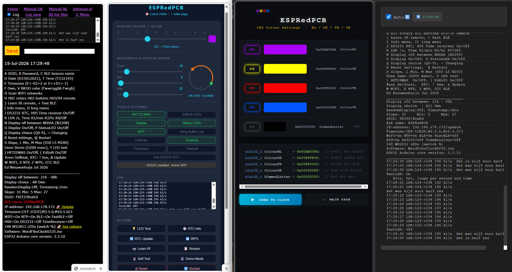
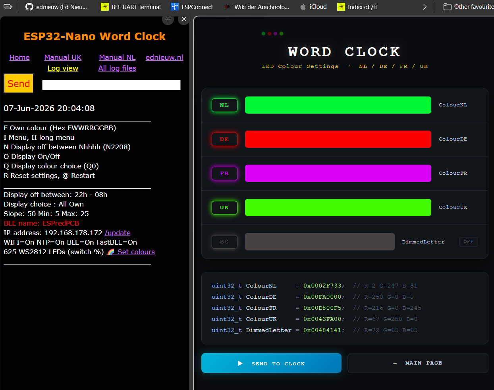
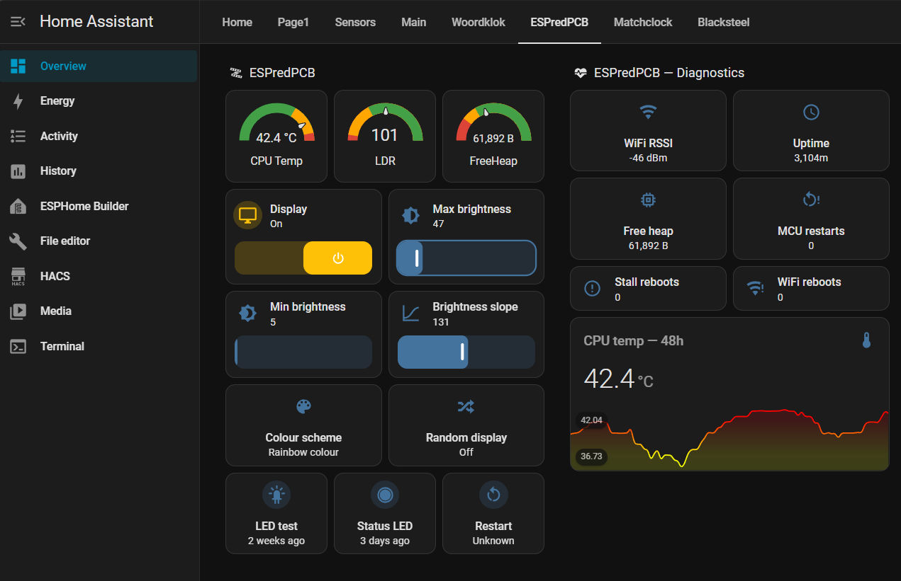

# Arduino-ESP32-Nano-Word clock

[Nederlands](READMENL.md)

Build your own word clock with WS2812 RGB or SK6812 RGBW LEDs, showing one or [four languages](https://github.com/ednieuw/FourLanguageClock), on an Arduino ESP32 Nano. 
The sketch also works on other ESP32 boards, with different pin numbering. 

[Compare other word clock software/hardware designs on the selector page.](https://github.com/ednieuw/WordclockSelector) 

The clock can be controlled with a:
- [BLE web page](https://github.com/ednieuw/HTML-BLEserial)
- [BLE terminal in a browser](https://ednieuw.com/BLESerial/BLE_UART_Terminal.html)
- [BLE serial terminal app](https://ednieuw.com/BLESerial/IOSappMain.html)
- Serial cable connected to a PC
- Rotary encoder
- IR remote control
- (Membrane) keypad
- MQTT, e.g. via Home Assistant
- [iOS time sender app](https://apps.apple.com/nl/app/bluetooth-uart-time/id6760344877) or [web page app (Windows/Android)](https://github.com/ednieuw/HTML-TimeSender) —> [open Time sender HTML](https://ednieuw.com/Woordklok/TimeSender/TimeSender.html)

## Documentation

| For whom | Document |
|---|---|
| **Users of a clock** | [Short user guide](UserGuide.md) (also as [PDF](Manual-Instructions/UserGuide_V247.pdf)) |
| **Everything about the clock** | [Manual](Manual.md): quick start, installing, operation, all menu commands, MQTT and Home Assistant, Fibonacci clock, maintenance, appendices and time zones |
| **Builders** | [Hardware and construction](Hardware_EN.md): components, printed circuit boards (PCBs), power supply, connections, the clock case |
| **Developers** | [Program explanation](ProgramExplanation.md): structure of the sketch and how the software can be modified |
| **Home Assistant** | [MQTT and Home Assistant](MQTT-HomeAssistant-setup.md) |
| **Files** | The sketch is in the folder [WordFiboClockV247](WordFiboClockV247), the PCB designs in the folder [PCB](PCB), the front plates in [WordPlateFrontCovers](WordPlateFrontCovers) |

Bluetooth LE exists in two variants for serial communication: the TI CC2541 service (`FFE0`) and the Nordic nRF52 service (`6e400001-b5a3-...`). This clock uses the **nRF52 service**. See [Using BLE on a mobile phone to operate the ESP32](https://github.com/ednieuw/nRF-ESP32).

## Getting started

1. Connect the clock to the power supply.
2. Connect the clock to WIFI: through the access point page `StartWordclock`, through the Bluetooth app or with WPS.
3. The clock shows the correct time. The menu can be operated with the BLE app or in a browser.

The steps are explained in the [short user guide](UserGuide.md).

## Architecture & related projects

Since V230, the word clock sketch has been combined with the [Fibonacci clock sketch](https://github.com/ednieuw/Fibonacci-Nano-ESP32-clock) to simplify maintenance. There is also a third option; NOCLOCK.

The three architectures are easy to split apart via `#define`'s in a few places, and the clock functions can be stripped out entirely with `#define NOCLOCK`. Functionality can be toggled on/off from the menu.

Coding for an [HC-12 time sender](https://github.com/ednieuw/ESP32-HC12) was also added — it sends NTP time over HC-12 to another MCU equipped with an HC-12 module to receive the transmission up to 1000 meters away.

When no WiFi is available, time can instead be sent to the clock via a time sender iOS app or a time sender web page, using Bluetooth on a phone or tablet.

## Screens

 In several browsers the tab can be split to see the menu and the serial monitor response in one tab.   

 
All menus in a browser since version V235.

 

To connect the clock to WIFI the SSID and password of the router can be entered with the BLE serial terminal app, or the WPS function can be used. 

Software updates can be uploaded with OTA (Over the Air). 

 
With MQTT in Home Assistant.

| | |
|---|---|
|  <strong>Full menu</strong> | The clock keeps its time correct within the second using the internet Network Time Protocol (NTP), with daylight-saving corrections when a time zone is entered.  If no internet is available, a DS3231 RTC module can be attached to the PCB to get an accurate time. With a rotary encoder, membrane pad, time sender app or almost any IR remote control the time can be set.  An LDR (light-dependent resistor) is used to give the LEDs an optimal brightness. |

Clock with Corten steel face
