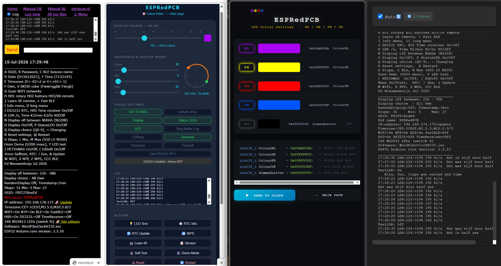
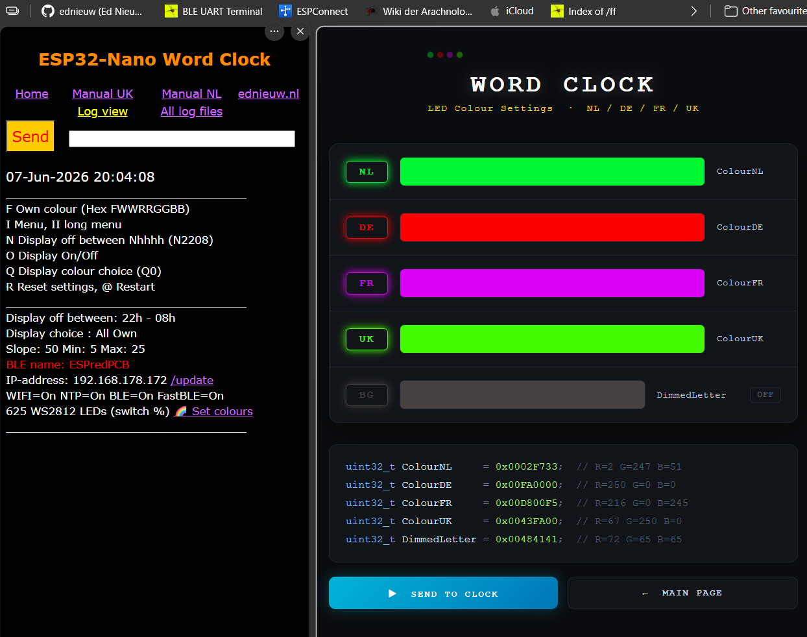
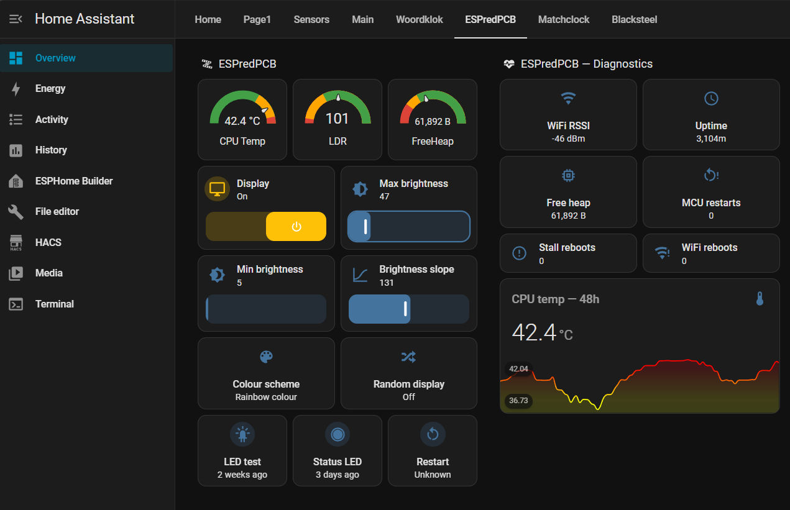

# Arduino-ESP32-Nano-Woordklok

[English](README.md)

Bouw een eigen woordklok met WS2812 RGB- of SK6812 RGBW-LEDs, met één of [vier talen](https://github.com/ednieuw/FourLanguageClock), op een Arduino ESP32 Nano. 
De sketch werkt ook op andere ESP32-borden, met een andere pinnummering. 

[Vergelijk andere woordklok software/hardware-ontwerpen op de selectiepagina.](https://github.com/ednieuw/WordclockSelector) 

De klok kan worden bediend met:
- [BLE-webpagina](https://github.com/ednieuw/HTML-BLEserial)
- [BLE-terminal in een browser](https://ednieuw.com/BLESerial/BLE_UART_Terminal.html)
- [BLE seriële terminal-app](https://ednieuw.com/BLESerial/IOSappMain.html)
- Seriële kabel verbonden met een pc
- Rotary encoder
- IR-afstandsbediening
- (Membraan) toetsenbord
- MQTT, bijvoorbeeld via Home Assistant
- [Time sender-app (iOS)](https://apps.apple.com/nl/app/bluetooth-uart-time/id6760344877) of [webpagina (Windows/Android)](https://github.com/ednieuw/HTML-TimeSender) —> [open Time sender HTML](https://ednieuw.com/Woordklok/TimeSender/TimeSender.html)

## Documentatie

| Voor wie | Document |
|---|---|
| **Gebruikers van een klok** | [Korte gebruikershandleiding](Gebruikershandleiding.md) (ook als [PDF](Manual-Instructions/Gebruikershandleiding_V247.pdf)) |
| **Alles over de klok** | [Handleiding](Handleiding.md): snelle start, installeren, bediening, alle menucommando's, MQTT en Home Assistant, Fibonacci-klok, onderhoud, bijlagen en tijdzones |
| **Bouwers** | [Hardware en bouw](Hardware.md): onderdelen, printplaten (PCB's), voeding, aansluitingen, de klokkast |
| **Ontwikkelaars** | [Programmauitleg](Programmauitleg.md): opbouw van de sketch en hoe de software kan worden aangepast |
| **Home Assistant** | [MQTT en Home Assistant](MQTT-HomeAssistant-setup.md) |
| **Bestanden** | De sketch staat in de map [WordFiboClockV247](WordFiboClockV247), de PCB-ontwerpen in de map [PCB](PCB), de frontplaten in [WordPlateFrontCovers](WordPlateFrontCovers) |

Bluetooth LE bestaat in twee varianten voor seriële communicatie: de TI CC2541-service (`FFE0`) en de Nordic nRF52-service (`6e400001-b5a3-...`). Deze klok gebruikt de **nRF52-service**. Zie [BLE op een mobiel gebruiken om de ESP32 te bedienen](https://github.com/ednieuw/nRF-ESP32).

## Aan de slag

1. Sluit de klok aan op de voeding.
2. Koppel de klok met WIFI: via de toegangspunt-pagina `StartWordclock`, via de Bluetooth-app of met WPS.
3. De klok toont de juiste tijd. Het menu is met de BLE-app of in een browser te bedienen.

De stappen staan uitgelegd in de [korte gebruikershandleiding](Gebruikershandleiding.md).

## Architectuur & gerelateerde projecten

Sinds V230 is de woordklok-sketch gecombineerd met de [Fibonacci-klok-sketch](https://github.com/ednieuw/Fibonacci-Nano-ESP32-clock) om het onderhoud te vereenvoudigen. Er is ook een derde optie; NOCLOCK.

De drie architecturen zijn eenvoudig te splitsen via `#define`'s op enkele plaatsen, en de klokfuncties kunnen volledig worden verwijderd met `#define NOCLOCK`. Functionaliteit kan via het menu aan/uit worden gezet.

Er is ook code voor een [HC-12 timesender](https://github.com/ednieuw/ESP32-HC12) toegevoegd — deze verzendt NTP-tijd via HC-12 naar een andere MCU met een HC-12-module die de uitzending tot 1000 meter verderop ontvangt.

Als er geen WiFi beschikbaar is, kan de tijd in plaats daarvan naar de klok worden gestuurd via een timesender iOS-app of een timesender-webpagina, met Bluetooth op een telefoon of tablet.

## Schermen

 In diverse browsers kan het tabblad worden gesplitst om het menu en de respons van de seriële monitor in één tabblad te zien.   

 
Alle menu's in een browser sinds versie V235.

 

Om de klok met WIFI te verbinden kunnen de SSID en het wachtwoord van de router worden ingevoerd met de BLE seriële terminal-app, of kan de WPS-functie worden gebruikt. 

Software-updates kunnen worden geüpload met OTA (Over the Air). 

 
Met MQTT in Home Assistant.

| | |
|---|---|
|  <strong>Volledig menu</strong> | De klok houdt de tijd tot op de seconde nauwkeurig bij via het internet Network Time Protocol (NTP), met zomer-/wintertijdcorrectie wanneer een tijdzone is ingevoerd.  Als er geen internet beschikbaar is, kan een DS3231 RTC-module op de PCB worden aangesloten voor een nauwkeurige tijd. Met een rotary encoder, membraantoetsenbord, time sender-app of bijna elke IR-afstandsbediening kan de tijd worden ingesteld.  Een LDR (lichtgevoelige weerstand) zorgt voor een optimale helderheid van de LEDs. |

Klok met frontplaat van Cortenstaal
