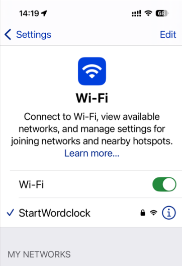
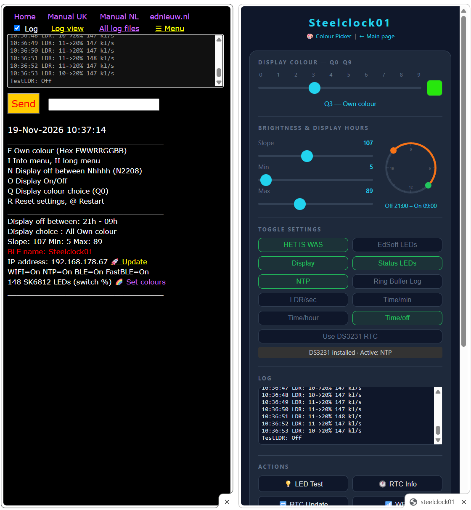

# Short user guide word clock

[Nederlands](Gebruikershandleiding.md)

This short guide is for the everyday use of a ready-made word clock with an Arduino Nano ESP32. All details are in the full [Manual](Manual.md).

## Contents

1. [Connecting the clock](#1-connecting-the-clock)
2. [Connecting to WIFI](#2-connecting-to-wifi)
3. [Operating the clock](#3-operating-the-clock)
4. [Frequently used settings](#4-frequently-used-settings)
5. [Setting the time without WIFI](#5-setting-the-time-without-wifi)
6. [Updating the software](#6-updating-the-software)
7. [Resetting](#7-resetting)
8. [Troubleshooting](#8-troubleshooting)

---

## 1. Connecting the clock

Connect the power supply of the clock. As soon as the clock is on, the status LED on the Nano ESP32 lights up:

| Colour | Meaning |
|---|---|
| Red | The program is running |
| Green | WIFI is connected |
| Blue | There is a Bluetooth connection |

## 2. Connecting to WIFI

The clock gets the time from the internet. For that it needs the name (SSID) and the password of the WIFI router, once. These are often printed on the underside of the router.

### With the access point page (without an app)

1. On a phone, tablet or PC, open the WIFI settings and select the station **StartWordclock**. The password is **wordclock**.
2. Open a browser and type **192.168.4.1**.
3. Enter the name and password of the router and press **Submit**.
4. The clock restarts and shows the correct time.

### With a Bluetooth app

1. Install a serial Bluetooth app (see [3](#3-operating-the-clock)) and connect to the clock.
2. Send `a` followed by the router name, for example `aROUTERNAME`.
3. Send `b` followed by the password, for example `bSecret1234`.
4. Send `@` to restart the clock.

Does the router have a WPS button? Then press the WPS button on the router and afterwards send `z`.

## 3. Operating the clock

The clock has one menu of commands. A command consists of a letter, optionally followed by a value. Upper or lower case makes no difference.

### With an app or a browser

| Platform | App |
|---|---|
| iPhone / iPad / Mac | **BLE Serial Pro** or **BLESerial nRF** |
| Android | **Serial Bluetooth Terminal** or **BLE Serial Pro** (turn *timestamp* off) |
| Windows / Linux / macOS (browser) | [BLE UART Terminal](https://ednieuw.com/BLESerial/BLE_UART_Terminal.html) |

In the app, choose the clock in the list (default `wordclock`) and send `i` for the short menu or `ii` for the long menu.

### With the web page

If the clock is connected to WIFI, the IP address is in the menu (`i`). Type that address in a browser, for example `192.168.178.77`, or use `http://wordclock.local`. Save the link as a favourite. The page has an input field for commands, a **Menu** page with sliders and switches, a colour picker (*Set colours*) and a log viewer.

## 4. Frequently used settings

| What | Command | Example |
|---|---|---|
| Choose a colour scheme (`Q` alone shows the list) | `Q0` to `Q9` | `Q2` = all words white |
| Own colour | `Fwwrrggbb` or `Fwrgb`, or the colour picker on the web page | `F0900` = red |
| Change the colour scheme automatically | `~1` (per minute), `~2` (per hour), `~0` (off) | `~2` |
| Display off between two hours | `Nhhhh` | `N2208` = off from 22:00 to 08:00; `N` alone switches it off |
| Display on or off | `O` | `O` |
| Minimum brightness | `Lnnn` | `L5` |
| Maximum brightness | `Mnnn` | `M200` |
| How fast the brightness follows the light | `Snnn` | `S80` |
| Time zone | `E` + time zone text | `eCET-1CEST,M3.5.0,M10.5.0/3` (Netherlands) |

The settings are kept during a power failure. See [chapter 7](Manual.md#7-menu-commands-a-z) of the Manual for all commands and [the time zone table](Manual.md#13-appendices).

## 5. Setting the time without WIFI

With WIFI there is nothing to set: the clock gets the time by itself. Without WIFI a DS3231 time module on the printed circuit board is needed.

1. Send `J`: the clock uses the DS3231.
2. Send `W` to switch WIFI off and `@` to restart.
3. Send the date, for example `D09062025`, and the time, for example `T143000`.

Does the clock have a **rotary encoder** or three **push buttons**? Then press the button (active for 60 seconds): 1 press sets the hours, 2 presses the minutes, 3 presses the light intensity, 4 presses switch between RTC and NTP. See [chapter 5.3](Manual.md#53-setting-the-time) for the IR remote control and the time receiver.

## 6. Updating the software

If the clock is connected to WIFI, new software can be uploaded without a cable.

1. Find the IP address in the menu (`i`).
2. In a browser, type the address followed by `/update`, for example `192.168.178.141/update`.
3. Choose the correct `.bin` file for the clock variant and press *Upload* **once**.
4. Wait about 20 seconds. The clock restarts by itself.

See [chapter 11.1](Manual.md#111-updating-the-software-ota) for more explanation.

## 7. Resetting

| Command | What happens |
|---|---|
| `@` | The clock restarts. All settings are kept |
| `R` | All preferences back to the default values. WIFI data and time zone are kept |
| `RRRRR` | Total reset, the WIFI data is also erased |

## 8. Troubleshooting

| Problem | Solution |
|---|---|
| The clock does not connect to WIFI | Check the router name and password (case-sensitive). Send `G` to see the networks in the neighbourhood. The clock only works with WIFI on 2.4 GHz. If needed send `RRRRR` and enter the data again |
| The clock keeps starting the station *StartWordclock* | The router data is missing or incorrect. Enter it again through the access point page |
| The display is off | Is `N` set to a time range? Send `N` to switch that off. Send `O` or `O1` to switch the display on |
| One hour difference | Check the time zone (`E`) and whether WIFI and NTP are on and the DS3231 is off (`ii`, at the bottom) |
| The web page cannot be reached | Use the IP address from the menu instead of `wordclock.local` |
| The app shows truncated or distorted lines | Send `+` to switch between fast and slow Bluetooth |
| The clock does not appear in the app | Check that Bluetooth is on (`CCC`) and use an app that supports the nRF52 UART |
| Nothing helps | Send `@`. If that does not solve it, send `R`, and then `RRRRR` if needed |

See [chapter 11.6](Manual.md#116-troubleshooting) for more problems and solutions.

---

Want to know more? The full [Manual](Manual.md) covers MQTT and Home Assistant, the Fibonacci clock and the time sender, among other things. The construction of the clock is in [Hardware_EN.md](Hardware_EN.md).
